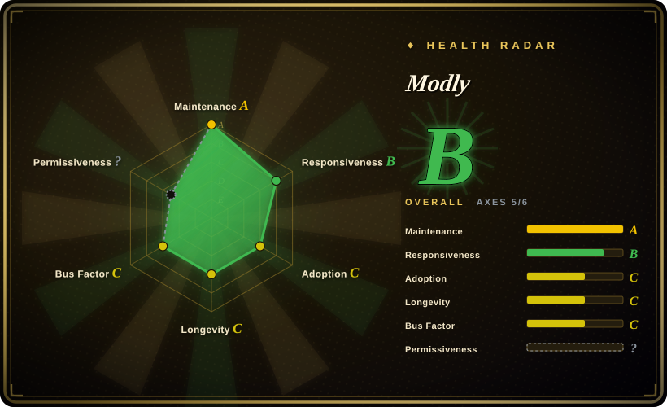
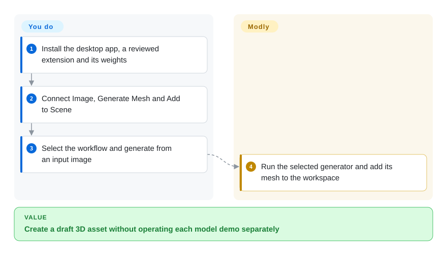
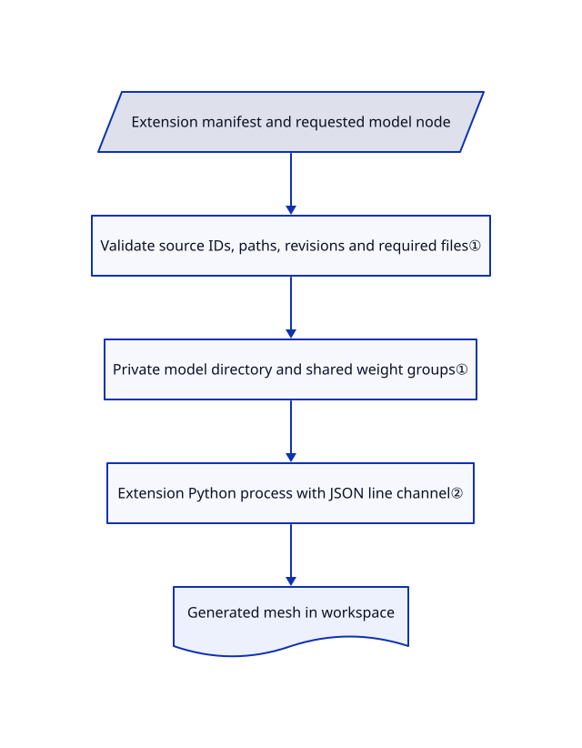

# Modly

Turning one reference image into a mesh usually means juggling separate model scripts and GPU environments. Modly gives those generators a desktop workflow, shared model management and mesh export.

## When to use

You make prototype game or visualization assets from reference images and want to try several local generators through one desktop app. Choose Modly when installing model extensions and wiring image-to-mesh workflows is preferable to maintaining each model's demo separately. Treat generated geometry as an asset draft, not a measured reconstruction of unseen surfaces.

## When NOT to use

- For reconstructing an actual room from multiple photos, use [Spirula Studio](../3d-reconstruction/spirula-studio.md); a single-view generator invents hidden geometry.
- To modify the generation method itself, use the Hunyuan3D-2 or TripoSR source directly. Modly is the application and extension layer, not the model's training implementation.
- If third-party Python code cannot run on your workstation, do not install arbitrary extensions. Use an approved offline renderer or isolated machine; a per-extension virtual environment is not a security sandbox.
- For redistribution requiring an unmodified standard MIT license, obtain clarification first. The LICENSE appends an explicit visible UI/documentation credit requirement beyond its MIT text.

## Comparison

| Alternative | In index | Our verdict | Tradeoff |
|---|---|---|---|
| [Hunyuan3D-2](https://github.com/Tencent-Hunyuan/Hunyuan3D-2) | not indexed | Choose its source to customize one generation pipeline; choose Modly to operate installed generators through a shared desktop workflow. | Model-specific control versus application integration; not added in this tab batch. |
| [TripoSR](https://github.com/VAST-AI-Research/TripoSR) | not indexed | Choose TripoSR for a focused single-image model baseline; choose Modly when model switching and asset operations matter more. | Smaller research/runtime surface versus extension management; not added in this tab batch. |
| [Spirula Studio](../3d-reconstruction/spirula-studio.md) | ✅ | Choose Spirula for multi-view capture reconstruction; choose Modly for plausible assets inferred from a reference image. | Observed-scene fitting versus generated hidden geometry. |

## Quick start

Download the release app for Windows, Linux or Apple Silicon macOS. On Models, install a reviewed GitHub extension and download its required model weights. Connect Image, Generate Mesh and Add to Scene in a workflow, select that workflow and generate from your input image. Modly coordinates extension execution and workspace assets; you supply compatible hardware, trusted extension code and model-license approval. Inspect and export the mesh, and expect topology or texture cleanup before production use.

<!-- flow-steps:begin (generated from flows/modly.json by tools/flow_card.py — do not edit) -->

Text version of the flow

1. **You**: Install the desktop app, a reviewed extension and its weights
2. **You**: Connect Image, Generate Mesh and Add to Scene
3. **You**: Select the workflow and generate from an input image
4. **Modly**: Run the selected generator and add its mesh to the workspace

**Value**: Create a draft 3D asset without operating each model demo separately

<!-- flow-steps:end -->

## Key techniques

<!-- mechanism:begin (generated from mechanisms/modly.json by tools/mechanism_card.py; do not edit) -->

Text version of the mechanism

- Extension manifest and requested model node
- Validate source IDs, paths, revisions and required files①
- Private model directory and shared weight groups①
- Extension Python process with JSON line channel②
- Generated mesh in workspace

- Extension manifest and requested model node → Validate source IDs, paths, revisions and required files①
- Validate source IDs, paths, revisions and required files① → Private model directory and shared weight groups①
- Private model directory and shared weight groups① → Extension Python process with JSON line channel②
- Extension Python process with JSON line channel② → Generated mesh in workspace

<!-- mechanism:end -->

### 1. Validate a model's multi-source download plan

- **Problem:** A model node can need weights from several repositories and incorrectly appear installed after only one download.
- **How:** model_sources validates provider, repository IDs, revisions, portable relative paths and required checks. Readiness requires each declared check to resolve to a regular, nonempty file without symlink traversal; shared weight groups have separate roots.
- **Limits:** Presence and nonzero size are not cryptographic weight authentication. Pin revisions and inspect model terms; legacy manifest fields retain their own behavior.
- **Source:** [Source-plan validation and readiness](https://github.com/lightningpixel/modly/blob/f11a4d2bd9fe994b9d30f76a36cb6c18ac8733ea/api/services/model_sources.py#L94-L373).

### 2. Run generators behind a line-based process protocol

- **Problem:** Models need incompatible Python dependencies and must report progress without corrupting application state.
- **How:** ExtensionProcess starts the extension's Python environment and exchanges newline-delimited JSON with runner.py. Separate readers handle replies and stderr; each process lifetime gets a fresh response queue.
- **Limits:** The child inherits the host environment and filesystem authority. Startup and model-load waits can be unbounded, and a known missing import can trigger a pip installation; process separation is dependency isolation only.
- **Source:** [Extension process](https://github.com/lightningpixel/modly/blob/f11a4d2bd9fe994b9d30f76a36cb6c18ac8733ea/api/services/extension_process.py#L70-L300).

## Tech stack

Electron, React 18, TypeScript, Three.js and React Flow; a Python FastAPI backend with trimesh, PyMeshLab and Hugging Face downloads. Model implementations live in separately installed extensions.

## Dependencies

A compatible GPU and sufficient model-specific memory; driver and PyTorch/CUDA/ROCm/MPS requirements depend on the extension. Releases bundle Python resources, while development uses Node and a Python environment. Initial extension and weight downloads require network access.

## Ops difficulty

**Medium to high.** The desktop surface simplifies generation, not GPU compatibility or extension trust. Manage large weight stores, per-extension environments and workspace backups. Review auto-updates, model downloads and each extension's setup before allowing execution.

## Health & viability

- On 2026-10-18, v0.4.3 and the latest main commit dated to 2026-10-04. Created 2026-03-17, it has seven months of history.
- `lightningpixel` leads contributions, with several additional contributors. The 8,236 stars do not establish mesh quality or extension safety.
- The LICENSE contains MIT text plus a visible attribution addendum; this page uses a custom license identifier rather than silently calling it plain MIT. Extension/model licenses are separate.
- [推断：依据是年轻桌面应用与独立模型扩展] Useful for a reversible asset-generation pilot; pin app, extensions and model revisions together.

## Caveats (unverified)

- [未验证：无模型安装且禁止运行上游] GPU compatibility, generation quality, export fidelity and extension setup were not exercised.
- [未验证：无法替代法律解释] The addendum's legal interpretation and OSI compatibility need legal review before redistribution.
- [推断：依据是年轻桌面应用与独立模型扩展] Reproducibility depends on more than the app version alone.
