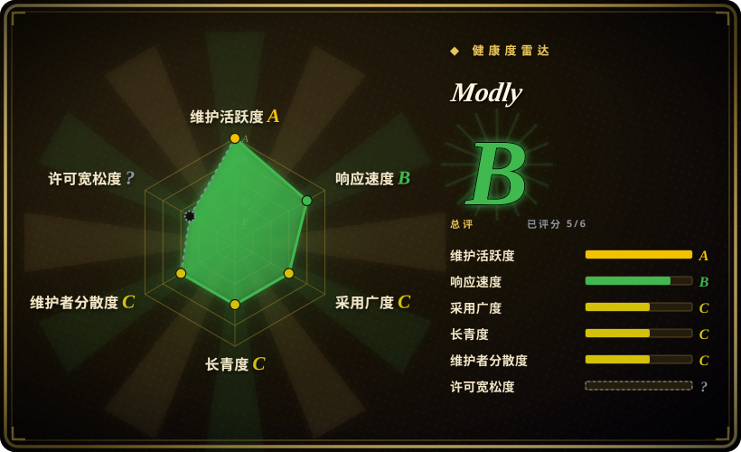
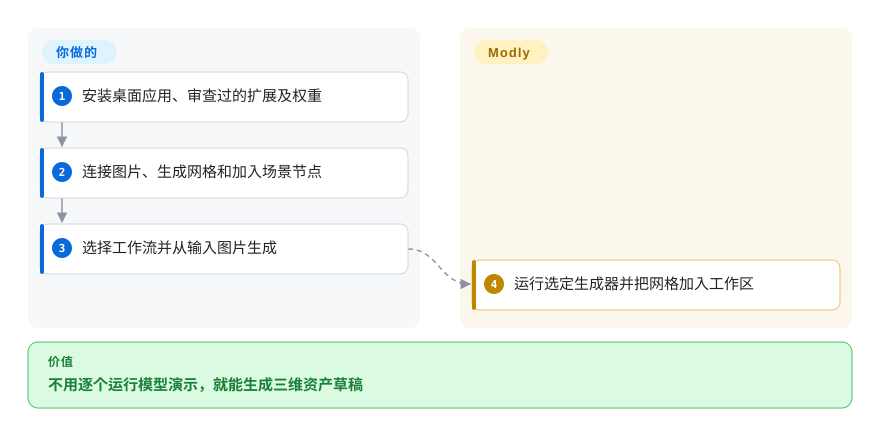
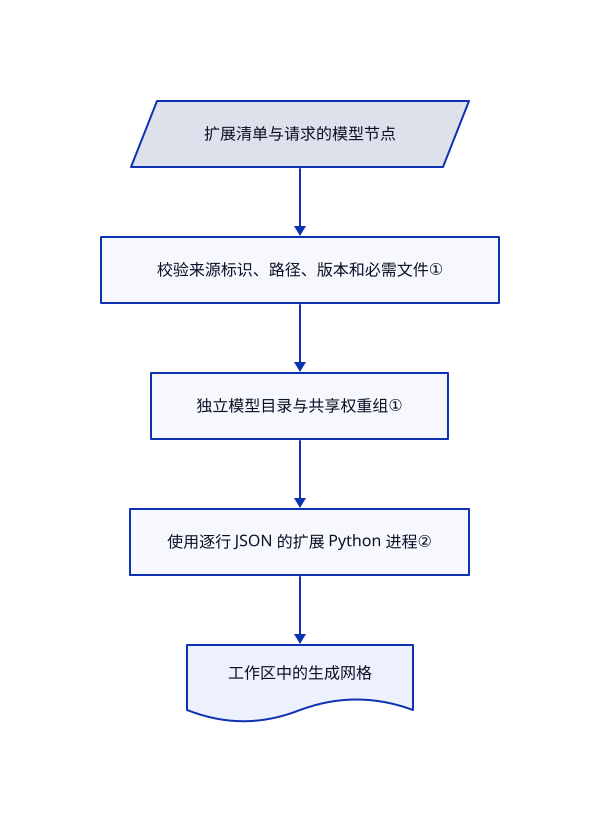

# Modly

把一张参考图变成网格，往往要折腾不同模型脚本和显卡环境。Modly 用桌面工作流统一生成器、模型管理与网格导出。

## 何时使用

你要用参考图制作游戏或可视化资产原型，想在同一桌面应用里尝试多个本地生成器。若安装模型扩展、连接图片转网格流程，比维护各模型演示更合适，选 Modly。生成几何应当作资产草稿，不是对不可见表面的实测重建。

## 何时不用

- 从多张照片重建真实房间，选 [Spirula Studio](../3d-reconstruction/spirula-studio.zh.md)；单视图生成器会推测隐藏几何。
- 要修改生成方法本身，直接使用 Hunyuan3D-2 或 TripoSR 源码。Modly 是应用与扩展层，不是模型训练实现。
- 工作站不允许运行第三方 Python 时，不要安装任意扩展。使用获准的离线渲染器或隔离机器；独立虚拟环境不是安全沙箱。
- 分发必须采用未修改的标准 MIT 时，先取得澄清。LICENSE 在 MIT 正文后追加了界面或文档中可见署名的要求。

## 横向对比

| 替代品 | 是否收录 | 我们的评价 | 取舍 |
|---|---|---|---|
| [Hunyuan3D-2](https://github.com/Tencent-Hunyuan/Hunyuan3D-2) | 未收录 | 要定制单个生成流程，选模型源码；要用统一桌面工作流运行多个生成器，选 Modly。 | 特定模型控制力与应用集成之间取舍；本批未收录。 |
| [TripoSR](https://github.com/VAST-AI-Research/TripoSR) | 未收录 | 聚焦单图模型基线选 TripoSR；模型切换和资产操作更重要时选 Modly。 | 较小研究运行面与扩展管理之间取舍；本批未收录。 |
| [Spirula Studio](../3d-reconstruction/spirula-studio.zh.md) | ✅ | 多视角实拍重建选 Spirula；从参考图推测合理资产选 Modly。 | 拟合已观察场景，与生成隐藏几何不同。 |

## 快速上手

下载 Windows、Linux 或 Apple Silicon macOS 发布应用。在模型页安装审查过的 GitHub 扩展，下载所需权重。把图片、生成网格和加入场景节点相连，选择工作流，再从输入图生成。Modly 协调扩展和工作区资产；你负责兼容硬件、可信扩展代码和模型许可。检查并导出网格，生产使用前仍可能需要清理拓扑或纹理。

<!-- flow-steps:begin (generated from flows/modly.json by tools/flow_card.py — do not edit) -->

流程文字版

1. **你**：安装桌面应用、审查过的扩展及权重
2. **你**：连接图片、生成网格和加入场景节点
3. **你**：选择工作流并从输入图片生成
4. **Modly**：运行选定生成器并把网格加入工作区

**价值**：不用逐个运行模型演示，就能生成三维资产草稿

<!-- flow-steps:end -->

## 技术要点

<!-- mechanism:begin (generated from mechanisms/modly.json by tools/mechanism_card.py; do not edit) -->

机制文字版

- 扩展清单与请求的模型节点
- 校验来源标识、路径、版本和必需文件①
- 独立模型目录与共享权重组①
- 使用逐行 JSON 的扩展 Python 进程②
- 工作区中的生成网格

- 扩展清单与请求的模型节点 → 校验来源标识、路径、版本和必需文件①
- 校验来源标识、路径、版本和必需文件① → 独立模型目录与共享权重组①
- 独立模型目录与共享权重组① → 使用逐行 JSON 的扩展 Python 进程②
- 使用逐行 JSON 的扩展 Python 进程② → 工作区中的生成网格

<!-- mechanism:end -->

### 1. 校验模型的多来源下载计划

- **解决：** 一个模型节点需要多个仓库的权重，却可能下载部分后就显示已安装。
- **做法：** model_sources 校验提供商、仓库、版本、可移植相对路径和必需检查项。所有声明文件都必须存在、非空且不经过软链，才算就绪；共享权重组另有目录。
- **边界：** 存在且非空不是密码学身份校验。应固定版本并查模型条款；旧清单字段保留自身行为。
- **源码：** [来源计划与就绪检查](https://github.com/lightningpixel/modly/blob/f11a4d2bd9fe994b9d30f76a36cb6c18ac8733ea/api/services/model_sources.py#L94-L373)。

### 2. 用逐行协议运行生成器进程

- **解决：** 模型依赖不兼容，又需要报告进度而不破坏应用状态。
- **做法：** ExtensionProcess 启动扩展的 Python 环境，与 runner.py 交换逐行 JSON。回复和错误流分开读取，每个进程生命周期使用新回复队列。
- **边界：** 子进程继承宿主环境及文件权限。启动和加载模型可能无限等待，已知缺失导入还会触发 pip 安装；分进程只隔离依赖。
- **源码：** [扩展进程](https://github.com/lightningpixel/modly/blob/f11a4d2bd9fe994b9d30f76a36cb6c18ac8733ea/api/services/extension_process.py#L70-L300)。

## 技术栈

Electron、React 18、TypeScript、Three.js 和 React Flow；Python FastAPI 后端，使用 trimesh、PyMeshLab 及 Hugging Face 下载。模型实现位于另行安装的扩展。

## 依赖

需要兼容显卡及模型所需内存。驱动、PyTorch、CUDA／ROCm／MPS 取决于扩展。发布包携带 Python 资源；开发环境需要 Node 和 Python。首次安装扩展与下载权重需要联网。

## 运维难度

**中等至高。** 桌面界面简化生成，不解决显卡兼容或扩展信任。要管理大权重、独立环境和工作区备份。放行执行前审查自动更新、模型下载及每个扩展的安装步骤。

## 健康度与可持续性

- 截至 2026-10-18，v0.4.3 和主干最近提交均为 2026-10-04。创建于 2026-03-17，约七个月历史。
- `lightningpixel` 主导贡献，并有数名其他贡献者。8,236 颗星不证明网格质量或扩展安全。
- LICENSE 包含 MIT 正文和可见署名附录，本页使用自定义许可标识，不默认为标准 MIT。扩展和模型许可另查。
- [推断：依据是年轻桌面应用与独立模型扩展] 适合可回退的资产生成试用，应同时固定应用、扩展和模型版本。

## 存疑（未验证）

- [未验证：无模型安装且禁止运行上游] 未测试显卡兼容、生成质量、导出保真和扩展安装。
- [未验证：无法替代法律解释] 附录的法律解释和 OSI 兼容性，分发前应由法律人员审查。
- [推断：依据是年轻桌面应用与独立模型扩展] 仅固定应用版本不足以保证复现。
