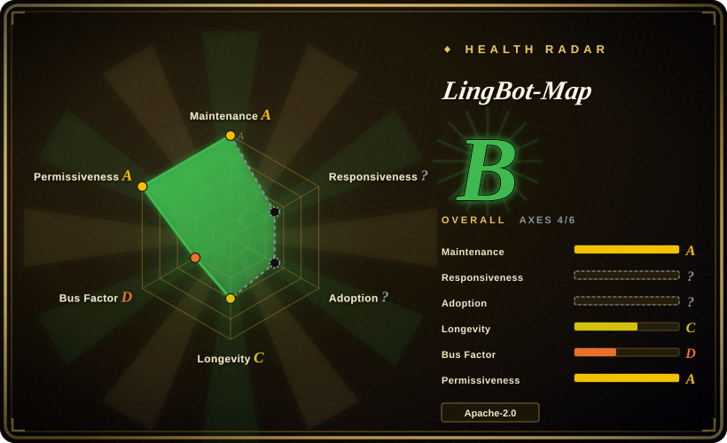
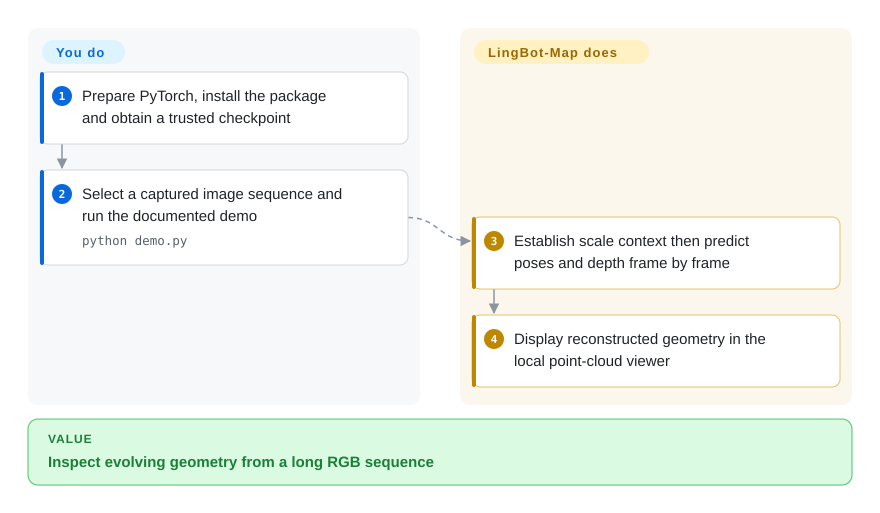
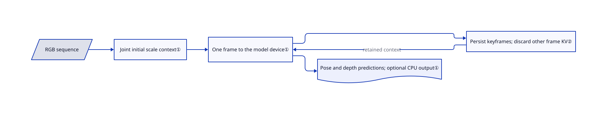

# LingBot-Map

A walking video keeps growing while a whole-sequence reconstruction runs out of memory. LingBot-Map estimates camera motion and dense geometry frame by frame, retaining selected context instead of jointly processing every frame again.

## When to use

You research mapping or reconstruct a long recorded walkthrough from RGB frames. You need evolving camera poses and depth rather than a photorealistic scene trained separately for each capture. Choose LingBot-Map over a splat trainer when streaming geometric inference is the goal; choose it over classic feature-matching photogrammetry when learned feed-forward estimates are the experiment you want to evaluate. The repository includes reusable model modules, checkpoints, scene examples and benchmark code, not only a paper demonstration.

## When NOT to use

- **You want a polished splat/mesh asset workflow.** Choose [Spirula Studio](spirula-studio.md); LingBot-Map is a research inference stack, not an asset editor or splat trainer.
- **Survey-grade accuracy is a hard constraint.** Evaluate COLMAP with a calibrated photogrammetry pipeline; do not treat learned depth or the paper's benchmark rank as a geometry certificate.
- **You need a simple batch multi-view geometry baseline.** Compare VGGT; LingBot-Map's keyframe caches and state/window settings add streaming-specific complexity.
- **You expect unlimited-range mapping without resets.** Use a validated mapping pipeline with explicit loop closure and reset behavior. The README warns that training-distance limits can produce pose collapse and recommends windowed mode.
- **You cannot maintain a CUDA research environment.** Prefer Spirula Studio's packaged desktop path for capture-to-asset work. The source can select CPU and SDPA, but that is not evidence of practical real-time CPU throughput.

## Comparison

| Alternative | In index | Our verdict | Tradeoff |
|---|---|---|---|
| [Spirula Studio](spirula-studio.md) | ✅ | Choose Spirula for a packaged splat/mesh authoring workflow; choose LingBot-Map for streaming pose/depth model experiments. | Asset training and export versus learned geometric inference; very different outputs. |
| COLMAP | not indexed | Choose COLMAP for a classical calibrated photogrammetry baseline; choose LingBot-Map when frame-wise learned inference is the research objective. | Explicit matching/optimization versus checkpoint-dependent estimates; real repository, not added in this tab batch. |
| VGGT | not indexed | Choose VGGT for a batch geometry model baseline; choose LingBot-Map when retained temporal context and long video inference decide. | Simpler whole-batch model use versus keyframe and cache tuning; real repository, not added in this tab batch. |

## Quick start

Prepare Python 3.10+, install PyTorch separately using the README's CUDA instructions, then install the repository with `pip install -e .` and viewer extras as needed. Download the supplied checkpoint and run `python demo.py --model_path /path/to/lingbot-map.pt --image_folder example/courthouse --mask_sky`. The program estimates geometry and opens a local Viser point-cloud viewer, a browser interface for inspecting the reconstruction. FlashInfer is recommended for cached attention; `--use_sdpa` selects native PyTorch attention instead. You supply captures, trusted checkpoints and GPU resources, and decide whether depth/pose quality meets your task; the model does not certify scale or build a production mapping service.

<!-- flow-steps:begin (generated from flows/lingbot-map.json by tools/flow_card.py — do not edit) -->

Text version of the flow

1. **You**: Prepare PyTorch, install the package and obtain a trusted checkpoint
2. **You**: Select a captured image sequence and run the documented demo — `python demo.py`
3. **LingBot-Map**: Establish scale context then predict poses and depth frame by frame
4. **LingBot-Map**: Display reconstructed geometry in the local point-cloud viewer

**Value**: Inspect evolving geometry from a long RGB sequence

<!-- flow-steps:end -->

## Key techniques

<!-- mechanism:begin (generated from mechanisms/lingbot-map.json by tools/mechanism_card.py; do not edit) -->

Text version of the mechanism

- RGB sequence
- Joint initial scale context①
- One frame to the model device①
- Persist keyframes; discard other frame KV②
- Pose and depth predictions; optional CPU output①

- RGB sequence → Joint initial scale context①
- Joint initial scale context① → One frame to the model device①
- One frame to the model device① → Persist keyframes; discard other frame KV②
- Persist keyframes; discard other frame KV② → One frame to the model device① (retained context)
- One frame to the model device① → Pose and depth predictions; optional CPU output①

<!-- mechanism:end -->

### 1. Establish scale context before causal frame processing

- **Problem:** Processing a long sequence jointly repeatedly moves many images and intermediate predictions through GPU memory.
- **How:** The streaming method clears old caches, jointly processes initial scale frames, then moves one frame at a time to the model device. Predictions can move to CPU while the aggregator retains attention context from previous frames.
- **Limits:** Returned predictions still grow with sequence length outside the GPU. The documented training-distance limit remains; offloading does not fix geometric drift.
- **Source:** [Streaming inference](https://github.com/Robbyant/lingbot-map/blob/b9dd1b1de535e6d36e777fb42b8433c781bfd783/lingbot_map/models/gct_stream.py#L371-L499).

### 2. Predict every frame but retain only selected frames in the cache

- **Problem:** Keeping every frame's attention keys and values increases memory pressure and can exceed the model's trained context range.
- **How:** Keyframes persist their keys/values, which are cached attention representations; non-keyframes use cached context and their own representation without appending it. The skip flag covers both aggregator and camera-head caches, including FlashInfer's paged cache.
- **Limits:** Increasing the interval trades temporal evidence for memory. The README reports training on 320 views and does not promise that arbitrarily sparse keyframes prevent pose failure.
- **Source:** [Cache skip and frame loop](https://github.com/Robbyant/lingbot-map/blob/b9dd1b1de535e6d36e777fb42b8433c781bfd783/lingbot_map/models/gct_stream.py#L322-L340), [backend setup](https://github.com/Robbyant/lingbot-map/blob/b9dd1b1de535e6d36e777fb42b8433c781bfd783/lingbot_map/aggregator/stream.py#L85-L149).

## Tech stack

Python and PyTorch, DINOv2/VGGT-derived components, streaming transformer/camera heads, optional FlashInfer CUDA attention and Viser visualization. The package manifest separately lists image and scientific-Python utilities, but does not install PyTorch for you.

## Dependencies

Python 3.10+, a separately installed compatible PyTorch/torchvision stack and a downloaded model checkpoint. The documented fast path uses NVIDIA CUDA and optional FlashInfer; SDPA avoids FlashInfer. Sky masking adds ONNX Runtime and may download a segmentation model on first use. The reviewed README describes extra batch-render dependencies that are not all declared in its current `pyproject.toml`; verify that route separately rather than assuming `pip install -e .` supplies it.

## Ops difficulty

**High relative to packaged reconstruction apps.** Pin checkpoint, source, CUDA and attention backend together. Long sequences need keyframe/window choices and CPU-output storage. The demo uses `torch.load(..., weights_only=False)`, so only load trusted checkpoints. Keep the viewer private and budget GPU memory separately from retained prediction memory.

## Health & viability

- **2026-10-18 — research-stage, six months old.** The repository was created April 15 and has no GitHub releases in the retrieved list. Package version 0.1.0 is a manifest version, not a stable-service commitment.
- **Backing and ownership.** Robbyant hosts the project; the contributor snapshot is concentrated in a few authors. This is team research backing, not foundation governance or long-term support.
- **Reusable evidence.** Model implementations, benchmark scripts and examples support real experimentation. Apache-2.0 is present; inherited Meta components retain copyright/license headers.
- **Lindy judgment.** Active research and visible adoption do not supply a long record of deployment compatibility; evaluate it on your capture domain before depending on it.

## Caveats (unverified)

- [未验证：未配置 GPU 或运行上游] Accuracy, memory use and the README's approximately 20 FPS claim were not reproduced. No benchmark-superiority claim is adopted here.
- [推断：依据是研究发布形态和短历史] Pin an experimental integration behind replaceable interfaces rather than treating the model as an indefinitely stable mapping backend.
