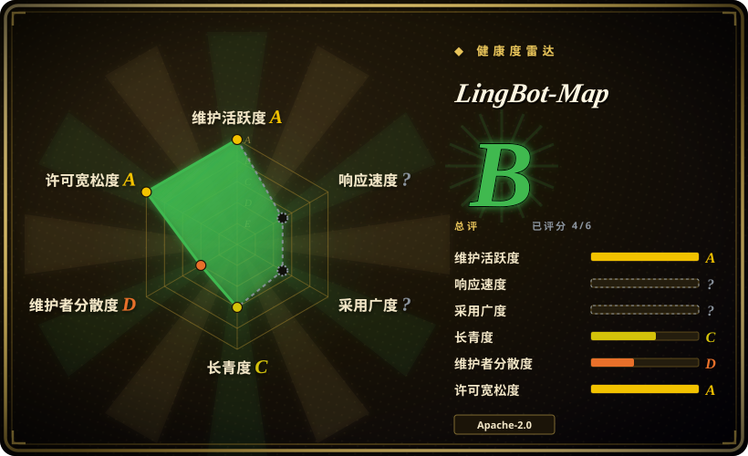
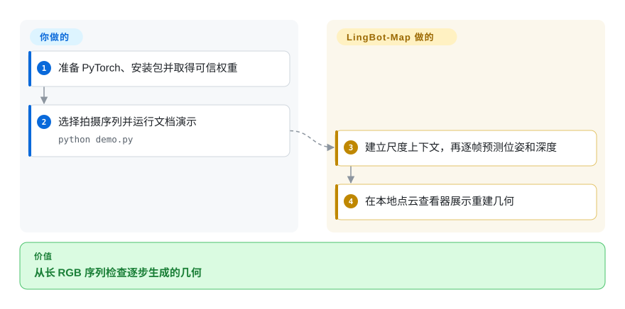
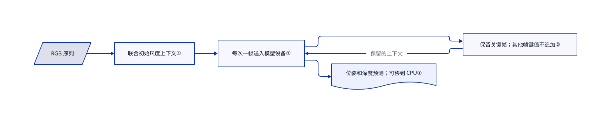

# LingBot-Map

行走视频越拍越长，整段联合重建先耗尽显存。LingBot-Map 逐帧估计相机运动和稠密几何，只保留选定上下文，不反复联合处理全部帧。

## 何时使用

你研究建图，或用 RGB 画面重建长段行走录像。目标是不断更新的相机位姿和深度，不是每个场景单独训练的写实资产。需要流式几何推理时，选它而非高斯泼溅训练器；想评估学习式前馈估计时，选它与传统特征匹配摄影测量比较。仓库提供可复用模型、权重、场景样本和评测代码，不只有论文演示。

## 何时不用

- **想得到成熟的泼溅或网格资产工作流。** 选 [Spirula Studio](spirula-studio.zh.md)；本项目是研究推理栈，不是资产编辑器或泼溅训练器。
- **测量级精度是硬约束。** 评估 COLMAP 加标定摄影测量流水线，不要把学习式深度或论文排名当几何认证。
- **只要简单的批量多视图几何基线。** 比较 VGGT；本项目的关键帧缓存和窗口状态增加流式调参复杂度。
- **期待无限范围建图而不重置。** 使用经过验证、明确处理闭环和重置的建图流水线。README 警告训练距离范围可能导致位姿崩溃，并建议窗口模式。
- **无法维护 CUDA 研究环境。** 从拍摄到资产可优先选 Spirula Studio 安装包。源码能选 CPU 和 SDPA，但这不证明 CPU 实时速度实用。

## 横向对比

| 替代品 | 是否收录 | 我们的评价 | 取舍 |
|---|---|---|---|
| [Spirula Studio](spirula-studio.zh.md) | ✅ | 安装即用的泼溅或网格制作选 Spirula；流式位姿与深度实验选 LingBot-Map。 | 资产训练导出与学习式几何推理，产物不同。 |
| COLMAP | 未收录 | 传统标定摄影测量基线选 COLMAP；逐帧学习式推理是研究目标时选 LingBot-Map。 | 显式匹配优化与依赖权重的估计之间取舍；真实仓库，本次标签批次未收录。 |
| VGGT | 未收录 | 批量几何模型基线选 VGGT；时序上下文和长视频推理决定选型时选 LingBot-Map。 | 批模型调用较简单，后者要调关键帧和缓存；真实仓库，本次标签批次未收录。 |

## 快速上手

准备 Python 3.10+，按 README 的 CUDA 指引单独安装 PyTorch，再用 `pip install -e .` 安装仓库，并按需装查看器扩展。下载提供的权重后，运行 `python demo.py --model_path /path/to/lingbot-map.pt --image_folder example/courthouse --mask_sky`。程序估计几何，并打开本地 Viser 点云查看器，也就是浏览器中的重建检查界面。缓存注意力推荐 FlashInfer，`--use_sdpa` 则改用 PyTorch 自带注意力。你提供画面、可信权重和 GPU，判断位姿与深度是否可用；模型不认证尺度，也不部署生产建图服务。

<!-- flow-steps:begin (generated from flows/lingbot-map.json by tools/flow_card.py — do not edit) -->

流程文字版

1. **你**：准备 PyTorch、安装包并取得可信权重
2. **你**：选择拍摄序列并运行文档演示 — `python demo.py`
3. **LingBot-Map**：建立尺度上下文，再逐帧预测位姿和深度
4. **LingBot-Map**：在本地点云查看器展示重建几何

**价值**：从长 RGB 序列检查逐步生成的几何

<!-- flow-steps:end -->

## 技术要点

<!-- mechanism:begin (generated from mechanisms/lingbot-map.json by tools/mechanism_card.py; do not edit) -->

机制文字版

- RGB 序列
- 联合初始尺度上下文①
- 每次一帧送入模型设备①
- 保留关键帧；其他帧键值不追加②
- 位姿和深度预测；可移到 CPU①

- RGB 序列 → 联合初始尺度上下文①
- 联合初始尺度上下文① → 每次一帧送入模型设备①
- 每次一帧送入模型设备① → 保留关键帧；其他帧键值不追加②
- 保留关键帧；其他帧键值不追加② → 每次一帧送入模型设备①（保留的上下文）
- 每次一帧送入模型设备① → 位姿和深度预测；可移到 CPU①

<!-- mechanism:end -->

### 1. 先建立尺度上下文，再逐帧处理

- **解决：** 整段联合处理会反复将大量图像及中间预测送入显存。
- **做法：** 流式方法清空旧缓存，联合处理开头的尺度帧，再逐帧移到模型设备。预测可移到 CPU，聚合器保留此前帧的注意力上下文。
- **边界：** 返回的预测仍会在显存外随序列增长。训练距离限制依然存在，卸载到 CPU 不修复几何漂移。
- **源码：** [流式推理](https://github.com/Robbyant/lingbot-map/blob/b9dd1b1de535e6d36e777fb42b8433c781bfd783/lingbot_map/models/gct_stream.py#L371-L499)。

### 2. 每帧都预测，只让选定帧进入缓存

- **解决：** 每帧都保留注意力键值，会增加内存压力，也可能超出训练过的上下文范围。
- **做法：** 关键帧持续保存注意力键值，也就是用于复用上下文的表示。非关键帧读取旧上下文和自身表示，但不追加。跳过标志同时覆盖聚合器、相机头及 FlashInfer 分页缓存。
- **边界：** 加大间隔用时序证据换内存。README 说训练使用 320 个视图，不保证任意稀疏采样都能防止位姿失败。
- **源码：** [跳过追加与逐帧循环](https://github.com/Robbyant/lingbot-map/blob/b9dd1b1de535e6d36e777fb42b8433c781bfd783/lingbot_map/models/gct_stream.py#L322-L340)、[后端选择](https://github.com/Robbyant/lingbot-map/blob/b9dd1b1de535e6d36e777fb42b8433c781bfd783/lingbot_map/aggregator/stream.py#L85-L149)。

## 技术栈

Python 和 PyTorch，派生自 DINOv2/VGGT 的组件，流式 Transformer 与相机预测头，可选 FlashInfer CUDA 注意力及 Viser 可视化。包清单列出图像和科学计算工具，但不会替你安装 PyTorch。

## 依赖

Python 3.10+，单独安装的兼容 PyTorch/torchvision 和模型权重。文档快速路径使用 NVIDIA CUDA 及可选 FlashInfer；SDPA 可免去 FlashInfer。天空掩码另需 ONNX Runtime，首次可能下载分割模型。所读 README 描述的批渲染依赖没有全部列进当前 `pyproject.toml`，该路径须另行核对，不能认为基础安装已提供。

## 运维难度

**相对打包重建应用为高。** 一起固定权重、源码、CUDA 和注意力后端。长序列需选关键帧、窗口和 CPU 预测存储。演示使用 `torch.load(..., weights_only=False)`，只能加载可信权重。查看器保持私有，预测存储和显存分别预算。

## 健康度与可持续性

- **2026-10-18，半年历史的研究项目。** 仓库建于 4 月 15 日，获取的 GitHub 发布列表为空。包版本 0.1.0 是清单版本，不是稳定服务承诺。
- **背书与归属。** Robbyant 托管，贡献集中在少数作者。团队研究背书不等于基金会治理或长期支持。
- **可复用证据。** 模型实现、基准脚本和样例支持实际实验。Apache-2.0 实文存在，继承的 Meta 组件保留版权和许可头。
- **Lindy 判断。** 研究活跃和可见关注度不提供长期部署兼容记录，依赖前应在自己的拍摄领域评估。

## 存疑（未验证）

- [未验证：未配置 GPU 或运行上游] 未复现精度、内存和 README 约 20 FPS 的速度，不采用基准全面领先的断言。
- [推断：依据是研究发布形态和短历史] 宜把实验集成放在可替换接口后，不宜视为长期稳定的建图后端。
