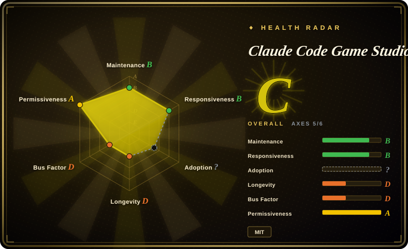
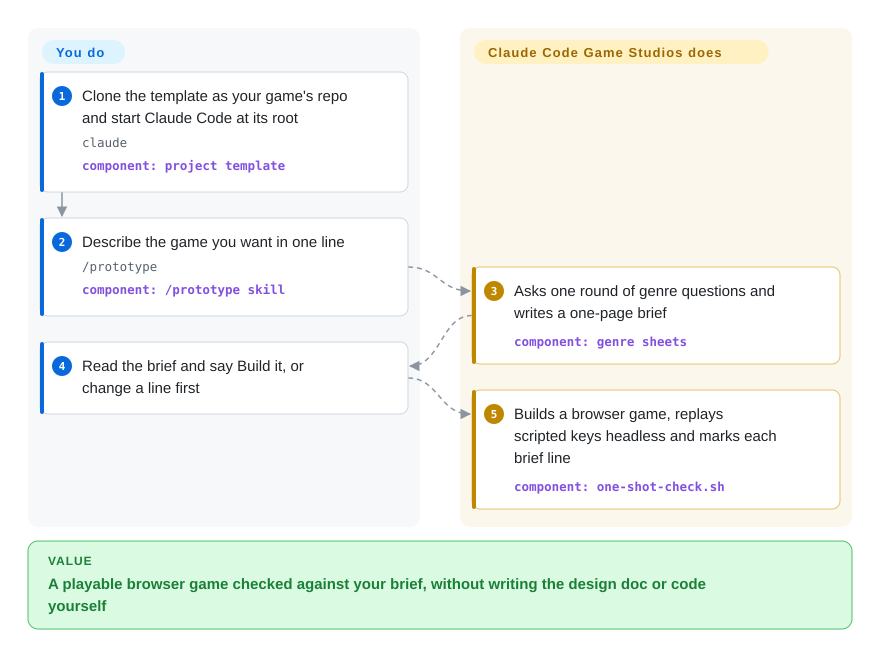
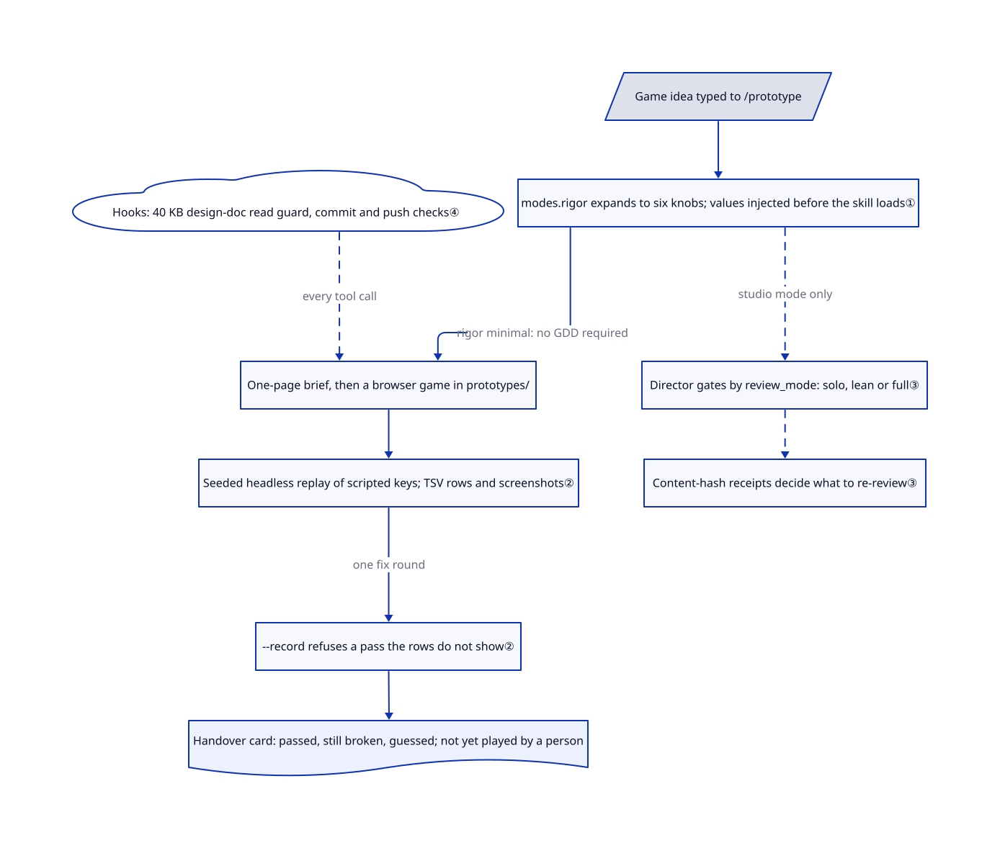

# Claude Code Game Studios

You ask Claude Code for "a small game" and get a file that throws errors on load, ignores half of what you asked, or turns into thirty design documents before anything moves on screen. This template turns your game repository into a Claude Code project that asks one round of questions, writes a one-page brief, builds a browser game from it, and runs a scripted headless check before handing it to you.

## When to use

You are a solo developer or a small team with a Claude Code subscription and a game idea such as "a fishing game where the rare fish only bite at dusk". Asking a bare agent gives you a single `index.html` with no record of what you asked for, no way to tell whether "the fish bite at dusk" was built, and nowhere to put the next feature. Reach for this template when you want the game's repository itself to carry the process: `/prototype` asks the genre's questions, writes `design/game-brief.md`, builds the game in `prototypes/<name>/`, plays it in a headless browser with seeded inputs, and marks each brief line pass, missing, broken or not assessed before the handover.

It beats a general coding harness such as Superpowers or ECC when the domain is games: it ships genre question sheets, engine tables and specialists for Godot, Unity and Unreal, and a path from one-file prototype to a Vite/TypeScript project. It beats a game-dev recipe pack when you want an opinionated end-to-end workflow with hooks and checks rather than reference instructions. The price is that you adopt one author's process, inside Claude Code only, as files in your own repository.

## When NOT to use

- **You do not use Claude Code.** The skills rely on Claude Code's `!` preprocessing, `allowed-tools` grants, subagent frontmatter and hook events; the repository has no Codex, Cursor or opencode route. For engine-aware game guidance that installs into several agents, use [awesome-gamedev-agent-skills](../../agent-skills/engineering/awesome-gamedev-agent-skills.md).
- **You already have a large engine project and want the agent to act inside the editor.** This template's checks are strongest on its own browser one-shots; the README says the Godot/Unity/Unreal route is built but not yet tested the way the browser path was. For live Unity scene inspection and edits, use [Unity-MCP](../../game-dev/unity-mcp.md); for Godot, `Coding-Solo/godot-mcp` (not indexed).
- **You want a general software-engineering harness, not a game studio.** The 49 agents, director gates and genre sheets are game-specific weight. For a general brainstorm→plan→TDD→verify process, use [Superpowers](superpowers.md); for cross-project hooks and memory, use [ECC](ecc.md).
- **You want to keep the harness separate from your project and upgrade it cleanly.** This is a template you clone into the game's repository, not a plugin. Upgrades are manual merges of `.claude/` guided by a 98 KB `UPGRADING.md`, and edited `settings.json` must be merged by hand. If you need a versioned install you can update in place, use a plugin-style harness such as [Superpowers](superpowers.md).
- **You need a team-backed dependency.** All 44 default-branch commits are by one maintainer; outside fixes arrive as issues and PRs that the maintainer reimplements and credits in releases (9 merged PRs against 46 open on 2026-11-18). If your studio cannot absorb a fork when that person stops, treat it as a pattern source and copy the parts you need.
- **You expect "Studio mode" to make the game better.** The README's own measurement says the `standard` rigor wrote 30 documents before code and was ranked last in a playtest, which is why `minimal` is the default. If you want the full director hierarchy for its traceability, accept that cost; do not expect quality from paperwork alone.

## Comparison

| Alternative | In index | Our verdict | Tradeoff |
|---|---|---|---|
| [awesome-gamedev-agent-skills](../../agent-skills/engineering/awesome-gamedev-agent-skills.md) | ✅ | Choose awesome-gamedev-agent-skills when you want engine- and version-aware game recipes in several agents; choose Claude Code Game Studios when you want one Claude Code workflow that builds and checks a playable prototype. | The recipe pack is portable and light but runs no checks; this template brings hooks, scripts and a headless self-check, and ties you to Claude Code and to its repository layout. |
| [Unity-MCP](../../game-dev/unity-mcp.md) | ✅ | For an existing Unity project where the agent must read and change the running editor, pick Unity-MCP; pick this template for idea-to-prototype process and documents around the code. | Unity-MCP gives live editor control but no game-design workflow; this template gives workflow and checks but cannot see a Unity scene. They can be combined. |
| [Superpowers](superpowers.md) | ✅ | If the problem is an agent skipping plans and tests on general software, choose Superpowers; if the problem is turning a game idea into something playable and growing it, choose this template. | Superpowers is a small installable plugin with no domain content; this template carries 75 skills, 49 agents and genre sheets you must keep merged into your repository. |
| [ECC](ecc.md) | ✅ | Choose ECC for a cross-project Claude Code harness with memory and security scanning; choose this template when the harness should live in one game's repository. | ECC installs once for every project; this template is per-repository and game-specific, so each game carries its own copy and upgrade burden. |
| [Coding-Solo/godot-mcp](https://github.com/Coding-Solo/godot-mcp) | not indexed | For a Godot project where the agent must launch the editor, run scenes and read errors, use godot-mcp; use this template for the brief, gates and story workflow around that code. | godot-mcp supplies execution tools and needs Godot plus Node.js; this template's Godot route is reference docs and agents without an editor bridge. Not added in this tab batch. |

## Quick start

The README's setup is to clone the repository as your game's own repository (`git clone https://github.com/Donchitos/Claude-Code-Game-Studios.git my-game`), open Claude Code at its root (the folder that holds `CLAUDE.md` and `project.yaml`), and type `/prototype` with your idea, or `/start` to be routed by where you are. Starting in a subfolder skips the project's hooks, deny rules and ask-first permission mode. You supply Claude Code and its model usage, Git, Python 3 (it reads `project.yaml`; without it every setting falls back to its default), Bash (Git Bash on Windows), and Chrome, Edge or Chromium for the screenshot checks; Node.js is needed only when a game grows into a web project or uses three.js. The template asks the questions, writes the brief, builds the game, runs the checks and records commits and tags; you answer, approve the brief, play the result and decide PROCEED, PIVOT or KILL. After play you change it by asking, grow it into a Vite/TypeScript project one feature per sitting, or switch on studio mode — agents in a director/lead/specialist hierarchy, design documents per system, epics and sprints.

<!-- flow-steps:begin (generated from flows/claude-code-game-studios.json by tools/flow_card.py — do not edit) -->

Text version of the flow

1. **You**: Clone the template as your game's repo and start Claude Code at its root — `claude` — component: `project template`
2. **You**: Describe the game you want in one line — `/prototype` — component: `/prototype skill`
3. **Claude Code Game Studios**: Asks one round of genre questions and writes a one-page brief — component: `genre sheets`
4. **You**: Read the brief and say Build it, or change a line first
5. **Claude Code Game Studios**: Builds a browser game, replays scripted keys headless and marks each brief line — component: `one-shot-check.sh`

**Value**: A playable browser game checked against your brief, without writing the design doc or code yourself

<!-- flow-steps:end -->

## Key techniques

<!-- mechanism:begin (generated from mechanisms/claude-code-game-studios.json by tools/mechanism_card.py; do not edit) -->

Text version of the mechanism

- Game idea typed to /prototype
- modes.rigor expands to six knobs; values injected before the skill loads①
- One-page brief, then a browser game in prototypes/
- Seeded headless replay of scripted keys; TSV rows and screenshots②
- --record refuses a pass the rows do not show②
- Director gates by review_mode: solo, lean or full③
- Content-hash receipts decide what to re-review③
- Hooks: 40 KB design-doc read guard, commit and push checks④
- Handover card: passed, still broken, guessed; not yet played by a person

- Game idea typed to /prototype → modes.rigor expands to six knobs; values injected before the skill loads①
- modes.rigor expands to six knobs; values injected before the skill loads① → One-page brief, then a browser game in prototypes/ (rigor minimal: no GDD required)
- One-page brief, then a browser game in prototypes/ → Seeded headless replay of scripted keys; TSV rows and screenshots②
- Seeded headless replay of scripted keys; TSV rows and screenshots② → --record refuses a pass the rows do not show② (one fix round)
- --record refuses a pass the rows do not show② → Handover card: passed, still broken, guessed; not yet played by a person
- modes.rigor expands to six knobs; values injected before the skill loads① → Director gates by review_mode: solo, lean or full③ (studio mode only) [optional/fallback]
- Director gates by review_mode: solo, lean or full③ → Content-hash receipts decide what to re-review③ [optional/fallback]
- Hooks: 40 KB design-doc read guard, commit and push checks④ → One-page brief, then a browser game in prototypes/ (every tool call) [optional/fallback]

<!-- mechanism:end -->

### 1. One rigor setting expands into six, resolved before the skill runs

- **Problem:** Six separate process settings (required design-document sections, document density, QA evidence, story size, review mode, team size) are too many to ask a new user, yet every skill must read the same values.
- **How:** `modes.rigor` (`minimal`, `standard`, `full`) maps to a fixed row of six values. A lookup checks `project.local.yaml`, `project.yaml`, a legacy file, then the rigor row, then the default, and reports which source won. An invalid value falls through instead of winning. Each skill puts the lookup in a `!` line, which Claude Code runs before the model reads the skill, so the values arrive already resolved.
- **Limits:** It is a Bash/awk YAML reader, not a YAML parser; it needs Python for some paths and silently uses defaults without it. The `!` line works only with the exact per-skill `allowed-tools` grant; the docs record how a different form failed to load outside auto mode in v1.1.0.
- **Source:** [Rigor expansion](https://github.com/Donchitos/Claude-Code-Game-Studios/blob/abc0de79d6ceb0b5d7aa693945849b3937afbe6a/.claude/hooks/yaml-helper.sh#L1240-L1283), [resolution order](https://github.com/Donchitos/Claude-Code-Game-Studios/blob/abc0de79d6ceb0b5d7aa693945849b3937afbe6a/.claude/hooks/yaml-helper.sh#L1366-L1417), [preprocessing rule](https://github.com/Donchitos/Claude-Code-Game-Studios/blob/abc0de79d6ceb0b5d7aa693945849b3937afbe6a/.claude/docs/config-resolution.md#L1-L25).

### 2. A seeded headless replay, and a recorder that refuses unsupported passes

- **Problem:** A model that wrote a game will tend to say it works; a parse check does not show a frozen screen or text off the edge.
- **How:** `one-shot-run.sh` copies the game to a temporary folder and puts a driver script in front of it that fixes time and randomness, so the same key log gives the same run. It plays in headless Chrome, Edge or Chromium, screenshots where it stops, and prints TSV rows for crashes, frozen screens, unreadable text and unresponsive input. `one-shot-check.sh --record` refuses a "pass" that the rows or evidence files do not show, refuses an unlisted brief item, and refuses a third run in one round.
- **Limits:** It is a smoke test: it shows the game boots and responds, not that it is fun or correctly difficult, and the skill tells the agent never to tune difficulty by script. Items it cannot see (sound, feel) are "not assessed", and the run needs a local browser; without one every row is not assessed.
- **Source:** [Run driver](https://github.com/Donchitos/Claude-Code-Game-Studios/blob/abc0de79d6ceb0b5d7aa693945849b3937afbe6a/.claude/scripts/one-shot-run.sh#L1-L10), [record refusals](https://github.com/Donchitos/Claude-Code-Game-Studios/blob/abc0de79d6ceb0b5d7aa693945849b3937afbe6a/.claude/scripts/one-shot-check.sh#L20-L40), [self-check procedure](https://github.com/Donchitos/Claude-Code-Game-Studios/blob/abc0de79d6ceb0b5d7aa693945849b3937afbe6a/.claude/skills/prototype/references/one-shot-2c-self-check.md).

### 3. Director gates scaled by review mode, with hash receipts for re-review

- **Problem:** A director-agent review at every step of a long project costs tokens and time; skipping reviews entirely loses the cross-check.
- **How:** 28 gate definitions (creative, technical, producer, art, lead-programmer, QA, narrative) live in their own files; a spawned director agent reads its gate file in its own context and returns APPROVE, CONCERNS or REJECT. `review_mode` decides what runs: `solo` none, `lean` only phase gates, `full` all. Review skills store SHA hashes of the files they read and re-review only when the bytes change, not when mtime or git status say so.
- **Limits:** Gates are model judgments, not tests. The default `minimal` rigor sets `solo`, so a new project runs no director gates unless you raise it. Hashing gives false positives (extra reviews) when a hash tool is missing, by design.
- **Source:** [Gate index and review modes](https://github.com/Donchitos/Claude-Code-Game-Studios/blob/abc0de79d6ceb0b5d7aa693945849b3937afbe6a/.claude/docs/director-gates.md#L1-L82), [review receipts](https://github.com/Donchitos/Claude-Code-Game-Studios/blob/abc0de79d6ceb0b5d7aa693945849b3937afbe6a/.claude/scripts/review-receipts.sh#L1-L30).

### 4. Hooks that mostly warn, and one read guard that blocks

- **Problem:** Agents read whole design documents of tens of kilobytes into context, overwrite files a skill should never touch, and commit invalid data JSON.
- **How:** `settings.json` wires 15 hooks across session start, tool calls, subagent start/stop and compaction. `validate-read.sh` refuses a whole-file read of a design document over 40 KB and replies with its headings and line numbers, so the retry reads one section. `validate-write.sh` only warns; `validate-commit.sh` can block a `git commit` (for example data JSON with no Python to validate it). Each hook exits early when the call is not relevant.
- **Limits:** The hooks run only when Claude Code is started at the project root, and on Windows only with Git Bash; without Bash they skip themselves and say so. Warnings depend on the agent heeding them. The deny list is pattern matching on command text, so a commit message containing `push +` is also denied.
- **Source:** [Read guard](https://github.com/Donchitos/Claude-Code-Game-Studios/blob/abc0de79d6ceb0b5d7aa693945849b3937afbe6a/.claude/hooks/validate-read.sh#L15-L28), [hook wiring](https://github.com/Donchitos/Claude-Code-Game-Studios/blob/abc0de79d6ceb0b5d7aa693945849b3937afbe6a/.claude/settings.json), [hook table](https://github.com/Donchitos/Claude-Code-Game-Studios/blob/abc0de79d6ceb0b5d7aa693945849b3937afbe6a/README.md#L266-L300).

## Tech stack

- **Prompts:** 75 skills (`.claude/skills/<name>/SKILL.md` plus `references/`), 49 subagent definitions, 14 path-scoped rule files, 62 document templates and genre sheets in Markdown/YAML — about 35,000 lines of skill Markdown at the reviewed commit.
- **Runtime glue:** Bash and awk (about 22,000 lines of `.sh` under `.claude/`), written for macOS's bash 3.2, Linux and Git Bash; Python 3 for YAML and JSON validation; a JavaScript driver injected into the game for headless runs.
- **Generated games:** a single-folder HTML/JavaScript one-shot by default; grown projects use Vite, TypeScript, Playwright and optional three.js, Phaser or PixiJS starters. Engine routes add reference docs and specialists for Godot 4, Unity and Unreal Engine 5.
- **Agent models:** agent frontmatter pins 3 agents to `opus`, 16 to `sonnet` and leaves 30 on `inherit` (your session's model).

## Dependencies

- **Required:** Claude Code (and its model subscription or API cost), Git, Python 3, Bash (Git Bash on Windows).
- **For the self-check:** Chrome, Edge, Chromium or chrome-headless-shell on the machine; without one the screenshot rows read "not assessed".
- **Optional:** Node.js for grown web projects and three.js; jq for hook validation; a game engine (Godot, Unity, Unreal) only if you choose an engine route.
- **Network:** a session-start hook asks the GitHub releases API for a newer version at most once a day (off with `updates.check: false` or under CI); `vendor-three.sh` may download three.js from jsDelivr. No other outbound calls were found in the hooks and scripts.

## Ops difficulty

**Low to start, medium to keep.** No service runs; you clone a repository and start Claude Code. The ongoing cost is the template model: every game repository carries its own copy of `.claude/`, and each release (six minor/patch releases from September to November 2026) comes with a manual merge procedure in `UPGRADING.md` that separates files you can overwrite from files you must merge. Customized skills and `settings.json` make that merge harder, which is why the repository ships `studio-tests/` and `/skill-test` to recheck edited skills. Model usage, especially with studio mode and Opus-pinned directors, is a running cost you own.

## Health & viability

- **Maintenance (2026-11-18):** active. Ten releases since v0.2.0 (2026-02-20); v1.3.0 on 2026-11-09, with six releases between 2026-09-23 and 2026-11-09. There was a gap between v1.0.0 (2026-05-13) and v1.1.0 (2026-09-23) with only bug-fix commits.
- **Governance / bus factor:** one individual (`owner.type: User`); every default-branch commit is by the maintainer. External contributions are credited in release notes but reimplemented rather than merged (9 merged vs 46 open PRs). Bus factor is 1; funding is GitHub Sponsors and Buy Me a Coffee.
- **Age / Lindy:** created 2026-02-12, about nine months old. Too young for a Lindy prior; still active.
- **Adoption:** 39,952 stars and 5,222 forks in nine months. Forks are expected for a clone-me template; the star count on a nine-month single-author repo is a hype signal to discount, not evidence of production use. [推断：no dependents or shipped-game list is published, and the README says the games are deliberately not shipped]
- **Risk flags:** MIT, copyright held by the author; no CLA and no relicense history. Tied to Claude Code's skill, hook and permission formats; the v1.1.0 → v1.1.1 breakage (skills failing outside auto mode) shows host changes can break it between releases. No CI workflow in `.github/`; testing is described as manual across Windows, macOS and Linux.

## Caveats (unverified)

- [未验证：author-reported, no data or protocol published in the repository] The blind comparison (brief from questions picked over a hand-written brief three times out of three), the six-story growth test and the `minimal` vs `standard` measurement (1 vs 30 documents, `standard` ranked last) are the maintainer's own tests.
- [未验证：not run for this entry] Whether `/prototype` produces a working game for a given idea, how many tokens a one-shot or a studio-mode feature costs, and how often the self-check catches real defects were not reproduced.
- [未验证：README states built but untested] The Godot, Unity and Unreal routes and the system design-document path have not had the same test as the browser path.
- [推断：from commit authorship and PR counts on 2026-11-18] Continuity depends on one person; the PR-reimplementation pattern may change.
- [推断：based on stars vs. age and absent dependent data] The star count reflects attention rather than verified adoption.
