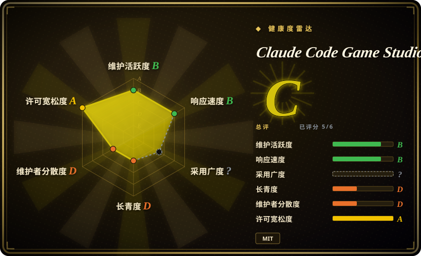
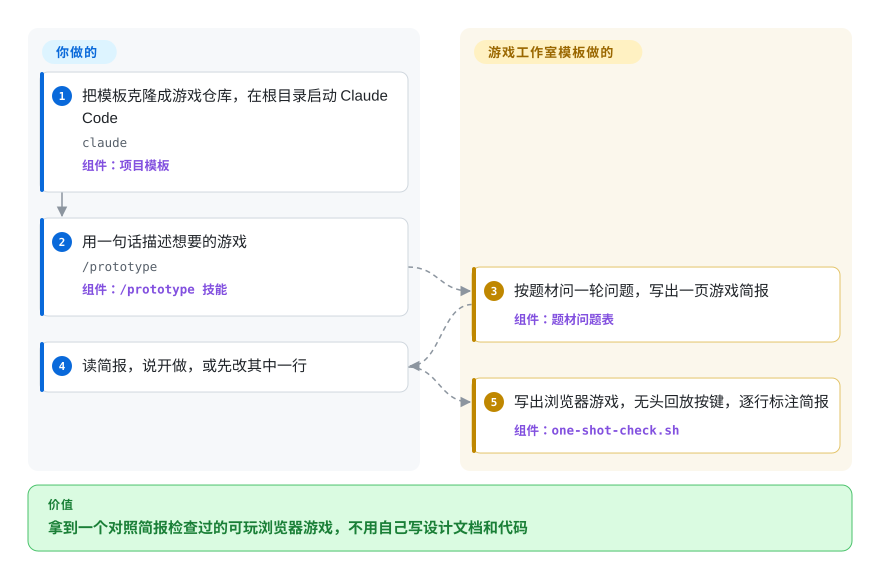
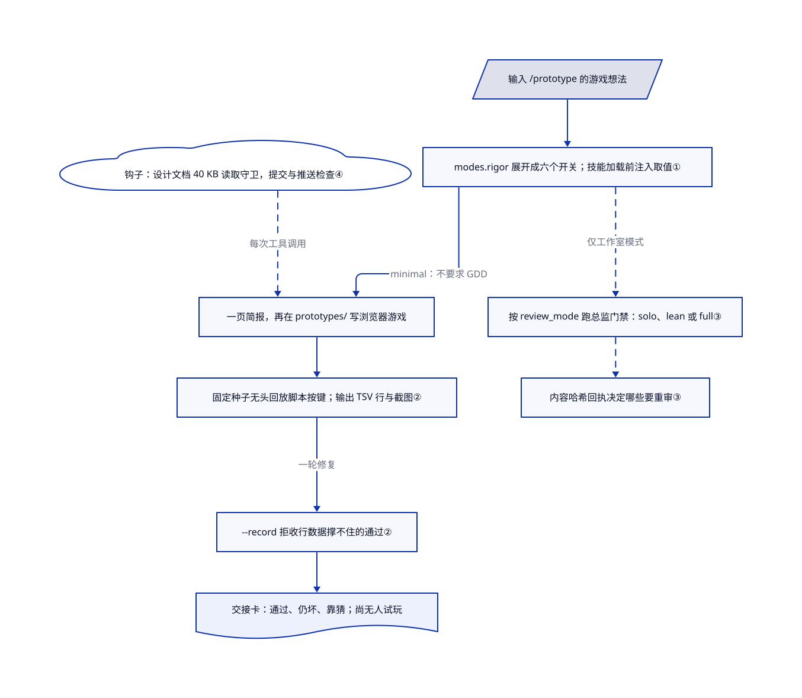

# Claude Code Game Studios

你让 Claude Code 做“一个小游戏”，拿到的要么一打开就报错，要么你说的一半没做，要么先冒出三十份设计文档、屏幕上什么都不动。这个模板把你的游戏仓库变成一个 Claude Code 项目：先问一轮问题，写一页简报，照简报做出浏览器游戏，交给你之前再用无头浏览器按脚本跑一遍检查。

## 何时使用

你是独立开发者或小团队，订着 Claude Code，手里有个点子，比如“一个钓鱼游戏，稀有鱼只在黄昏咬钩”。直接问 agent，你会得到一个 `index.html`：没有记录你当初要了什么，看不出“黄昏咬钩”到底做没做，下一个功能也不知道往哪放。想让游戏仓库本身带上流程时，就用这个模板：`/prototype` 按题材提问，写出 `design/game-brief.md`，在 `prototypes/<name>/` 里做出游戏，用固定种子的输入在无头浏览器里试玩，交付前把简报每一行标成通过、缺失、坏掉或未评估。

做游戏时，它比 Superpowers、ECC 这类通用编码 harness 合适：它自带题材问题表、引擎对照表，以及 Godot、Unity、Unreal 专家 agent，还有一条从单文件原型长成 Vite/TypeScript 项目的路。和游戏开发配方包比，它给的是一条带钩子和检查、从头走到尾的固定流程，而不是参考说明。代价是你要接受一个作者的流程，只能在 Claude Code 里用，而且这些文件会放进你自己的仓库。

## 何时不用

- **你不用 Claude Code。** 技能依赖 Claude Code 的 `!` 预处理、`allowed-tools` 授权、子 agent 的 frontmatter 和钩子事件，仓库里没有 Codex、Cursor、opencode 的路线。想要能装进多个 agent、懂引擎版本的游戏开发指引，用 [awesome-gamedev-agent-skills](../../agent-skills/engineering/awesome-gamedev-agent-skills.zh.md)。
- **你已有大型引擎项目，要 agent 直接在编辑器里动手。** 这个模板的检查在它自己的浏览器原型上最扎实，README 自己说 Godot/Unity/Unreal 路线已经做好、但没像浏览器路线那样测过。要实时查看和修改 Unity 场景，用 [Unity-MCP](../../game-dev/unity-mcp.zh.md)；Godot 用 `Coding-Solo/godot-mcp`（未收录）。
- **你要的是通用软件工程 harness，不是游戏工作室。** 49 个 agent、总监门禁和题材问题表都是游戏专用的分量。通用的“构思→计划→TDD→验证”流程用 [Superpowers](superpowers.zh.md)；跨项目的钩子和记忆用 [ECC](ecc.zh.md)。
- **你想把 harness 和项目分开，并能干净地升级。** 这是要克隆进游戏仓库的模板，不是插件。升级靠照着 98 KB 的 `UPGRADING.md` 手工合并 `.claude/`，改过的 `settings.json` 也得手工合。要能原地升级的版本化安装，选 [Superpowers](superpowers.zh.md) 这类插件形态的 harness。
- **你需要有团队兜底的依赖。** 默认分支 44 个提交全部出自一位维护者；外部修复以 issue 和 PR 形式提交，由维护者重写并在发布说明里致谢（2026-11-18 已合并 PR 9 个，未合并 46 个）。如果你的工作室在那个人停手时接不住一个分叉，就把它当设计参考，只抄需要的部分。
- **你指望“工作室模式”让游戏更好玩。** README 自己的测量是：`standard` 档在写第一行代码前产出 30 份文档，试玩排名垫底，所以默认档是 `minimal`。要总监层级换来的可追溯性，就接受这个成本，别指望文档本身带来质量。

## 横向对比

| 替代品 | 是否收录 | 我们的评价 | 取舍 |
|---|---|---|---|
| [awesome-gamedev-agent-skills](../../agent-skills/engineering/awesome-gamedev-agent-skills.zh.md) | ✅ | 想在多个 agent 里用懂引擎和版本的游戏配方，选 awesome-gamedev-agent-skills；想在 Claude Code 里走一条做出并检查可玩原型的流程，选本模板。 | 配方包可移植、轻，但不跑任何检查；本模板带钩子、脚本和无头自检，代价是绑定 Claude Code 和它的仓库布局。 |
| [Unity-MCP](../../game-dev/unity-mcp.zh.md) | ✅ | 已有 Unity 项目、需要 agent 读改正在运行的编辑器时，选 Unity-MCP；要从点子到原型的流程和代码周边文档，选本模板。 | Unity-MCP 能实时控制编辑器，但没有游戏设计流程；本模板有流程和检查，却看不到 Unity 场景。两者可以叠用。 |
| [Superpowers](superpowers.zh.md) | ✅ | 问题是 agent 在一般软件上跳过计划和测试，选 Superpowers；问题是把游戏点子做成能玩的东西再慢慢长大，选本模板。 | Superpowers 是不带领域内容的小型可安装插件；本模板带 75 个技能、49 个 agent 和题材问题表，需要你持续合并进自己的仓库。 |
| [ECC](ecc.zh.md) | ✅ | 要一个带记忆和安全扫描、跨项目通用的 Claude Code harness，选 ECC；harness 应该住在某个游戏仓库里时，选本模板。 | ECC 装一次所有项目通用；本模板按仓库放、只管游戏，每个游戏各带一份副本和各自的升级负担。 |
| [Coding-Solo/godot-mcp](https://github.com/Coding-Solo/godot-mcp) | 未收录 | Godot 项目里要 agent 启动编辑器、跑场景、读报错，用 godot-mcp；要围绕代码的简报、门禁和 story 流程，用本模板。 | godot-mcp 提供执行工具，需要 Godot 和 Node.js；本模板的 Godot 路线只有参考文档和 agent，没有编辑器桥。本批标签收录未加入。 |

## 快速上手

README 的做法是把仓库克隆成你游戏自己的仓库（`git clone https://github.com/Donchitos/Claude-Code-Game-Studios.git my-game`），在根目录（放着 `CLAUDE.md` 和 `project.yaml` 的那层）打开 Claude Code，输入 `/prototype` 加上你的点子；或者输入 `/start`，让它按你所处的阶段分流。在子目录里启动会跳过项目的钩子、禁止规则和先问后做的权限模式。你要准备的是：Claude Code 及其模型用量、Git、Python 3（用来读 `project.yaml`；没有它，所有设置都会悄悄退回默认值）、Bash（Windows 上是 Git Bash），以及给截图检查用的 Chrome、Edge 或 Chromium；Node.js 只在游戏长成 Web 项目或用 three.js 时才需要。模板负责提问、写简报、做游戏、跑检查、记录提交和标签；你负责回答、批准简报、试玩，然后裁定继续、转向还是放弃（PROCEED、PIVOT、KILL）。试玩之后，你可以直接提修改，可以把它长成 Vite/TypeScript 项目、每次只加一个功能，也可以打开工作室模式——按总监、主管、专员分层的 agent，每个系统一份设计文档，再加 epic 和冲刺。

<!-- flow-steps:begin (generated from flows/claude-code-game-studios.json by tools/flow_card.py — do not edit) -->

流程文字版

1. **你**：把模板克隆成游戏仓库，在根目录启动 Claude Code — `claude` — 组件：`项目模板`
2. **你**：用一句话描述想要的游戏 — `/prototype` — 组件：`/prototype 技能`
3. **Claude Code Game Studios**：按题材问一轮问题，写出一页游戏简报 — 组件：`题材问题表`
4. **你**：读简报，说开做，或先改其中一行
5. **Claude Code Game Studios**：写出浏览器游戏，无头回放按键，逐行标注简报 — 组件：`one-shot-check.sh`

**价值**：拿到一个对照简报检查过的可玩浏览器游戏，不用自己写设计文档和代码

<!-- flow-steps:end -->

## 技术要点

<!-- mechanism:begin (generated from mechanisms/claude-code-game-studios.json by tools/mechanism_card.py; do not edit) -->

机制文字版

- 输入 /prototype 的游戏想法
- modes.rigor 展开成六个开关；技能加载前注入取值①
- 一页简报，再在 prototypes/ 写浏览器游戏
- 固定种子无头回放脚本按键；输出 TSV 行与截图②
- --record 拒收行数据撑不住的通过②
- 按 review_mode 跑总监门禁：solo、lean 或 full③
- 内容哈希回执决定哪些要重审③
- 钩子：设计文档 40 KB 读取守卫，提交与推送检查④
- 交接卡：通过、仍坏、靠猜；尚无人试玩

- 输入 /prototype 的游戏想法 → modes.rigor 展开成六个开关；技能加载前注入取值①
- modes.rigor 展开成六个开关；技能加载前注入取值① → 一页简报，再在 prototypes/ 写浏览器游戏（minimal：不要求 GDD）
- 一页简报，再在 prototypes/ 写浏览器游戏 → 固定种子无头回放脚本按键；输出 TSV 行与截图②
- 固定种子无头回放脚本按键；输出 TSV 行与截图② → --record 拒收行数据撑不住的通过②（一轮修复）
- --record 拒收行数据撑不住的通过② → 交接卡：通过、仍坏、靠猜；尚无人试玩
- modes.rigor 展开成六个开关；技能加载前注入取值① → 按 review_mode 跑总监门禁：solo、lean 或 full③（仅工作室模式）〔可选／兜底〕
- 按 review_mode 跑总监门禁：solo、lean 或 full③ → 内容哈希回执决定哪些要重审③〔可选／兜底〕
- 钩子：设计文档 40 KB 读取守卫，提交与推送检查④ → 一页简报，再在 prototypes/ 写浏览器游戏（每次工具调用）〔可选／兜底〕

<!-- mechanism:end -->

### 1. 一个严格度设置展开成六个，在技能运行前解析好

- **解决：** 六个独立的流程设置（必填设计文档章节、文档密度、QA 证据、story 粒度、评审模式、团队规模）太多，没法一一问新用户，可每个技能又得读到同一组值。
- **做法：** `modes.rigor`（`minimal`、`standard`、`full`）对应一行固定的六个值。查值顺序是 `project.local.yaml`、`project.yaml`、旧版文本文件、严格度那一行、最后是默认值，并报告取自哪一层；非法取值不生效，继续往下找。每个技能把这次查值写成一行 `!` 命令，Claude Code 在模型读技能之前执行它，所以模型拿到的已经是解析后的值。
- **边界：** 这是 Bash/awk 写的 YAML 读取器，不是完整的 YAML 解析器；部分路径依赖 Python，缺了就悄悄用默认值。`!` 行只有配上每个技能精确的 `allowed-tools` 授权才会执行；文档记录了 v1.1.0 用另一种写法时，在非自动模式下技能根本加载不起来。
- **源码：** [严格度展开](https://github.com/Donchitos/Claude-Code-Game-Studios/blob/abc0de79d6ceb0b5d7aa693945849b3937afbe6a/.claude/hooks/yaml-helper.sh#L1240-L1283)、[解析顺序](https://github.com/Donchitos/Claude-Code-Game-Studios/blob/abc0de79d6ceb0b5d7aa693945849b3937afbe6a/.claude/hooks/yaml-helper.sh#L1366-L1417)、[预处理规则](https://github.com/Donchitos/Claude-Code-Game-Studios/blob/abc0de79d6ceb0b5d7aa693945849b3937afbe6a/.claude/docs/config-resolution.md#L1-L25)。

### 2. 固定种子的无头回放，加一个拒收无据“通过”的记录器

- **解决：** 写游戏的模型倾向于说“能跑”；语法检查也看不出画面卡死、文字出界。
- **做法：** `one-shot-run.sh` 把游戏复制到临时目录，在它前面插一个驱动脚本，固定时间和随机数，同一串按键就得到同一局。它在无头 Chrome、Edge 或 Chromium 里试玩，在停下处截图，把崩溃、卡屏、看不清的文字、按键无响应输出成 TSV 行。`one-shot-check.sh --record` 拒收行数据或证据文件撑不住的“通过”，拒收没列出的简报条目，一轮里第三次运行也会被拒绝。
- **边界：** 这是冒烟测试：只证明游戏能启动、有响应，不证明好玩或难度合适，技能也明确要求 agent 不许用脚本调难度。看不见的条目（声音、手感）记为“未评估”；运行需要本机浏览器，没有就全部记为未评估。
- **源码：** [运行驱动](https://github.com/Donchitos/Claude-Code-Game-Studios/blob/abc0de79d6ceb0b5d7aa693945849b3937afbe6a/.claude/scripts/one-shot-run.sh#L1-L10)、[记录拒收规则](https://github.com/Donchitos/Claude-Code-Game-Studios/blob/abc0de79d6ceb0b5d7aa693945849b3937afbe6a/.claude/scripts/one-shot-check.sh#L20-L40)、[自检流程](https://github.com/Donchitos/Claude-Code-Game-Studios/blob/abc0de79d6ceb0b5d7aa693945849b3937afbe6a/.claude/skills/prototype/references/one-shot-2c-self-check.md)。

### 3. 按评审模式开关总监门禁，用哈希回执决定是否重审

- **解决：** 长项目里每一步都让总监 agent 审一遍，费 token 又费时间；完全不审又少了交叉检查。
- **做法：** 28 个门禁定义（创意、技术、制作人、美术、主程、QA、叙事）各占一个文件；被派出的总监 agent 在自己的上下文里读门禁文件，给出 APPROVE、CONCERNS 或 REJECT。`review_mode` 决定跑哪些：`solo` 一个不跑，`lean` 只跑阶段门禁，`full` 全跑。评审技能记下所读文件的 SHA 哈希，只有字节变了才重审，不看修改时间或 git 状态。
- **边界：** 门禁是模型判断，不是测试。默认的 `minimal` 严格度对应 `solo`，新项目不调高就一个总监门禁都不跑。缺少哈希工具时会多审（误报），这是有意的取舍。
- **源码：** [门禁索引与评审模式](https://github.com/Donchitos/Claude-Code-Game-Studios/blob/abc0de79d6ceb0b5d7aa693945849b3937afbe6a/.claude/docs/director-gates.md#L1-L82)、[评审回执](https://github.com/Donchitos/Claude-Code-Game-Studios/blob/abc0de79d6ceb0b5d7aa693945849b3937afbe6a/.claude/scripts/review-receipts.sh#L1-L30)。

### 4. 钩子大多只警告，只有读取守卫会拦

- **解决：** agent 会把几十 KB 的设计文档整篇读进上下文，会覆盖技能本不该碰的文件，还会提交不合法的数据 JSON。
- **做法：** `settings.json` 在会话开始、工具调用、子 agent 启停和上下文压缩等事件上挂了 15 个钩子。`validate-read.sh` 拒绝整篇读取超过 40 KB 的设计文档，回给它标题和行号，让重试只读一节。`validate-write.sh` 只警告；`validate-commit.sh` 可以拦下 `git commit`（例如没有 Python 校验时提交了数据 JSON）。每个钩子在与当前调用无关时立即退出。
- **边界：** 只有在项目根目录启动 Claude Code 时钩子才生效，Windows 上还得有 Git Bash；没有 Bash 时钩子会自行跳过并提示。警告要靠 agent 自己听。禁止列表是对命令文本做模式匹配，所以提交信息里出现 `push +` 也会被拦。
- **源码：** [读取守卫](https://github.com/Donchitos/Claude-Code-Game-Studios/blob/abc0de79d6ceb0b5d7aa693945849b3937afbe6a/.claude/hooks/validate-read.sh#L15-L28)、[钩子配置](https://github.com/Donchitos/Claude-Code-Game-Studios/blob/abc0de79d6ceb0b5d7aa693945849b3937afbe6a/.claude/settings.json)、[钩子一览](https://github.com/Donchitos/Claude-Code-Game-Studios/blob/abc0de79d6ceb0b5d7aa693945849b3937afbe6a/README.md#L266-L300)。

## 技术栈

- **提示词：** 75 个技能（`.claude/skills/<name>/SKILL.md` 加 `references/`）、49 个子 agent 定义、14 个按路径生效的规则文件、62 个文档模板和题材问题表，均为 Markdown/YAML；审阅时的提交里技能 Markdown 约 35,000 行。
- **运行胶水：** Bash 和 awk（`.claude/` 下约 22,000 行 `.sh`），按 macOS 自带的 bash 3.2、Linux 和 Git Bash 编写；Python 3 负责 YAML 和 JSON 校验；无头运行时往游戏里注入一个 JavaScript 驱动。
- **生成的游戏：** 默认是单目录的 HTML/JavaScript 原型；长大后的项目用 Vite、TypeScript、Playwright，可选 three.js、Phaser 或 PixiJS 起步模板。引擎路线另带 Godot 4、Unity、Unreal Engine 5 的参考文档和专家 agent。
- **agent 模型：** agent 的 frontmatter 里 3 个固定用 `opus`、16 个用 `sonnet`、30 个是 `inherit`（沿用你会话里的模型）。

## 依赖

- **必需：** Claude Code（及其订阅或 API 费用）、Git、Python 3、Bash（Windows 上是 Git Bash）。
- **自检需要：** 本机装有 Chrome、Edge、Chromium 或 chrome-headless-shell；都没有时截图相关行记为“未评估”。
- **可选：** Node.js（Web 项目长大和 three.js 用）；jq（钩子校验用）；游戏引擎（Godot、Unity、Unreal）只在选了引擎路线时需要。
- **网络：** 一个会话开始钩子每天最多问一次 GitHub releases API 有无新版本（`updates.check: false` 或 CI 环境下关闭）；`vendor-three.sh` 可能从 jsDelivr 下载 three.js。钩子和脚本里没有发现其他外发请求。

## 运维难度

**起步低，长期中等。** 不用跑任何服务，克隆仓库、启动 Claude Code 即可。持续成本来自模板这种形态：每个游戏仓库各带一份 `.claude/`，每次发版（2026 年 9 月到 11 月共 6 个小版本和补丁版本）都附一份 `UPGRADING.md` 里的手工合并步骤，区分哪些文件可以直接覆盖、哪些必须合并。改过的技能和 `settings.json` 会让合并更难，所以仓库自带 `studio-tests/` 和 `/skill-test` 来复查改过的技能。模型用量是你自己承担的持续开销，开工作室模式、用固定 Opus 的总监 agent 时尤其明显。

## 健康度与可持续性

- **维护（2026-11-18）：** 活跃。从 v0.2.0（2026-02-20）到 v1.3.0（2026-11-09）共 10 个发布，其中 2026-09-23 到 2026-11-09 之间发了 6 个。v1.0.0（2026-05-13）到 v1.1.0（2026-09-23）之间有一段只有修 bug 提交的空档。
- **治理与巴士因子：** 个人仓库（`owner.type: User`），默认分支每个提交都出自维护者本人。外部贡献会在发布说明里致谢，但由维护者重写而不是直接合并（已合并 PR 9 个，未合并 46 个）。巴士因子为 1；资金来自 GitHub Sponsors 和 Buy Me a Coffee。
- **年龄与 Lindy：** 2026-02-12 创建，约九个月。太年轻，谈不上 Lindy 先验；目前仍活跃。
- **采用度：** 九个月 39,952 星、5,222 个 fork。“克隆我”型模板本来就会被大量 fork；一个九个月、单人维护的仓库拿到这么多星，应视为热度信号打折看待，不是生产使用的证据。[推断：仓库没有公布依赖方或已发售游戏清单，README 也说明故意不收录用它做出的游戏]
- **风险信号：** MIT 许可，版权归作者本人；无 CLA，无改许可历史。绑定 Claude Code 的技能、钩子和权限格式；v1.1.0 → v1.1.1 的故障（技能在非自动模式下失效）说明宿主变化可能在两个版本之间把它弄坏。`.github/` 里没有 CI 工作流，测试按 README 说法是在 Windows、macOS、Linux 上手工进行。

## 存疑（未验证）

- [未验证：作者自报，仓库没有公开数据和测试方案] 盲测对比（按问题生成的简报三次都胜过手写简报）、六个 story 的长大测试，以及 `minimal` 对 `standard` 的测量（1 份对 30 份文档、`standard` 排名垫底）都是维护者自己做的测试。
- [未验证：本条目没有实际运行] `/prototype` 对某个点子能否做出可用的游戏、一次原型或一次工作室模式功能要花多少 token、自检能抓到多少真实缺陷，都没有复现。
- [未验证：README 说已做好但未测试] Godot、Unity、Unreal 路线和系统设计文档路径没有经过与浏览器路线同样的测试。
- [推断：依据 2026-11-18 的提交作者和 PR 计数] 项目延续性取决于一个人；“重写外部 PR”的做法也可能改变。
- [推断：依据星数与仓库年龄的对比，以及缺少依赖方数据] 星数反映的是关注度，不是经过验证的采用度。
