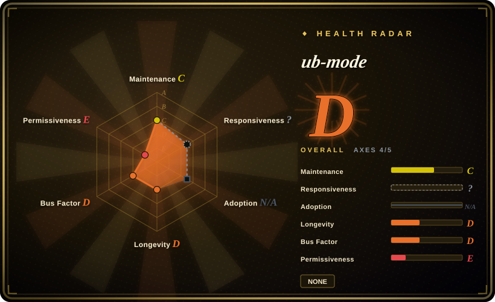
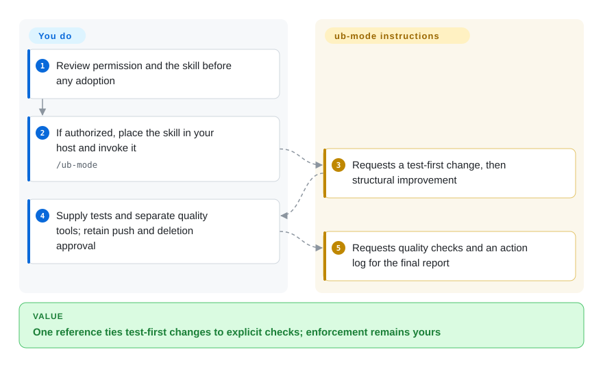
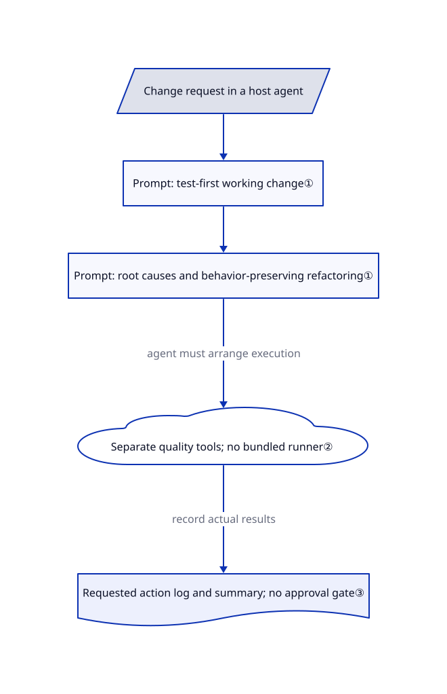

# ub-mode

Your agent patches code until tests pass but leaves duplication and weak tests behind. ub-mode puts a test-first change loop and named quality checks into one readable skill, not an executable gate.

## When to use

You maintain a codebase where an agent fixes one failing test by adding another special case, then calls the work finished. You want to inspect a compact engineering checklist rather than adopt a whole plugin framework. ub-mode groups the work into making the change work, improving its structure, and recording the work. Its distinctive choice is pairing that short prompt with named complexity, duplication, and mutation-testing tools; the tools themselves live elsewhere.

Read it as a reference first. The reviewed repository contains only `README.md` and `SKILL.md`, with no license file or express license grant in either file. This page describes the material; it does not grant permission to copy or redistribute it.

## When NOT to use

- **You need an installed planning and execution workflow.** Choose [Superpowers](superpowers.md) for its separate planning, test-first implementation, and verification skills; ub-mode has one prompt and no bundled orchestrator.
- **You need cross-session knowledge capture.** Choose [Compound Engineering](compound-engineering.md) for its explicit solution-note loop; ub-mode requests an action log and summaries but supplies no persistence implementation.
- **You need executable hooks and memory infrastructure.** Evaluate [ECC](ecc.md) instead. ub-mode neither installs its companion tools nor invokes them through code; CI must run and enforce your actual checks separately.
- **Your workflow forbids autonomous pushes or disk cleanup.** Prefer a reviewed [Superpowers](superpowers.md) workflow with your own permission gates. ub-mode's practice section asks for pushing to the main line and reclaiming disk space; it supplies no approval mechanism. Open [issue 2](https://github.com/unclebob/ub-mode/issues/2) flags both instructions.
- **You require an explicit reuse license.** Consider the MIT-licensed [Superpowers](superpowers.md) rather than treating a public file or README installation advice as a complete license grant.

## Comparison

| Alternative | In index | Our verdict | Tradeoff |
|---|---|---|---|
| [Superpowers](superpowers.md) | Yes | Choose Superpowers when you need an installable planning-to-verification workflow; use ub-mode as a compact reference when one engineering checklist is enough. | More workflow assets and host integration to review, rather than ub-mode's two-file surface; Superpowers has an explicit MIT license. |
| [Compound Engineering](compound-engineering.md) | Yes | Choose Compound Engineering when the next task must reuse lessons from previous tasks; ub-mode only asks the agent to log its actions. | Dedicated solution artifacts and a multi-phase plugin add conventions that the smaller ub-mode reference does not impose. |
| [ECC](ecc.md) | Yes | Choose ECC when session hooks and persistent memory are part of the requirement; inspect ub-mode when you want principles without inheriting a runtime. | ECC brings executable components and a much larger trust surface; ub-mode leaves tool installation, enforcement, and storage to you. |

## Quick start

First inspect the fixed [README](https://github.com/unclebob/ub-mode/blob/57a8bdd28e45ed41900ace0bafa2ff76dd9ed70f/README.md#L18-L20) and resolve reuse permission before adopting the file. The README describes placing `SKILL.md` at `ub-mode/SKILL.md` under the host agent's skills directory, then invoking `/ub-mode`; this is a documented path, not an installation performed for this entry. You supply a compatible agent, its model access and costs, the codebase, test commands, and separately installed quality tools. The skill asks the agent to follow the work/improve/practice sequence; it does not run a service or verify compliance itself. Keep push and deletion permissions outside the prompt, and check host-specific loading before relying on it.

<!-- flow-steps:begin (generated from flows/ub-mode.json by tools/flow_card.py — do not edit) -->

Text version of the flow

1. **You**: Review permission and the skill before any adoption
2. **You**: If authorized, place the skill in your host and invoke it — `/ub-mode`
3. **ub-mode**: Requests a test-first change, then structural improvement
4. **You**: Supply tests and separate quality tools; retain push and deletion approval
5. **ub-mode**: Requests quality checks and an action log for the final report

**Value**: One reference ties test-first changes to explicit checks; enforcement remains yours

<!-- flow-steps:end -->

## Key techniques

<!-- mechanism:begin (generated from mechanisms/ub-mode.json by tools/mechanism_card.py; do not edit) -->

Text version of the mechanism

- Change request in a host agent
- Prompt: test-first working change①
- Prompt: root causes and behavior-preserving refactoring①
- Separate quality tools; no bundled runner②
- Requested action log and summary; no approval gate③

- Change request in a host agent → Prompt: test-first working change①
- Prompt: test-first working change① → Prompt: root causes and behavior-preserving refactoring①
- Prompt: root causes and behavior-preserving refactoring① → Separate quality tools; no bundled runner② (agent must arrange execution)
- Separate quality tools; no bundled runner② → Requested action log and summary; no approval gate③ (record actual results)

<!-- mechanism:end -->

### 1. Separate a working change from structural improvement

- **Problem:** Passing the immediate test can leave a patch with brittle special cases.
- **How:** The rule file puts test-first changes and domain/boundary design in its first stage, then root-cause repair, behavior tests, and refactoring in its second stage. It permits skipping a dishonest test when a meaningful one is impractical.
- **Limits:** These are instructions to a model, not a state machine or a test runner. The repository contains no implementation that verifies stage transitions or justifies a skipped test.
- **Source:** [Work and improvement rules](https://github.com/unclebob/ub-mode/blob/57a8bdd28e45ed41900ace0bafa2ff76dd9ed70f/SKILL.md#L16-L129).

### 2. Name concrete checks without bundling their execution

- **Problem:** A general request to improve quality gives an agent no measurable target.
- **How:** The prompt names Crapper with per-function CRAP below 10, Dryer for duplication ranked at least 0.8, and Mutator to expose missed behavior. CRAP combines complexity and test coverage; mutation testing changes code to see whether tests detect the change. The README links four companion repositories, including a viewer.
- **Limits:** Only tool names and targets ship here, not command syntax, installation, language compatibility, or CI integration. Open issue 3 requests clearer tool invocation guidance; no benchmark is supplied here.
- **Source:** [Tool rules](https://github.com/unclebob/ub-mode/blob/57a8bdd28e45ed41900ace0bafa2ff76dd9ed70f/SKILL.md#L108-L129), [companion descriptions](https://github.com/unclebob/ub-mode/blob/57a8bdd28e45ed41900ace0bafa2ff76dd9ed70f/README.md#L9-L16), [issue 3](https://github.com/unclebob/ub-mode/issues/3).

### 3. Keep execution history while limiting main-thread context

- **Problem:** Long agent runs accumulate context and make the reasons for changes hard to recover.
- **How:** Practice rules request an action-and-reason log, a final report, and moving bulky material out of the main thread while retaining summaries. They also describe worktree cleanup and small commits.
- **Limits:** No log schema, storage backend, summarizer, cleanup checker, or approval gate is included. The final push instruction is a behavior request, not user authorization.
- **Source:** [Practice rules](https://github.com/unclebob/ub-mode/blob/57a8bdd28e45ed41900ace0bafa2ff76dd9ed70f/SKILL.md#L131-L152).

## Health & viability

- **Maintenance, 2026-10-28:** created October 25; the default branch still points to the October 25 commit. Four commits, one listed contributor, and no releases or tags were returned by GitHub. This is a new publication, not an established release line.
- **Governance and backing:** the repository belongs to the individual `unclebob`; its two files contain no governance or support commitment. A named author is not a continuity guarantee.
- **Age and adoption:** only three calendar days old at verification, despite 3158 stars. [推断：based on repository age and available history] There is no meaningful Lindy record yet; attention does not establish reliable execution or long-term maintenance.
- **License and provenance:** the README explicitly credits portions of poteto's rules. No license is stated in this repository; the credited source's current license does not establish the complete permission chain for this adaptation. Keep that distinction when evaluating reuse.

## Caveats (unverified)

- [未验证：no license grant or adaptation authorization was provided in the reviewed repository] The full authorization chain from credited source material to this adaptation remains unresolved; public visibility is not evidence of copying or redistribution rights.
- [未验证：installation and model execution were deliberately outside this read-only review] Host loading, agent compliance, actual quality improvements, companion-tool compatibility, and model costs were not tested.
- [推断：only three calendar days of public repository history were available] Longevity cannot yet be inferred from stars or the author's reputation.
