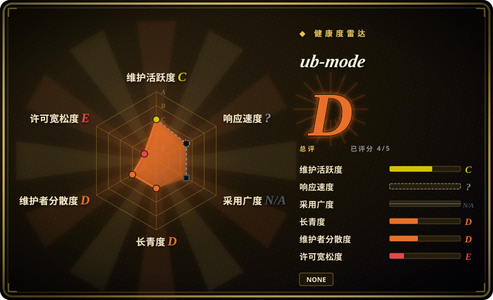
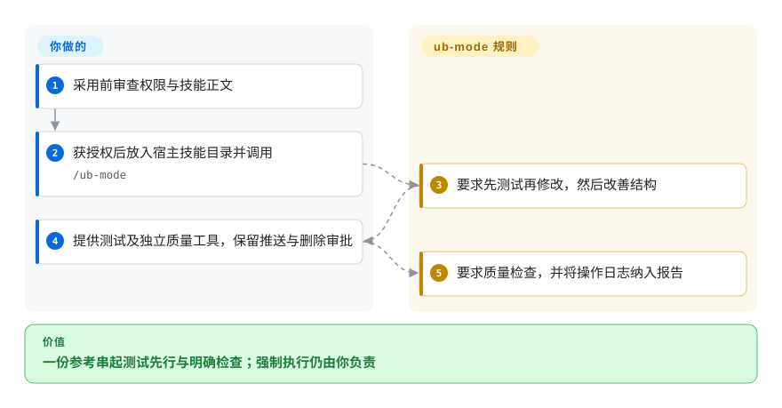
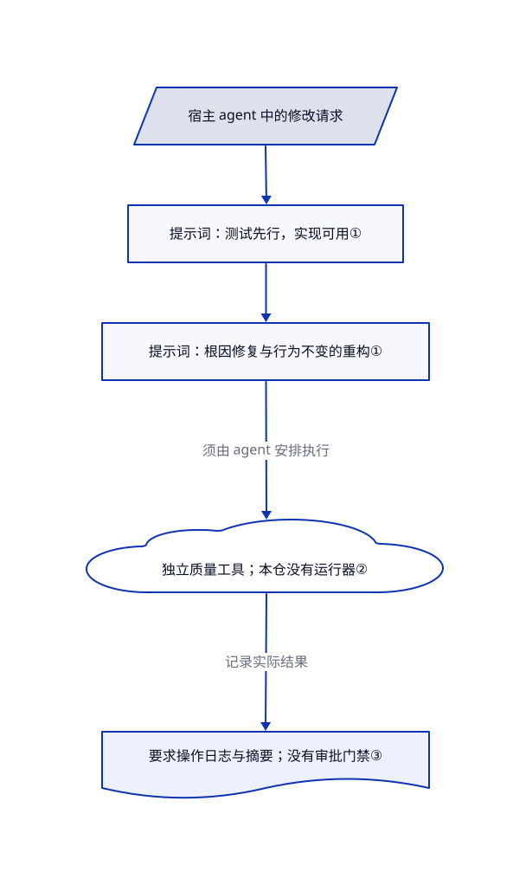

# ub-mode

agent 补到测试通过，却留下重复代码和无效测试。ub-mode 把测试先行和具体质量检查放进一份可读规则，但它不是可执行门禁。

## 何时使用

你维护一个代码库，agent 为修一条失败测试又加一个特殊分支，然后宣布完成。你想先读一份紧凑的工程清单，而不是接入整套插件框架。ub-mode 把工作分成实现可用、改善结构、记录实践三个阶段。它的特点是将短提示词与复杂度、重复代码、变异测试工具配对，但工具本身在别的仓库。

先把它当作参考材料阅读。已审查仓库只有 `README.md` 和 `SKILL.md`，没有许可文件，两份正文也没有明确许可授予。本页只介绍材料，不授予复制或重分发权限。

## 何时不用

- **你要现成的计划与执行流程。** 选 [Superpowers](superpowers.zh.md)，它分别提供计划、测试先行实现和验证技能；ub-mode 只有一份提示词，没有内置编排器。
- **你要跨会话积累经验。** 选 [Compound Engineering](compound-engineering.zh.md)，它明确把解决方案写成笔记供下次读取；ub-mode 要求记录操作和保留摘要，但没有持久化实现。
- **你要可执行 hook 和记忆底座。** 评估 [ECC](ecc.zh.md)。ub-mode 不安装配套工具，也没有调用工具的程序；实际检查仍须由你的 CI 单独执行和拦截。
- **你的流程禁止自主推送或清理磁盘。** 优先审查 [Superpowers](superpowers.zh.md) 的流程，并保留自己的权限门禁。ub-mode 的实践段要求推送主线和回收磁盘，却没有审批机制。[问题 2](https://github.com/unclebob/ub-mode/issues/2) 已指出这两项指令。
- **你要求明确的复用许可。** 可考虑采用 MIT 的 [Superpowers](superpowers.zh.md)，不要把文件公开或 README 的安装建议当作完整许可授予。

## 横向对比

| 替代品 | 是否收录 | 我们的评价 | 取舍 |
|---|---|---|---|
| [Superpowers](superpowers.zh.md) | 已收录 | 需要可安装的计划到验证流程，选 Superpowers；只想阅读一份工程清单，可把 ub-mode 当紧凑参考。 | Superpowers 有更多流程资产和宿主集成需要审查，而 ub-mode 只有两份文件；前者还有明确的 MIT 许可。 |
| [Compound Engineering](compound-engineering.zh.md) | 已收录 | 下一次任务必须复用上次经验，选 Compound Engineering；ub-mode 只要求记录操作。 | 专门的解决方案文件和多阶段插件带来额外约定，小型参考 ub-mode 没有这套结构。 |
| [ECC](ecc.zh.md) | 已收录 | 需求包含会话 hook 和持久记忆，选 ECC；不想继承运行时，只想读原则时再看 ub-mode。 | ECC 有可执行组件，信任面大得多；ub-mode 把工具安装、强制执行和存储都留给你。 |

## 快速上手

先读固定版本的 [README](https://github.com/unclebob/ub-mode/blob/57a8bdd28e45ed41900ace0bafa2ff76dd9ed70f/README.md#L18-L20)，采用文件前先核清复用权限。README 描述的路径是把 `SKILL.md` 放到宿主 agent 技能目录下的 `ub-mode/SKILL.md`，再调用 `/ub-mode`；这是文档路径，本次没有实际安装。你提供兼容的 agent、模型访问及费用、代码库、测试命令和单独安装的质量工具。技能要求 agent 按实现、改善、实践的顺序工作，但不运行服务，也不自行验证遵守情况。推送和删除权限须放在提示词之外，依赖前还要验证宿主加载行为。

<!-- flow-steps:begin (generated from flows/ub-mode.json by tools/flow_card.py — do not edit) -->

流程文字版

1. **你**：采用前审查权限与技能正文
2. **你**：获授权后放入宿主技能目录并调用 — `/ub-mode`
3. **ub-mode**：要求先测试再修改，然后改善结构
4. **你**：提供测试及独立质量工具，保留推送与删除审批
5. **ub-mode**：要求质量检查，并将操作日志纳入报告

**价值**：一份参考串起测试先行与明确检查；强制执行仍由你负责

<!-- flow-steps:end -->

## 技术要点

<!-- mechanism:begin (generated from mechanisms/ub-mode.json by tools/mechanism_card.py; do not edit) -->

机制文字版

- 宿主 agent 中的修改请求
- 提示词：测试先行，实现可用①
- 提示词：根因修复与行为不变的重构①
- 独立质量工具；本仓没有运行器②
- 要求操作日志与摘要；没有审批门禁③

- 宿主 agent 中的修改请求 → 提示词：测试先行，实现可用①
- 提示词：测试先行，实现可用① → 提示词：根因修复与行为不变的重构①
- 提示词：根因修复与行为不变的重构① → 独立质量工具；本仓没有运行器②（须由 agent 安排执行）
- 独立质量工具；本仓没有运行器② → 要求操作日志与摘要；没有审批门禁③（记录实际结果）

<!-- mechanism:end -->

### 1. 将实现可用与结构改善分开

- **解决：** 眼前测试通过后，补丁仍可能充满脆弱的特殊分支。
- **做法：** 规则在第一阶段安排测试先行、领域结构和边界设计，第二阶段安排根因修复、行为测试和重构。当有意义的测试不可行时，它允许不写虚假的测试。
- **边界：** 这是发给模型的指令，不是状态机或测试运行器。仓库没有验证阶段切换或审查跳过测试理由的实现。
- **源码：** [实现与改善规则](https://github.com/unclebob/ub-mode/blob/57a8bdd28e45ed41900ace0bafa2ff76dd9ed70f/SKILL.md#L16-L129)。

### 2. 指定具体检查，但不内置执行

- **解决：** 泛泛要求改善质量，无法给 agent 一个可测量目标。
- **做法：** 提示词指定 Crapper 的单函数 CRAP 低于 10、Dryer 消除排名至少 0.8 的重复，以及 Mutator 检查遗漏行为。CRAP 结合复杂度和测试覆盖率；变异测试会修改代码，检查测试能否发现变化。README 链接四个配套仓库，其中包括查看器。
- **边界：** 这里只提供工具名和目标，没有命令语法、安装流程、语言兼容表或 CI 接入。尚未关闭的问题 3 要求补充调用说明；本仓也没有基准测试。
- **源码：** [工具规则](https://github.com/unclebob/ub-mode/blob/57a8bdd28e45ed41900ace0bafa2ff76dd9ed70f/SKILL.md#L108-L129)、[配套工具描述](https://github.com/unclebob/ub-mode/blob/57a8bdd28e45ed41900ace0bafa2ff76dd9ed70f/README.md#L9-L16)、[问题 3](https://github.com/unclebob/ub-mode/issues/3)。

### 3. 保留执行历史，减少主线程上下文

- **解决：** 长任务会堆积上下文，也让修改原因难以追溯。
- **做法：** 实践规则要求记录每次操作及原因，结束时报告，并将大块材料移出主线程，只保留摘要。它还描述工作树清理和小步提交。
- **边界：** 没有日志格式、存储后端、摘要器、清理检查器或审批门禁。结尾的推送指令只是行为要求，不等于用户授权。
- **源码：** [实践规则](https://github.com/unclebob/ub-mode/blob/57a8bdd28e45ed41900ace0bafa2ff76dd9ed70f/SKILL.md#L131-L152)。

## 健康度与可持续性

- **维护，2026-10-28：** 仓库于 10 月 25 日创建，默认分支仍指向当天的提交。GitHub 返回四次提交、一位贡献者，没有发布版或标签。这是新发布的材料，不是成熟版本线。
- **治理与支持：** 仓库属于个人账号 `unclebob`，两份文件没有治理或支持承诺。具名作者不等于持续维护保证。
- **年龄与关注：** 核实时仅跨三个日历日，却已有 3158 星。[推断：依据仓库年龄及可见历史] 目前没有有意义的林迪记录；关注量不能证明执行可靠或长期维护。
- **许可与来源：** README 明确注明部分内容来自 poteto 的规则。本仓没有声明许可；被归属来源当前采用什么许可，不能证明本次改写的完整授权链。评估复用时须保留这一区别。

## 存疑（未验证）

- [未验证：已读仓库没有许可授予或改写授权说明] 被归属来源到本次改写的完整授权链仍未核清；公开可见不等于有权复制或重分发。
- [未验证：本次只读审查明确排除安装和模型执行] 没有实测宿主加载、agent 遵守情况、实际质量改善、配套工具兼容性或模型费用。
- [推断：只掌握三个日历日的公开仓库历史] 不能从星数或作者声誉推断项目寿命。
