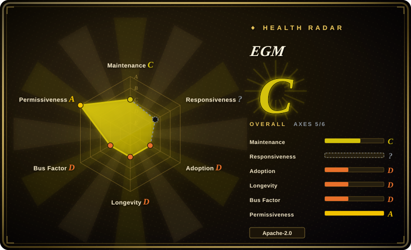
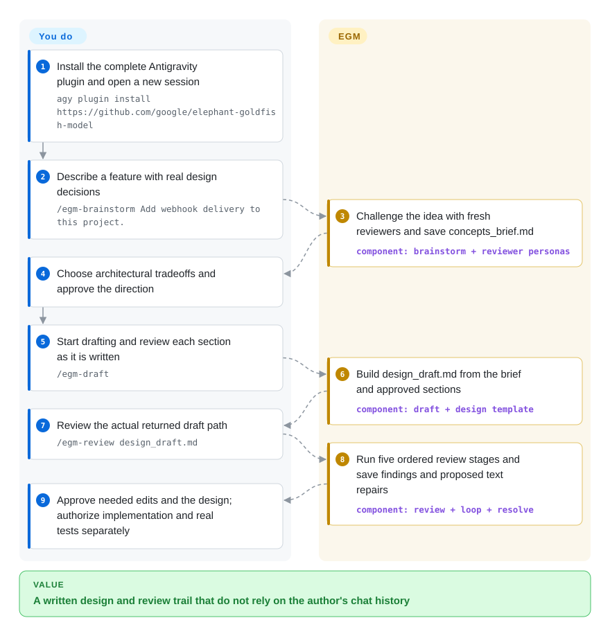
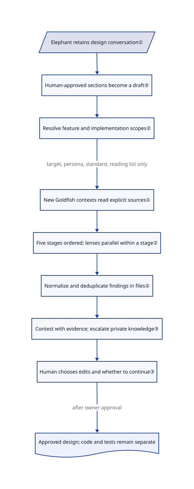

# Elephant-Goldfish Model (EGM)

Your agent agrees that a design is complete, but a new teammate cannot tell what retries or duplicate events should do. EGM keeps a context-rich author and fresh-context reviewers apart, then leaves architectural choices and approval with you.

## When to use

You are designing webhook delivery, a storage change or another feature with real failure-mode decisions. The agent that helped invent the design now silently fills gaps from your earlier conversation, so asking it to review itself misses assumptions a new implementer cannot know. Install EGM when you want to turn that conversation into a file-backed specification and test its clarity, design rationale, codebase fit and implementation plan through new reviewer contexts before writing production code.

The Elephant is the ongoing author conversation; Goldfish are fresh reviewer tasks given the draft and explicit source context, not the earlier discussion. You resolve tradeoffs, approve each draft section and decide which findings deserve edits. This is a seven-skill plugin and persona collection, not model weights, a training method or a replacement coding runtime. Choose it over Spec Kit when independent reading of a design is the missing step, rather than a broader spec-to-task-to-code scaffold.

## When NOT to use

- **The bug and its fix are already clear.** Use your ordinary tested coding workflow, or [Superpowers](../coding-agent-harnesses/superpowers.md) for structured debugging and TDD. EGM's repeated design approvals add little to a mechanical repair.
- **You need the same package to implement and verify a feature.** Choose [Spec Kit](spec-kit.md) for a spec/plan/task implementation path, or Superpowers for test-first execution. EGM's design workflow explicitly prohibits production implementation; an approved spec still needs real tests and separate implementation authorization.
- **Your host cannot create fresh subagent contexts.** Use a human design review, or a supported host with that capability. EGM requires stopping rather than relabeling a same-thread critique as Goldfish review. A product name alone does not establish that its current session exposes the required tools.
- **You need cross-model independence or a proof of correctness.** Use separately selected model families plus executable acceptance checks, or formal verification when the claim requires it. The actual Claude adapter says `model: inherit`; fresh context is not statistical independence, a distinct model or a mathematical proof.
- **You want an unattended architect that chooses for you.** Use [Superpowers](../coding-agent-harnesses/superpowers.md) after explicitly approving its intended scope, or a team-owned fixed design template. EGM asks the owner to choose defensible architectural alternatives even when asked to pick one; its review loop also waits for human confirmation between rounds.
- **You need repository-wide maintenance triage, not a feature design.** Choose [Improve](improve.md). It starts from code evidence and ranks work; EGM starts from a document or concept to challenge.
- **You cannot expose project details to the chosen host.** Use a locally approved model/host or a human reviewer under your organization's data rules. Review inputs, quoted outputs, transcripts and backups follow the host's policies; EGM context isolation is not filesystem isolation or deletion of provider copies.
- **You require verified cloud workflow parity or vendor support.** Use a locally validated supported host, or obtain a supported product contract. The upstream test record leaves Cowork and ChatGPT Work trace gaps open, and the README explicitly says this is not an officially supported Google product.

## Comparison

| Alternative | In index | Our verdict | Tradeoff |
| --- | --- | --- | --- |
| [Spec Kit](spec-kit.md) | Indexed | Choose Spec Kit when the team needs a repeatable spec-to-plan-to-task-to-code trail; choose EGM when fresh readers must challenge the design before implementation. | Spec Kit adds a Python CLI and project scaffold; EGM uses plugin resources, reviewer lenses and repeated human design decisions. Neither makes generated code correct by declaration. |
| [Superpowers](../coding-agent-harnesses/superpowers.md) | Indexed | Choose Superpowers for the agent that will brainstorm, implement test-first and verify; choose EGM for a bounded design-only drafting and review workflow. | Broader lifecycle discipline versus a narrower author/reviewer context split. Combining both without clear phase ownership risks conflicting routing and approval rules. |
| [Improve](improve.md) | Indexed | Choose Improve when an existing repository must first reveal which maintenance work matters; choose EGM when you already have a feature or draft whose assumptions need challenge. | Improve prioritizes evidence-backed handoff plans; EGM supplies a staged review of one design and keeps adjudication with its original author and the human owner. |

## Quick start

Install the **whole plugin**, not only `skills/`: its instructions read `agents/`, standards under `resources/` and host integration guides. For Antigravity the documented command is `agy plugin install https://github.com/google/elephant-goldfish-model`; start a new session, then follow the webhook example below. In Claude Code use `claude plugin marketplace add google/elephant-goldfish-model`, then `claude plugin install egm@egm`, and invoke skills with the `/egm:` prefix. The Claude guide requires 2.1.271 or later for `omitClaudeMd`; permission to read the actual plugin resources remains necessary. Codex uses its marketplace and skill picker; check actual delegation tools before reviewing.

You provide the project, feature goals, source-reading scope, host account/model budget and architectural decisions. EGM instructs the host to save `concepts_brief.md`, build `design_draft.md` section by section and write stage reports; you review sections and choose findings to address. Use the actual returned draft path, not a guessed filename. Only after you approve the design do you leave the design workflow and authorize implementation plus executable acceptance checks.

For removal, disable or uninstall the plugin through the chosen host; exact removal commands were not established from the inspected upstream files. This does not restore modified Markdown. The [data notice](https://github.com/google/elephant-goldfish-model/blob/b3a35956759bf7f024af2ff061b2e0b44b438e4c/docs/privacy.md#L9-L31) says workspace artifacts persist until deleted and host transcripts/backups follow host policy. Keep needed designs and reports, restore unwanted document edits from your own versioned baseline, and check any custom artifact directory before deleting it. There is no documented EGM-wide rollback or provider-data erasure mechanism in the reviewed material.

<!-- flow-steps:begin (generated from flows/elephant-goldfish-model.json by tools/flow_card.py — do not edit) -->

Text version of the flow

1. **You**: Install the complete Antigravity plugin and open a new session — `agy plugin install https://github.com/google/elephant-goldfish-model`
2. **You**: Describe a feature with real design decisions — `/egm-brainstorm Add webhook delivery to this project.`
3. **EGM**: Challenge the idea with fresh reviewers and save concepts_brief.md — component: `brainstorm + reviewer personas`
4. **You**: Choose architectural tradeoffs and approve the direction
5. **You**: Start drafting and review each section as it is written — `/egm-draft`
6. **EGM**: Build design_draft.md from the brief and approved sections — component: `draft + design template`
7. **You**: Review the actual returned draft path — `/egm-review design_draft.md`
8. **EGM**: Run five ordered review stages and save findings and proposed text repairs — component: `review + loop + resolve`
9. **You**: Approve needed edits and the design; authorize implementation and real tests separately

**Value**: A written design and review trail that do not rely on the author's chat history

<!-- flow-steps:end -->

## Key techniques

<!-- mechanism:begin (generated from mechanisms/elephant-goldfish-model.json by tools/mechanism_card.py; do not edit) -->

Text version of the mechanism

- Elephant retains design conversation①
- Human-approved sections become a draft③
- Resolve feature and implementation scopes②
- New Goldfish contexts read explicit sources①
- Five stages ordered; lenses parallel within a stage②
- Normalize and deduplicate findings in files②
- Contest with evidence; escalate private knowledge③
- Human chooses edits and whether to continue③
- Approved design; code and tests remain separate

- Elephant retains design conversation① → Human-approved sections become a draft③
- Human-approved sections become a draft③ → Resolve feature and implementation scopes②
- Resolve feature and implementation scopes② → New Goldfish contexts read explicit sources① (target, persona, standard, reading list only)
- New Goldfish contexts read explicit sources① → Five stages ordered; lenses parallel within a stage②
- Five stages ordered; lenses parallel within a stage② → Normalize and deduplicate findings in files②
- Normalize and deduplicate findings in files② → Contest with evidence; escalate private knowledge③
- Contest with evidence; escalate private knowledge③ → Human chooses edits and whether to continue③
- Human chooses edits and whether to continue③ → Approved design; code and tests remain separate (after owner approval)

<!-- mechanism:end -->

### 1. Split author memory from the reviewer's reading task

- **Problem:** An author conversation can silently supply facts that the design file never records.
- **How:** Each Goldfish receives the target, persona, standard and explicit context in a new native subagent. The Claude comprehension adapter restricts tools to Read/Grep/Glob, inherits the model, omits user/project instruction files and requires reporting an incomplete review if needed resources cannot be read. Its canonical persona checks definitions across the whole draft before flagging a missing explanation.
- **Limits:** Shared personas alone do not enforce host tool restrictions. No subagent tool means no Goldfish review; no nesting means direct dispatch. Claude's guide distinguishes context/tool isolation from filesystem isolation, and an inherited model is not cross-model independence.
- **Source:** [Actual Claude adapter](https://github.com/google/elephant-goldfish-model/blob/b3a35956759bf7f024af2ff061b2e0b44b438e4c/.claude-plugin/agents/comprehension.md#L1-L17), [canonical comprehension checks](https://github.com/google/elephant-goldfish-model/blob/b3a35956759bf7f024af2ff061b2e0b44b438e4c/agents/comprehension.md#L34-L45), [delegation boundary](https://github.com/google/elephant-goldfish-model/blob/b3a35956759bf7f024af2ff061b2e0b44b438e4c/skills/egm_review/SKILL.md#L19-L28), [actual isolation scope](https://github.com/google/elephant-goldfish-model/blob/b3a35956759bf7f024af2ff061b2e0b44b438e4c/docs/claude.md#L102-L130).

### 2. Review design and implementation at different scopes

- **Problem:** A reviewer can criticize implementation detail as if it were a product requirement, or review stale line ranges after edits.
- **How:** Review intake locates the implementation-plan heading and separates the feature portion from implementation detail. The complete flow sequences zoom-out, comprehension, design critique, another zoom-out and implementation readiness. The configurable loop re-resolves the semantic target before every iteration. Reviewers within one stage can run concurrently; a synthesizer can deduplicate findings and write a file without forwarding all raw output to the main conversation.
- **Limits:** Ambiguous boundaries need human selection. Uninterrupted mode skips checkpoints, not stage dependencies. The standard review caps stage re-audits at one and can advance with residual tradeoffs; the general review loop instead waits for explicit human continuation. Neither zero findings nor advancement certifies correctness or bounded total cost.
- **Source:** [Scope discovery](https://github.com/google/elephant-goldfish-model/blob/b3a35956759bf7f024af2ff061b2e0b44b438e4c/skills/egm_review/SKILL.md#L161-L205), [re-audit cap and five stages](https://github.com/google/elephant-goldfish-model/blob/b3a35956759bf7f024af2ff061b2e0b44b438e4c/skills/egm_review/SKILL.md#L245-L292), [semantic re-resolution and human continuation](https://github.com/google/elephant-goldfish-model/blob/b3a35956759bf7f024af2ff061b2e0b44b438e4c/skills/egm_review_loop/SKILL.md#L97-L150), [stage ordering](https://github.com/google/elephant-goldfish-model/blob/b3a35956759bf7f024af2ff061b2e0b44b438e4c/docs/claude.md#L36-L44), [synthesis](https://github.com/google/elephant-goldfish-model/blob/b3a35956759bf7f024af2ff061b2e0b44b438e4c/agents/synthesizer.md#L35-L58).

### 3. Require checkable objections and human-owned repairs

- **Problem:** The author can dismiss criticism with private intent, or a reviewer can push edits based on facts it never had.
- **How:** The resolver labels each finding CONTEST, ESCALATE, PROPOSE FIX or DECLINE. A contest must cite evidence accessible to the reviewer; private team knowledge escalates to the human. It saves the proposed repairs and yields before applying approved changes. Drafting separately requires owner selection for defensible architecture choices and section approval; execution instructions prohibit production code during design.
- **Limits:** These are host-executed prompt procedures, not a transaction system or runtime safety proof. Auto-accept applies proposed text edits, not all findings and not production authorization. Artifact deletion cannot undo already edited documents, and a resolved report does not establish that an implementation was tested.
- **Source:** [Evidence-based classification](https://github.com/google/elephant-goldfish-model/blob/b3a35956759bf7f024af2ff061b2e0b44b438e4c/skills/egm_resolve/SKILL.md#L54-L82), [approval and edits](https://github.com/google/elephant-goldfish-model/blob/b3a35956759bf7f024af2ff061b2e0b44b438e4c/skills/egm_resolve/SKILL.md#L110-L144), [architectural owner](https://github.com/google/elephant-goldfish-model/blob/b3a35956759bf7f024af2ff061b2e0b44b438e4c/skills/egm_draft/SKILL.md#L63-L71), [section approval](https://github.com/google/elephant-goldfish-model/blob/b3a35956759bf7f024af2ff061b2e0b44b438e4c/skills/egm_draft/SKILL.md#L87-L139), [design-only constraint](https://github.com/google/elephant-goldfish-model/blob/b3a35956759bf7f024af2ff061b2e0b44b438e4c/resources/execution_instructions.md#L3-L20).

## Health & viability

- **Maintenance, 2026-10-27:** public, non-fork, not archived; first release v0.1.0 was published October 27 and the reviewed main commit is `b3a3595`. Installable skills, reviewer personas and packaging/testing code make this more than the original essay. The 63 Claude distribution files match this repository's own canonical files; the [runtime packer](https://github.com/google/elephant-goldfish-model/blob/b3a35956759bf7f024af2ff061b2e0b44b438e4c/scripts/pack_plugin.py#L12-L53) explicitly packages shared resources and host adapters, not another vendor's bundle.
- **Governance and backing:** Google owns the repository; contributions require the [Google CLA](https://github.com/google/elephant-goldfish-model/blob/b3a35956759bf7f024af2ff061b2e0b44b438e4c/CONTRIBUTING.md#L76-L93). The scorer finds eight active contributors, but 86.7% of commits belong to the top contributor, grading governance D. That does not create a support contract: the [README disclaimer](https://github.com/google/elephant-goldfish-model/blob/b3a35956759bf7f024af2ff061b2e0b44b438e4c/README.md#L124-L126) explicitly denies official Google product support.
- **Age and adoption:** created September 13, only 44 days old. The Lindy record is short regardless of organization or stars. [Unverified: author claim without independent usage evidence] The README says thousands of Google engineers use EGM; this review did not establish active installations, outcome improvement or reduced defects.
- **Verification maturity:** the [upstream test record](https://github.com/google/elephant-goldfish-model/blob/b3a35956759bf7f024af2ff061b2e0b44b438e4c/TESTING.md#L89-L134) describes October 22 fixtures for Antigravity, Claude Code and Codex, retaining limitations and cloud evidence gaps. These are upstream reports, not runs performed for this page. It explicitly rejects child receipts and parent summaries as substitutes for native tool evidence.
- **License and data risk:** the actual [Apache-2.0 text](https://github.com/google/elephant-goldfish-model/blob/b3a35956759bf7f024af2ff061b2e0b44b438e4c/LICENSE#L67-L152) includes patent terms, redistribution conditions and no warranty. Source notices identify Google LLC. Its [privacy notice](https://github.com/google/elephant-goldfish-model/blob/b3a35956759bf7f024af2ff061b2e0b44b438e4c/docs/privacy.md#L5-L38) documents no separate EGM service or credentials, but inputs and reports can carry confidential data through the host. Bootstrap may invoke discovery commands and a configured formatter; authorize those separately rather than treating design-only as a blanket no-command sandbox.
- **Automated signal:** overall C covers five of six axes. Maintenance C reflects one active week in the measured window; adoption D reflects only five release-asset downloads, not the README's internal-user claim. Responsiveness is unknown. A launch-day measurement cannot establish long-term support or meaningful adoption.

## Caveats (unverified)

- [Unverified: upstream execution, installation and model calls were excluded] No EGM workflow, host isolation probe or quality claim was reproduced. Upstream fixture records are attributed documentation, not independent acceptance evidence from this review.
- [Unverified: no independent usage dataset] “Thousands of Google engineers” is the README author's adoption claim, not measured installations, business benefit or mathematical correctness.
- [Unverified: no host uninstall or retention experiment] Exact removal commands, host-side transcript/backup deletion and recovery behavior were not established. Local artifact persistence is documented; uninstalling a plugin is not data erasure or rollback of edits.
- [Unverified: selected runtime and manifest paths, not a full-tree security audit] No harmful payload was identified in the inspected sources. This does not certify every script or host extension; model costs, file access and command authorization remain with the host and user.
