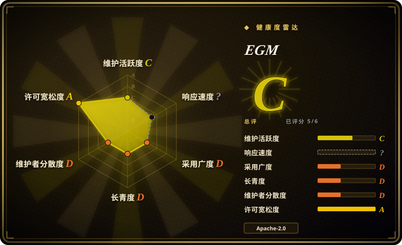
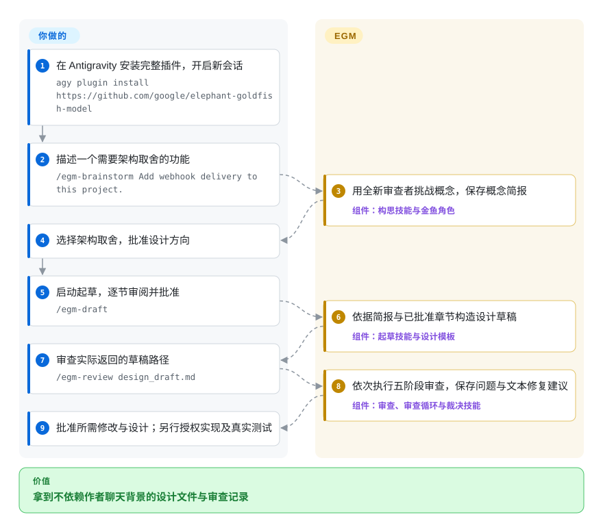
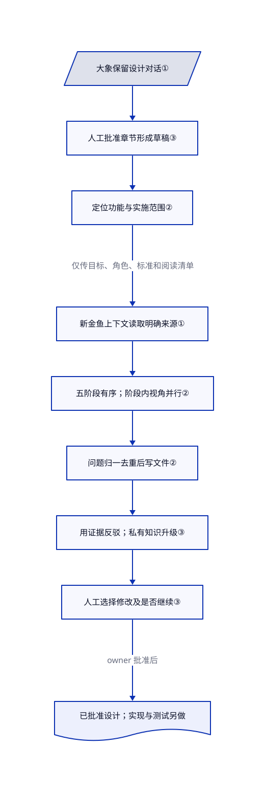

# Elephant-Goldfish Model (EGM)

agent 说设计已完整，新同事却看不出重试和重复事件该怎么处理。EGM 把保留背景的作者和全新上下文的审查者分开，再把架构取舍与批准留给你。

## 何时使用

你在设计 webhook 投递、存储变更，或其他需要讨论失败场景的功能。帮你构思的 agent 会默默用前文补足空白，导致自审看不出新实施者缺少哪些信息。希望先把对话变成规格文件，再让新审查上下文检查可理解性、设计依据、代码适配和实施计划时，选 EGM；生产实现留到设计获批之后。

大象是持续写作的主会话；金鱼是只拿到草稿与明确来源材料的新审查任务，不继承之前的讨论。你负责取舍、逐节批准，并决定哪些意见值得修改。它是七个技能和审查角色组成的插件，不是模型权重、训练方法或另一套编码运行时。比起 Spec Kit，若你缺的环节是“让新读者挑战设计”，而不是更广的规格到任务再到代码骨架，更适合选它。

## 何时不用

- **问题与修法已经清楚。** 用日常有测试的编码流程，或用 [Superpowers](../coding-agent-harnesses/superpowers.zh.md) 做结构化排错与 TDD。机械修复不需要反复批准设计。
- **你希望同一套工具实现并验证功能。** 要规格、方案、任务到实现，选 [Spec Kit](spec-kit.zh.md)；要测试先行执行，选 Superpowers。EGM 设计工作流明确禁止生产实现；批准规格后仍要另行授权实施并跑真实测试。
- **当前宿主不能创建全新子代理上下文。** 改用人工设计评审，或换成具备该能力的受支持宿主。EGM 要求停止，不能把同会话批评改叫金鱼审查；产品名本身不能证明当前会话提供所需工具。
- **你要求跨模型独立或正确性证明。** 改用独立选择的模型家族加可执行验收；需要证明时使用形式化验证。实际 Claude 适配器写的是 `model: inherit`，新上下文不等于统计独立、换模型或数学证明。
- **你希望无人值守的架构师替你定方案。** 明确批准范围后，可用 [Superpowers](../coding-agent-harnesses/superpowers.zh.md)，或用团队自定的固定设计模板。EGM 对有多种合理答案的架构要求人选，即使你让它代选也会再问；审查循环也会等人确认后才续轮。
- **你要全仓维护排查，而不是某个功能的设计。** 选 [Improve](improve.zh.md)。它从代码证据出发排序任务；EGM 从待挑战的文档或概念开始。
- **你不能向所选宿主暴露项目细节。** 用组织批准的本地模型与宿主，或按数据规则进行人工评审。输入、引用输出、会话和备份都遵循宿主政策；上下文隔离不是文件系统隔离，也不会删除提供商副本。
- **你要求已验证的云端能力一致性或厂商支持。** 选本地验证过的受支持宿主，或另行取得支持合同。上游测试记录仍保留 Cowork 与 ChatGPT Work 的轨迹证据缺口；README 明确说这不是 Google 官方支持的产品。

## 横向对比

| 替代品 | 是否收录 | 我们的评价 | 取舍 |
| --- | --- | --- | --- |
| [Spec Kit](spec-kit.zh.md) | 已收录 | 团队需要可重复的规格、方案、任务到代码线索时选 Spec Kit；缺少实现前的新读者挑战时选 EGM。 | Spec Kit 增加 Python CLI 与项目骨架；EGM 用插件资源、审查视角和反复的人工设计决定。两者都不能靠一句声明保证生成代码正确。 |
| [Superpowers](../coding-agent-harnesses/superpowers.zh.md) | 已收录 | 要 agent 构思、测试先行实现并验证，选 Superpowers；只要有明确边界的设计写作与审查，选 EGM。 | 更广的生命周期纪律，对比更窄的作者与审查上下文分工。两者叠加却不明确阶段归属，会引入路由与批准规则冲突。 |
| [Improve](improve.zh.md) | 已收录 | 现有仓库需要先找出值得维护的任务时选 Improve；已经有功能或草稿，要挑战其假设时选 EGM。 | Improve 优先输出有代码证据的交接计划；EGM 分阶段审查一个设计，由原作者和人类 owner 裁决。 |

## 快速上手

安装**完整插件**，不要只复制 `skills/`；指令还会读 `agents/`、`resources/` 下的标准和宿主指南。Antigravity 的文档命令是 `agy plugin install https://github.com/google/elephant-goldfish-model`，安装后开新会话，再照下图的 webhook 例子操作。Claude Code 则先用 `claude plugin marketplace add google/elephant-goldfish-model`，再用 `claude plugin install egm@egm`，调用时加 `/egm:` 前缀。Claude 指南要求 2.1.271 或更新版本来支持 `omitClaudeMd`，仍需批准实际插件资源的读取。Codex 走其插件市场与技能选择器；开始审查前要检查真实可用的委派工具。

你提供项目、功能目标、来源读取范围、宿主账号与模型预算，并做架构决定。EGM 指导宿主保存 `concepts_brief.md`，逐节构造 `design_draft.md`，再写阶段报告；你审阅章节并选择待处理问题。使用 agent 实际返回的草稿路径，不猜文件名。只有设计获你批准后，才离开设计工作流，另行授权实施与可执行验收。

停用或卸载通过所选宿主进行；所读上游材料未明确精确卸载命令。这不会恢复已改动的 Markdown。[数据声明](https://github.com/google/elephant-goldfish-model/blob/b3a35956759bf7f024af2ff061b2e0b44b438e4c/docs/privacy.md#L9-L31) 说工作区产物保留到用户删除，会话和备份按宿主规则保留。先保留需要的设计与报告，再从自己的版本基线恢复不需要的文档改动；删除前检查自定义产物目录。所读材料没有记载 EGM 全局回滚或提供商数据擦除机制。

<!-- flow-steps:begin (generated from flows/elephant-goldfish-model.json by tools/flow_card.py — do not edit) -->

流程文字版

1. **你**：在 Antigravity 安装完整插件，开启新会话 — `agy plugin install https://github.com/google/elephant-goldfish-model`
2. **你**：描述一个需要架构取舍的功能 — `/egm-brainstorm Add webhook delivery to this project.`
3. **EGM**：用全新审查者挑战概念，保存概念简报 — 组件：`构思技能与金鱼角色`
4. **你**：选择架构取舍，批准设计方向
5. **你**：启动起草，逐节审阅并批准 — `/egm-draft`
6. **EGM**：依据简报与已批准章节构造设计草稿 — 组件：`起草技能与设计模板`
7. **你**：审查实际返回的草稿路径 — `/egm-review design_draft.md`
8. **EGM**：依次执行五阶段审查，保存问题与文本修复建议 — 组件：`审查、审查循环与裁决技能`
9. **你**：批准所需修改与设计；另行授权实现及真实测试

**价值**：拿到不依赖作者聊天背景的设计文件与审查记录

<!-- flow-steps:end -->

## 技术要点

<!-- mechanism:begin (generated from mechanisms/elephant-goldfish-model.json by tools/mechanism_card.py; do not edit) -->

机制文字版

- 大象保留设计对话①
- 人工批准章节形成草稿③
- 定位功能与实施范围②
- 新金鱼上下文读取明确来源①
- 五阶段有序；阶段内视角并行②
- 问题归一去重后写文件②
- 用证据反驳；私有知识升级③
- 人工选择修改及是否继续③
- 已批准设计；实现与测试另做

- 大象保留设计对话① → 人工批准章节形成草稿③
- 人工批准章节形成草稿③ → 定位功能与实施范围②
- 定位功能与实施范围② → 新金鱼上下文读取明确来源①（仅传目标、角色、标准和阅读清单）
- 新金鱼上下文读取明确来源① → 五阶段有序；阶段内视角并行②
- 五阶段有序；阶段内视角并行② → 问题归一去重后写文件②
- 问题归一去重后写文件② → 用证据反驳；私有知识升级③
- 用证据反驳；私有知识升级③ → 人工选择修改及是否继续③
- 人工选择修改及是否继续③ → 已批准设计；实现与测试另做（owner 批准后）

<!-- mechanism:end -->

### 1. 分开作者记忆与审查读取任务

- **解决：** 作者会话可能悄悄提供设计文件从未记下的事实。
- **做法：** 每个金鱼在全新原生子代理中接收目标、角色、标准与明确上下文。Claude 的理解审查适配器仅允许 Read、Grep、Glob，继承模型，排除用户与项目指令文件；读不到必要资源就报告未完成。其规范角色会先查整篇草稿的定义，再判断解释是否缺失。
- **边界：** 共享角色文本本身不强制宿主工具限制。没有子代理工具就不能金鱼审查，不能嵌套时则直接委派。Claude 指南区分了上下文和工具隔离与文件系统隔离；继承模型不是跨模型独立。
- **源码：** [实际 Claude 适配器](https://github.com/google/elephant-goldfish-model/blob/b3a35956759bf7f024af2ff061b2e0b44b438e4c/.claude-plugin/agents/comprehension.md#L1-L17)、[规范理解检查](https://github.com/google/elephant-goldfish-model/blob/b3a35956759bf7f024af2ff061b2e0b44b438e4c/agents/comprehension.md#L34-L45)、[委派边界](https://github.com/google/elephant-goldfish-model/blob/b3a35956759bf7f024af2ff061b2e0b44b438e4c/skills/egm_review/SKILL.md#L19-L28)、[真实隔离范围](https://github.com/google/elephant-goldfish-model/blob/b3a35956759bf7f024af2ff061b2e0b44b438e4c/docs/claude.md#L102-L130)。

### 2. 分别审设计与实施，并重新定位范围

- **解决：** 审查者可能把实现细节当产品需求批评，也可能在文档改动后继续审旧行号。
- **做法：** 审查入口查找实施计划标题，分开功能部分与实施细节。完整流程依次做全局方向、理解、设计批评、再次全局检查和实施就绪评估。可配置循环每轮都重找语义目标；同阶段角色可以并行，汇总者去重后写文件，不把所有原始输出送回主会话。
- **边界：** 边界不明时要人选。不中断模式只跳过人工检查点，不跳过阶段依赖。标准审查每阶段最多复审一次，可能带着剩余取舍前进；通用循环则需人明确确认才续轮。零问题或进入下一阶段，都不证明正确或总费用有界。
- **源码：** [范围发现](https://github.com/google/elephant-goldfish-model/blob/b3a35956759bf7f024af2ff061b2e0b44b438e4c/skills/egm_review/SKILL.md#L161-L205)、[复审上限与五阶段](https://github.com/google/elephant-goldfish-model/blob/b3a35956759bf7f024af2ff061b2e0b44b438e4c/skills/egm_review/SKILL.md#L245-L292)、[语义重定位与人工续轮](https://github.com/google/elephant-goldfish-model/blob/b3a35956759bf7f024af2ff061b2e0b44b438e4c/skills/egm_review_loop/SKILL.md#L97-L150)、[阶段顺序](https://github.com/google/elephant-goldfish-model/blob/b3a35956759bf7f024af2ff061b2e0b44b438e4c/docs/claude.md#L36-L44)、[汇总](https://github.com/google/elephant-goldfish-model/blob/b3a35956759bf7f024af2ff061b2e0b44b438e4c/agents/synthesizer.md#L35-L58)。

### 3. 用可查证据反驳，由人批准修复

- **解决：** 作者可能用私下意图驳回批评，审查者也可能凭没拿到的事实推动修改。
- **做法：** 裁决者把问题分为 CONTEST、ESCALATE、PROPOSE FIX、DECLINE。反驳必须引用审查者可读的证据；私下团队知识要升级给人。它保存建议修改并停下，批准后才编辑。起草阶段还要求 owner 选择合理架构方案并逐节批准，执行指令则禁止设计期间写生产代码。
- **边界：** 这些由宿主执行的提示词流程，不是事务系统或运行时安全证明。批量接受只应用提议的文本修改，不包含全部意见，更不是生产授权。删除报告不能撤销已编辑文档，报告标记已处理也不证明实现经过测试。
- **源码：** [证据分类](https://github.com/google/elephant-goldfish-model/blob/b3a35956759bf7f024af2ff061b2e0b44b438e4c/skills/egm_resolve/SKILL.md#L54-L82)、[批准与编辑](https://github.com/google/elephant-goldfish-model/blob/b3a35956759bf7f024af2ff061b2e0b44b438e4c/skills/egm_resolve/SKILL.md#L110-L144)、[架构 owner](https://github.com/google/elephant-goldfish-model/blob/b3a35956759bf7f024af2ff061b2e0b44b438e4c/skills/egm_draft/SKILL.md#L63-L71)、[逐节批准](https://github.com/google/elephant-goldfish-model/blob/b3a35956759bf7f024af2ff061b2e0b44b438e4c/skills/egm_draft/SKILL.md#L87-L139)、[只做设计](https://github.com/google/elephant-goldfish-model/blob/b3a35956759bf7f024af2ff061b2e0b44b438e4c/resources/execution_instructions.md#L3-L20)。

## 健康度与可持续性

- **维护，截至 2026-10-27：** 公开、非 fork、未归档；首个发布 v0.1.0 在 10 月 27 日发布，研究基于 main 提交 `b3a3595`。可安装技能、审查角色和打包测试代码，使它不只是起源文章。63 份 Claude 发布目录文件均与本仓规范文件一致；[运行包构造器](https://github.com/google/elephant-goldfish-model/blob/b3a35956759bf7f024af2ff061b2e0b44b438e4c/scripts/pack_plugin.py#L12-L53) 明确打包共享资源和宿主适配器，不是其他厂商的素材包。
- **治理与背景：** 仓库由 Google 持有，贡献要求 [Google CLA](https://github.com/google/elephant-goldfish-model/blob/b3a35956759bf7f024af2ff061b2e0b44b438e4c/CONTRIBUTING.md#L76-L93)。评分器找到八名活跃贡献者，但首位占提交的 86.7%，治理为 D。这不构成支持合同；[README 声明](https://github.com/google/elephant-goldfish-model/blob/b3a35956759bf7f024af2ff061b2e0b44b438e4c/README.md#L124-L126) 明确说不是 Google 官方支持的产品。
- **年龄与采用：** 9 月 13 日创建，仅 44 天；组织背景和星标都不能补足短暂的 Lindy 记录。[未验证：只有作者声明，没有独立使用数据] README 说数千名 Google 工程师在用；本轮未建立活跃安装量、效果改善或缺陷减少的证据。
- **验证成熟度：** [上游测试记录](https://github.com/google/elephant-goldfish-model/blob/b3a35956759bf7f024af2ff061b2e0b44b438e4c/TESTING.md#L89-L134) 记载 10 月 22 日 Antigravity、Claude Code、Codex 的固定用例，并保留局限与云端证据缺口。这些是上游报告，不是本页研究时运行的结果。文档明确拒绝用子代理自写凭条和父会话总结代替原生工具证据。
- **许可与数据风险：** 真实 [Apache-2.0 文本](https://github.com/google/elephant-goldfish-model/blob/b3a35956759bf7f024af2ff061b2e0b44b438e4c/LICENSE#L67-L152) 包含专利条款、再分发条件和无担保条款，源码声明标注 Google LLC。[隐私说明](https://github.com/google/elephant-goldfish-model/blob/b3a35956759bf7f024af2ff061b2e0b44b438e4c/docs/privacy.md#L5-L38) 说没有单独的 EGM 服务或凭据，但输入与报告可能经宿主携带机密数据。Bootstrap 可调用发现命令和已有格式化器，应单独授权，不能把只做设计理解成禁止命令的沙箱。
- **自动信号：** 综合 C，六轴中五轴有分。维护 C 反映统计窗口内仅一个活跃周；采用 D 只反映五次发布附件下载，不是 README 的内部用户声明。响应度未知。首发当天的测量不能建立长期支持或有效采用证据。

## 存疑（未验证）

- [未验证：本轮禁止执行、安装和模型调用] 没有复现 EGM 流程、宿主隔离探针或质量宣传。上游固定用例记录是注明来源的文档，不是本轮独立验收证据。
- [未验证：没有独立使用数据] “数千名 Google 工程师使用”来自 README 作者声明，不是安装量、业务收益或数学正确性的实测。
- [未验证：未做宿主卸载或留存实验] 未明确精确卸载命令、宿主会话与备份删除和恢复行为。本地产物持久化有文档说明；卸载插件不等于数据擦除或文档回滚。
- [未验证：仅读部分运行资源和清单，未做全树安全审计] 所读源码未发现恶意载荷，不代表认证每个脚本与宿主扩展。模型费用、文件读取和命令授权仍由宿主与用户控制。
