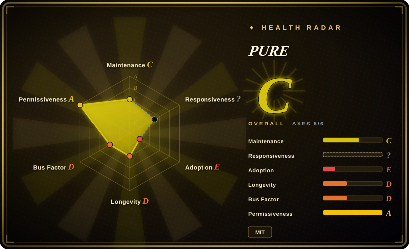
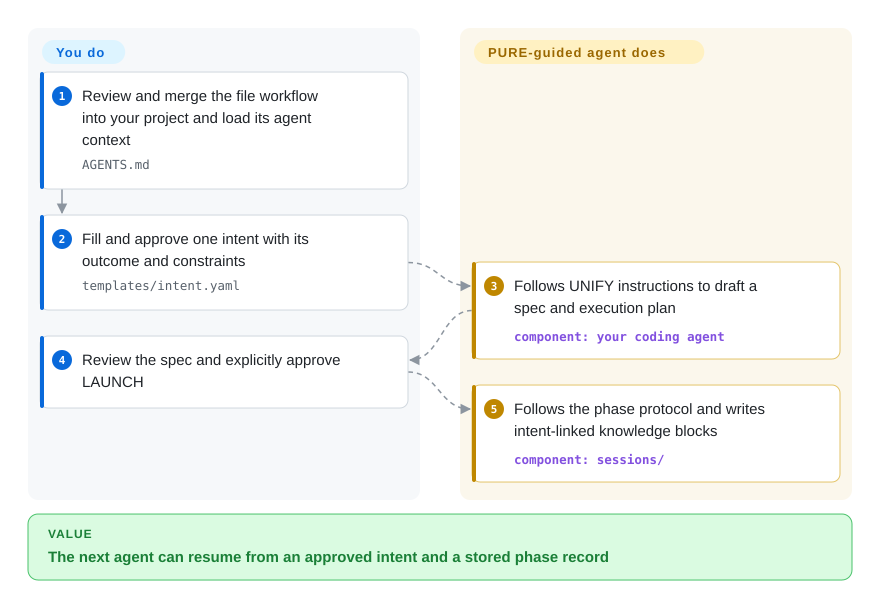
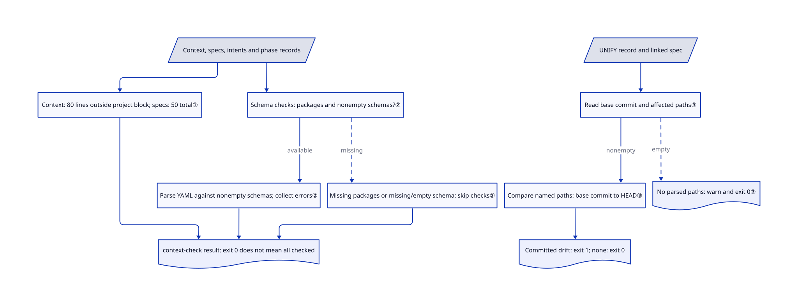

# PURE

Your next coding-agent session forgets which requirement was approved; PURE records intent, spec and phase handoffs in files, with small scripts to check parts of that trail.

## When to use

You're operating coding agents across more than one session and need every deliverable to remain traceable to an approved intent. Plain prompts are no longer enough: you want compact specs, explicit human gates, machine-readable handoffs, a registry that routes work by capability, and a durable session record that a fresh agent can resume without replaying the whole conversation.

You choose PURE over a prose-only methodology when you want those rules embodied in files, JSON schemas, and small scripts that can fail a check. Its main tradeoff is deliberate structure: it remains provider- and harness-neutral at the document level, but adopting it means accepting its PURPOSE→UNIFY→LAUNCH→SHIELD→EVOLVE lifecycle and repository layout.

## When NOT to use

- **You need a maintained entry point and wider adoption evidence.** Compare [Superpowers](../coding-agent-harnesses/superpowers.md) or [Spec Kit](spec-kit.md); PURE's latest main change is 2026-05-26, with one v0.1.0 release and no independent adoption signal. That is not a claim that its substitutes have multi-year histories.
- **You want only design principles, not repository machinery.** Use [12-Factor Agents](12-factor-agents.md) or [USDAD](usdad.md) instead; PURE adds intents, specs, sessions, registries, schemas, hooks, scripts, and archive conventions.
- **You need a vendor-supported spec CLI and generated project scaffolding.** Use [Spec Kit](spec-kit.md) instead; PURE's integration layer is plain files and Shell scripts that you wire into your chosen harness.
- **You expect scripts to prove that an agent obeyed every human gate.** Use your project's tests/permission controls alongside a workflow such as Spec Kit; PURE's Markdown rules are instructions, while its executable checks inspect file budgets and selected data, not agent obedience.
- **Your environment only has stock macOS/BSD utilities or no Bash.** Prefer Spec Kit's appropriate platform helpers, or adapt PURE deliberately; `new-intent.sh` uses `grep -P`, and freshness checking uses `mapfile`, which is absent in Apple's old Bash. The plain copy recipe is not a portability guarantee.
- **You need shared learning or a signed enterprise registry already running.** Start with ordinary reviewed Git files and Spec Kit rather than treating PURE's Tier 2/3 sketches as deployed services; its higher tiers require your own implementation and integration.

## Comparison

| Alternative | In index | Our verdict | Tradeoff |
|---|---|---|---|
| [Superpowers](../coding-agent-harnesses/superpowers.md) | ✅ | Choose Superpowers when installable cross-harness SDLC skills matter more than explicit intent and knowledge-block schemas; choose PURE when the auditable file protocol is the deciding requirement. | Superpowers is easier to activate and has broader mindshare; PURE exposes more project state as versioned data but requires repository adoption. |
| [Spec Kit](spec-kit.md) | ✅ | Choose Spec Kit when a vendor-backed CLI and generated spec workflow are preferred; choose PURE when provider-neutral registries, A2A handoffs, and phase records matter more. | Spec Kit brings a larger ecosystem and polished entry point; PURE is more transparent and decentralized but much younger. |
| [USDAD](usdad.md) | ✅ | Choose USDAD when you want a readable historical spec-first methodology to tailor manually; choose PURE when scripts, schemas, tests, and registries must accompany the method. | USDAD has less machinery and lower setup cost; PURE offers executable checks at the cost of more repository structure. |

## Quick start

Clone the actual `JonB32/pure-agentic` repository into a staging directory, then review and merge its context files, registry, templates, role/skill files and scripts into your project without overwriting existing agent rules. The names `your-org` and `pure-approach` in upstream examples are placeholders, not another required dependency; keep the `intents/`, `specs/`, `sessions/` directories and `schemas/` as well, because the minimal copy recipe omits files the checks consume. For a first intent, copy `templates/intent.yaml` into `intents/INT-0001.yaml`, fill the desired result, constraints and exclusions, and record your approval. Load the reviewed `AGENTS.md` in your coding harness, ask for UNIFY, review the generated spec, then explicitly approve LAUNCH ([QUICKSTART.md:22–65](https://github.com/JonB32/pure-agentic/blob/ddadf731f1f6cff5c9761cd4c09408c0a5b82d22/QUICKSTART.md#L22-L65)). The protocol directs your agent to write specs and phase knowledge blocks; you supply the agent/model, pay its usage costs, approve gates and wire real project tests and checks into CI. This is file-based workflow adoption, not a running model service or a guaranteed autonomous delivery engine.

<!-- flow-steps:begin (generated from flows/pure-agentic.json by tools/flow_card.py — do not edit) -->

Text version of the flow

1. **You**: Review and merge the file workflow into your project and load its agent context — `AGENTS.md`
2. **You**: Fill and approve one intent with its outcome and constraints — `templates/intent.yaml`
3. **PURE**: Follows UNIFY instructions to draft a spec and execution plan — component: `your coding agent`
4. **You**: Review the spec and explicitly approve LAUNCH
5. **PURE**: Follows the phase protocol and writes intent-linked knowledge blocks — component: `sessions/`

**Value**: The next agent can resume from an approved intent and a stored phase record

<!-- flow-steps:end -->

## Key techniques

<!-- mechanism:begin (generated from mechanisms/pure-agentic.json by tools/mechanism_card.py; do not edit) -->

Text version of the mechanism

- Context, specs, intents and phase records
- Context: 80 lines outside project block; specs: 50 total①
- Schema checks: packages and nonempty schemas?②
- Parse YAML against nonempty schemas; collect errors②
- Missing packages or missing/empty schema: skip checks②
- context-check result; exit 0 does not mean all checked
- UNIFY record and linked spec
- Read base commit and affected paths③
- Compare named paths: base commit to HEAD③
- No parsed paths: warn and exit 0③
- Committed drift: exit 1; none: exit 0

- Context, specs, intents and phase records → Context: 80 lines outside project block; specs: 50 total①
- Context: 80 lines outside project block; specs: 50 total① → context-check result; exit 0 does not mean all checked
- Context, specs, intents and phase records → Schema checks: packages and nonempty schemas?②
- Schema checks: packages and nonempty schemas?② → Parse YAML against nonempty schemas; collect errors② (available)
- Schema checks: packages and nonempty schemas?② → Missing packages or missing/empty schema: skip checks② (missing) [optional/fallback]
- Parse YAML against nonempty schemas; collect errors② → context-check result; exit 0 does not mean all checked
- Missing packages or missing/empty schema: skip checks② → context-check result; exit 0 does not mean all checked
- UNIFY record and linked spec → Read base commit and affected paths③
- Read base commit and affected paths③ → Compare named paths: base commit to HEAD③ (nonempty)
- Read base commit and affected paths③ → No parsed paths: warn and exit 0③ (empty) [optional/fallback]
- Compare named paths: base commit to HEAD③ → Committed drift: exit 1; none: exit 0

<!-- mechanism:end -->

### 1. Budget reusable context separately from project notes

- **Problem:** Reusable agent instructions can grow until every new session must load a large scaffold.
- **How:** `context-check.sh` excludes marked project-context blocks when counting the 80-line agent/role budgets. Specs have a separate 50-line count over the whole file; budget violations contribute errors to the final exit status.
- **Limits:** The excluded project block can still grow without that cap. Lines measure neither relevance nor actual model tokens, and these file checks do not enforce the agent's lifecycle approvals.
- **Source:** [scripts/context-check.sh:71–132](https://github.com/JonB32/pure-agentic/blob/ddadf731f1f6cff5c9761cd4c09408c0a5b82d22/scripts/context-check.sh#L71-L132), [exit policy:245–251](https://github.com/JonB32/pure-agentic/blob/ddadf731f1f6cff5c9761cd4c09408c0a5b82d22/scripts/context-check.sh#L245-L251).

### 2. Check saved record shapes only when validators are available

- **Problem:** Intent and knowledge-block files can parse as YAML while still violating the expected record fields.
- **How:** With `PyYAML` and `jsonschema` installed, the script loads the existing intent and knowledge-block schemas, parses matching YAML files and collects per-file errors. JSON Schema describes allowed record structure, not whether its claims are true.
- **Limits:** Missing Python packages skip the schema stage; a missing schema file or empty schema object skips that record type's checks, including YAML parsing. Exit 0 therefore proves neither complete schema coverage nor that every human gate was checked; Tier 2/3 service designs are not supplied by this checker.
- **Source:** [scripts/context-check.sh:167–243](https://github.com/JonB32/pure-agentic/blob/ddadf731f1f6cff5c9761cd4c09408c0a5b82d22/scripts/context-check.sh#L167-L243), [exit policy:245–251](https://github.com/JonB32/pure-agentic/blob/ddadf731f1f6cff5c9761cd4c09408c0a5b82d22/scripts/context-check.sh#L245-L251).

### 3. Compare committed changes against the spec's named files

- **Problem:** A spec may have been written before later commits changed the files it plans to touch.
- **How:** `freshness-check.sh` reads the UNIFY phase record's base commit, finds the linked spec and extracts Impact Zones—the paths named as affected. It compares those paths between the base and current `HEAD`, reporting committed drift.
- **Limits:** An empty parsed path list only warns and exits 0; missing required records or base data are errors. The comparison excludes uncommitted edits and cannot prove that the spec still makes semantic sense.
- **Source:** [scripts/freshness-check.sh:32–104](https://github.com/JonB32/pure-agentic/blob/ddadf731f1f6cff5c9761cd4c09408c0a5b82d22/scripts/freshness-check.sh#L32-L104), [drift result:107–123](https://github.com/JonB32/pure-agentic/blob/ddadf731f1f6cff5c9761cd4c09408c0a5b82d22/scripts/freshness-check.sh#L107-L123).

## Tech stack

- **Primary implementation:** Bash scripts for intent creation, registry queries, status, context budgets, freshness checks, and archival.
- **Data formats:** YAML for intents, registries, and knowledge blocks; JSON Schema for intents, knowledge blocks, and A2A handoffs; Markdown for agents, skills, hooks, specs, and methodology.
- **State model:** Git-tracked `intents/`, `specs/`, `sessions/`, `learned-skills/`, and `registry/` directories rather than a database or hosted control plane.
- **Quality controls:** Shell integration tests under `scripts/__tests__/` plus a GitHub Actions context-check workflow.

## Dependencies

- **Required local tools:** compatible Bash (freshness uses `mapfile`), Git and Unix tools; automatic intent IDs use PCRE-enabled `grep -P`, not stock BSD grep. Scripts assume project-state directories already exist.
- **Schema validation:** Python 3 with `PyYAML` and `jsonschema`; `context-check.sh` skips schema validation if these packages are absent.
- **Agent harness:** any coding-agent environment capable of loading `AGENTS.md` and role or skill Markdown files. The repository does not install or run an LLM itself.
- **Optional higher tiers:** shared storage, message transport, vector or graph persistence, and signing infrastructure are described for Tier 2/3 but are not bundled as complete services.

## Ops difficulty

**Low to medium for Tier 1; high if you pursue the documented higher tiers.** Tier 1 is a collection of versioned files and local scripts, so there is no server or database to operate. The burden is procedural: keep intents, specs, knowledge blocks, registry entries, and gates consistent, and integrate the checks into the harness and CI. Tier 2/3 sketches shared persistence, learning engines, signed registries, and protocol gateways; implementing those turns PURE from a file workflow into an architecture project.

## Health & viability

- **Verdict, 2026-10-13:** experimental process material, not a proven maintenance train. Main last changed on 2026-05-26; the sole v0.1.0 release is from 2026-05-20. No new default-branch development has appeared for nearly five months.
- **Implementation substance:** Shell utilities, schemas, examples, tests and CI are present. Their existence supports inspectability, not a claim that this review ran them or verified every platform.
- **Governance and bus factor:** a single user owns the repository and is the only recorded contributor. No foundation, company backing, co-maintainer policy, or governance document is published.
- **Age and Lindy:** created 2026-05-20, under five months old, with 0 stars. A young repository followed by a quiet period has little durability evidence; choose it for inspectable current artifacts, not a longevity bet.
- **Risk posture:** MIT is permissive and the core dependency surface is small. The larger risk is incomplete scope: Tier 2/3 capabilities are partly examples or architecture descriptions, and prompt-level agent behavior remains harness-dependent.

## Caveats (unverified)

- [未验证：未执行上游脚本或跨宿主试验] Runtime compatibility and equivalent provider/harness behavior were not exercised; source inspection is not an installation success report.
- [未验证：高阶集成未部署] Tier 2/3 architecture and stubs do not establish functioning shared learning, signed routing or enterprise compliance in your environment.
- [推断：提示词门与文件校验分离] Typed records can improve traceability, but no read script establishes that an LLM obeys every gate or that generated code meets its intent.
