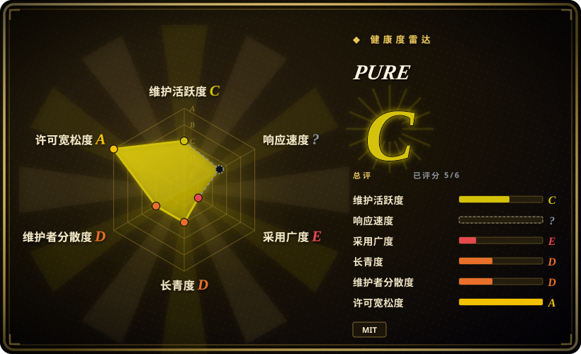
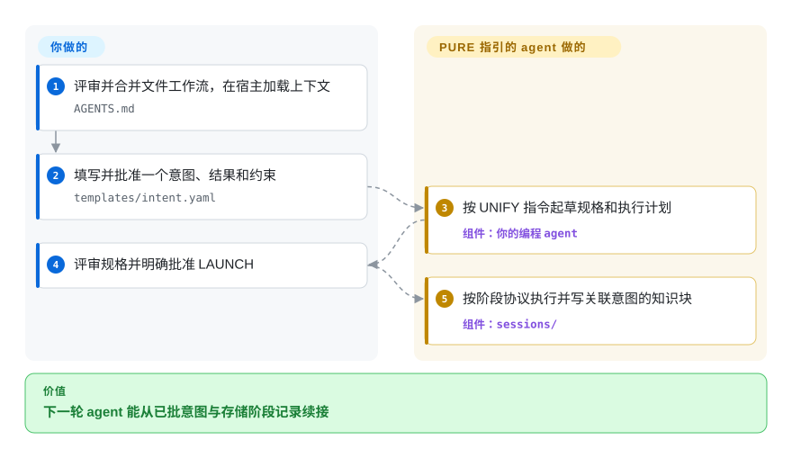
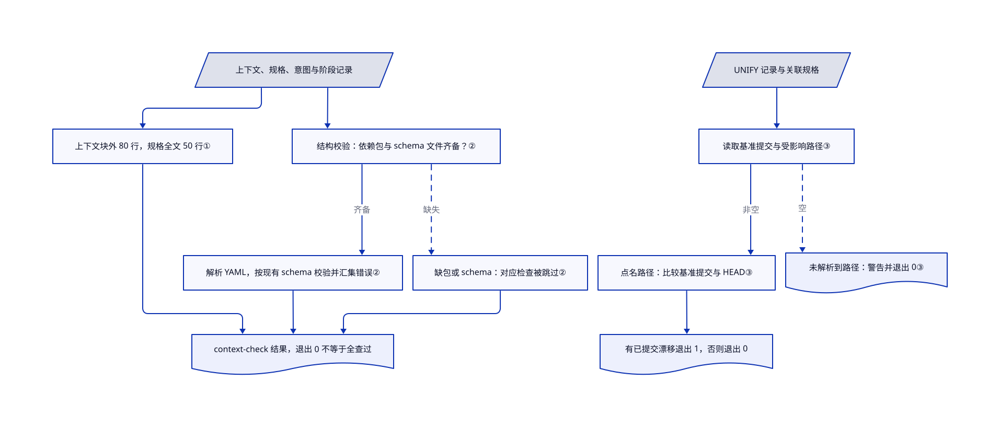

# PURE

下一轮编程 agent 忘了哪些要求已获批准；PURE 用文件记录意图、规格和阶段交接，并以小脚本检查其中一部分。

## 何时使用

你在多个会话之间运行 coding agent，希望每个交付物都能追溯到一个已批准 intent。普通提示词已经不够：你需要短小规格、显式人工 gate、机器可读交接、按能力路由工作的 registry，以及让 fresh agent 不必重放整段对话就能续接的持久会话记录。

当你不只想读一套文字方法论，还希望规则落实为文件、JSON Schema 和会失败的小脚本时，PURE 比纯文档方案更合适。它的代价也很明确：文档层面不绑定 provider 与 harness，但采用者要接受 PURPOSE→UNIFY→LAUNCH→SHIELD→EVOLVE 生命周期和仓库目录约定。

## 何时不用

- **需要维护中的入口与更广采用证据。** 比较 [Superpowers](../coding-agent-harnesses/superpowers.zh.md) 或 [Spec Kit](spec-kit.zh.md)；PURE 默认分支最后更新于 2026-05-26，只有一个 v0.1.0 release，没有独立采用信号。这不表示替代品已有多年历史。
- **你只要设计原则，不想引入仓库机制。** 改用 [12-Factor Agents](12-factor-agents.zh.md) 或 [USDAD](usdad.zh.md)；PURE 会增加 intents、specs、sessions、registry、schemas、hooks、scripts 和归档约定。
- **你需要厂商支持的 spec CLI 与自动生成项目脚手架。** 改用 [Spec Kit](spec-kit.zh.md)；PURE 的集成层是普通文件与 Shell 脚本，需要自己接入选定 harness。
- **期待脚本证明 agent 遵守全部人工门。** 在 Spec Kit 等工作流之外保留项目测试与权限控制；PURE 的 Markdown 是指令，可执行检查只查文件预算和部分数据，不证明 agent 服从。
- **只有系统自带 macOS/BSD 工具或没有 Bash。** 优先用 Spec Kit 对应平台辅助工具，或明确改造 PURE；`new-intent.sh` 使用 `grep -P`，freshness 检查使用苹果旧 Bash 没有的 `mapfile`。直接复制不保证可移植。
- **要求共享学习或企业签名注册表已经可用。** 从普通经评审 Git 文件和 Spec Kit 起步，别把 PURE 的 Tier 2/3 草图当运行中的服务；高阶层要自行实现和集成。

## 横向对比

| 替代品 | 是否收录 | 我们的评价 | 取舍 |
|---|---|---|---|
| [Superpowers](../coding-agent-harnesses/superpowers.zh.md) | 已收录 | 如果可安装、跨 harness 的 SDLC skills 比显式 intent 与 knowledge-block schema 更重要，选 Superpowers；如果可审计的文件协议是决定条件，选 PURE。 | Superpowers 更容易启用，采用面也更广；PURE 把更多项目状态暴露成版本化数据，但要求项目接受它的目录结构。 |
| [Spec Kit](spec-kit.zh.md) | 已收录 | 如果偏好厂商支持的 CLI 与自动生成规格流程，选 Spec Kit；如果 provider-neutral registry、A2A handoff 和阶段记录更重要，选 PURE。 | Spec Kit 有更大生态和更完整入口；PURE 更透明、更分散，但年轻得多。 |
| [USDAD](usdad.zh.md) | 已收录 | 如果要一套可手工裁剪的历史 spec-first 方法原稿，选 USDAD；如果方法必须配套脚本、schema、测试和 registry，选 PURE。 | USDAD 机制更少、接入成本更低；PURE 多了可执行检查，也多了仓库结构负担。 |

## 快速上手

将真实 `JonB32/pure-agentic` 仓库克隆到暂存目录，先评审再合并上下文文件、registry、模板、角色与技能文件和脚本，不覆盖项目原有 agent 规则。上游例子里的 `your-org` 与 `pure-approach` 是占位名称，不是额外依赖；也要保留 `intents/`、`specs/`、`sessions/` 和 `schemas/`，因为最小复制例子漏掉了检查所需文件。首次使用时，把 `templates/intent.yaml` 复制到 `intents/INT-0001.yaml`，填写希望得到的结果、约束与排除项，并记录人工批准。在编程宿主加载经评审的 `AGENTS.md`，要求 UNIFY，读生成规格后再明确批准 LAUNCH（[QUICKSTART.md:22–65](https://github.com/JonB32/pure-agentic/blob/ddadf731f1f6cff5c9761cd4c09408c0a5b82d22/QUICKSTART.md#L22-L65)）。协议指引你的 agent 写规格和阶段知识块；你提供 agent 与模型、承担用量费用、批准各门，并将真实项目测试与检查接入 CI。这是文件式工作流接入，不是模型服务，也不保证自动交付成功。

<!-- flow-steps:begin (generated from flows/pure-agentic.json by tools/flow_card.py — do not edit) -->

流程文字版

1. **你**：评审并合并文件工作流，在宿主加载上下文 — `AGENTS.md`
2. **你**：填写并批准一个意图、结果和约束 — `templates/intent.yaml`
3. **PURE**：按 UNIFY 指令起草规格和执行计划 — 组件：`你的编程 agent`
4. **你**：评审规格并明确批准 LAUNCH
5. **PURE**：按阶段协议执行并写关联意图的知识块 — 组件：`sessions/`

**价值**：下一轮 agent 能从已批意图与存储阶段记录续接

<!-- flow-steps:end -->

## 技术要点

<!-- mechanism:begin (generated from mechanisms/pure-agentic.json by tools/mechanism_card.py; do not edit) -->

机制文字版

- 上下文、规格、意图与阶段记录
- 上下文块外 80 行，规格全文 50 行①
- 结构校验：依赖包与 schema 文件齐备？②
- 解析 YAML，按现有 schema 校验并汇集错误②
- 缺包或 schema：对应检查被跳过②
- context-check 结果，退出 0 不等于全查过
- UNIFY 记录与关联规格
- 读取基准提交与受影响路径③
- 点名路径：比较基准提交与 HEAD③
- 未解析到路径：警告并退出 0③
- 有已提交漂移退出 1，否则退出 0

- 上下文、规格、意图与阶段记录 → 上下文块外 80 行，规格全文 50 行①
- 上下文块外 80 行，规格全文 50 行① → context-check 结果，退出 0 不等于全查过
- 上下文、规格、意图与阶段记录 → 结构校验：依赖包与 schema 文件齐备？②
- 结构校验：依赖包与 schema 文件齐备？② → 解析 YAML，按现有 schema 校验并汇集错误②（齐备）
- 结构校验：依赖包与 schema 文件齐备？② → 缺包或 schema：对应检查被跳过②（缺失）〔可选／兜底〕
- 解析 YAML，按现有 schema 校验并汇集错误② → context-check 结果，退出 0 不等于全查过
- 缺包或 schema：对应检查被跳过② → context-check 结果，退出 0 不等于全查过
- UNIFY 记录与关联规格 → 读取基准提交与受影响路径③
- 读取基准提交与受影响路径③ → 点名路径：比较基准提交与 HEAD③（非空）
- 读取基准提交与受影响路径③ → 未解析到路径：警告并退出 0③（空）〔可选／兜底〕
- 点名路径：比较基准提交与 HEAD③ → 有已提交漂移退出 1，否则退出 0

<!-- mechanism:end -->

### 1. 将复用指令与项目笔记分开计预算

- **解决：** 可复用的 agent 指令不断膨胀，会让每个新会话都得加载庞大骨架。
- **做法：** `context-check.sh` 检查 agent 与角色文件的 80 行预算时，排除标记过的项目上下文块。规格另按整个文件计 50 行预算，超限计入错误并影响最终退出码。
- **边界：** 被排除的项目块仍可不受此上限地增长。行数既不衡量相关性，也不等于模型实际词元数；这些文件检查不会强制 agent 获得生命周期批准。
- **源码：** [scripts/context-check.sh:71–132](https://github.com/JonB32/pure-agentic/blob/ddadf731f1f6cff5c9761cd4c09408c0a5b82d22/scripts/context-check.sh#L71-L132)、[退出策略：245–251](https://github.com/JonB32/pure-agentic/blob/ddadf731f1f6cff5c9761cd4c09408c0a5b82d22/scripts/context-check.sh#L245-L251)。

### 2. 校验器齐备时，才检查存档记录的形状

- **解决：** 意图与知识块即使能解析成 YAML，也可能缺少协议要求的字段。
- **做法：** 安装了 `PyYAML` 与 `jsonschema` 时，脚本加载现有的意图与知识块 schema，解析匹配的 YAML 文件，并汇集逐文件错误。JSON Schema 描述记录允许的结构，不证明记录里的说法真实。
- **边界：** 缺 Python 包会跳过 schema 阶段；缺某个 schema 文件，该类记录就不校验。退出 0 因此既不证明 schema 全覆盖，也不证明每个人工门都查过；这个检查器也不提供 Tier 2/3 设计中的服务。
- **源码：** [scripts/context-check.sh:167–243](https://github.com/JonB32/pure-agentic/blob/ddadf731f1f6cff5c9761cd4c09408c0a5b82d22/scripts/context-check.sh#L167-L243)、[退出策略：245–251](https://github.com/JonB32/pure-agentic/blob/ddadf731f1f6cff5c9761cd4c09408c0a5b82d22/scripts/context-check.sh#L245-L251)。

### 3. 按规格点名的文件检查已提交漂移

- **解决：** 规格写完后，后续提交可能已经改变了它打算修改的文件。
- **做法：** `freshness-check.sh` 从 UNIFY 阶段记录读取基准提交，找到关联规格，再提取 Impact Zones，也就是点名的受影响路径。它将这些路径在基准与当前 `HEAD` 之间比较，报告已提交漂移。
- **边界：** 解析出的路径列表为空时，只警告并退出 0；缺必需记录或基准数据则报错。比较不包含未提交编辑，也不能证明规格在语义上仍然适用。
- **源码：** [scripts/freshness-check.sh:32–104](https://github.com/JonB32/pure-agentic/blob/ddadf731f1f6cff5c9761cd4c09408c0a5b82d22/scripts/freshness-check.sh#L32-L104)、[漂移结果：107–123](https://github.com/JonB32/pure-agentic/blob/ddadf731f1f6cff5c9761cd4c09408c0a5b82d22/scripts/freshness-check.sh#L107-L123)。

## 技术栈

- **主要实现：** Bash 脚本负责创建 intent、查询 registry、查看状态、检查上下文预算、检测 freshness 和归档。
- **数据格式：** intent、registry、knowledge block 使用 YAML；intent、knowledge block、A2A handoff 使用 JSON Schema；agent、skill、hook、spec 和方法正文使用 Markdown。
- **状态模型：** 使用 Git 跟踪的 `intents/`、`specs/`、`sessions/`、`learned-skills/`、`registry/` 目录，而非数据库或托管控制面。
- **质量控制：** `scripts/__tests__/` 下有 Shell 集成测试，并提供 GitHub Actions context-check workflow。

## 依赖

- **必需本地工具：** 兼容 Bash（freshness 使用 `mapfile`）、Git 和 Unix 工具；自动意图编号需要支持 PCRE 的 `grep -P`，不是系统自带 BSD grep。脚本假定项目状态目录已经存在。
- **Schema 校验：** Python 3 加 `PyYAML` 与 `jsonschema`；缺少这些包时，`context-check.sh` 会跳过 schema validation。
- **Agent harness：** 任何能加载 `AGENTS.md` 和角色或 skill Markdown 的 coding-agent 环境。仓库自身不安装或运行 LLM。
- **可选高阶层：** Tier 2/3 描述了共享存储、消息传输、向量或图持久化与签名设施，但没有把它们作为完整服务打包。

## 运维难度

**Tier 1 为低到中；若实现文档中的高阶层则很高。** Tier 1 只是版本化文件与本地脚本，没有服务器或数据库。负担主要来自流程：持续维护 intent、spec、knowledge block、registry entry 与 gate 的一致性，并把检查接进 harness 和 CI。Tier 2/3 还描绘了共享持久化、learning engine、签名 registry 与协议 gateway；真要实现，会把 PURE 从文件工作流变成架构项目。

## 健康度与可持续性

- **判断日期 2026-10-13：** 实验性流程材料，不是已证明的稳定维护线。默认分支最后更新于 2026-05-26；唯一 v0.1.0 release 发布于 2026-05-20。近五个月没有默认分支开发。
- **实现含量：** 有 Shell 工具、schema、示例、测试和 CI。它们支持可检查性，不表示本次运行了工具或验证了所有平台。
- **治理与 bus factor：** 一个用户拥有仓库，也是唯一记录到的贡献者。没有基金会、公司支持、共同维护政策或治理文档。
- **年龄与 Lindy：** 创建于 2026-05-20，不足五个月，0 star。年轻仓库随后安静，耐久证据很弱；按当前可检查产物的适配度选，不把它当长寿押注。
- **风险姿态：** MIT 许可宽松，核心依赖面也很小。更大的风险是范围不完整：Tier 2/3 能力部分只是示例或架构说明，agent 的提示词行为仍取决于 harness。

## 存疑（未验证）

- [未验证：未执行上游脚本或跨宿主试验] 没有实测运行兼容性及不同供应商与宿主的行为等价；读源不等于安装成功。
- [未验证：高阶集成未部署] Tier 2/3 的架构和桩代码不证明你的环境已有可用共享学习、签名路由或企业合规。
- [推断：提示词门与文件校验分离] 类型化记录可以改善追溯，但已读脚本不能证明 LLM 遵守每个门，或生成代码符合意图。
