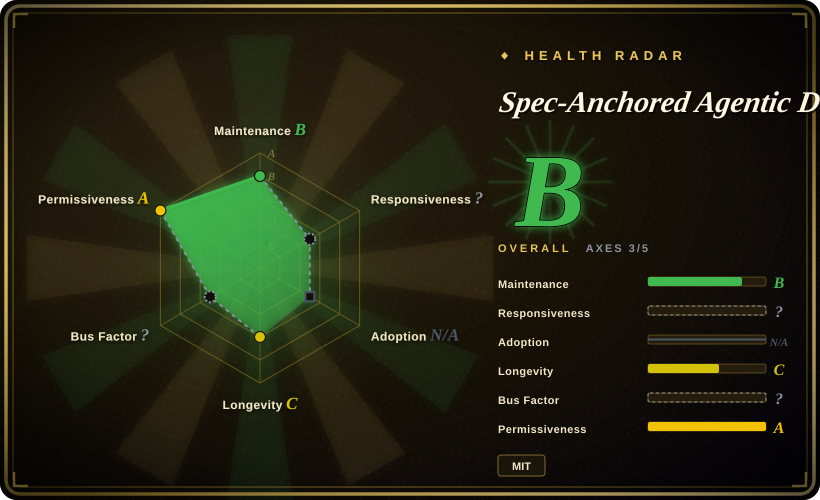
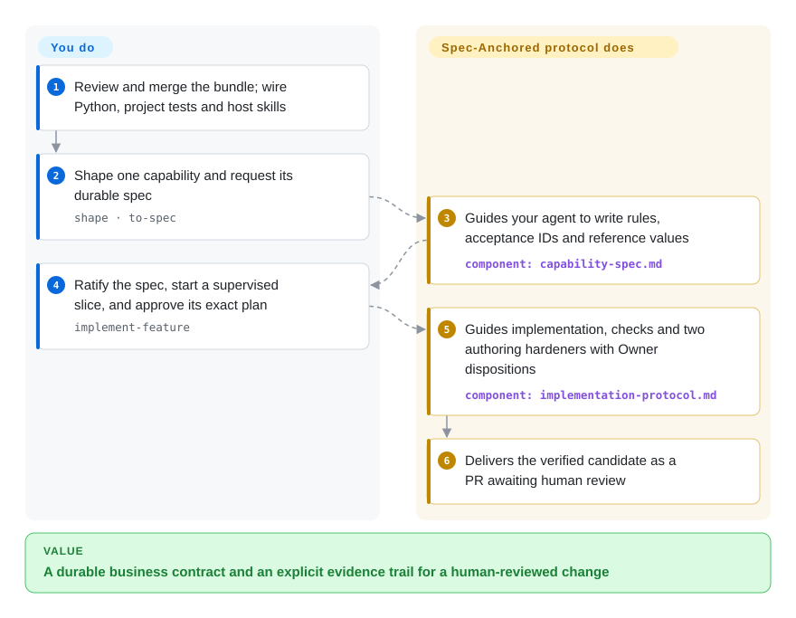

# Spec-Anchored Agentic Development

A shipped feature loses its business rules in old tickets; this bundle keeps a permanent capability spec and binds implementation approvals and evidence to explicit artifacts.

## When to use

You own a payments or orders capability and a fast coding agent keeps changing a rule nobody can find outside an old issue. You want one lasting spec with stable rule/acceptance IDs, plus a workflow that binds a reviewed plan, code scope and verification evidence to that contract. Choose this over a general skill pack when durable business truth and explicit authorization are the deciding concerns, not just a brainstorm-to-code sequence.

The current canonical bundle uses `AGENTS.md` and `.agents/` for Claude Code, Codex and Cursor, with harness adaptations rather than a Claude-only core. It includes Python artifact checks and two internal authoring hardeners, but you still build domain tests, environment verification and external review integration. Its scripts inspect artifact consistency; they do not by themselves verify that a claimed PR or review happened.

## When NOT to use

- **You want a drop-in workflow with wider installation/adoption evidence.** Compare [Superpowers](../coding-agent-harnesses/superpowers.md); this project is a small, directly copied bundle, even though its canonical files are now cross-harness.
- **You want a mainstream spec-driven starter toolkit rather than a permanent capability-contract system.** Use Spec Kit; it has broader tooling and community support with less commitment to this repository's governance model.
- **The task is a small patch with no durable business contract.** Use a normal issue, a focused test, and the existing repository workflow; creating a capability spec for every trivial edit adds ceremony without preserving meaningful decisions.
- **You only need compact file handoffs and lightweight repository checks.** Compare [PURE](pure-agentic.md); this bundle's policy instances, approval fingerprints and authoring-hardener sequence add more integration and verification obligations.
- **Your repository already has an authoritative instruction stack.** Keep it and borrow a spec template selectively, rather than blindly copying any bundle; duplicate rules or same-named files can conflict.
- **You expect unattended auto-merge or proof that remote reviews happened.** Keep human-reviewed PRs and real CI/provider event checks. Every implementation mode parks at human review; `validate-result` checks a terminal artifact's shape, not remote reality.
- **You cannot supply project-specific testing and hardening tools.** Use a smaller supervised Spec Kit workflow with existing tests; the bundle's `prep` skill tells you what to build, but does not ship your application's golden, mutation, fuzz or security checks.

## Comparison

| Alternative | In index | Our verdict | Tradeoff |
|---|---|---|---|
| [Spec Kit](spec-kit.md) | ✅ | Choose Spec Kit for a widely adopted spec-driven starter toolkit; choose this project when permanent capability specs and continuous conformance are the decisive requirements. | Spec Kit has stronger ecosystem and tooling reach, while this project imposes a more durable spec-to-code contract. |
| [Superpowers](../coding-agent-harnesses/superpowers.md) | ✅ | Choose Superpowers for installable brainstorm/TDD/review skills; choose this bundle when permanent capability contracts and artifact-bound authorization must organize the work. | Superpowers has broader installation channels; this bundle makes policy/evidence shapes explicit but leaves application and remote-event verification to you. |
| [PURE](pure-agentic.md) | ✅ | Choose PURE for compact intent/phase records and small Shell checks; choose this bundle for a standing capability spec with approval fingerprints and externally issued policy bounds. | PURE is lighter and experimental; this bundle has more executable artifact contracts and stricter process cost, not automatic correctness. |

## Quick start

Review the bundle in a staging clone, then merge `AGENTS.md`, `.agents/`, `agents/`, `policy/`, `scripts/`, tests and the needed templates without replacing your existing repository authority ([INSTALL.md:7–23](https://github.com/w00fx/spec-anchored-agentic-development/blob/4f8a13e757f0f2ae8e3c5abfe128f1adb6d0e782/INSTALL.md#L7-L23)). Prepare Python 3 and PyYAML, and connect the bundle gate separately from your application's tests, golden reference values, mutation/fuzz tools and CI. Start with one capability spec: invoke `shape` and `to-spec` in your host's explicit skill syntax, then have a human ratify its own PR before implementation ([README.md:131–140](https://github.com/w00fx/spec-anchored-agentic-development/blob/4f8a13e757f0f2ae8e3c5abfe128f1adb6d0e782/README.md#L131-L140)). Run `implement-feature` for one approved slice while you are present; review the plan and its approval fingerprint — a hash identifying that exact bundle — before allowing code changes. Your agent follows the shared protocol, invokes the two authoring hardeners and records their handoffs; the result is a PR awaiting human review, never an automatic merge. You own real tests, external review and environment verification, model costs and credentials; installing these prompts and scripts does not supply those services.

<!-- flow-steps:begin (generated from flows/spec-anchored-agentic-development.json by tools/flow_card.py — do not edit) -->

Text version of the flow

1. **You**: Review and merge the bundle; wire Python, project tests and host skills
2. **You**: Shape one capability and request its durable spec — `shape · to-spec`
3. **Spec-Anchored Agentic Development**: Guides your agent to write rules, acceptance IDs and reference values — component: `capability-spec.md`
4. **You**: Ratify the spec, start a supervised slice, and approve its exact plan — `implement-feature`
5. **Spec-Anchored Agentic Development**: Guides implementation, checks and two authoring hardeners with Owner dispositions — component: `implementation-protocol.md`
6. **Spec-Anchored Agentic Development**: Delivers the verified candidate as a PR awaiting human review

**Value**: A durable business contract and an explicit evidence trail for a human-reviewed change

<!-- flow-steps:end -->

## Key techniques

- **Keep business truth addressable after delivery.** [spec-templates/capability-spec.md:15–94](https://github.com/w00fx/spec-anchored-agentic-development/blob/4f8a13e757f0f2ae8e3c5abfe128f1adb6d0e782/spec-templates/capability-spec.md#L15-L94) gives one permanent entrypoint, stable rule/acceptance IDs and different representations for state, calculations and data shape. Tests and tickets can point to the same rule; the template still needs your real domain values and verification methods, not merely filled headings.
- **Bind approval to content, policy and run identity.** [scripts/spec-anchored:632–768](https://github.com/w00fx/spec-anchored-agentic-development/blob/4f8a13e757f0f2ae8e3c5abfe128f1adb6d0e782/scripts/spec-anchored#L632-L768) checks the canonical bundle against its resolved policy, hashes it, and checks approval records for matching fingerprint, repository and run. Changed plans or scope cannot silently reuse an old record; this is consistency checking, not authentication of an actual human/provider approval event.
- **A worker's scope proposal is not its authority.** [scripts/spec-anchored:961–1106](https://github.com/w00fx/spec-anchored-agentic-development/blob/4f8a13e757f0f2ae8e3c5abfe128f1adb6d0e782/scripts/spec-anchored#L961-L1106) intersects the manifest with an externally issued policy, applies absolute denies and separate truth/oracle grants. It can reject an unauthorized supplied diff; the launcher must still supply trustworthy policy and the complete real diff, and wire refusal into execution.
- **Reject mixed or invented completion states.** [scripts/spec-anchored:1109–1208](https://github.com/w00fx/spec-anchored-agentic-development/blob/4f8a13e757f0f2ae8e3c5abfe128f1adb6d0e782/scripts/spec-anchored#L1109-L1208) requires different fields for PR-ready, named-blocker and no-change results, forbids fields from other states, and checks repository/claim identities. That prevents a contradictory result envelope, but [scripts/spec-anchored:23–25](https://github.com/w00fx/spec-anchored-agentic-development/blob/4f8a13e757f0f2ae8e3c5abfe128f1adb6d0e782/scripts/spec-anchored#L23-L25) explicitly separates shape from proving remote PRs, commits and reviews exist.

## Health & viability

- **Verdict, 2026-10-13:** inspectable but young methodology tooling. Main last changed on 2026-09-02 and GitHub Releases is empty; the current tree now has a single-gate CI workflow, kernel contracts/adversarial tests, corpus checks and mutation adequacy. The old “no tests/CI” description no longer holds.
- **Governance:** the repository is User-owned, has one named author, and exposes no maintainer team, governance process, or release policy.
- **Age/Lindy and adoption:** created 2026-07-04, about three months old, with 6 stars. The adoption axis is structurally N/A for its missing tracked install channel, not evidence of widespread use; young age and a small audience do not establish durability.
- **License and risk:** root MIT text is verified. Direct file merging and runtime adapters need review; cross-harness Markdown remains advisory unless the surrounding harness actually calls the checks. Kernel tests are not evidence of reduced application defect rates or safe auto-merge.

## Caveats (unverified)

- [未验证：本次未安装上游 bundle 或执行其 gate] Host activation, workflow quality and runtime adapter fidelity were not tested; source/test inspection does not establish installation success.
- [未验证：没有独立效果试验] Defect reduction, delivery-speed gains and safe-autonomy outcomes remain unmeasured here; external taxonomy citations were not independently audited.
- [推断：检查器只校验传入产物，协议依赖宿主执行] A coherent artifact can still describe events that never happened. Real approval identity, commits, PRs, review results and model compliance require external verification.
