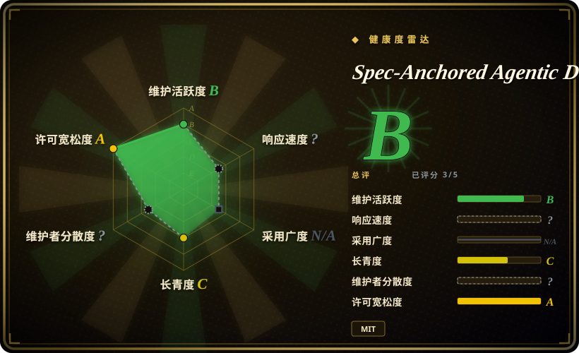
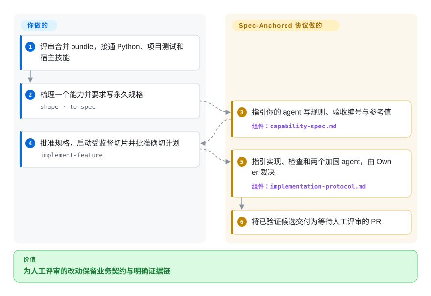
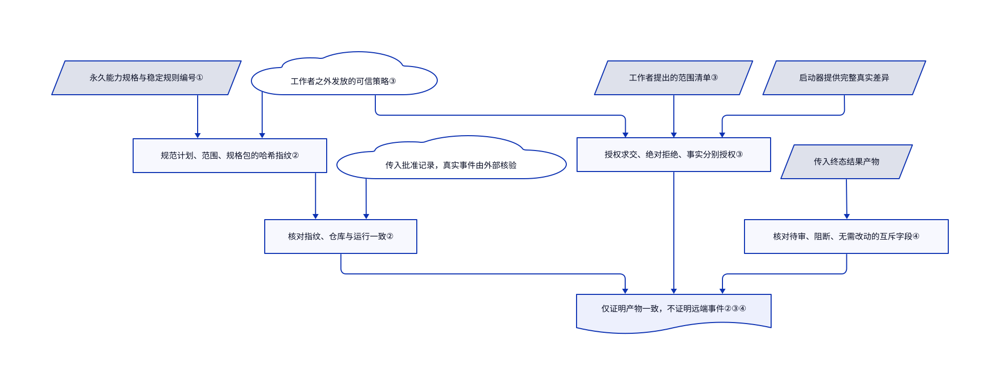

# Spec-Anchored Agentic Development

功能上线后，业务规则却埋在旧工单里；这套 bundle 保留永久能力规格，并用明确产物绑定实现批准与证据。

## 何时使用

你负责支付或订单能力，编程 agent 改规则很快，团队却只能从旧工单找原意。你需要保留一份带稳定规则与验收编号的规格，并让工作流把已审计划、代码范围和验证证据绑定到该契约。持久业务事实和明确授权是决定条件，而不只是头脑风暴到编码时，选它而非通用技能包。

当前规范 bundle 用 `AGENTS.md` 与 `.agents/` 服务 Claude Code、Codex 和 Cursor，通过适配处理宿主差别，而不是 Claude 专属核心。它含 Python 产物检查与两个内部改稿式加固 agent，但领域测试、环境验证和外部评审集成仍要你构建。脚本检查产物一致性，本身不验证声称的 PR 或 review 真的发生。

## 何时不用

- **要即装即用且有更广安装与采用证据的流程。** 比较 [Superpowers](../coding-agent-harnesses/superpowers.zh.md)；本项目仍是小型直接复制 bundle，尽管规范文件已跨宿主。
- **你想要主流的 spec-driven 起步工具，而不是永久 capability contract 系统。** 用 Spec Kit；它的工具和社区覆盖更广，对本仓库治理模型的承诺更少。
- **任务只是小 patch，没有需要长期保存的业务契约。** 使用普通 issue、一个聚焦测试和仓库现有流程；为每个微小修改建立 capability spec 只会增加仪式，不会保存有意义的决策。
- **只要紧凑文件交接与轻量仓库检查。** 比较 [PURE](pure-agentic.zh.md)；本 bundle 的策略实例、批准指纹和内部加固顺序增加集成与验证义务。
- **仓库已有权威指令栈。** 保留现有栈，选择性借用规格模板，不盲拷任何 bundle；重复规则或同名文件会冲突。
- **期待无人合并或证明远端评审发生。** 保留人工评审 PR 和真实 CI、供应商事件检查。各实现模式都停在人工评审前；`validate-result` 查终态产物结构，不查远端现实。
- **不能提供项目测试与加固工具。** 用较小的受监督 Spec Kit 流程和已有测试；bundle 的 `prep` 技能告诉你要建什么，不提供你应用自己的 golden、mutation、fuzz 或安全检查。

## 横向对比

| 替代品 | 是否收录 | 我们的评价 | 取舍 |
|---|---|---|---|
| [Spec Kit](spec-kit.zh.md) | 已收录 | 需要广泛采用的 spec-driven 起步工具时选 Spec Kit；永久 capability spec 和持续 conformance 是硬需求时，选本项目。 | Spec Kit 的生态和工具覆盖更强；本项目对 spec 与代码之间施加更持久的契约。 |
| [Superpowers](../coding-agent-harnesses/superpowers.zh.md) | 已收录 | 要可安装的头脑风暴、TDD 与评审技能选 Superpowers；要永久能力契约和产物绑定授权来组织工作时选本 bundle。 | Superpowers 安装渠道更广；本 bundle 明确策略与证据结构，但应用与远端事件验证留给你。 |
| [PURE](pure-agentic.zh.md) | 已收录 | 紧凑意图与阶段记录、小型 Shell 检查选 PURE；长期能力规格、批准指纹和外部发放的策略边界选本 bundle。 | PURE 更轻且实验性；本 bundle 可执行产物契约更多，流程成本更高，不是自动正确。 |

## 快速上手

在暂存克隆中评审 bundle，再合并 `AGENTS.md`、`.agents/`、`agents/`、`policy/`、`scripts/`、测试和所需模板，不替换现有仓库权威规则（[INSTALL.md:7–23](https://github.com/w00fx/spec-anchored-agentic-development/blob/4f8a13e757f0f2ae8e3c5abfe128f1adb6d0e782/INSTALL.md#L7-L23)）。准备 Python 3 与 PyYAML，再调用一次 `prep` 建立项目验证接口与基线，分别接通 bundle 检查及应用测试、golden 参考值、mutation/fuzz 工具和 CI。先做一个能力规格：按宿主显式技能语法调用 `shape` 与 `to-spec`，让人用单独 PR 批准规格后再实现（[README.md:131–140](https://github.com/w00fx/spec-anchored-agentic-development/blob/4f8a13e757f0f2ae8e3c5abfe128f1adb6d0e782/README.md#L131-L140)）。人在场时用 `implement-feature` 做一个已批切片，先审计划与批准指纹——标识那份完整批准包的哈希——再允许改码。你的 agent 按共享协议调用两个内部加固 agent 并记录交接；结果是等待人工评审的 PR，不是自动合并。真实测试、外部评审、环境验证、模型费用与凭据由你负责；安装提示词与脚本并不提供这些服务。

<!-- flow-steps:begin (generated from flows/spec-anchored-agentic-development.json by tools/flow_card.py — do not edit) -->

流程文字版

1. **你**：评审合并 bundle，接通 Python、项目测试和宿主技能
2. **你**：梳理一个能力并要求写永久规格 — `shape · to-spec`
3. **Spec-Anchored Agentic Development**：指引你的 agent 写规则、验收编号与参考值 — 组件：`capability-spec.md`
4. **你**：批准规格，启动受监督切片并批准确切计划 — `implement-feature`
5. **Spec-Anchored Agentic Development**：指引实现、检查和两个加固 agent，由 Owner 裁决 — 组件：`implementation-protocol.md`
6. **Spec-Anchored Agentic Development**：将已验证候选交付为等待人工评审的 PR

**价值**：为人工评审的改动保留业务契约与明确证据链

<!-- flow-steps:end -->

## 技术要点

<!-- mechanism:begin (generated from mechanisms/spec-anchored-agentic-development.json by tools/mechanism_card.py; do not edit) -->

机制文字版

- 永久能力规格与稳定规则编号①
- 规范计划、范围、规格包的哈希指纹②
- 传入批准记录，真实事件由外部核验
- 核对指纹、仓库与运行一致②
- 工作者之外发放的可信策略③
- 工作者提出的范围清单③
- 启动器提供完整真实差异
- 授权求交、绝对拒绝、事实分别授权③
- 传入终态结果产物
- 核对待审、阻断、无需改动的互斥字段④
- 仅证明产物一致，不证明远端事件②③④

- 永久能力规格与稳定规则编号① → 规范计划、范围、规格包的哈希指纹②
- 工作者之外发放的可信策略③ → 规范计划、范围、规格包的哈希指纹②
- 规范计划、范围、规格包的哈希指纹② → 核对指纹、仓库与运行一致②
- 传入批准记录，真实事件由外部核验 → 核对指纹、仓库与运行一致②
- 核对指纹、仓库与运行一致② → 仅证明产物一致，不证明远端事件②③④
- 工作者之外发放的可信策略③ → 授权求交、绝对拒绝、事实分别授权③
- 工作者提出的范围清单③ → 授权求交、绝对拒绝、事实分别授权③
- 启动器提供完整真实差异 → 授权求交、绝对拒绝、事实分别授权③
- 授权求交、绝对拒绝、事实分别授权③ → 仅证明产物一致，不证明远端事件②③④
- 传入终态结果产物 → 核对待审、阻断、无需改动的互斥字段④
- 核对待审、阻断、无需改动的互斥字段④ → 仅证明产物一致，不证明远端事件②③④

<!-- mechanism:end -->

### 1. 给业务规则一个长期可引用的地址

- **解决：** 工单关闭后，后来接手的 agent 可能找不到能力规则的权威入口。
- **做法：** 能力模板保留永久入口与稳定的规则、验收编号，让测试和工单引用。状态模型、带参考值的公式、数据结构或不变量比事件句更合适时，就用对应表示法。
- **边界：** 模板本身不是领域事实。你仍须提供真实参考值与验证方法；填满标题不证明业务行为正确。
- **源码：** [spec-templates/capability-spec.md:15–94](https://github.com/w00fx/spec-anchored-agentic-development/blob/4f8a13e757f0f2ae8e3c5abfe128f1adb6d0e782/spec-templates/capability-spec.md#L15-L94)。

### 2. 让批准记录匹配确切内容与本次运行

- **解决：** 计划变了、范围扩大了或换了运行，旧批准记录仍可能被拿来复用。
- **做法：** 检查器先按解析后的策略校验批准包，再将规范字段计算成哈希指纹。它比较所给批准记录的指纹、仓库与运行标识，绑定的是这份包，不是相似计划。
- **边界：** 这证明产物一致，不认证真人或供应商事件。外围宿主仍须核实真实批准；身份字符串相同不等于身份认证。
- **源码：** [scripts/spec-anchored:632–768](https://github.com/w00fx/spec-anchored-agentic-development/blob/4f8a13e757f0f2ae8e3c5abfe128f1adb6d0e782/scripts/spec-anchored#L632-L768)、[环境边界：23–26](https://github.com/w00fx/spec-anchored-agentic-development/blob/4f8a13e757f0f2ae8e3c5abfe128f1adb6d0e782/scripts/spec-anchored#L23-L26)。

### 3. 工作者提出的范围不能高于外部授权

- **解决：** 工作者可能写一份宽松的范围清单，再用这份提案给自己授权。
- **做法：** 范围检查器将提案与外部发放策略求交，并检查传入的变更路径。拒绝路径始终拒绝；规格语义、参考答案和指标基线分别要有授权，批准改规格不等于批准改测试判定器。
- **边界：** 它能拒绝所给差异中的越权修改，不能发现漏报修改或证明授权方可信。启动器仍须提供完整真实差异和可信策略，并在检查拒绝时真正停止执行。
- **源码：** [scripts/spec-anchored:961–1106](https://github.com/w00fx/spec-anchored-agentic-development/blob/4f8a13e757f0f2ae8e3c5abfe128f1adb6d0e782/scripts/spec-anchored#L961-L1106)。

### 4. 将待审、阻断与无需改动分成互斥结果

- **解决：** 结果可能一边声称就绪，一边声称阻断，或附上不属于该状态的证据字段。
- **做法：** 结果检查器对 PR 就绪、具名阻断、无需改动分别要求字段，并禁止其它状态字段。它还核对仓库引用，以及任务认领应保留待人工评审，还是释放。
- **边界：** 自洽结果包不证明其中的 PR、提交或评审真实存在。远端事件核验仍须另做；PR 就绪仍是等待人工评审，不是允许合并。
- **源码：** [scripts/spec-anchored:1109–1208](https://github.com/w00fx/spec-anchored-agentic-development/blob/4f8a13e757f0f2ae8e3c5abfe128f1adb6d0e782/scripts/spec-anchored#L1109-L1208)、[环境边界：23–26](https://github.com/w00fx/spec-anchored-agentic-development/blob/4f8a13e757f0f2ae8e3c5abfe128f1adb6d0e782/scripts/spec-anchored#L23-L26)。

## 健康度与可持续性

- **判断日期 2026-10-13：** 可检查但年轻的方法论工具。默认分支最后更新于 2026-09-02，GitHub Releases 为空；当前已有统一 gate 的 CI、kernel 契约与对抗测试、语料检查和变异充分性检查。旧“没有测试与 CI”描述已不成立。
- **治理：** 仓库属于个人账号，只有一位具名作者，没有维护团队、治理流程或 release policy。
- **年龄、Lindy 与采用：** 创建于 2026-07-04，约三个月，6 stars。采用轴因缺可追踪安装渠道而结构性 N/A，不是广泛使用的证据；年轻与小受众不能建立耐久性。
- **许可与风险：** 根 MIT 全文已核。直接合并文件和宿主适配需评审；跨宿主 Markdown 仍是指导，除非外围实际调用检查。Kernel 测试不证明应用缺陷减少或自动合并安全。

## 存疑（未验证）

- [未验证：本次未安装上游 bundle 或执行其 gate] 宿主激活、工作流质量和运行适配保真没有实测；读源和测试不证明安装成功。
- [未验证：没有独立效果试验] 缺陷减少、交付加速和安全自治效果仍未测量；外部分类法引用未独立核查。
- [推断：检查器只校验传入产物，协议依赖宿主执行] 一致产物仍能描述从未发生的事件。真实批准身份、commit、PR、评审结果和模型服从要外部验证。
