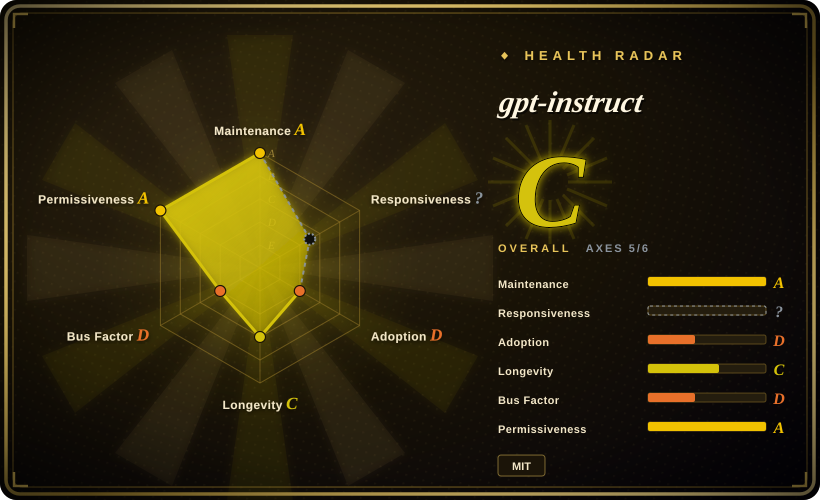
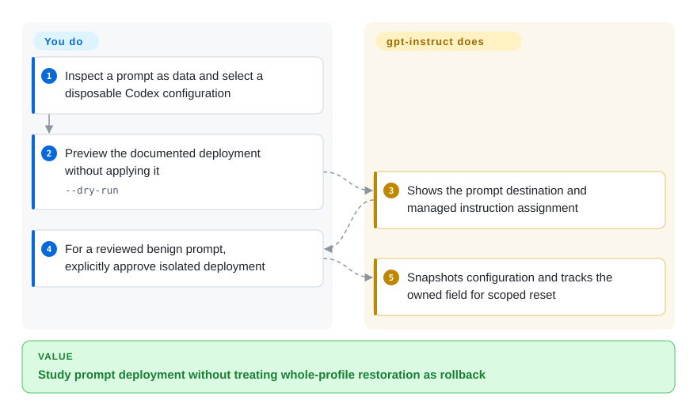

# gpt-instruct

You want to study how a coding-agent prompt changes execution and rollback behavior without losing unrelated local configuration. This repository combines versioned prompt archives with a narrowly managed Codex configuration installer; its shipped unrestricted prompts are not a safe production default.

## When to use

You are auditing prompt deployment in a disposable agent environment. A full configuration restore would overwrite provider settings added since the experiment. Study this repository for its per-field ownership ledger, prompt hashes and reset behavior, rather than treating a long instruction file as a runtime safeguard. Its useful distinction from a methodology pack is a concrete installer that tracks exactly which configuration line and files it owns.

## When NOT to use

- Need ordinary production development discipline? Use [Superpowers](../coding-agent-harnesses/superpowers.md) or your existing reviewed workflow. The shipped v45 prompt explicitly requests unrestricted execution and suppresses refusal/context checks; do not put it in a credentialed daily profile.
- Need reproducible cross-provider prompt regression tests? Use [promptfoo](../../llm-eval/promptfoo.md). This project's reported experiments use local raw evidence excluded from git, and some referenced test paths are absent from the reviewed public tree.
- Want to learn permission enforcement and the agent loop? Use [Learn Claude Code](learn-claude-code.md). Replacing model instructions changes model behavior, not tool permissions or sandbox boundaries.

## Comparison

| Alternative | In index | Our verdict | Tradeoff |
|---|---|---|---|
| [Superpowers](../coding-agent-harnesses/superpowers.md) | ✅ | Choose Superpowers for a staged development workflow; study gpt-instruct only when prompt replacement and scoped rollback are the research subject. | Composable skills and approval stages versus a model-specific instruction override with material safety risk. |
| [promptfoo](../../llm-eval/promptfoo.md) | ✅ | Choose promptfoo for your own versioned cases and CI assertions; use gpt-instruct as a source of deployment patterns, not independent proof of its published gains. | General evaluation infrastructure versus project-specific, partly unpublished experimental evidence. |
| [Learn Claude Code](learn-claude-code.md) | ✅ | Choose the course to rebuild runtime mechanisms; choose this corpus to inspect managed prompt deployment without building an agent runtime. | Runnable harness lessons versus a small installer and prompt archive collection. |

## Quick start

Clone only for inspection and read the ZIP contents as inert text before considering deployment. The documented read-only preview is `python3 codex-instruct.py --apply --version gpt-5.6-v45 --dry-run`; point `--codex-dir` at a disposable configuration, never your daily profile. The installer can copy a reviewed Markdown instruction file, snapshot configuration and manage its top-level `model_instructions_file` entry. You supply a safe prompt, isolation, model access and independent verification; the package does not enforce tool safety. Its `--reset` restores the managed entry, while full snapshot restoration is a separate explicit action.

<!-- flow-steps:begin (generated from flows/gpt-instruct.json by tools/flow_card.py — do not edit) -->

Text version of the flow

1. **You**: Inspect a prompt as data and select a disposable Codex configuration
2. **You**: Preview the documented deployment without applying it — `--dry-run`
3. **gpt-instruct**: Shows the prompt destination and managed instruction assignment
4. **You**: For a reviewed benign prompt, explicitly approve isolated deployment
5. **gpt-instruct**: Snapshots configuration and tracks the owned field for scoped reset

**Value**: Study prompt deployment without treating whole-profile restoration as rollback

<!-- flow-steps:end -->

## Key techniques

<!-- mechanism:begin (generated from mechanisms/gpt-instruct.json by tools/mechanism_card.py; do not edit) -->

Text version of the mechanism

- Reviewed prompt and disposable config
- Validate name and refuse unowned files②
- Record previous assignment and file hashes①
- Snapshot and atomically replace files②
- Restore only the still-managed instruction field①

- Reviewed prompt and disposable config → Validate name and refuse unowned files②
- Validate name and refuse unowned files② → Record previous assignment and file hashes①
- Record previous assignment and file hashes① → Snapshot and atomically replace files②
- Snapshot and atomically replace files② → Restore only the still-managed instruction field①

<!-- mechanism:end -->

### 1. Own one configuration field instead of restoring everything

- **Problem:** Removing a prompt experiment must not overwrite newer model/provider configuration.
- **How:** The installer records the prior top-level instruction assignment and managed prompt hashes. Reset restores that assignment only if the current line still references a managed file, leaving unrelated TOML text intact.
- **Limits:** This is configuration ownership, not semantic prompt validation; a malicious or mistaken instruction remains dangerous after a perfectly scoped installation.
- **Source:** [Targeted replacement](https://github.com/MDX-Tom/gpt-instruct/blob/3ab84df64468bb74cc9eb4e5423660083953c44f/codex-instruct.py#L199-L267), [ownership and reset](https://github.com/MDX-Tom/gpt-instruct/blob/3ab84df64468bb74cc9eb4e5423660083953c44f/codex-instruct.py#L351-L425).

### 2. Refuse unowned prompt files and separate preview from writes

- **Problem:** Installing an archive can overwrite a user's existing prompt file or partially update configuration.
- **How:** The script accepts a single selected Markdown archive member, validates the destination basename, refuses unowned existing files, snapshots config and writes via a same-directory temporary file plus atomic replacement. Dry-run stops before those writes.
- **Limits:** Archive selection and atomic file replacement do not establish prompt safety or an all-files transaction. Full snapshot restore can overwrite unrelated settings and has its own confirmation path.
- **Source:** [Atomic write](https://github.com/MDX-Tom/gpt-instruct/blob/3ab84df64468bb74cc9eb4e5423660083953c44f/codex-instruct.py#L270-L290), [archive and deployment](https://github.com/MDX-Tom/gpt-instruct/blob/3ab84df64468bb74cc9eb4e5423660083953c44f/codex-instruct.py#L428-L533).

## Health & viability

- On 2026-10-18, repository metadata showed creation on 2026-07-11 and last push on 2026-10-04. README's stable default is v45; its newer model lines are explicitly prereleases and have not passed all stated release gates.
- MDX-Tom leads the contributor snapshot. LICENSE retains both li lingbo and yynxxxxx, matching the acknowledged source lineage; only one of 93 public blobs matches that predecessor tree.
- [推断] Three months of development and model-specific naming give little longevity evidence. Extract the scoped configuration pattern, not a promise that instructions reliably compel completion.
- Safety risk is intrinsic to the distributed prompt content. The corpus also contains reusable deployment code and tests, so it is not merely a purposeless live payload.

## Caveats (unverified)

- [未验证] Reported model gains were not reproduced. The comparison document says raw runs are gitignored; referenced local artifacts and several test paths are absent from the public snapshot.
- [推断] Installer patterns can be reused independently of the prompt, but their suitability for another config format requires new tests; none were run here.
