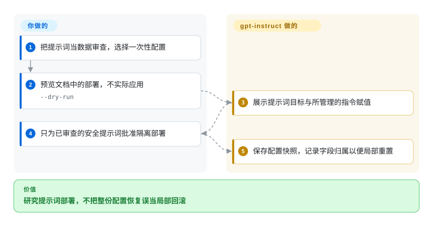

# gpt-instruct

你想研究提示词如何改变编程助手的执行与回滚，却不想丢掉其他本机配置。这个仓库把版本化提示词压缩包与窄范围配置安装器放在一起；随包的无限制提示词不是安全的生产默认值。

## 何时使用

你在一次性助手环境中审计提示词部署。实验后若恢复完整配置，会覆盖期间新增的提供商设置。可研究这里的字段归属账本、提示词哈希和重置行为，而非把长指令当运行时安全措施。它与方法论技能包的区别，是有具体安装器记录自己拥有哪一行配置、哪些文件。

## 何时不用

- 要正常生产开发纪律时，用 [Superpowers](../coding-agent-harnesses/superpowers.zh.md) 或现有已审查流程。随包 v45 明确要求无限制执行并压制拒绝与上下文检查，不应安装到带凭据的日常配置。
- 要可复现、跨提供商的提示词回归时，用 [promptfoo](../../llm-eval/promptfoo.zh.md)。本项目原始实验记录被排除在版本库外，审阅的公开树也缺少部分被引用测试路径。
- 要学习权限执行与助手循环时，用 [Learn Claude Code](learn-claude-code.zh.md)。替换模型指令只改变模型行为，不会建立工具权限或沙箱边界。

## 横向对比

| 替代品 | 是否收录 | 我们的评价 | 取舍 |
|---|---|---|---|
| [Superpowers](../coding-agent-harnesses/superpowers.zh.md) | ✅ | 要分阶段开发流程时选 Superpowers；只有研究提示词替换与局部回滚时才看本项目。 | 可组合技能与审批阶段，换模型专用指令覆盖；后者有实质安全风险。 |
| [promptfoo](../../llm-eval/promptfoo.zh.md) | ✅ | 要自有版本化用例与持续集成断言时选 promptfoo；本项目只作为部署模式材料，不作其效果的独立证据。 | 通用评测基础设施，换专用且部分未公开的实验记录。 |
| [Learn Claude Code](learn-claude-code.zh.md) | ✅ | 要重建运行时机制时选课程；只查提示词托管部署、不构建助手时看本项目。 | 可运行的助手机制课程，换小型安装器与提示词归档集合。 |

## 快速上手

只为阅读而克隆，先把压缩包里的内容作为普通文字审查。文档中的只读预览是 `python3 codex-instruct.py --apply --version gpt-5.6-v45 --dry-run`；用 `--codex-dir` 指向一次性配置，不指向日常环境。安装器可复制已审查的 Markdown 指令、保存配置快照，并管理顶层 `model_instructions_file`。你负责安全提示词、隔离、模型访问与独立验证，项目不负责强制工具安全。`--reset` 只恢复所管理的配置项，整份快照恢复是另一个显式操作。

<!-- flow-steps:begin (generated from flows/gpt-instruct.json by tools/flow_card.py — do not edit) -->

流程文字版

1. **你**：把提示词当数据审查，选择一次性配置
2. **你**：预览文档中的部署，不实际应用 — `--dry-run`
3. **gpt-instruct**：展示提示词目标与所管理的指令赋值
4. **你**：只为已审查的安全提示词批准隔离部署
5. **gpt-instruct**：保存配置快照，记录字段归属以便局部重置

**价值**：研究提示词部署，不把整份配置恢复误当局部回滚

<!-- flow-steps:end -->

## 技术要点

<!-- mechanism:begin (generated from mechanisms/gpt-instruct.json by tools/mechanism_card.py; do not edit) -->

机制文字版

- 已审查提示词与一次性配置
- 校验名称，拒绝覆盖非托管文件②
- 记录原赋值与文件哈希①
- 保存快照并原子替换文件②
- 只恢复仍属托管的指令字段①

- 已审查提示词与一次性配置 → 校验名称，拒绝覆盖非托管文件②
- 校验名称，拒绝覆盖非托管文件② → 记录原赋值与文件哈希①
- 记录原赋值与文件哈希① → 保存快照并原子替换文件②
- 保存快照并原子替换文件② → 只恢复仍属托管的指令字段①

<!-- mechanism:end -->

### 1. 只拥有一个配置字段，不恢复整份文件

- **解决：** 移除提示词实验不应覆盖较新的模型与提供商设置。
- **做法：** 安装器记录原顶层指令赋值和所管理提示词的哈希。只有当前配置仍指向受管理文件时，重置才恢复那一项，并保留无关 TOML 文字。
- **边界：** 这是配置归属管理，不是提示词语义验证；安装范围再准确，恶意或错误指令仍危险。
- **源码：** [定点替换](https://github.com/MDX-Tom/gpt-instruct/blob/3ab84df64468bb74cc9eb4e5423660083953c44f/codex-instruct.py#L199-L267)、[归属与重置](https://github.com/MDX-Tom/gpt-instruct/blob/3ab84df64468bb74cc9eb4e5423660083953c44f/codex-instruct.py#L351-L425)。

### 2. 拒绝覆盖非托管文件，分开预览与写入

- **解决：** 安装压缩包可能覆盖用户已有提示词，或留下半写配置。
- **做法：** 脚本只接受选定的单个 Markdown 成员，校验目标文件名，拒绝已有非托管文件，保存配置快照，再用同目录临时文件原子替换。预览在这些写入之前停止。
- **边界：** 成员选择与原子文件替换不证明提示词安全，也不等于跨文件事务。整份快照恢复可能覆盖无关设置，因此另有确认流程。
- **源码：** [原子写入](https://github.com/MDX-Tom/gpt-instruct/blob/3ab84df64468bb74cc9eb4e5423660083953c44f/codex-instruct.py#L270-L290)、[归档与部署](https://github.com/MDX-Tom/gpt-instruct/blob/3ab84df64468bb74cc9eb4e5423660083953c44f/codex-instruct.py#L428-L533)。

## 健康度与可持续性

- 截至 2026-10-18，元数据显示仓库创建于 2026-07-11，最后推送于 2026-10-04。README 稳定默认仍是 v45，更新模型线明确属于预发布，未通过全部自定门槛。
- 贡献者以 MDX-Tom 为主。许可证保留 li lingbo 与 yynxxxxx，和致谢中的来源一致；93 个公开文件里只有一个与前身树相同。
- [推断] 三个月开发历史与模型专用命名，不能构成长寿证据。可提取局部配置管理模式，不应相信指令能可靠强迫完成任务。
- 安全风险来自随包提示词本身，但仓库另有可复用部署代码与测试，不是只有无用途的有害载荷。

## 存疑（未验证）

- [未验证] 没有复现模型效果。对比文档说明原始运行被版本控制忽略，公开快照缺少所引用本地产物和部分测试路径。
- [推断] 安装器模式可与提示词分开借鉴，但换配置格式后需重新测试；本次没有运行这些测试。
