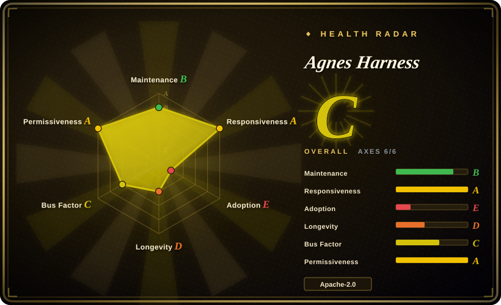
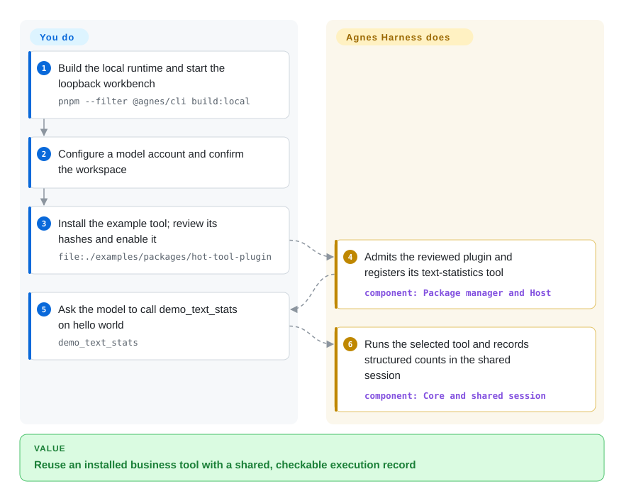
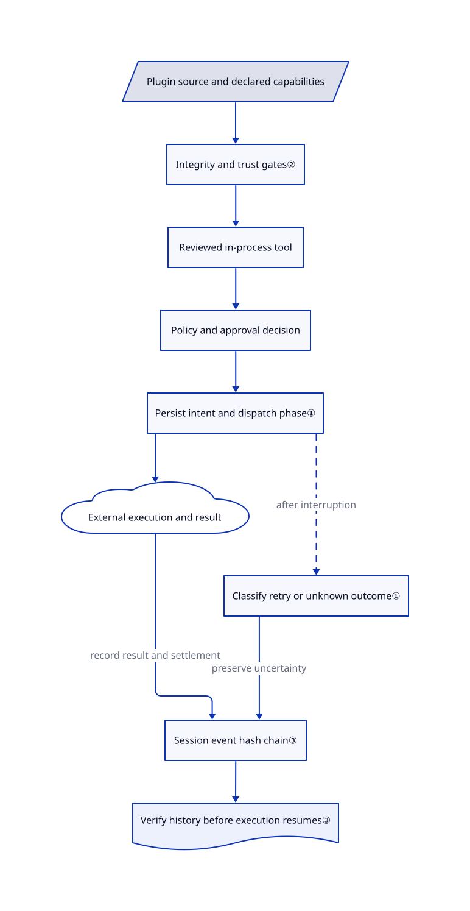

# Agnes Harness

Your customer-specific agent tool works, but its approvals and task history disappear between the browser and terminal. Agnes Harness puts both clients on one backend and packages business tools as reviewed plugins.

## When to use

You integrate agents into customer systems. One customer needs an order lookup; another needs a warehouse panel. After a command times out, nobody can tell whether it changed an order, and moving the task from Web to CLI means copying the conversation. You want a shared runtime with approval records, recoverable session state, and installable business tools instead of another customer-specific fork.

Choose Agnes when reusable backend tools and custom workbench panels belong in the same deployment. Unlike a graph library such as LangGraph, it supplies the local workbench, daemon, plugin lifecycle, and execution loop. You accept a source-only pre-alpha rather than a stable integration contract. Optional AgnesHub adds MHS device connections; ordinary software tasks do not require devices.

## When NOT to use

- **You only need a coding assistant.** Choose [OpenCode](../../coding-agents/terminal-agents/independent-runtimes/opencode.md) for a packaged terminal-first agent. Agnes adds source builds, native helpers, and customer-plugin integration work.
- **Your application needs an explicit Python workflow graph.** Choose [LangGraph](../agent-sdks/langgraph.md). Agnes runs its own loop; its documentation excludes a usable production Python runtime/thin SDK path.
- **You need a control center for existing Claude Code, Codex, or Gemini CLI processes.** Choose [OpenHands](../../coding-agents/orchestration-and-review/openhands.md). Agnes is an extensible runtime, not primarily a wrapper around those vendor CLIs.
- **You must execute hostile plugins in a multi-tenant service.** Evaluate OpenHands' container-sandboxed agent backends instead, keeping arbitrary plugin code outside the trusted host. Agnes ordinary backend plugins run in-process; package hashes and tool approvals do not isolate malicious Node code. Its workbench has no verified public-service login deployment.
- **You require stable releases, Windows security parity, or safe physical actuation today.** Use LangGraph for software state behind your own validated service, and keep device safety in a separately validated controller. Agnes has no public release or upgrade commitment, documents incomplete Windows boundaries, and says task cancellation is not an emergency stop. Jev-driven decisions remain planned, not implemented.

## Comparison

| Alternative | In index | Our verdict | Tradeoff |
| --- | --- | --- | --- |
| [LangGraph](../agent-sdks/langgraph.md) | ✅ | For an explicit graph embedded in your application, choose LangGraph; choose Agnes when a shared workbench and reviewed business plugins are the starting point. | LangGraph leaves clients, tools, and service assembly to you; Agnes supplies them but brings a younger, source-only platform. |
| [OpenHands](../../coding-agents/orchestration-and-review/openhands.md) | ✅ | For dispatching existing coding agents across machines and schedules, choose OpenHands; choose Agnes to build customer tools and panels inside one runtime. | OpenHands adds remote agent backends and container options; Agnes emphasizes plugin governance and shared local sessions rather than cross-agent dispatch. |
| [OpenCode](../../coding-agents/terminal-agents/independent-runtimes/opencode.md) | ✅ | For daily repository editing with provider choice, choose OpenCode; choose Agnes when business interfaces and plugin activation are the main integration problem. | OpenCode has packaged distribution and coding-focused clients; Agnes offers business extensions but requires native source builds and pre-alpha acceptance. |

## Quick start

Build from the repository root with `pnpm install --frozen-lockfile`, then `pnpm --filter @agnes/cli build:local`, and start `node packages/cli/dist/local/agnes.mjs serve`. Prepare Node.js 24.10+, pnpm 10.34.5, native build tools, and a separate trial home; keep the printed Web address on loopback. Configure a model account in Web and confirm the task directory; provider tests and conversations can incur charges. Install `file:./examples/packages/hot-tool-plugin`, review its source/content and capability hashes, and enable it through Plugin management. Ask it to call `demo_text_stats` on `hello world`; the expected structured result is `{"characters":11,"words":2}`. Agnes manages the tool loop and shared record; you supply credentials, validate permissions, inspect the actual tool record, and implement real connectors.

<!-- flow-steps:begin (generated from flows/agnes-harness.json by tools/flow_card.py — do not edit) -->

Text version of the flow

1. **You**: Build the local runtime and start the loopback workbench — `pnpm --filter @agnes/cli build:local`
2. **You**: Configure a model account and confirm the workspace
3. **You**: Install the example tool; review its hashes and enable it — `file:./examples/packages/hot-tool-plugin`
4. **Agnes Harness**: Admits the reviewed plugin and registers its text-statistics tool — component: `Package manager and Host`
5. **You**: Ask the model to call demo_text_stats on hello world — `demo_text_stats`
6. **Agnes Harness**: Runs the selected tool and records structured counts in the shared session — component: `Core and shared session`

**Value**: Reuse an installed business tool with a shared, checkable execution record

<!-- flow-steps:end -->

## Key techniques

<!-- mechanism:begin (generated from mechanisms/agnes-harness.json by tools/mechanism_card.py; do not edit) -->

Text version of the mechanism

- Plugin source and declared capabilities
- Integrity and trust gates②
- Reviewed in-process tool
- Policy and approval decision
- Persist intent and dispatch phase①
- External execution and result
- Classify retry or unknown outcome①
- Session event hash chain③
- Verify history before execution resumes③

- Plugin source and declared capabilities → Integrity and trust gates②
- Integrity and trust gates② → Reviewed in-process tool
- Reviewed in-process tool → Policy and approval decision
- Policy and approval decision → Persist intent and dispatch phase①
- Persist intent and dispatch phase① → External execution and result
- External execution and result → Session event hash chain③ (record result and settlement)
- Persist intent and dispatch phase① → Classify retry or unknown outcome① (after interruption) [optional/fallback]
- Classify retry or unknown outcome① → Session event hash chain③ (preserve uncertainty)
- Session event hash chain③ → Verify history before execution resumes③

<!-- mechanism:end -->

### 1. Recover effects without blindly repeating a write

- **Problem:** A crash after sending a command can leave its external effect unknown; retrying can perform the action twice.
- **How:** Core records effect intent and dispatch state, then classifies recovery from saved policy, effect identity, result, and transport phase. Safe reads can receive a bounded same-effect retry; idempotent actions need reconciliation evidence that they were not applied.
- **Limits:** Destructive or never-replay calls with uncertain dispatch remain unknown. This is not exactly-once execution; power loss can lose an unflushed retry-budget commit.
- **Source:** [Recovery classification:43–118](https://github.com/AgnesAI-Labs/agnes-harness/blob/98bc11572ba162bcdf6ce2b29612a44508faf951/packages/core/src/step/tool-recovery.ts#L43-L118), [intent and dispatch:965–1009](https://github.com/AgnesAI-Labs/agnes-harness/blob/98bc11572ba162bcdf6ce2b29612a44508faf951/packages/core/src/step/tools.ts#L965-L1009).

### 2. Bind package trust to reviewed bytes and capabilities

- **Problem:** Approving a package name does not establish trust in a changed version or expanded permissions.
- **How:** The trust gate checks installed-tree integrity, license allowlist, release quarantine, extension API range, and the capability ceiling. Installation and activation remain separate; Web enable confirmation binds current content and capability hashes.
- **Limits:** These checks admit trusted code; they do not contain arbitrary Node operations inside an ordinary in-process plugin. Four bundled helpers can be installed, trusted, and enabled automatically on initial configuration.
- **Source:** [Trust gate:29–92](https://github.com/AgnesAI-Labs/agnes-harness/blob/98bc11572ba162bcdf6ce2b29612a44508faf951/packages/package-manager/src/trust-gate.ts#L29-L92), [lifecycle and bundled helpers](https://github.com/AgnesAI-Labs/agnes-harness/blob/98bc11572ba162bcdf6ce2b29612a44508faf951/docs/guide/packages.md).

### 3. Check an event hash chain before trusting session history

- **Problem:** Reopening a session should not silently execute from changed or missing historical records.
- **How:** Each protected event hashes its canonical representation with the preceding digest and session identity. Verification checks contiguous sequences and digests in pages of 500 records. A verified-head checkpoint permits an early history view while full verification continues; execution waits for verification.
- **Limits:** The docs identify undetectable tail removal and an export race during worker hibernation. The chain does not prove an external action happened; session-open extension hooks can run before background verification finishes.
- **Source:** [Hashing and verification:71–162](https://github.com/AgnesAI-Labs/agnes-harness/blob/98bc11572ba162bcdf6ce2b29612a44508faf951/packages/core/src/log/integrity.ts#L71-L162), [history-integrity exceptions](https://github.com/AgnesAI-Labs/agnes-harness/blob/98bc11572ba162bcdf6ce2b29612a44508faf951/docs/guide/sessions.md).

## Tech stack

- TypeScript ESM monorepo on Node.js; CLI/TUI, SDK, daemon, Host, and Core packages.
- Cordis plugin contexts/lifecycles, React 18 Web assets, TypeBox/Ajv schema validation.
- SQLite session storage in the local profile; native process helpers and OS sandbox adapters.
- Apache-2.0 project code; vendored/adapted MIT code and binary dependencies retain separate terms. Inspect [NOTICE](https://github.com/AgnesAI-Labs/agnes-harness/blob/98bc11572ba162bcdf6ce2b29612a44508faf951/NOTICE) before redistribution.

## Dependencies

- Node.js ≥24.10, pnpm 10.34.5, and native build tools. macOS uses Xcode Command Line Tools and Seatbelt; Linux command execution requires usable bubblewrap/user namespaces.
- A model provider/account for real tasks. The simulated-model demo tests plumbing, not real model quality.
- A private home containing credentials, sessions, grants, audits, and caches. Clients share a daemon only with matching home/profile/data directory.
- Optional MCP servers, plugins, or AgnesHub/MHS devices. OAuth-bound MCP definitions are currently skipped by the session mounting path.

## Ops difficulty

**Medium for an isolated local trial; high for customer delivery.** Build native components, pin a commit, protect the home, and preserve sessions before upgrades. The workbench is loopback-local, not a ready public multi-user service. Hot updates and rollback cannot reverse external business effects. Linux/Windows acceptance, workload stability, and real model behavior need separate tests. The [security guide](https://github.com/AgnesAI-Labs/agnes-harness/blob/98bc11572ba162bcdf6ce2b29612a44508faf951/docs/guide/security.md) documents that Full permissions lets shell modify configuration state which file-tool protections refuse.

## Health & viability

- **Maintenance, 2026-10-22:** public and not archived; the repository was pushed that day, but reviewed `main` ends at a 2026-10-13 commit. PRs 499, 502, and 503 merged on 2026-10-22 into `feat/agh-plugin-core`, not `main`; do not assume those fixes are in this snapshot. The releases API returns no releases. This is active construction, not a stable release line.
- **Governance, 2026-10-22:** AgnesAI-Labs owns the project. Contributors include several accounts, with the largest at 164 commits; CONTRIBUTING limits code/documentation PRs to invited internal developers. Open licensing does not mean open contribution governance.
- **Age and selection judgment, 2026-10-22:** created 2026-09-22, only 30 days old. Treat it as an integration experiment rather than a durability bet. [推断：based on age, pre-alpha status, and absent releases; long-term survival is unobserved]
- **Adoption and license:** 1101 stars are interest, not evidence of production deployments. Apache-2.0 project code and retained notices favor reuse, but there is no public installer or upgrade commitment. See [limitations](https://github.com/AgnesAI-Labs/agnes-harness/blob/98bc11572ba162bcdf6ce2b29612a44508faf951/docs/reference/limitations.md).

## Caveats (unverified)

- [未验证：static review only; installation and model/device execution were not authorized] Sources were reviewed at `98bc11572ba162bcdf6ce2b29612a44508faf951`. Build success, cross-platform isolation, workload stability, tool selection, and physical safety were not reproduced.
- [推断：based on 30-day repository age, pre-alpha docs, and no releases] Limiting use to integration experiments is a risk judgment, not a measured failure rate.
- [未验证：no independent deployment evidence in reviewed sources] Stars do not establish production adoption; README benchmark numbers were not used as selection evidence or reproduced.
