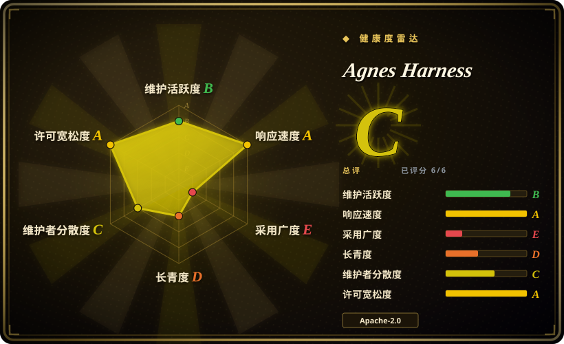
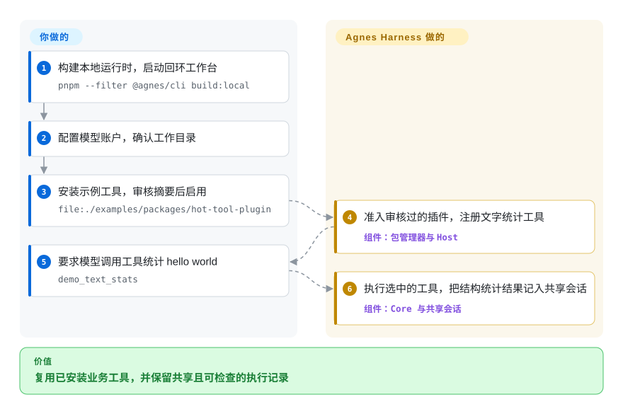
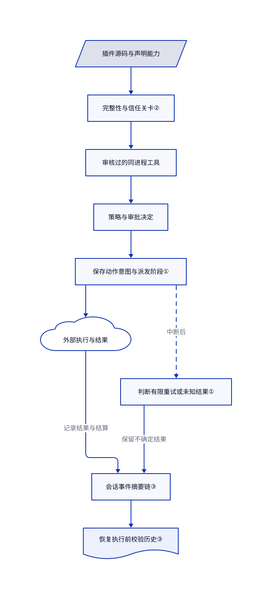

# Agnes Harness

给客户接好的工具能跑，但网页和终端各记各的审批与任务历史。Agnes Harness 让两端共用后台，再把业务工具做成经审核启用的插件。

## 何时使用

你负责把智能体接进客户系统。一家要查订单，另一家要仓库面板。命令超时后，没人知道订单是否已改；从网页换到终端，还得复制对话。你想共用执行记录、审批和恢复状态，把业务工具打包复用，而不是每个客户维护一个分叉。

当后端业务工具与定制工作台需要一起交付时，可以试用它。相比 LangGraph 这样的流程图库，它提供本地工作台、常驻后台、插件生命周期和执行循环。代价是接受只能源码构建的早期预览版，而非稳定集成合同。可选 AgnesHub 插件负责 MHS 设备接入；普通软件任务不需要设备。

## 何时不用

- **只要日常编码助手。** 选 [OpenCode](../../coding-agents/terminal-agents/independent-runtimes/opencode.zh.md)，直接使用面向终端的发行包。Agnes 多了源码构建、原生组件和客户插件集成工作。
- **要把明确的 Python 流程图嵌入应用。** 选 [LangGraph](../agent-sdks/langgraph.zh.md)。Agnes 自己运行工具循环，文档明确没有可用的生产 Python 运行时及轻量 SDK 路径。
- **要统一调度现有 Claude Code、Codex 或 Gemini CLI。** 选 [OpenHands](../../coding-agents/orchestration-and-review/openhands.zh.md)。Agnes 是可扩展运行时，不是主要给这些厂商命令行套控制台。
- **要在多租户服务里运行恶意插件。** 可评估 OpenHands 的容器沙箱后端，并把任意插件代码放在受信宿主之外。Agnes 普通后端插件在同一进程执行；内容摘要和工具审批不隔离恶意 Node 代码。网页工作台也没有验证过的公网登录部署。
- **今天就要稳定发行、Windows 安全对齐或安全驱动实体设备。** 软件状态机可用 LangGraph，再自行验证服务。设备安全应留给另行验证的控制器。Agnes 不承诺公开发行和升级，Windows 边界仍不完整，取消任务不等于紧急停止。Jev 决策集成也仍是规划，不是现成功能。

## 横向对比

| 替代品 | 是否收录 | 我们的评价 | 取舍 |
| --- | --- | --- | --- |
| [LangGraph](../agent-sdks/langgraph.zh.md) | ✅ | 要把明确的流程图嵌进自己的应用，选 LangGraph；要从共享工作台和经审核的业务插件起步，选 Agnes。 | LangGraph 把客户端、工具和服务组装留给你；Agnes 提供这些组件，但平台更年轻，而且只能源码构建。 |
| [OpenHands](../../coding-agents/orchestration-and-review/openhands.zh.md) | ✅ | 要跨机器、按计划派发现有编码助手，选 OpenHands；要在同一运行时开发客户工具和面板，选 Agnes。 | OpenHands 提供远程后端和容器选项；Agnes 更重插件治理与本地共享会话，而非跨助手调度台。 |
| [OpenCode](../../coding-agents/terminal-agents/independent-runtimes/opencode.zh.md) | ✅ | 日常改仓库、自由选模型，选 OpenCode；主要难题是业务界面和插件启用，才选 Agnes。 | OpenCode 有发行包和编码客户端；Agnes 的业务扩展面更宽，但要原生源码构建，并自行验收早期接口。 |

## 快速上手

在仓库根目录执行 `pnpm install --frozen-lockfile`，再执行 `pnpm --filter @agnes/cli build:local`，随后用 `node packages/cli/dist/local/agnes.mjs serve` 启动。准备 Node.js 24.10 以上、pnpm 10.34.5、原生构建工具和独立试用目录，只使用终端打印的回环地址。在网页配置模型账户，确认任务目录；连接测试和对话可能收费。从 `file:./examples/packages/hot-tool-plugin` 安装文字统计示例，审核来源、内容摘要和能力摘要，再通过插件管理启用。要求调用 `demo_text_stats` 统计 `hello world`，预期结构结果是 `{"characters":11,"words":2}`。Agnes 管工具循环和共享记录；你提供凭据、验证权限、查看真实工具记录，并编写真正的业务连接器。

<!-- flow-steps:begin (generated from flows/agnes-harness.json by tools/flow_card.py — do not edit) -->

流程文字版

1. **你**：构建本地运行时，启动回环工作台 — `pnpm --filter @agnes/cli build:local`
2. **你**：配置模型账户，确认工作目录
3. **你**：安装示例工具，审核摘要后启用 — `file:./examples/packages/hot-tool-plugin`
4. **Agnes Harness**：准入审核过的插件，注册文字统计工具 — 组件：`包管理器与 Host`
5. **你**：要求模型调用工具统计 hello world — `demo_text_stats`
6. **Agnes Harness**：执行选中的工具，把结构统计结果记入共享会话 — 组件：`Core 与共享会话`

**价值**：复用已安装业务工具，并保留共享且可检查的执行记录

<!-- flow-steps:end -->

## 技术要点

<!-- mechanism:begin (generated from mechanisms/agnes-harness.json by tools/mechanism_card.py; do not edit) -->

机制文字版

- 插件源码与声明能力
- 完整性与信任关卡②
- 审核过的同进程工具
- 策略与审批决定
- 保存动作意图与派发阶段①
- 外部执行与结果
- 判断有限重试或未知结果①
- 会话事件摘要链③
- 恢复执行前校验历史③

- 插件源码与声明能力 → 完整性与信任关卡②
- 完整性与信任关卡② → 审核过的同进程工具
- 审核过的同进程工具 → 策略与审批决定
- 策略与审批决定 → 保存动作意图与派发阶段①
- 保存动作意图与派发阶段① → 外部执行与结果
- 外部执行与结果 → 会话事件摘要链③（记录结果与结算）
- 保存动作意图与派发阶段① → 判断有限重试或未知结果①（中断后）〔可选／兜底〕
- 判断有限重试或未知结果① → 会话事件摘要链③（保留不确定结果）
- 会话事件摘要链③ → 恢复执行前校验历史③

<!-- mechanism:end -->

### 1. 恢复执行，但不盲目重做写操作

- **解决：** 命令发出后崩溃，外部结果可能未知；直接重试可能把同一动作做两次。
- **做法：** Core 保存副作用意图和派发状态，再结合持久化策略、动作身份、结果和传输阶段判断恢复。安全只读调用可有限重试同一动作；幂等操作还需要“尚未应用”的核对证据。
- **边界：** 破坏性或禁止重放的调用，只要派发结果不明就保留未知。这不保证恰好执行一次；断电可能丢失未刷盘的重试预算提交。
- **源码：** [恢复分类第 43–118 行](https://github.com/AgnesAI-Labs/agnes-harness/blob/98bc11572ba162bcdf6ce2b29612a44508faf951/packages/core/src/step/tool-recovery.ts#L43-L118)、[意图和派发记录第 965–1009 行](https://github.com/AgnesAI-Labs/agnes-harness/blob/98bc11572ba162bcdf6ce2b29612a44508faf951/packages/core/src/step/tools.ts#L965-L1009)。

### 2. 信任绑定审核过的字节和能力

- **解决：** 批准包名，不代表批准后来变动的版本或扩大的权限。
- **做法：** 信任关卡检查安装目录完整性、许可证白名单、发布隔离期、扩展接口版本和能力上限。安装与激活分开；网页启用确认绑定当前内容摘要与能力摘要。
- **边界：** 这些检查负责准入受信代码，不限制普通同进程插件里的任意 Node 操作。四个内置助手插件可在初次配置时自动安装、信任并启用。
- **源码：** [信任关卡第 29–92 行](https://github.com/AgnesAI-Labs/agnes-harness/blob/98bc11572ba162bcdf6ce2b29612a44508faf951/packages/package-manager/src/trust-gate.ts#L29-L92)、[包生命周期与内置助手行为](https://github.com/AgnesAI-Labs/agnes-harness/blob/98bc11572ba162bcdf6ce2b29612a44508faf951/docs/guide/packages.md)。

### 3. 用事件摘要链检查会话历史

- **解决：** 重新打开会话时，不应从被修改或缺失的记录继续执行。
- **做法：** 每条受保护事件把规范化内容、前一条摘要和会话身份一起计算摘要。校验按每页 500 条检查连续序号和摘要。已验证位置允许先显示历史、后台继续全量检查；执行仍等待校验。
- **边界：** 文档列出无法检测尾部删除，以及工作进程休眠期间的导出竞争。摘要链不能证明外部动作实际发生；会话打开时的扩展钩子可先于后台校验完成运行。
- **源码：** [摘要和分页校验第 71–162 行](https://github.com/AgnesAI-Labs/agnes-harness/blob/98bc11572ba162bcdf6ce2b29612a44508faf951/packages/core/src/log/integrity.ts#L71-L162)、[历史完整性范围与例外](https://github.com/AgnesAI-Labs/agnes-harness/blob/98bc11572ba162bcdf6ce2b29612a44508faf951/docs/guide/sessions.md)。

## 技术栈

- Node.js 上的 TypeScript ESM 单仓库，包含命令行、终端界面、SDK、常驻后台、Host 和 Core。
- Cordis 管插件上下文和生命周期；网页资源使用 React 18；TypeBox 与 Ajv 校验数据结构。
- 本地配置使用 SQLite 保存会话，另有平台原生进程辅助组件和系统命令沙箱适配器。
- 项目自有代码采用 Apache-2.0。引入及改编的 MIT 代码、二进制依赖保留独立声明；再分发前应查看 [NOTICE](https://github.com/AgnesAI-Labs/agnes-harness/blob/98bc11572ba162bcdf6ce2b29612a44508faf951/NOTICE)。

## 依赖

- Node.js 24.10 以上、pnpm 10.34.5 和原生构建工具。macOS 使用 Xcode Command Line Tools 与 Seatbelt；Linux 命令执行需要可用的 bubblewrap 和用户命名空间。
- 真实任务需要配置模型账户。模拟模型演示只验证接线，不证明真实模型质量。
- 独立私有数据目录，保存凭据、会话、授权、审计和缓存。客户端只有使用相同数据目录及配置身份才共用后台。
- 可选 MCP 服务、自定义插件或 AgnesHub／MHS 设备。会话挂载路径目前跳过绑定 OAuth 的 MCP 定义。

## 运维难度

**隔离的本地试用为中等，客户交付为高。** 你要构建原生组件、固定提交、保护私有目录，并在升级前保留会话。工作台面向本机回环，不是现成的公网多用户服务。插件热更新和回滚不能撤销外部业务副作用。Linux／Windows、长任务稳定性和模型行为都需单独验收。[安全指南](https://github.com/AgnesAI-Labs/agnes-harness/blob/98bc11572ba162bcdf6ce2b29612a44508faf951/docs/guide/security.md)还指出，完全权限下的 shell 可以修改被文件工具保护的配置状态。

## 健康度与可持续性

- **维护情况，截至 2026-10-22：** 公开、未归档，仓库当天仍推送，但已读 `main` 停在 2026-10-13 的提交。PR 499、502、503 当天合入的是 `feat/agh-plugin-core`，不是 `main`；不能把这些修复算入本次快照。发行 API 没有返回发行版本。这是活跃建设期，不是稳定发行线。
- **治理情况，截至 2026-10-22：** AgnesAI-Labs 持有仓库。贡献者接口显示多人参与，最大贡献者有 164 次提交；贡献说明只接受受邀内部开发者的代码及文档 PR。许可证开放不等于贡献治理开放。
- **年龄与选型判断，截至 2026-10-22：** 仓库创建于 2026-09-22，只有 30 天。宜作为集成实验，而非长期依赖押注。[推断：依据是仓库年龄、早期预览状态和没有发行，长期存续尚不可观察]
- **采用与许可：** 1101 星只能说明关注，不能证明生产部署。自有代码 Apache-2.0、保留第三方声明，有利于复用；但没有公开安装器或升级承诺。详见[限制清单](https://github.com/AgnesAI-Labs/agnes-harness/blob/98bc11572ba162bcdf6ce2b29612a44508faf951/docs/reference/limitations.md)。

## 存疑（未验证）

- [未验证：本次仅静态阅读，未获准安装上游或运行模型与设备] 调研固定在 `98bc11572ba162bcdf6ce2b29612a44508faf951`。未复现构建、跨平台隔离、长任务稳定性、模型选工具和实体设备安全。
- [推断：依据是仓库只有 30 天、预览文档及没有发行] 建议只做集成实验，是风险判断，不是测得的故障率。
- [未验证：已读材料没有独立生产部署证据] 星数不能证明生产采用；未将 README 的基准数字作为选型证据，也未复现。
