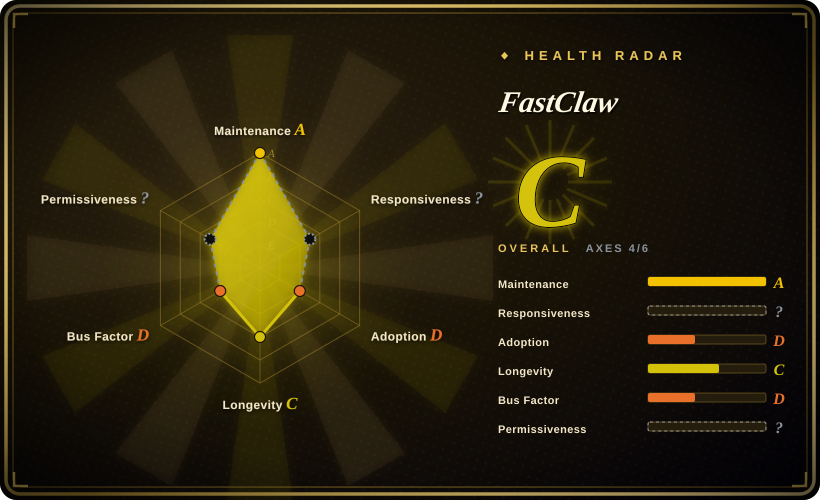
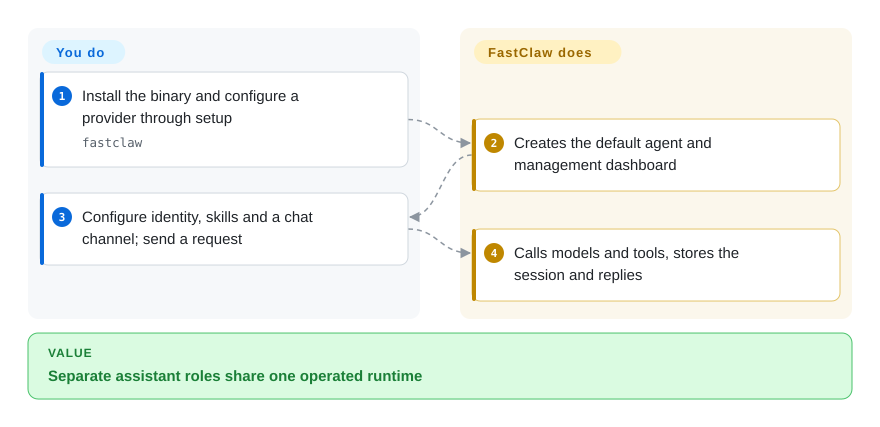
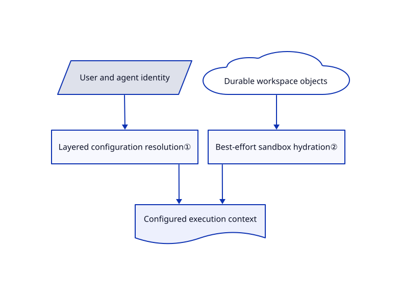

# FastClaw

Your support bot and research bot need different models, memory and chat credentials, but you do not want a separate stack for each. FastClaw puts named agents, configuration, sessions and messaging adapters behind one Go service.

## When to use

You are building an application with several assistant roles, each answering through a web chat, an API or an IM bot. Instead of assembling a Python agent framework and a separate management interface, you run FastClaw and create agents with their own model, identity files and skills. Pick it over OpenClaw when managing many agent records and application-user sessions is the core need; pick a library when you need to control the loop inside your own process instead. Its single-binary core does not make sandboxing or distributed storage free.

## When NOT to use

- **An OSI-only or white-label platform:** its Community License adds SaaS and branding restrictions to Apache text. Choose MIT [OpenClaw](../personal-assistants/openclaw.md) for a personal/trusted-team assistant, or [Pydantic AI](../agent-sdks/pydantic-ai.md) to build your own licensed runtime.
- **Untrusted users with default settings:** self-hosted execution uses the host shell by default; sandbox use is optional unless enforced. Use an explicitly hardened deployment, or [OpenClaw Enterprise](../../kubernetes-agents/openclaw-enterprise.md) when isolated tenant infrastructure is the actual requirement.
- **A tiny private assistant without platform administration:** choose [Hermes Agent](../personal-assistants/hermes-agent.md); FastClaw adds accounts, scoped configuration, API keys and a database you must manage.
- **Guaranteed all-or-nothing workspace restoration:** the hydration implementation logs and skips per-file failures. For transaction-like workflows, build explicit validation in your application using [Pydantic AI](../agent-sdks/pydantic-ai.md), not an assumption that a sandbox contains every saved file.

## Comparison

| Alternative | In index | Our verdict | Tradeoff |
|---|---|---|---|
| [OpenClaw](../personal-assistants/openclaw.md) | ✅ | Choose FastClaw for an application-facing roster of agents and scoped credentials; choose OpenClaw for one assistant spanning personal channels. | FastClaw centralizes agent records and per-user sessions, but brings a restrictive community license and platform administration. |
| [Hermes Agent](../personal-assistants/hermes-agent.md) | ✅ | Choose Hermes for a personal server assistant that accumulates reusable procedures; choose FastClaw for a dashboard and API managing separate agent identities. | Hermes emphasizes one persistent assistant profile; FastClaw keeps agents, settings and credentials in a service database. |
| [Pydantic AI](../agent-sdks/pydantic-ai.md) | ✅ | Choose Pydantic AI when your Python application must own the agent loop and validation; choose FastClaw when you want an operated agent service. | A library avoids adopting this platform's storage and UI conventions, but you build sessions, channels and administration yourself. |

## Quick start

Install a release binary, or inspect the README's installer before using it: that script downloads a release and can append to your shell configuration. Run `fastclaw` to open setup, configure a model provider and create the default agent. Open `http://localhost:18953`, sign in with the admin credential and edit the agent's identity, skills and channel bindings. FastClaw handles model calls, tools and session storage; you provide provider keys, bot tokens, backups and safe tool permissions. Before accepting untrusted chatters on a self-hosted installation, configure a sandbox and `FASTCLAW_SANDBOX_ENFORCE=1`; enabling the sandbox feature alone does not remove host execution.

<!-- flow-steps:begin (generated from flows/fastclaw.json by tools/flow_card.py — do not edit) -->

Text version of the flow

1. **You**: Install the binary and configure a provider through setup — `fastclaw`
2. **FastClaw**: Creates the default agent and management dashboard
3. **You**: Configure identity, skills and a chat channel; send a request
4. **FastClaw**: Calls models and tools, stores the session and replies

**Value**: Separate assistant roles share one operated runtime

<!-- flow-steps:end -->

## Key techniques

<!-- mechanism:begin (generated from mechanisms/fastclaw.json by tools/mechanism_card.py; do not edit) -->

Text version of the mechanism

- User and agent identity
- Layered configuration resolution①
- Durable workspace objects
- Best-effort sandbox hydration②
- Configured execution context

- User and agent identity → Layered configuration resolution①
- Layered configuration resolution① → Configured execution context
- Durable workspace objects → Best-effort sandbox hydration②
- Best-effort sandbox hydration② → Configured execution context

<!-- mechanism:end -->

### 1. Resolve configuration by ownership

- **Problem:** Shared providers and defaults must coexist with private user and agent choices.
- **How:** Configuration resolves from system to user to agent to the user-agent pair. Provider records replace by name; settings merge top-level fields; a disabled inner channel removes an inherited channel.
- **Limits:** Provider replacement is not a deep field merge. This precedence is a configuration mechanism, not proof that every tenant boundary has been audited.
- **Source:** [Ownership resolution](https://github.com/fastclaw-ai/fastclaw/blob/45a7f8bd97c168cf4ad9d2c57f087fe043c0a7ef/internal/scope/scope.go#L1-L258).

### 2. Restore durable files into disposable sandboxes

- **Problem:** A new sandbox must see files saved in previous sessions without becoming the permanent data store.
- **How:** Hydration lists workspace objects by agent, project and session, reads each object and writes it into the sandbox. Storage and execution remain separate components.
- **Limits:** Copying is sequential and best-effort: list or per-file failures are logged, and individual files can be missing. Large workspaces need a different transfer strategy; the code itself recommends pagination, parallel copying or snapshots.
- **Source:** [Sandbox hydration](https://github.com/fastclaw-ai/fastclaw/blob/45a7f8bd97c168cf4ad9d2c57f087fe043c0a7ef/internal/sandbox/workspace_hydrate.go#L13-L63).

## Tech stack

Go 1.25 core, Cobra CLI and bundled web console; SQLite by default, PostgreSQL support, Redis messaging/leases and S3-compatible object storage for distributed setups. Docker and E2B are sandbox backends; provider and messaging SDKs are declared in `go.mod`.

## Dependencies

A model provider, local or remote; writable persistent storage for `~/.fastclaw`; bot credentials for connected channels. Sandboxing needs Docker or an E2B account. Multi-replica deployment adds PostgreSQL, Redis and shared object storage rather than sharing one local SQLite file.

## Ops difficulty

**Medium locally, high for hosted multi-user operation.** The binary and SQLite simplify a single node. Public access requires credential rotation, session isolation checks and enforced sandbox policies; multiple replicas add database migrations, leases, shared workspaces and sandbox capacity. The default boot path automatically runs storage migrations, so back up before upgrades.

## Health & viability

- **2026-10-18:** v1.4.0 shipped October 14 after v1.3 releases on October 9; the repository has recent commits and is not archived.
- Created March 2026, about seven months ago; active development does not yet supply a multi-year Lindy record.
- ThinkAny's license and the contributor list show vendor control with contributions concentrated in `idoubi` and `Bin-Huang`. A Go core is not evidence of operational maturity.
- [Commercial Use §1(a)](https://github.com/fastclaw-ai/fastclaw/blob/45a7f8bd97c168cf4ad9d2c57f087fe043c0a7ef/LICENSE#L7-L30) permits commercial use “without modifying the source code”; the listed permitted cases include internal deployment and use as your own product's backend. Restrictions on selling FastClaw itself as a multi-tenant platform and removing frontend branding still apply. Do not label the project Apache-2.0; commercial use after source modification needs clarification as recorded below.

## Caveats (unverified)

- [未验证：未获许可方对修改后商用范围的澄清] Commercial Use §1(a)'s “without modifying the source code” qualifier must be read alongside the permitted-use examples and appended Apache terms. Confirm the authorization scope with ThinkAny before commercial use of modified source; this page concludes neither unrestricted permission nor a blanket prohibition.
- [未验证：本次禁止执行上游程序] Tenant isolation, sandbox enforcement across all tools, throughput and deployment migrations were not exercised.
- [推断：依据是逐文件容错的恢复实现] Applications needing complete workspace restoration should verify expected files before executing a task.
