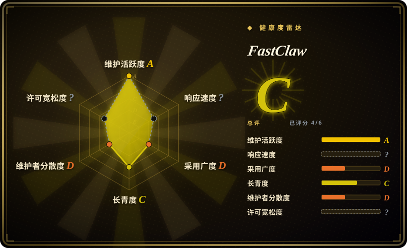
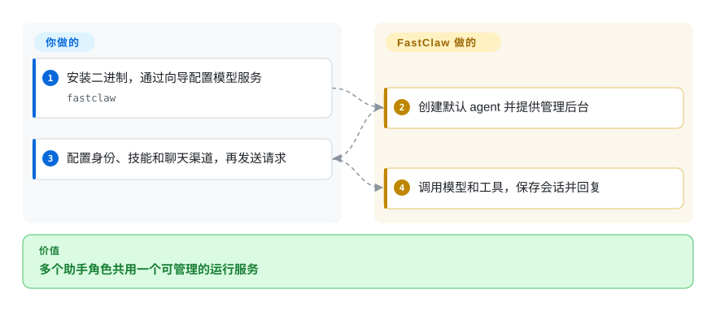
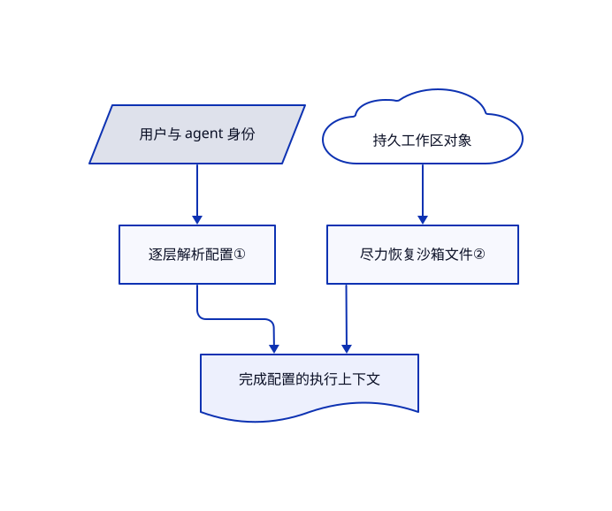

# FastClaw

客服机器人和调研机器人各要模型、记忆和聊天凭据，你却不想各搭一套服务。FastClaw 用一个 Go 服务管理多个具名 agent、配置、会话与聊天接入。

## 何时使用

你正在开发带多个助手角色的应用，各角色要从网页、接口或聊天机器人接收请求。相比组装 Python 框架再另做管理后台，你可以部署 FastClaw，为每个 agent 配置模型、身份文件和技能。相比 OpenClaw，你的核心需求是管理多个 agent 记录和应用用户会话；若必须把循环嵌进自己的程序，则该选库。单二进制核心不代表沙箱与分布式存储没有成本。

## 何时不用

- **只准 OSI 许可或需要白标平台：** Community License 在 Apache 文本上增加托管和品牌限制。个人或可信团队助手可选 MIT 的 [OpenClaw](../personal-assistants/openclaw.zh.md)；自建运行时可用 [Pydantic AI](../agent-sdks/pydantic-ai.zh.md)。
- **默认配置直接接不可信用户：** 自托管默认仍使用宿主 shell，未强制时沙箱只是可选工具。应先加固；若目标是隔离租户基础设施，可考虑 [OpenClaw Enterprise](../../kubernetes-agents/openclaw-enterprise.zh.md)。
- **只要一个私人助手，不想管理平台：** 选 [Hermes Agent](../personal-assistants/hermes-agent.zh.md)；FastClaw 额外引入账号、分层配置、接口密钥和数据库。
- **必须完整恢复工作区才能运行：** 恢复实现会记录并跳过单文件失败。用 [Pydantic AI](../agent-sdks/pydantic-ai.zh.md) 在自己的应用里明确校验，不要假定沙箱一定包含全部保存文件。

## 横向对比

| 替代品 | 是否收录 | 我们的评价 | 取舍 |
|---|---|---|---|
| [OpenClaw](../personal-assistants/openclaw.zh.md) | ✅ | 应用要管理多个 agent 和分层凭据，选 FastClaw；一个助手覆盖个人聊天渠道，选 OpenClaw。 | FastClaw 集中管理 agent 与用户会话，但增加社区许可限制和平台运维。 |
| [Hermes Agent](../personal-assistants/hermes-agent.zh.md) | ✅ | 私人服务器助手积累操作方法，选 Hermes；后台和接口管理多个独立身份，选 FastClaw。 | Hermes 侧重持续存在的个人配置；FastClaw 将 agent、配置与凭据存进服务数据库。 |
| [Pydantic AI](../agent-sdks/pydantic-ai.zh.md) | ✅ | Python 应用必须控制循环与校验，选 Pydantic AI；要直接运营 agent 服务，选 FastClaw。 | 库不绑定本平台的数据和界面约定，但会话、渠道和管理功能都要自己做。 |

## 快速上手

安装发布二进制，或先检查 README 的安装脚本；脚本会下载发布包，并可能追加 shell 配置。运行 `fastclaw` 打开向导，配置模型供应商并创建默认 agent。打开 `http://localhost:18953`，用管理员凭据登录，再配置身份、技能和聊天渠道。FastClaw 负责调用模型、工具和保存会话；你提供模型密钥、机器人令牌、备份和安全权限。自托管接不可信用户之前，应配置沙箱并设置 `FASTCLAW_SANDBOX_ENFORCE=1`；只开启沙箱功能并不会禁止宿主执行。

<!-- flow-steps:begin (generated from flows/fastclaw.json by tools/flow_card.py — do not edit) -->

流程文字版

1. **你**：安装二进制，通过向导配置模型服务 — `fastclaw`
2. **FastClaw**：创建默认 agent 并提供管理后台
3. **你**：配置身份、技能和聊天渠道，再发送请求
4. **FastClaw**：调用模型和工具，保存会话并回复

**价值**：多个助手角色共用一个可管理的运行服务

<!-- flow-steps:end -->

## 技术要点

<!-- mechanism:begin (generated from mechanisms/fastclaw.json by tools/mechanism_card.py; do not edit) -->

机制文字版

- 用户与 agent 身份
- 逐层解析配置①
- 持久工作区对象
- 尽力恢复沙箱文件②
- 完成配置的执行上下文

- 用户与 agent 身份 → 逐层解析配置①
- 逐层解析配置① → 完成配置的执行上下文
- 持久工作区对象 → 尽力恢复沙箱文件②
- 尽力恢复沙箱文件② → 完成配置的执行上下文

<!-- mechanism:end -->

### 1. 按归属层级解析配置

- **解决：** 共用供应商和默认值，必须能与用户和 agent 的私有配置并存。
- **做法：** 配置按系统、用户、agent、用户与 agent 组合逐层覆盖。供应商按名称整项替换，设置只合并顶层字段；内层禁用渠道会删除继承项。
- **边界：** 供应商不是逐字段深合并。这是配置机制，不代表所有租户边界都经过安全审计。
- **源码：** [归属层级解析](https://github.com/fastclaw-ai/fastclaw/blob/45a7f8bd97c168cf4ad9d2c57f087fe043c0a7ef/internal/scope/scope.go#L1-L258)。

### 2. 将持久文件恢复到临时沙箱

- **解决：** 新沙箱要看到以往会话文件，但不应自己充当永久存储。
- **做法：** 恢复器按 agent、项目和会话列出工作区对象，逐个读取，再写入沙箱；持久存储和执行组件分开。
- **边界：** 复制是串行且尽力而为；列表或文件失败会记日志，单个文件可能缺失。源码明确建议大型工作区使用分页、并发复制或快照。
- **源码：** [沙箱文件恢复](https://github.com/fastclaw-ai/fastclaw/blob/45a7f8bd97c168cf4ad9d2c57f087fe043c0a7ef/internal/sandbox/workspace_hydrate.go#L13-L63)。

## 技术栈

Go 1.25 核心、Cobra 命令行与内嵌网页控制台；默认 SQLite，可选 PostgreSQL；分布式部署使用 Redis 消息与租约，以及兼容 S3 的对象存储。沙箱支持 Docker 和 E2B；供应商与聊天 SDK 见 `go.mod`。

## 依赖

本地或远程模型服务；保存 `~/.fastclaw` 的持久空间；各聊天平台的机器人凭据。沙箱需要 Docker 或 E2B 账号。多副本还需 PostgreSQL、Redis 和共享对象存储，而不是共用一个本地 SQLite 文件。

## 运维难度

**本地中，托管多用户高。** 二进制和 SQLite 简化单节点部署。对外服务需要轮换凭据、检查会话隔离并强制沙箱策略；多副本增加数据库迁移、租约、共享文件和沙箱容量管理。启动默认自动执行存储迁移，升级前必须备份。

## 健康度与可持续性

- **2026-10-18：** v1.4.0 发布于 10 月 14 日，之前 10 月 9 日有 v1.3 系列；仓库近期仍提交，未归档。
- 创建于 2026 年 3 月，约七个月；活跃不等于已有多年的林迪记录。
- ThinkAny 的许可证与贡献列表体现厂商控制，提交集中在 `idoubi` 和 `Bin-Huang`。Go 核心不等于运维成熟。
- [商用条款第 1（a）项](https://github.com/fastclaw-ai/fastclaw/blob/45a7f8bd97c168cf4ad9d2c57f087fe043c0a7ef/LICENSE#L7-L30) 明确以“不修改源代码”为商用限定；后续列出的允许场景包括内部部署及作为自有产品后端。向多租户销售 FastClaw 平台本身及移除前端品牌的限制仍保留。不能标成 Apache-2.0；修改源码后的商用范围须另行确认，见下方存疑项。

## 存疑（未验证）

- [未验证：未获许可方对修改后商用范围的澄清] 商用条款第 1（a）项的“不修改源代码”限定，须与后续允许场景及附带 Apache 条款共同解释。修改源码后商用前应向 ThinkAny 确认授权范围；本页既不推定无限制许可，也不认定一律禁止。
- [未验证：本次禁止执行上游程序] 未实测租户隔离、各工具的沙箱强制、吞吐及部署迁移。
- [推断：依据是逐文件容错的恢复实现] 需要完整工作区的应用，应在执行任务前检查预期文件。
