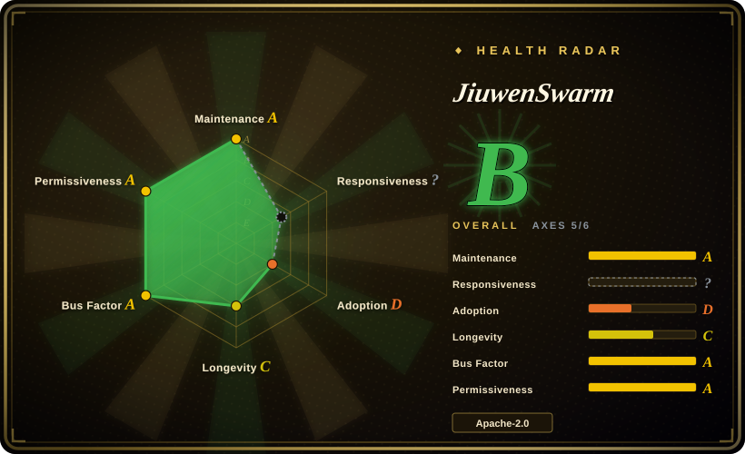
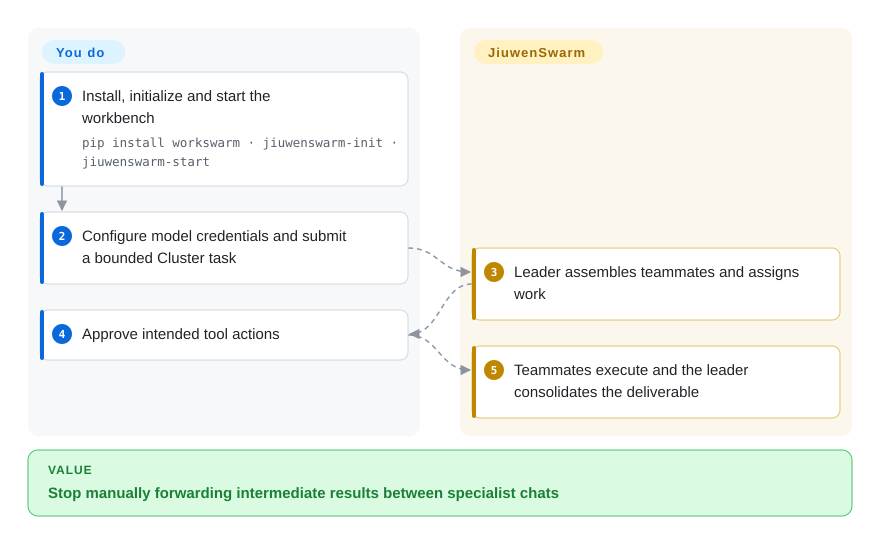
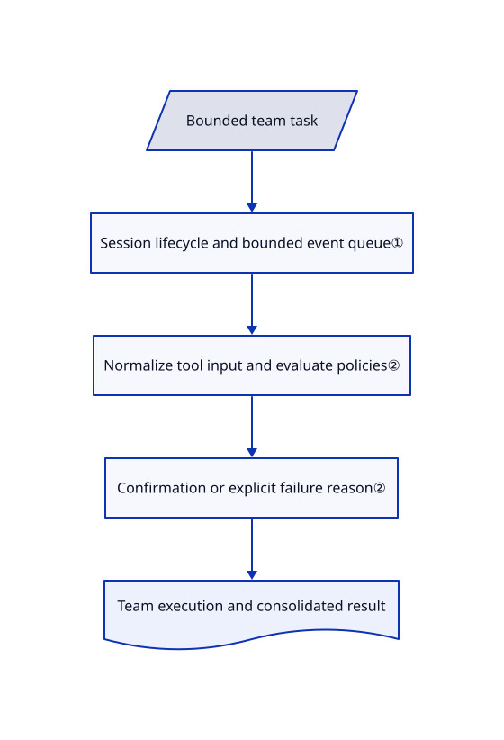

# JiuwenSwarm

A research-and-report task needs several specialists, but you keep moving their outputs between chats. JiuwenSwarm supplies a workbench where a leader assigns work, collects teammates' results and exposes tool approvals.

## When to use

You want to ask for an industry report from a browser or Feishu and have a leader coordinate research, analysis and drafting without writing a Python graph first. Choose JiuwenSwarm over an agent SDK when the ready-made Work/Code workbench, chat adapters and team management are worth operating its larger application. Start with local team execution; distributing agents adds separate registry, transport and shared-storage requirements rather than merely a switch for more workers.

## When NOT to use

- **You are embedding a small typed model call.** Choose [Pydantic AI](../agent-sdks/pydantic-ai.md); this application brings web services, memory stores, connectors and many dependencies.
- **You must program every transition and checkpoint yourself.** Choose [LangGraph](../agent-sdks/langgraph.md); a model-led team is not a deterministic application graph.
- **You need simultaneous distributed teams in multiple terminal windows.** The distributed guide specifies one active session per channel and stopping the previous team on a new session. Keep local teams or use a custom [CrewAI](../agent-sdks/crewai.md) deployment with your own concurrency policy.
- **You expect all learning writes to ask first.** Evolution is disabled by default; when enabled, teammate experience uses automatic saving even with `auto_save: false`. Keep it disabled or use version-controlled [CrewAI](../agent-sdks/crewai.md) role definitions with an external review process.
- **You need independent evidence that harness optimization generalizes.** Use an external acceptance set frozen before optimization rather than treating internal candidate scores as unseen-case evidence. The reviewed single-harness [configuration materializer](https://github.com/openJiuwen-ai/jiuwenswarm/blob/660d28b26c70390ac1ac8f48dc1513dd149983ed/jiuwenswarm/agents/harness/common/rsi/materializer.py#L294-L323) sets `candidate_holdout_cases: 0`; its [service path](https://github.com/openJiuwen-ai/jiuwenswarm/blob/660d28b26c70390ac1ac8f48dc1513dd149983ed/jiuwenswarm/agents/harness/common/rsi/services.py#L896-L903) accepts one candidate and no improver evolution policy. Internal improvement therefore does not establish generalization; this limitation describes that generated profile, not a prohibition on evaluating the project externally.

## Comparison

| Alternative | In index | Our verdict | Tradeoff |
|---|---|---|---|
| [CrewAI](../agent-sdks/crewai.md) | ✅ | Choose JiuwenSwarm for a workbench and existing chat channels; choose CrewAI when your Python application should own roles and task integration. | Packaged user surfaces versus application-controlled assembly; both require validating model-led handoffs. |
| [LangGraph](../agent-sdks/langgraph.md) | ✅ | Choose LangGraph for explicit resumable transitions; choose JiuwenSwarm for an immediately usable leader/team application. | More control costs graph code and service assembly. |
| [OpenClaw](../personal-assistants/openclaw.md) | ✅ | Choose OpenClaw for one personal assistant across many channels; choose JiuwenSwarm when visible team formation and role handoffs are the main task. | A personal gateway versus a larger multi-agent workbench; neither removes the need to constrain host access. |

## Quick start

The documented command-line path is `pip install workswarm`, `jiuwenswarm-init`, then `jiuwenswarm-start`; the browser frontend opens at `http://localhost:5173`. Supply a default model name, API address, key and provider in the configuration page or `~/.jiuwenswarm/config/config.yaml`. Submit a bounded task in Cluster mode and approve intended tool calls; the leader organizes teammates and consolidates the deliverable. You supply model access, integration credentials and file permissions, and pay for model calls. Pin a tested release: the latest release and the reviewed default-branch manifest carry different version numbers.

<!-- flow-steps:begin (generated from flows/jiuwenswarm.json by tools/flow_card.py — do not edit) -->

Text version of the flow

1. **You**: Install, initialize and start the workbench — `pip install workswarm · jiuwenswarm-init · jiuwenswarm-start`
2. **You**: Configure model credentials and submit a bounded Cluster task
3. **JiuwenSwarm**: Leader assembles teammates and assigns work
4. **You**: Approve intended tool actions
5. **JiuwenSwarm**: Teammates execute and the leader consolidates the deliverable

**Value**: Stop manually forwarding intermediate results between specialist chats

<!-- flow-steps:end -->

## Key techniques

<!-- mechanism:begin (generated from mechanisms/jiuwenswarm.json by tools/mechanism_card.py; do not edit) -->

Text version of the mechanism

- Bounded team task
- Session lifecycle and bounded event queue①
- Normalize tool input and evaluate policies②
- Confirmation or explicit failure reason②
- Team execution and consolidated result

- Bounded team task → Session lifecycle and bounded event queue①
- Session lifecycle and bounded event queue① → Normalize tool input and evaluate policies②
- Normalize tool input and evaluate policies② → Confirmation or explicit failure reason②
- Confirmation or explicit failure reason② → Team execution and consolidated result

<!-- mechanism:end -->

### 1. Team lifecycle with bounded observer queues

- **Problem:** A disconnected workbench must not make a long team run retain every event indefinitely.
- **How:** TeamManager owns session/request generations, streams and observers. Its event queue is bounded to 64 entries and producers wait for capacity; local execution uses the underlying Runner runtime pool rather than the auxiliary distributed bootstrap objects.
- **Limits:** This is event backpressure, not a token or task-quality limit. Distributed sessions have additional lifecycle constraints and require an external A2X registry.
- **Source:** [Team lifecycle manager](https://github.com/openJiuwen-ai/jiuwenswarm/blob/660d28b26c70390ac1ac8f48dc1513dd149983ed/jiuwenswarm/agents/harness/team/team_manager.py), [distributed contract](https://github.com/openJiuwen-ai/jiuwenswarm/blob/660d28b26c70390ac1ac8f48dc1513dd149983ed/docs/en/DistributedTeam.md#L13-L41).

### 2. Separate policy evaluation from confirmation

- **Problem:** A permission-engine error must not silently authorize a tool call.
- **How:** The evaluator normalizes tool arguments, consults scene and engine policies, and combines the strictest result with send-file path checks. Missing engines, failed refreshes and exceptions yield `ask` with explicit failure reasons.
- **Limits:** `ask` depends on the channel's confirmation behavior; disabling the permission master switch allows calls, and approval rules are not OS isolation.
- **Source:** [Policy evaluator](https://github.com/openJiuwen-ai/jiuwenswarm/blob/660d28b26c70390ac1ac8f48dc1513dd149983ed/jiuwenswarm/agents/harness/common/rails/permissions/policy_eval.py#L65-L129), [permission semantics](https://github.com/openJiuwen-ai/jiuwenswarm/blob/660d28b26c70390ac1ac8f48dc1513dd149983ed/docs/en/ToolPermissionsSecurity.md#L9-L39).

## Tech stack

Python 3.11–3.13, openJiuwen agent-core, FastAPI/Uvicorn, Pydantic, SQLite/aiosqlite, ChromaDB, FAISS and Playwright. The manifest pins openJiuwen and A4P to GitCode sources; terminal UI and distributed extras are separate dependency groups.

## Dependencies

A model service is mandatory. Single-machine mode does not imply a mandatory PostgreSQL deployment; distributed mode additionally needs its specified transport, shared storage and separately deployed A2X registry. Optional IM channels require application credentials and platform configuration. Browser tools need browser runtime support.

## Ops difficulty

**Medium locally, high distributed.** Back up configuration, workspace and experience stores; inspect permission settings and remote connector access. Distributed operation adds node identity, registry availability, transport ports, shared state and session teardown. Do not equate the desktop installer with a production cluster.

## Health & viability

- **2026-10-18:** created March 2026, unarchived, with many visible contributors and Huawei copyright in reviewed implementation files. It is an organization-backed project, not evidence of neutral foundation governance.
- **Maintenance:** the latest sampled release is v0.2.8.beta1 from October 3, while the reviewed manifest says 0.2.5.beta1. Treat branch documentation and release behavior as separate contracts.
- **Judgment:** seven months of history and active beta releases support evaluation, not a strong Lindy durability prior. Broad integrations increase both utility and the upgrade/permission testing surface.

## Caveats (unverified)

- [未验证：未部署上游] Team correctness, permission behavior across every channel and distributed recovery were not reproduced.
- [未验证：未对发布包做源码映射] The version mismatch is observed, but this read did not establish which default-branch features ship in each published wheel or desktop installer.
- [未验证：未运行外部冻结验收集] No improvement on independent unseen cases was measured. The single-harness profile's zero candidate holdout is a verified configuration fact above; any generalization claim still requires a separately frozen external acceptance set.
