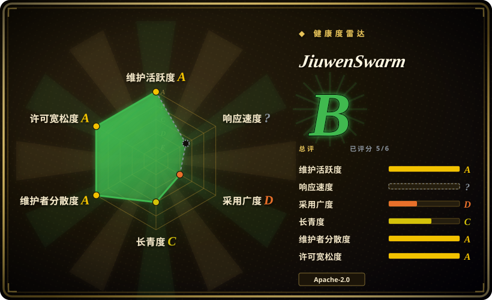
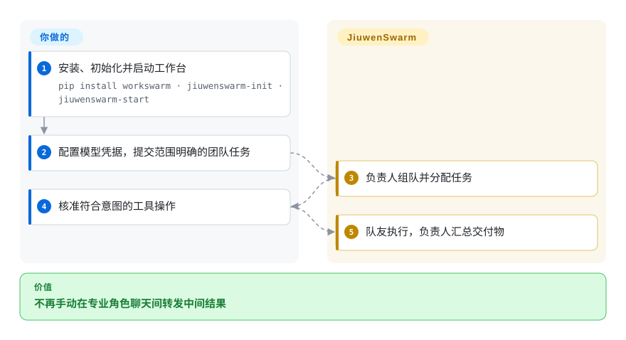
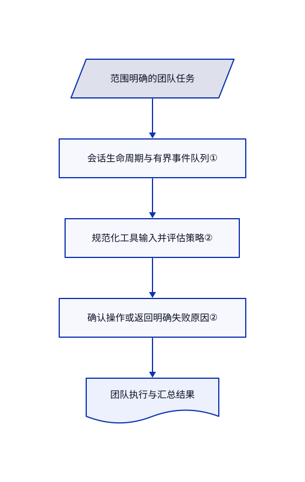

# JiuwenSwarm

一份研究报告要多人分工，你却还在不同聊天间手动搬结果。JiuwenSwarm 提供工作台，让负责人分配任务、汇总队友产出，并展示工具审批。

## 何时使用

你想从浏览器或飞书提交行业报告任务，让负责人协调研究、分析与写稿，而不是先写 Python 流程图。现成的 Work/Code 工作台、聊天适配和团队管理，足以抵偿维护整套应用的成本时，选 JiuwenSwarm 而非 agent SDK。先使用单机团队；分布式运行还要独立注册服务、传输与共享存储，并非打开开关就能加机器。

## 何时不用

- **只在已有服务中嵌入类型化模型调用。** 选 [Pydantic AI](../agent-sdks/pydantic-ai.zh.md)。此应用还带来网页服务、记忆存储、渠道与大量依赖。
- **必须自己编程定义每次转移与检查点。** 选 [LangGraph](../agent-sdks/langgraph.zh.md)。模型领导的团队不等于确定性应用流程图。
- **多个终端窗口要同时运行分布式团队。** 分布式指南限定每渠道一个活跃会话，新会话会停止旧团队。保留本地团队，或用 [CrewAI](../agent-sdks/crewai.zh.md) 自行定义部署并发策略。
- **要求所有经验写入都先审批。** 演化默认关闭；开启后，即使 `auto_save: false`，队友经验仍走自动保存。保持关闭，或用版本控制的 [CrewAI](../agent-sdks/crewai.zh.md) 角色定义接外部评审。
- **需要独立证据证明 harness 优化能泛化。** 使用优化前冻结的外部验收集，不能把内部候选分数当成未见样本的证据。已读单 harness [配置生成器](https://github.com/openJiuwen-ai/jiuwenswarm/blob/660d28b26c70390ac1ac8f48dc1513dd149983ed/jiuwenswarm/agents/harness/common/rsi/materializer.py#L294-L323)固定写入 `candidate_holdout_cases: 0`；对应[服务路径](https://github.com/openJiuwen-ai/jiuwenswarm/blob/660d28b26c70390ac1ac8f48dc1513dd149983ed/jiuwenswarm/agents/harness/common/rsi/services.py#L896-L903)只接受一个候选，且不接受 improver 演化策略。内部提升不能证明泛化；此限制只针对这条生成配置路径，不代表项目禁止外部评测。

## 横向对比

| 替代品 | 是否收录 | 我们的评价 | 取舍 |
|---|---|---|---|
| [CrewAI](../agent-sdks/crewai.zh.md) | ✅ | 要现成工作台与聊天渠道，选 JiuwenSwarm；让自己的 Python 应用管理角色和任务集成，选 CrewAI。 | 打包的用户界面对比自主组装；两者都要验证模型驱动的交接。 |
| [LangGraph](../agent-sdks/langgraph.zh.md) | ✅ | 要显式可恢复的状态转移，选 LangGraph；要直接使用负责人和团队应用，选 JiuwenSwarm。 | 更多控制要付出流程代码和服务组装成本。 |
| [OpenClaw](../personal-assistants/messaging-daemons/openclaw.zh.md) | ✅ | 多渠道里的单个个人助手选 OpenClaw；主要需求是可见的组队与角色交接，选 JiuwenSwarm。 | 个人网关对比更大的多 agent 工作台；都必须约束宿主访问权限。 |

## 快速上手

文档的命令行路径是 `pip install workswarm`、`jiuwenswarm-init`，再执行 `jiuwenswarm-start`；浏览器前端位于 `http://localhost:5173`。在配置页或 `~/.jiuwenswarm/config/config.yaml` 提供默认模型名、接口地址、密钥和提供方。切到 Cluster 模式提交范围清楚的任务，再核准符合意图的工具调用；负责人组织队友并汇总交付物。模型访问、集成凭据、文件权限和模型费用由你承担。请固定已测试的发布版本；最新发布与本次读取的默认分支清单版本号不同。

<!-- flow-steps:begin (generated from flows/jiuwenswarm.json by tools/flow_card.py — do not edit) -->

流程文字版

1. **你**：安装、初始化并启动工作台 — `pip install workswarm · jiuwenswarm-init · jiuwenswarm-start`
2. **你**：配置模型凭据，提交范围明确的团队任务
3. **JiuwenSwarm**：负责人组队并分配任务
4. **你**：核准符合意图的工具操作
5. **JiuwenSwarm**：队友执行，负责人汇总交付物

**价值**：不再手动在专业角色聊天间转发中间结果

<!-- flow-steps:end -->

## 技术要点

<!-- mechanism:begin (generated from mechanisms/jiuwenswarm.json by tools/mechanism_card.py; do not edit) -->

机制文字版

- 范围明确的团队任务
- 会话生命周期与有界事件队列①
- 规范化工具输入并评估策略②
- 确认操作或返回明确失败原因②
- 团队执行与汇总结果

- 范围明确的团队任务 → 会话生命周期与有界事件队列①
- 会话生命周期与有界事件队列① → 规范化工具输入并评估策略②
- 规范化工具输入并评估策略② → 确认操作或返回明确失败原因②
- 确认操作或返回明确失败原因② → 团队执行与汇总结果

<!-- mechanism:end -->

### 1. 用有界观察队列管理团队生命周期

- **解决：** 工作台断线后，长任务不能把全部事件永久留在内存。
- **做法：** TeamManager 管理会话与请求代次、流和观察者。事件队列上限为 64，满时生产者等待；本地执行使用底层 Runner 运行池，不复用分布式启动的辅助对象。
- **边界：** 这是事件背压，不是 token 或任务质量限制。分布式会话另有生命周期约束，还需独立 A2X 注册服务。
- **源码：** [团队生命周期管理](https://github.com/openJiuwen-ai/jiuwenswarm/blob/660d28b26c70390ac1ac8f48dc1513dd149983ed/jiuwenswarm/agents/harness/team/team_manager.py)、[分布式契约](https://github.com/openJiuwen-ai/jiuwenswarm/blob/660d28b26c70390ac1ac8f48dc1513dd149983ed/docs/en/DistributedTeam.md#L13-L41)。

### 2. 分开评估策略与用户确认

- **解决：** 权限引擎出错时，不能悄悄放行工具。
- **做法：** 评估器规范化参数，查询场景与引擎策略，并把文件发送路径检查按更严格结果合并。引擎缺失、刷新失败与异常都会返回 `ask`，附明确原因。
- **边界：** `ask` 仍取决于渠道的确认行为；关闭权限总开关会放行调用，审批也不是操作系统隔离。
- **源码：** [策略评估器](https://github.com/openJiuwen-ai/jiuwenswarm/blob/660d28b26c70390ac1ac8f48dc1513dd149983ed/jiuwenswarm/agents/harness/common/rails/permissions/policy_eval.py#L65-L129)、[权限语义](https://github.com/openJiuwen-ai/jiuwenswarm/blob/660d28b26c70390ac1ac8f48dc1513dd149983ed/docs/en/ToolPermissionsSecurity.md#L9-L39)。

## 技术栈

Python 3.11–3.13、openJiuwen agent-core、FastAPI/Uvicorn、Pydantic、SQLite/aiosqlite、ChromaDB、FAISS 与 Playwright。依赖清单把 openJiuwen 和 A4P 固定到 GitCode 源；终端界面与分布式能力使用独立依赖组。

## 依赖

必须有模型服务。单机模式并不表示必须部署 PostgreSQL；分布式另需指定传输、共享存储与单独部署的 A2X 注册服务。可选 IM 渠道需要应用凭据和平台设置。浏览器工具需要浏览器运行支持。

## 运维难度

**单机中，分布式高。** 要备份配置、工作区和经验存储，检查权限策略与远程渠道访问。分布式还增加节点身份、注册服务可用性、传输端口、共享状态与会话清理。桌面安装器不能等同于生产集群。

## 健康度与可持续性

- **截至 2026-10-18：** 仓库建于 2026 年 3 月，未归档，有多位可见贡献者，已读实现文件含华为版权声明。它有组织背景，不代表中立基金会治理。
- **维护：** 最新发布样本为 10 月 3 日的 v0.2.8.beta1，已读清单却标为 0.2.5.beta1。分支文档与发布行为应分开判断。
- **判断：** 七个月历史与活跃 beta 发布支持试用，尚无强长期存续证据。广泛集成既增加价值，也增加升级和权限测试面。

## 存疑（未验证）

- [未验证：未部署上游] 未复现团队正确性、所有渠道的权限行为及分布式恢复。
- [未验证：未对发布包做源码映射] 已观察到版本不一致，但未证明各发布 wheel 或桌面安装器包含哪些默认分支功能。
- [未验证：未运行外部冻结验收集] 未测得独立未见样本上的提升。单 harness 配置的候选留出数为零，是上文已核实的配置事实；泛化结论仍需另行冻结的外部验收集。
