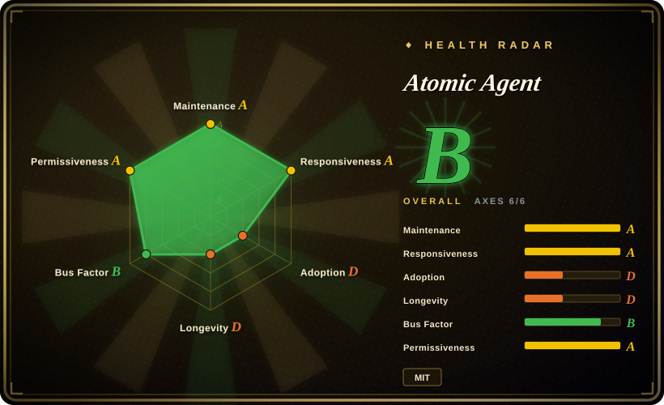
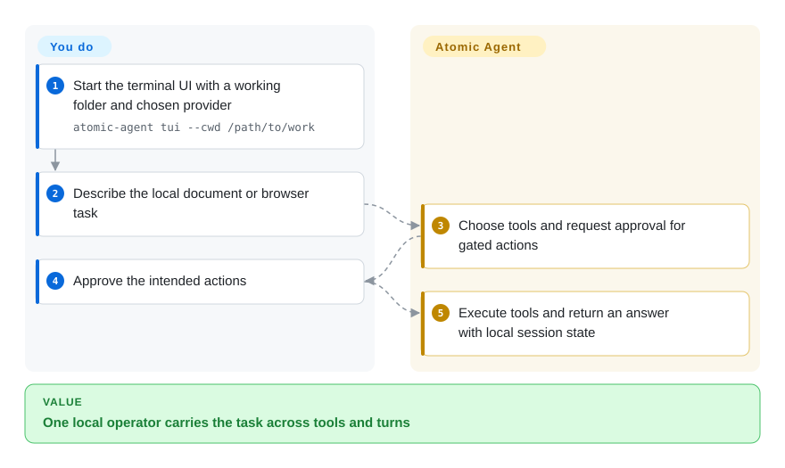
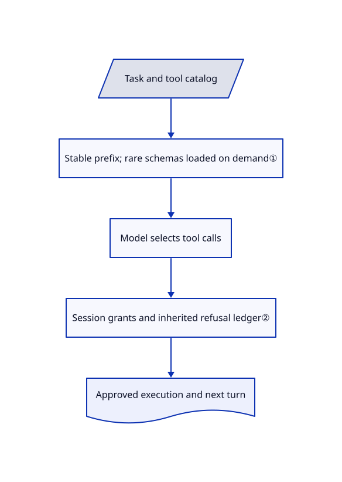

# Atomic Agent

Your local model spends each turn rereading a growing tool transcript. Atomic Agent separates a stable instruction prefix from bounded session state and runs tools through an approval-aware local loop.

## When to use

You want a personal operator to read documents, browse a site and edit local files, but a small local model keeps wasting its window on full tool descriptions. You choose Atomic Agent for its managed llama.cpp path, on-demand tool schemas and persistent local memory, rather than starting with a cloud-oriented assistant and assembling local-model support yourself. Treat memory as convenient recall, not an independently verified fact store or identity authority. Its terminal interface, HTTP server and desktop sidecar share the runtime; local inference hardware remains your responsibility.

## When NOT to use

- **You need an established release contract.** The README calls this a developer preview; prefer [OpenClaw](messaging-daemons/openclaw.md) for its signed-release process, and still harden the host.
- **You assume local-first means no outbound reporting.** Analytics and Sentry are enabled by default. Disable them before use with `ATOMIC_AGENT_ANALYTICS=off`; evaluate [OpenHuman](openhuman.md) when an explicit offline mode is the deciding requirement.
- **Your target is a tiny board, not a model-capable computer.** Choose [PicoClaw](messaging-daemons/picoclaw.md) with separately hosted inference; Atomic's managed model weights and cache are not included in the agent runtime footprint.
- **You mainly need a programmable agent library.** Choose [Pydantic AI](../agent-sdks/pydantic-ai.md); Atomic owns sessions, tools, memory and process lifecycle rather than just supplying a typed call loop.
- **You need a high-trust factual record.** Use a source-linked ledger with independent fact review instead of treating a memory score as verification. The [vote prompt](https://github.com/AtomicBot-ai/atomic-agent/blob/7899d173e0a07665f45cf014de065eb38f405127/src/memory/voting/vote-prompt.ts#L59-L77) permits UPVOTE when the reply uses or paraphrases an item, or follows its recommendation; the [store](https://github.com/AtomicBot-ai/atomic-agent/blob/7899d173e0a07665f45cf014de065eb38f405127/src/memory/voting/vote-store.ts#L302-L313) increments or decrements a bounded score. Adoption or repetition is a usage reward, not external evidence that the remembered claim is true.
- **You need multilingual identity verification.** Use an authoritative authenticated identity system, not remembered names. The [reflection filter](https://github.com/AtomicBot-ai/atomic-agent/blob/7899d173e0a07665f45cf014de065eb38f405127/src/memory/reflection/reflection-grounding.ts#L729-L771) primarily compares Latin/Cyrillic evidence; [other-script names, and Latin names when evidence is mostly another script](https://github.com/AtomicBot-ai/atomic-agent/blob/7899d173e0a07665f45cf014de065eb38f405127/src/memory/reflection/reflection-grounding.ts#L885-L896), can be incomparable and are [skipped by that name filter](https://github.com/AtomicBot-ai/atomic-agent/blob/7899d173e0a07665f45cf014de065eb38f405127/src/memory/reflection/reflection-grounding.ts#L1083-L1086), not thereby verified. A [brief confirmation of the assistant's preceding name question](https://github.com/AtomicBot-ai/atomic-agent/blob/7899d173e0a07665f45cf014de065eb38f405127/src/memory/name-grounding.ts#L71-L90) can count as conversation evidence. These heuristics test support in conversation, not real-world identity.

## Comparison

| Alternative | In index | Our verdict | Tradeoff |
|---|---|---|---|
| [Hermes Agent](messaging-daemons/hermes-agent.md) | ✅ | Choose Atomic for managed local inference and compact tool prompts; choose Hermes for a VPS assistant centered on self-written skills and scheduled work. | Atomic couples the operator to its local backend management; Hermes has a Python runtime and its own evolving memory. |
| [OpenClaw](messaging-daemons/openclaw.md) | ✅ | Choose OpenClaw when chat-channel coverage and companion apps decide; choose Atomic when local-model prompt economics decide. | Broader channels versus a llama.cpp-first loop; neither turns host tool access into tenant isolation. |
| [PicoClaw](messaging-daemons/picoclaw.md) | ✅ | Choose PicoClaw for a small cross-compiled agent on an embedded board; choose Atomic for an interactive local workstation operator. | Small Go runtime versus bundled operator surfaces and separate heavyweight model downloads. |

## Quick start

Download a release archive and inspect the documented installer before choosing to run it; this intake did not execute it. Launch `atomic-agent tui --cwd /path/to/work`, select a local or cloud provider, and describe the task. With managed local models, the application downloads weights and starts the inference backend; with cloud models, you supply credentials and pay the provider. Review proposed actions and keep the normal approval mode; the app returns tool results and a final answer while keeping sessions on disk. Turn analytics off before first launch when outbound reporting is unacceptable.

<!-- flow-steps:begin (generated from flows/atomic-agent.json by tools/flow_card.py — do not edit) -->

Text version of the flow

1. **You**: Start the terminal UI with a working folder and chosen provider — `atomic-agent tui --cwd /path/to/work`
2. **You**: Describe the local document or browser task
3. **Atomic Agent**: Choose tools and request approval for gated actions
4. **You**: Approve the intended actions
5. **Atomic Agent**: Execute tools and return an answer with local session state

**Value**: One local operator carries the task across tools and turns

<!-- flow-steps:end -->

## Key techniques

<!-- mechanism:begin (generated from mechanisms/atomic-agent.json by tools/mechanism_card.py; do not edit) -->

Text version of the mechanism

- Task and tool catalog
- Stable prefix; rare schemas loaded on demand①
- Model selects tool calls
- Session grants and inherited refusal ledger②
- Approved execution and next turn

- Task and tool catalog → Stable prefix; rare schemas loaded on demand①
- Stable prefix; rare schemas loaded on demand① → Model selects tool calls
- Model selects tool calls → Session grants and inherited refusal ledger②
- Session grants and inherited refusal ledger② → Approved execution and next turn

<!-- mechanism:end -->

### 1. Stable prefix and on-demand tool schemas

- **Problem:** Repeating every tool schema spends the small model's context on tools it never uses.
- **How:** The prefix renders frequent tools fully and rare tools as one-line names; `tool.view` materializes details in the variable tail. Instructions switch between native function calls and grammar-constrained JSON so the model is not given contradictory emission formats.
- **Limits:** Stable bytes help cache reuse on compatible backends, not factual correctness; changing tool roles can require a new cold prefix.
- **Source:** [Prefix assembly](https://github.com/AtomicBot-ai/atomic-agent/blob/7899d173e0a07665f45cf014de065eb38f405127/src/prompt/stable-prefix.ts#L245-L367).

### 2. Scope approvals to a session and remember refusals

- **Problem:** A model can repeat a denied write through another tool or a delegated worker.
- **How:** The gate keeps session-specific grants and declined calls or whole-file targets. Fusion workers inherit their parent's declined targets rather than treating delegation as new authority.
- **Limits:** Callers must identify target paths; approval policy is not an operating-system sandbox and permissive modes intentionally widen authority.
- **Source:** [Approval gate and refusal tracking](https://github.com/AtomicBot-ai/atomic-agent/blob/7899d173e0a07665f45cf014de065eb38f405127/src/approval/approval-gate.ts#L145-L255).

## Tech stack

TypeScript, Node.js, React/Ink terminal UI, SQLite through better-sqlite3, playwright-core and the MCP SDK. Release binaries bundle the Node runtime and support assets; source development requires Node.js 25.7 or newer.

## Dependencies

A local llama.cpp-compatible inference server or configured cloud provider. Browser tasks require a supported installed Chromium-family browser. Optional integrations need their own credentials and may send data to Telegram, Discord, Composio or model providers.

## Ops difficulty

**Medium.** One-user installation is packaged, but model downloads, hardware sizing, native assets, browser permissions, local state backups and approval policies remain operational work. HTTP embedding also needs API authentication and process supervision.

## Health & viability

- **2026-10-18:** created in April 2026, not archived, with v0.6.9 released on October 15; the scorer reports the latest default-branch commit as three days old. Several contributors appear in history; the leading author has substantially more commits than the next contributors.
- **Judgment:** a six-month-old developer preview is suitable for a reversible personal trial, not a stable integration promise. Frequent releases demonstrate maintenance but provide little Lindy evidence.
- **Risk:** the current issue sample includes a grammar reply-truncation report and a corresponding fix PR. The MIT license names Atomic Bot; analytics defaults and bundled backend updates deserve explicit review before deployment.

## Caveats (unverified)

- [未验证：未运行上游程序] End-to-end action safety, local model quality and runtime resource use were not reproduced; source inspection is not a sandbox audit.
- [未验证：未复跑评测] The README's GAIA and TurboQuant performance claims are author-reported; they do not determine this recommendation.
- [未验证：未运行长期记忆与多文字系统验收] Long-term mistaken recall, reinforcement of incorrect items and multilingual name-check quality were not measured. The documented usage-vote and incomparable-name behavior above is source-verified, not a fact-correctness or identity guarantee.
