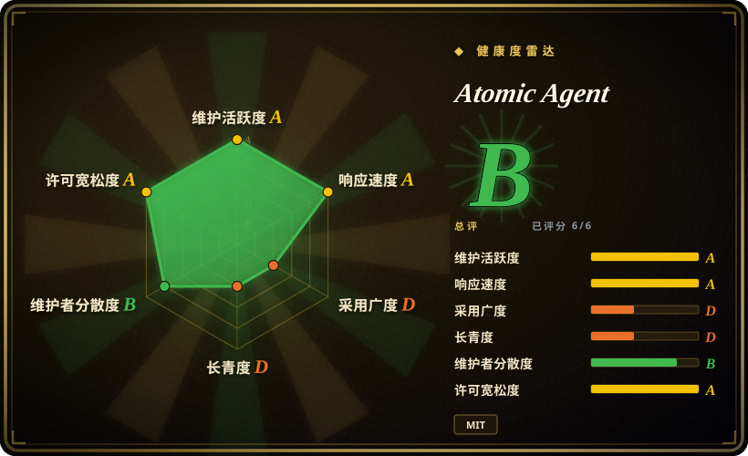
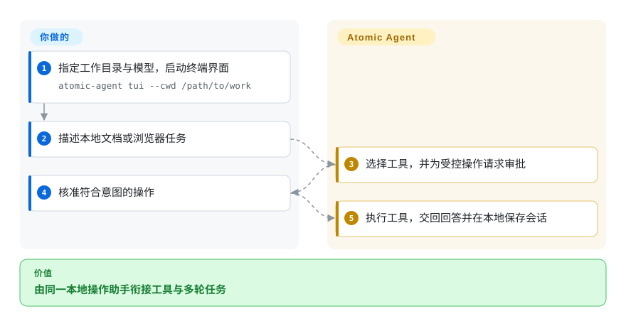
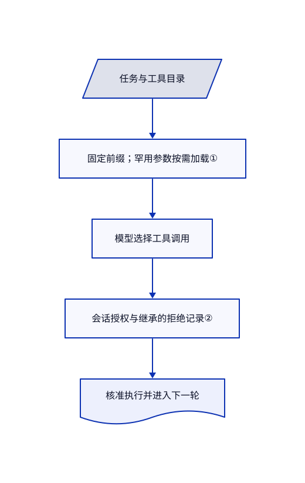

# Atomic Agent

本地小模型每轮都在重读越来越长的工具记录。Atomic Agent 把固定指令与受预算限制的会话状态分开，并用本地审批循环执行工具。

## 何时使用

你想让个人助手读文档、浏览网页并修改本地文件，小模型却把上下文花在完整工具说明上。你选 Atomic Agent，是为了托管 llama.cpp 的路径、按需加载的工具参数与本地持久记忆，而不是给偏云端的助手重新拼装本地模型支持。记忆用于方便召回，不是独立核实的事实库或身份凭据。终端、HTTP 服务和桌面侧进程共用运行时；推理硬件仍由你提供。

## 何时不用

- **需要稳定的发布契约。** README 明确写着开发者预览。优先考虑有签名发布流程的 [OpenClaw](messaging-daemons/openclaw.zh.md)，仍需加固宿主机。
- **把本地优先理解成不外发。** 分析事件与 Sentry 默认开启。首次启动前设置 `ATOMIC_AGENT_ANALYTICS=off`；明确离线模式是硬约束时，评估 [OpenHuman](openhuman.zh.md)。
- **部署目标是小开发板。** 选 [PicoClaw](messaging-daemons/picoclaw.zh.md) 并单独托管推理。Atomic 的模型权重与缓存不属于 agent 本身的内存占用。
- **只想嵌入可编程调用循环。** 选 [Pydantic AI](../agent-sdks/pydantic-ai.zh.md)。Atomic 会接管会话、工具、记忆与进程生命周期，而非只提供类型化调用。
- **需要高可信事实记录。** 使用带来源、另行审阅事实的账本，不能把记忆分数当作核验。[投票提示词](https://github.com/AtomicBot-ai/atomic-agent/blob/7899d173e0a07665f45cf014de065eb38f405127/src/memory/voting/vote-prompt.ts#L59-L77)允许在回答采用、复述条目或遵循其建议时触发 UPVOTE；[存储层](https://github.com/AtomicBot-ai/atomic-agent/blob/7899d173e0a07665f45cf014de065eb38f405127/src/memory/voting/vote-store.ts#L302-L313)只增减并限幅保存分数。采用与复述属于使用奖励，不是记忆内容正确的外部证据。
- **需要多语言身份核验。** 使用权威认证身份系统，不能依赖记住的姓名。[反思过滤器](https://github.com/AtomicBot-ai/atomic-agent/blob/7899d173e0a07665f45cf014de065eb38f405127/src/memory/reflection/reflection-grounding.ts#L729-L771)主要比较拉丁与西里尔文字证据；[其他文字姓名，以及证据主要用其他文字时的拉丁姓名](https://github.com/AtomicBot-ai/atomic-agent/blob/7899d173e0a07665f45cf014de065eb38f405127/src/memory/reflection/reflection-grounding.ts#L885-L896)，可能被判为不可比较，并[跳过该姓名过滤](https://github.com/AtomicBot-ai/atomic-agent/blob/7899d173e0a07665f45cf014de065eb38f405127/src/memory/reflection/reflection-grounding.ts#L1083-L1086)，不代表核验成功。[对助手前一条姓名询问的简短确认](https://github.com/AtomicBot-ai/atomic-agent/blob/7899d173e0a07665f45cf014de065eb38f405127/src/memory/name-grounding.ts#L71-L90)也可作为会话证据。这些启发式只核对会话支持，不认证现实身份。

## 横向对比

| 替代品 | 是否收录 | 我们的评价 | 取舍 |
|---|---|---|---|
| [Hermes Agent](messaging-daemons/hermes-agent.zh.md) | ✅ | 托管本地推理与压缩工具提示词优先，选 Atomic；重点是服务器常驻、自写技能和定时任务，选 Hermes。 | Atomic 把操作助手与本地后端管理结合；Hermes 使用 Python 和自己的记忆演化路径。 |
| [OpenClaw](messaging-daemons/openclaw.zh.md) | ✅ | 聊天渠道与配套客户端决定选型时，选 OpenClaw；小模型提示词成本决定时，选 Atomic。 | 更广的渠道对比 llama.cpp 优先的循环；宿主工具权限都不等于租户隔离。 |
| [PicoClaw](messaging-daemons/picoclaw.zh.md) | ✅ | 嵌入式开发板上的小型运行时选 PicoClaw；工作站交互操作助手选 Atomic。 | 小型 Go 核心对比丰富的操作界面；模型下载还需另算。 |

## 快速上手

先下载发布归档，检查文档中的安装脚本，再决定是否执行；本次收录没有运行它。启动 `atomic-agent tui --cwd /path/to/work`，选择本地或云端模型，再描述任务。托管本地模式会下载权重并启动推理后端；云端模式需要你提供凭据并支付模型费用。保留常规审批模式并逐项核准操作，应用把工具结果与最终回答交回你，并在磁盘保存会话。不能接受分析外发时，在首次启动前关闭它。

<!-- flow-steps:begin (generated from flows/atomic-agent.json by tools/flow_card.py — do not edit) -->

流程文字版

1. **你**：指定工作目录与模型，启动终端界面 — `atomic-agent tui --cwd /path/to/work`
2. **你**：描述本地文档或浏览器任务
3. **Atomic Agent**：选择工具，并为受控操作请求审批
4. **你**：核准符合意图的操作
5. **Atomic Agent**：执行工具，交回回答并在本地保存会话

**价值**：由同一本地操作助手衔接工具与多轮任务

<!-- flow-steps:end -->

## 技术要点

<!-- mechanism:begin (generated from mechanisms/atomic-agent.json by tools/mechanism_card.py; do not edit) -->

机制文字版

- 任务与工具目录
- 固定前缀；罕用参数按需加载①
- 模型选择工具调用
- 会话授权与继承的拒绝记录②
- 核准执行并进入下一轮

- 任务与工具目录 → 固定前缀；罕用参数按需加载①
- 固定前缀；罕用参数按需加载① → 模型选择工具调用
- 模型选择工具调用 → 会话授权与继承的拒绝记录②
- 会话授权与继承的拒绝记录② → 核准执行并进入下一轮

<!-- mechanism:end -->

### 1. 固定前缀与按需工具参数

- **解决：** 每轮重复工具参数，会挤占小模型真正用于任务的上下文。
- **做法：** 前缀完整呈现常用工具，罕用工具只保留名称和一句说明；调用 `tool.view` 后，详情才进入可变尾部。原生函数调用与受语法约束的 JSON 使用不同输出指令，避免互相冲突。
- **边界：** 固定字节只帮助兼容后端复用缓存，不保证事实正确；切换工具角色可能重新计算前缀。
- **源码：** [前缀组装](https://github.com/AtomicBot-ai/atomic-agent/blob/7899d173e0a07665f45cf014de065eb38f405127/src/prompt/stable-prefix.ts#L245-L367)。

### 2. 按会话授权，并记住已拒绝操作

- **解决：** 模型可能换工具或委派 worker，重复用户已拒绝的写入。
- **做法：** 审批器按会话保存授权，以及已拒绝的调用和整文件目标。Fusion worker 继承父会话的拒绝目标，不能把委派当作新权限。
- **边界：** 调用方必须正确标出目标路径；审批策略不是操作系统沙箱，宽松模式也会主动扩大权限。
- **源码：** [审批与拒绝记录](https://github.com/AtomicBot-ai/atomic-agent/blob/7899d173e0a07665f45cf014de065eb38f405127/src/approval/approval-gate.ts#L145-L255)。

## 技术栈

TypeScript、Node.js、React/Ink 终端界面、better-sqlite3、playwright-core 与 MCP SDK。发布二进制包含 Node 运行时与配套资源；源码开发要求 Node.js 25.7 以上。

## 依赖

本地 llama.cpp 兼容推理服务，或配置好的云端模型。浏览器任务需要已安装的受支持 Chromium 系浏览器。可选集成要单独配置凭据，并可能向 Telegram、Discord、Composio 或模型提供方发送数据。

## 运维难度

**中。** 单用户安装已有打包，但模型下载、硬件容量、原生资源、浏览器权限、状态备份和审批策略仍需维护。HTTP 集成还需要接口认证与进程托管。

## 健康度与可持续性

- **截至 2026-10-18：** 仓库建于 2026 年 4 月，未归档；10 月 15 日发布 v0.6.9，评分器测得默认分支最近提交距今三天。历史中有多位贡献者，但首位作者提交量明显更高。
- **判断：** 六个月的开发者预览适合可回退的个人试用，不宜当作稳定集成契约。频繁发布证明仍在维护，尚不足以形成长期存续证据。
- **风险：** 最新问题样本包含语法输出提前截断及对应修复 PR。MIT 实文署名 Atomic Bot；部署前应明确检查分析外发和后端自动更新。

## 存疑（未验证）

- [未验证：未运行上游程序] 未复现操作安全、本地模型质量与资源占用；源码阅读不等于沙箱审计。
- [未验证：未复跑评测] README 的 GAIA 与 TurboQuant 性能来自作者报告，不作为本页推荐依据。
- [未验证：未运行长期记忆与多文字系统验收] 未测量长期误记、错误条目被强化与多语言姓名核对质量。上文的使用投票与不可比较姓名行为已由源码核实，但不构成事实正确或身份保证。
