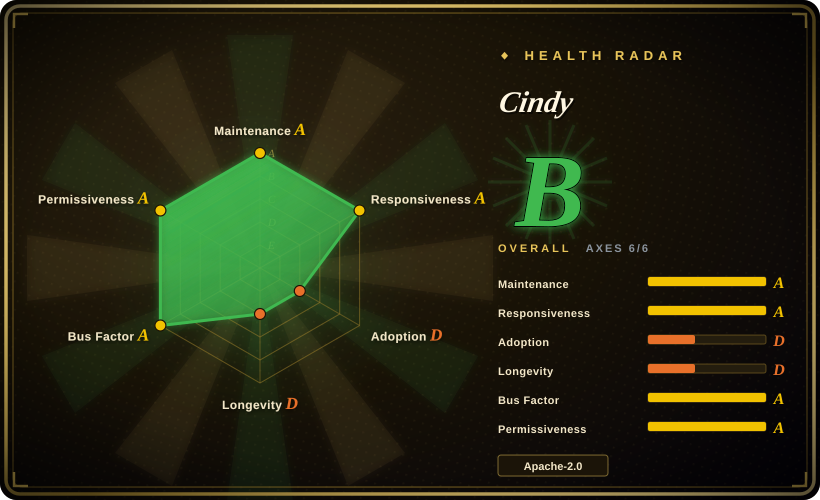
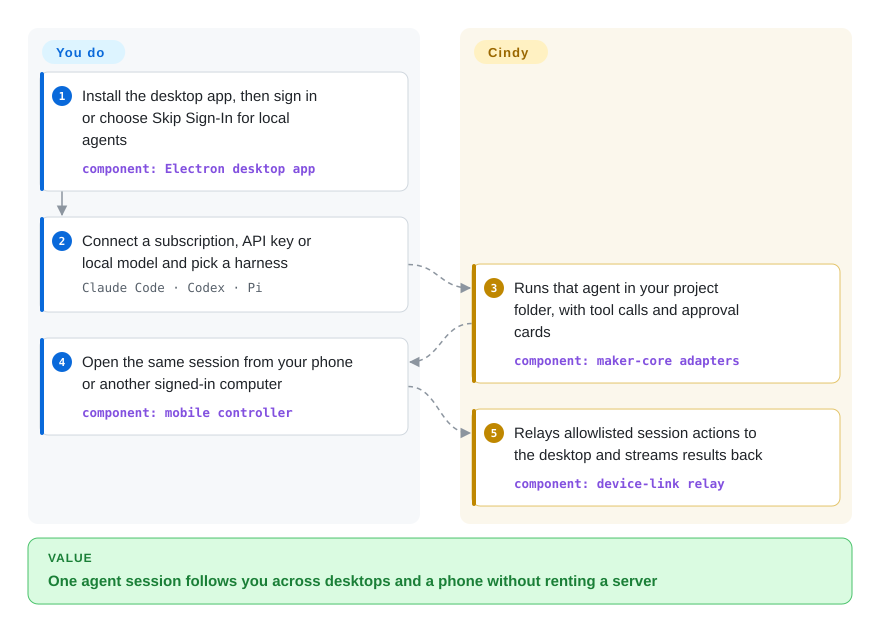
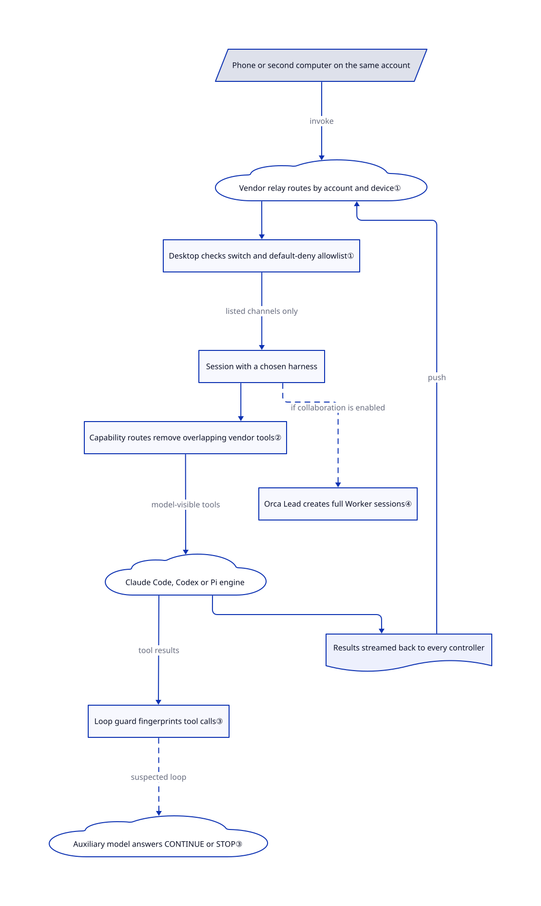

# Cindy

Your Claude Code session lives in a terminal on the office desktop, so a phone, a laptop or another agent cannot pick it up without copying files and context. Cindy wraps Claude Code, Codex and the Pi agent in one desktop app, then lets your own phone and computers drive that session through an account-scoped relay.

## When to use

You already pay for Claude Code or Codex, and you work across a work Mac, a home Windows desktop and a phone. The agent you started on the office machine is halfway through a refactor when you leave; on the train you can only see a Slack message saying `Allow this bash command? (y/n)`. You want to approve it, steer the task and read its files from the phone, without renting a server or pushing the repository to a cloud workspace. Cindy fits that situation: the desktop app runs the agent beside your files, and the mobile app is only a remote control for that desktop.

Choose it over [OpenMausBot](openmausbot.md) when cross-device continuation, phone control and remote desktop matter more than a chat roster of bots. Choose it over [Nezha](../../../agent-tooling/supervision-surfaces/agent-cockpits/nezha.md) when you want a whole assistant product (memory, automations, plugins, Lead/Worker teams) rather than a local supervision window. The price is a vendor-operated account and relay for every multi-device feature, an analytics SDK in official builds, and a very fast-moving young codebase.

## When NOT to use

- **You need multi-device control without a vendor account.** The relay and backend live in a separate, unpublished repository; "Skip Sign-In" runs local agents only, and server-backed features become unavailable. Use [Nezha](../../../agent-tooling/supervision-surfaces/agent-cockpits/nezha.md) for a local-only supervision window, or [Kandev](../../../agent-tooling/supervision-surfaces/agent-cockpits/kandev.md) when you can host the server yourself.
- **Your policy forbids product analytics or default vendor endpoints.** Official builds ship TapDB analytics with the statistics switch defaulting on, and the README documents a mobile SSO path where consent can be recorded without the policy step. The default endpoints point at Cindy cloud. Build from source with analytics disabled, or choose [OpenWorker](openworker.md) for a BYOK desktop coworker without a required vendor account.
- **You will open untrusted repositories in a build older than 2026-10-31.** A public static audit (issue #8237) reported that `.cindy/automations/schedules.json` in a project could be imported and run a pre-run shell command without consent. Main fixed this on 2026-10-31 (commits `63397cd7` and `e3a530e0`), after the v0.1.121 release. Until a release that contains them ships, work only on trusted repositories or build from main.
- **You want one stable, minimal agent runtime.** The repository is about 100 days old and has 12,540 commits, 1,936 open issues and 438 open PRs (2026-11-01), plus daily releases. Expect behavior changes between versions. Use the vendor CLIs directly, or [OpenMausBot](openmausbot.md) when you only need a lighter wrapper around the CLIs you already run.
- **You want a hosted multi-tenant team platform.** Cindy is a personal client: remote control is limited to devices on one account, and Orca teams belong to one Lead session on one desktop. For team-chat workspaces with shared agents, look at the [team-chat](../../../team-chat/INDEX.md) category.

## Comparison

| Alternative | In index | Our verdict | Tradeoff |
|---|---|---|---|
| [OpenMausBot](openmausbot.md) | ✅ | Choose OpenMausBot when you want your logged-in CLIs as named chat bots with Allow/Deny cards; choose Cindy when one session must follow you across desktops and a phone. | OpenMausBot keeps a localhost harness and light ops, but adds no device relay; Cindy adds remote desktop, provider sharing and teams at the price of a vendor account and relay. |
| [LobsterAI](lobsterai.md) | ✅ | Choose LobsterAI for packaged office deliverables that return through IM around an OpenClaw runtime; choose Cindy when the work is coding-agent sessions on Claude Code, Codex or Pi. | LobsterAI centers artifacts and IM channels; Cindy centers harness adapters, phone control and multi-agent teams, with a larger and faster-changing surface. |
| [OpenWorker](openworker.md) | ✅ | Choose OpenWorker for a signed-out BYOK desktop coworker with approval gates and audit provenance; choose Cindy when existing Claude Code or Codex subscriptions and multi-device access drive the choice. | OpenWorker avoids a mandatory vendor account; Cindy reuses vendor CLI subscriptions and adds device sync, but defaults to vendor endpoints and analytics. |
| [Nezha](../../../agent-tooling/supervision-surfaces/agent-cockpits/nezha.md) | ✅ | Choose Nezha to supervise local Claude Code/Codex tasks with terminal, session and Git views; choose Cindy when you need a phone controller, memory and automations as well. | Nezha is a narrower local cockpit; Cindy is a full assistant product whose cross-device features depend on its cloud. |

## Quick start

End users download a signed build from cindy.app for macOS, Windows, Linux, iOS or Android; developers clone the repository and run `pnpm install`, which also downloads the Claude Code, Codex and ripgrep binaries the desktop app ships. On first launch, sign in with a Cindy account or choose "Skip Sign-In" for local agents only. Next, connect a model source — an existing Claude Code or Codex subscription, your own API key, a local model or Cindy's paid managed service — and pick a harness, meaning the agent engine that runs the task (Claude Code, Codex or Pi). You type the task in a project folder; Cindy runs the agent there, shows tool calls and approval cards, and, when you are signed in on several devices, lets the phone or another computer continue that session. You remain responsible for provider billing and limits, for which folders and permission modes you grant, and for which devices you allow to be controlled. No upstream build or app was run for this entry.

<!-- flow-steps:begin (generated from flows/cindy.json by tools/flow_card.py — do not edit) -->

Text version of the flow

1. **You**: Install the desktop app, then sign in or choose Skip Sign-In for local agents — component: `Electron desktop app`
2. **You**: Connect a subscription, API key or local model and pick a harness — `Claude Code · Codex · Pi`
3. **Cindy**: Runs that agent in your project folder, with tool calls and approval cards — component: `maker-core adapters`
4. **You**: Open the same session from your phone or another signed-in computer — component: `mobile controller`
5. **Cindy**: Relays allowlisted session actions to the desktop and streams results back — component: `device-link relay`

**Value**: One agent session follows you across desktops and a phone without renting a server

<!-- flow-steps:end -->

## Key techniques

<!-- mechanism:begin (generated from mechanisms/cindy.json by tools/mechanism_card.py; do not edit) -->

Text version of the mechanism

- Phone or second computer on the same account
- Vendor relay routes by account and device①
- Desktop checks switch and default-deny allowlist①
- Session with a chosen harness
- Capability routes remove overlapping vendor tools②
- Claude Code, Codex or Pi engine
- Loop guard fingerprints tool calls③
- Auxiliary model answers CONTINUE or STOP③
- Orca Lead creates full Worker sessions④
- Results streamed back to every controller

- Phone or second computer on the same account → Vendor relay routes by account and device① (invoke)
- Vendor relay routes by account and device① → Desktop checks switch and default-deny allowlist①
- Desktop checks switch and default-deny allowlist① → Session with a chosen harness (listed channels only)
- Session with a chosen harness → Capability routes remove overlapping vendor tools②
- Capability routes remove overlapping vendor tools② → Claude Code, Codex or Pi engine (model-visible tools)
- Claude Code, Codex or Pi engine → Loop guard fingerprints tool calls③ (tool results)
- Loop guard fingerprints tool calls③ → Auxiliary model answers CONTINUE or STOP③ (suspected loop) [optional/fallback]
- Session with a chosen harness → Orca Lead creates full Worker sessions④ (if collaboration is enabled) [optional/fallback]
- Claude Code, Codex or Pi engine → Results streamed back to every controller
- Results streamed back to every controller → Vendor relay routes by account and device① (push)

<!-- mechanism:end -->

### 1. Remote control through a default-deny IPC tunnel

- **Problem:** A phone that can drive a desktop agent can also become a remote shell if every desktop function is reachable.
- **How:** The relay only reads routing headers, isolates users by account and routes by device; the controlled desktop checks a remote-control switch and the `REMOTE_INVOKE_ALLOWLIST` before calling an existing IPC handler. Any channel not listed is unreachable; window, shell, credential and raw database writes are documented as never allowed. An optional reliable layer adds sequencing, cumulative ACKs, 4 MiB messages and bounded retransmission.
- **Limits:** The relay server is not in this repository, so its isolation is documented, not reviewable here. The allowlist still exposes session creation, sending, permission-mode changes and Orca control to any device on the same account.
- **Source:** [allowlist policy:1–25](https://github.com/makecindy/cindy/blob/b59490c088cb163666781a769e11749e44a8c87f/packages/device-link/src/allowlist.ts#L1-L25), [allowlist set:754–762](https://github.com/makecindy/cindy/blob/b59490c088cb163666781a769e11749e44a8c87f/packages/device-link/src/allowlist.ts#L754-L762), [relay and reliable transport:11–81](https://github.com/makecindy/cindy/blob/b59490c088cb163666781a769e11749e44a8c87f/packages/device-link/README.md#L11-L81).

### 2. Remove overlapping harness tools in code, not prompts

- **Problem:** Claude Code and Codex bring their own computer-use, artifact and connector tools, whose results bypass Cindy's guards or appear only in the vendor app.
- **How:** A host routing table marks such capabilities `disabled` and names Cindy's replacement. Each harness adapter removes them from the model-visible surface (Claude through disallowed tools and denied MCP servers, Codex through thread-level plugin and MCP settings). `findUnenforcedCapabilityRoutes` makes tests fail when a route has no adapter able to enforce it.
- **Limits:** Claude's overrides match by name, so a user's own server with the same name is also disabled. Pi accepts no routes, so the table does not constrain it.
- **Source:** [routing table:1–60](https://github.com/makecindy/cindy/blob/b59490c088cb163666781a769e11749e44a8c87f/apps/desktop/src/main/maker-host/capability-routing.ts#L1-L60), [enforcement check:1–33](https://github.com/makecindy/cindy/blob/b59490c088cb163666781a769e11749e44a8c87f/packages/maker-core/src/agents/capability-route-support.ts#L1-L33), [design rule:452–480](https://github.com/makecindy/cindy/blob/b59490c088cb163666781a769e11749e44a8c87f/docs/dev-rules/maker-core-and-agent-behavior.md#L452-L480).

### 3. Detect tool loops, then ask a second model before stopping

- **Problem:** An agent can circle through the same searches for hours while still emitting events, so an idle timeout never fires.
- **How:** `ToolLoopGuard` fingerprints tool name, input and output across three windows, including a 128-read rotation check, and ignores calls at least 30 seconds apart as polling. A hit is only suspected; `ToolLoopMonitor` sends a redacted 12-call summary to an auxiliary model, which may answer only CONTINUE or STOP. Thirty fast identical calls or an hour of identical results stop the task without review.
- **Limits:** These are bounded heuristics, not proofs; reviews are capped at 3 per turn with a 20-second timeout, and timeouts or missing reviewers allow the pattern to continue. Each review spends auxiliary-model tokens.
- **Source:** [thresholds:20–60](https://github.com/makecindy/cindy/blob/b59490c088cb163666781a769e11749e44a8c87f/packages/maker-core/src/agents/shared/loop-guard.ts#L20-L60), [review monitor:33–193](https://github.com/makecindy/cindy/blob/b59490c088cb163666781a769e11749e44a8c87f/packages/maker-core/src/agents/shared/tool-loop-review.ts#L33-L193), [behavior contract:30–102](https://github.com/makecindy/cindy/blob/b59490c088cb163666781a769e11749e44a8c87f/docs/dev-rules/maker-core-and-agent-behavior.md#L30-L102).

### 4. Lead and Worker teams as full sessions

- **Problem:** One-shot subagents lose their context and history once they return, so a long task cannot be split and reviewed across agents.
- **How:** Orca turns a session into a Lead that creates Worker sessions, each with its own harness, model, effort, tool stream and visible history. SQLite partial unique indexes keep one active team per Lead and one focused Worker per team; four services own lifecycle, worker creation, task dispatch and inter-agent messages.
- **Limits:** A team is bound to one Lead session, Workers cannot be shared across Leads, archived Workers have no unarchive entry, and workflow orchestration is not implemented yet.
- **Source:** [Orca goals and limits:33–54](https://github.com/makecindy/cindy/blob/b59490c088cb163666781a769e11749e44a8c87f/docs/dev-rules/orca-team-architecture.md#L33-L54), [service boundaries:71–104](https://github.com/makecindy/cindy/blob/b59490c088cb163666781a769e11749e44a8c87f/docs/dev-rules/orca-team-architecture.md#L71-L104), [team and worker indexes:807–866](https://github.com/makecindy/cindy/blob/b59490c088cb163666781a769e11749e44a8c87f/apps/desktop/src/main/localDb/schema.ts#L807-L866).

## Tech stack

- pnpm monorepo in TypeScript. The [desktop manifest](https://github.com/makecindy/cindy/blob/b59490c088cb163666781a769e11749e44a8c87f/apps/desktop/package.json) pins Electron 42.11.12 with React 19, Vite, better-sqlite3, Drizzle ORM and node-pty; the [mobile manifest](https://github.com/makecindy/cindy/blob/b59490c088cb163666781a769e11749e44a8c87f/apps/mobile/package.json) uses Expo 57 and React Native 0.86.
- `packages/maker-core` holds the Claude Code, Codex and Pi adapters, memory, tool-loop guard and auto-review; `packages/device-link` is the host-agnostic remote-control protocol; `packages/opencli-vendor` is a declared copy of jackwener/opencli 2.0.2 (Apache-2.0) used for browser recipes.
- The [root manifest](https://github.com/makecindy/cindy/blob/b59490c088cb163666781a769e11749e44a8c87f/package.json) requires Node ≥22.12 and pnpm ≥10.7 and <11; its `postinstall` downloads agent binaries.

## Dependencies

- **Model access:** a Claude Code or Codex subscription, your own provider API keys, a local model, or Cindy's managed model service. Provider billing and limits apply; the free client does not include model usage.
- **Cindy cloud:** sign-in, the device-link relay, cloud companions, SkillHub and auto-updates use vendor endpoints listed in `config/endpoint*.json`. The backend source is not published. Local "Skip Sign-In" mode avoids the account but loses those features, and some official plugins still require the model service (issue #7581).
- **Developer build:** Node 22, pnpm 10, Git LFS, and network access during `pnpm install` for the Claude Code, Codex and ripgrep binaries.

## Ops difficulty

**Low for one user on the official builds; high to run without the vendor.** Installing the app and signing in is a download. The operating work is permission hygiene: decide permission modes, which folders agents may touch, which devices may control which, and whether analytics stays on. Turn off analytics in Settings, and on mobile follow the README's relaunch note so the SDK stays uninitialized. Building and distributing your own client is possible under Apache-2.0, but you would still point it at Cindy's servers. Replacing the relay and backend means writing them yourself, because their code is not here. To retire it, revoke remote control on each device, sign out, and remove local data and agent transcripts after review.

## Health & viability

- **Maintenance, 2026-11-01:** very active. The reviewed commit `b59490c0` landed the same day; [v0.1.121](https://github.com/makecindy/cindy/releases/tag/v0.1.121) shipped 2026-10-30 after near-daily stable and beta releases. Main had 12,540 commits since the 2026-07-24 first public commit.
- **Governance and backing:** the NOTICE names XD Inc. as copyright holder, and the `makecindy` organization owns the repository. Top contributors (dashhuang, zqchris, MagicLizi, DavidShenXD) together hold most commits. Contributions use DCO sign-off with no CLA. The backend, pricing and analytics are vendor-controlled.
- **Age and Lindy:** about 100 days public. Lindy offers no durability prior yet; corporate backing raises the odds of continued work, but young vendor products can also be refocused. [推断：based on age and the commercial service model, not a track record]
- **Adoption and risk:** 8.9k stars and 1.1k forks (2026-11-01); the README claims GitHub Trending #1 on 2026-10-26. Large open issue and PR queues, partly opened by automation bots, reflect pace as much as backlog. The main risks are vendor lock-in for multi-device features, default-on analytics, and a security fix not yet in a release.

## Caveats (unverified)

- [未验证：no app, build or relay was run] Cross-device continuation, provider sharing, remote desktop and the reliable transport were read from docs and source, not exercised.
- [未验证：the relay/backend repository is not public] Account isolation, relay storage and what the cloud stores for companions cannot be audited from this repository.
- [推断：fix commits are dated after the v0.1.121 release] Released builds up to v0.1.121 likely still contain the project-automation command path reported in issue #8237. Verify the version before opening untrusted repositories.
- [未验证：README marketing] The GitHub Trending #1 claim and adoption beyond stars were not independently checked.
- [推断：age plus commercial backing, not a longevity record] The continuation outlook depends on XD Inc.'s product strategy, which this entry cannot observe.
