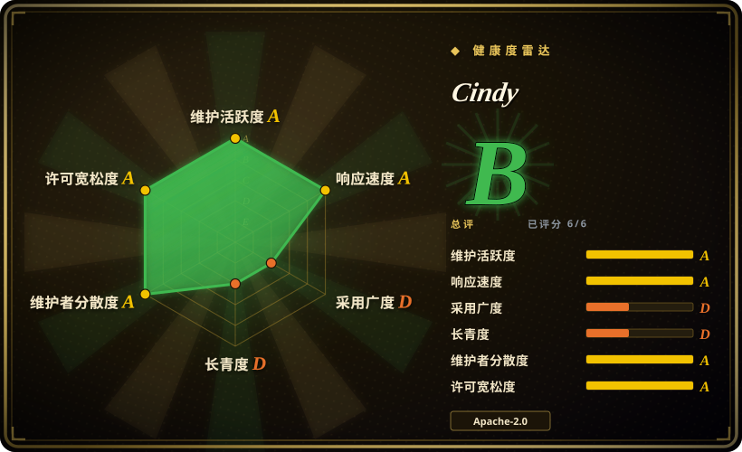
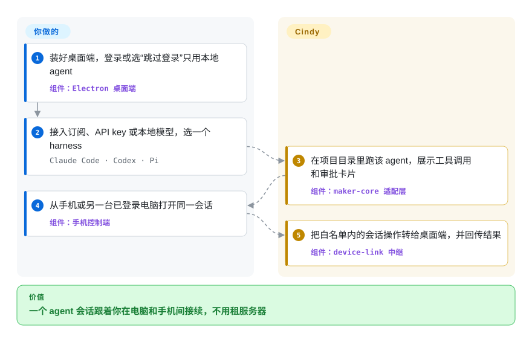
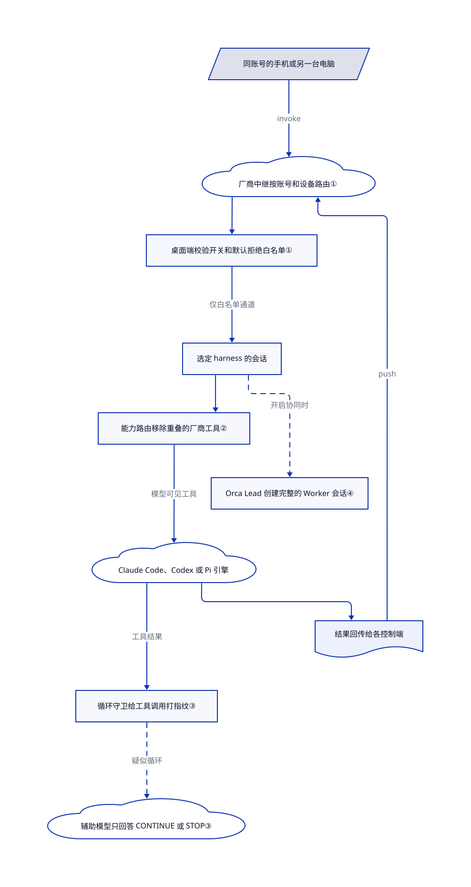

# Cindy

你的 Claude Code 会话跑在办公室电脑的终端里，换到手机、笔记本或另一个 agent 上就接不住，只能手动搬文件、重讲上下文。Cindy 把 Claude Code、Codex 和 Pi 三种 agent 包进一个桌面应用，再让你自己的手机和其他电脑经同账号中继去操控这个会话。

## 何时使用

你已经在付 Claude Code 或 Codex 的订阅，日常在公司的 Mac、家里的 Windows 台式机和手机之间来回。离开办公室时，那台电脑上的 agent 重构到一半；在地铁上你只看到一条 Slack 消息：`Allow this bash command? (y/n)`。你想在手机上批准它、调整方向、翻它改的文件，又不想租服务器，也不想把仓库推到云端工作区。Cindy 正对这个场景：桌面端在你的文件旁边跑 agent，手机端只是那台桌面的遥控器。

和 [OpenMausBot](openmausbot.zh.md) 比，跨设备接续、手机操控和远程桌面比“聊天式机器人花名册”更重要时选 Cindy。和 [Nezha](../../../agent-tooling/supervision-surfaces/agent-cockpits/nezha.zh.md) 比，你要的是完整的助手产品（记忆、自动化、插件、Lead/Worker 协同），而不只是本机监工窗口时选 Cindy。代价是：所有多设备功能都依赖厂商账号和中继，官方构建内置统计 SDK，代码库年轻且变化极快。

## 何时不用

- **你要多设备操控，又不能用厂商账号。** 中继和后端在另一个未公开的仓库；“跳过登录”只跑本地 agent，依赖服务端的功能都不可用。只要本机监工窗口，用 [Nezha](../../../agent-tooling/supervision-surfaces/agent-cockpits/nezha.zh.md)；能自己托管服务端，用 [Kandev](../../../agent-tooling/supervision-surfaces/agent-cockpits/kandev.zh.md)。
- **你的合规要求禁止产品统计或默认厂商端点。** 官方构建带 TapDB 统计，统计开关默认打开；README 还写明手机端企业 SSO 路径可能在没走隐私政策步骤时就记下同意。默认端点指向 Cindy 云。要么从源码构建并关掉统计，要么选不强制厂商账号、自带 key 的桌面助手 [OpenWorker](openworker.zh.md)。
- **你会用 2026-10-31 之前的构建打开不受信任的仓库。** 公开的静态审计（issue #8237）报告：项目里的 `.cindy/automations/schedules.json` 可能被自动导入，并在没有确认的情况下执行前置 shell 命令。主干在 2026-10-31 修复（提交 `63397cd7` 与 `e3a530e0`），晚于 v0.1.121 发布。包含修复的版本发布前，只打开可信仓库，或从主干构建。
- **你要一个稳定、精简的 agent 运行时。** 仓库公开约 100 天，有 12,540 个提交、1,936 个未关闭 issue、438 个未合并 PR（2026-11-01），几乎每天发版。版本之间行为会变。直接用厂商 CLI，或只需要轻量包一层时用 [OpenMausBot](openmausbot.zh.md)。
- **你要托管的多租户团队平台。** Cindy 是个人客户端：远程控制只限同一账号下的设备，Orca 协同属于某台桌面上的一个 Lead 会话。要团队共享 agent 的聊天工作区，去看 [team-chat](../../../team-chat/INDEX.zh.md) 分类。

## 横向对比

| 替代品 | 是否收录 | 我们的评价 | 取舍 |
|---|---|---|---|
| [OpenMausBot](openmausbot.zh.md) | ✅ | 想把已登录的 CLI 变成带“允许／拒绝”卡片的聊天机器人，选 OpenMausBot；一个会话必须跟着你在多台电脑和手机间接续，选 Cindy。 | OpenMausBot 只有本机 harness，运维轻，但没有设备中继；Cindy 多了远程桌面、模型共享和协同，代价是厂商账号与中继。 |
| [LobsterAI](lobsterai.zh.md) | ✅ | 围绕 OpenClaw 做办公交付物、经 IM 回传，选 LobsterAI；工作是 Claude Code、Codex 或 Pi 的编码会话，选 Cindy。 | LobsterAI 以产物和 IM 渠道为中心；Cindy 以 harness 适配、手机操控和多 agent 协同为中心，面更大、变化更快。 |
| [OpenWorker](openworker.zh.md) | ✅ | 要免登录、自带 key、带审批门和审计溯源的桌面助手，选 OpenWorker；现有 Claude Code／Codex 订阅和多设备访问是决定因素时，选 Cindy。 | OpenWorker 不强制厂商账号；Cindy 复用厂商 CLI 订阅并能跨设备，但默认走厂商端点并开启统计。 |
| [Nezha](../../../agent-tooling/supervision-surfaces/agent-cockpits/nezha.zh.md) | ✅ | 只想在本机用终端、会话和 Git 视图监工 Claude Code／Codex，选 Nezha；还要手机遥控、记忆和自动化，选 Cindy。 | Nezha 是更窄的本地驾驶舱；Cindy 是完整助手产品，跨设备功能依赖它的云。 |

## 快速上手

普通用户从 cindy.app 下载 macOS、Windows、Linux、iOS 或 Android 的签名安装包；开发者克隆仓库后运行 `pnpm install`，它会顺带下载桌面端自带的 Claude Code、Codex 和 ripgrep 二进制。首次启动时用 Cindy 账号登录，或选“跳过登录”只用本地 agent。然后接入模型来源——已有的 Claude Code 或 Codex 订阅、自己的 API key、本地模型，或 Cindy 收费的托管模型服务——再选一个 harness（真正执行任务的 agent 引擎：Claude Code、Codex 或 Pi）。你在某个项目目录里输入任务；Cindy 在那里运行 agent，展示工具调用和审批卡片，多台设备登录同一账号时，手机或另一台电脑可以接着操作这个会话。厂商计费和额度、授权哪些目录和权限模式、允许哪些设备被控，都由你负责。本条目没有运行上游构建或应用。

<!-- flow-steps:begin (generated from flows/cindy.json by tools/flow_card.py — do not edit) -->

流程文字版

1. **你**：装好桌面端，登录或选“跳过登录”只用本地 agent — 组件：`Electron 桌面端`
2. **你**：接入订阅、API key 或本地模型，选一个 harness — `Claude Code · Codex · Pi`
3. **Cindy**：在项目目录里跑该 agent，展示工具调用和审批卡片 — 组件：`maker-core 适配层`
4. **你**：从手机或另一台已登录电脑打开同一会话 — 组件：`手机控制端`
5. **Cindy**：把白名单内的会话操作转给桌面端，并回传结果 — 组件：`device-link 中继`

**价值**：一个 agent 会话跟着你在电脑和手机间接续，不用租服务器

<!-- flow-steps:end -->

## 技术要点

<!-- mechanism:begin (generated from mechanisms/cindy.json by tools/mechanism_card.py; do not edit) -->

机制文字版

- 同账号的手机或另一台电脑
- 厂商中继按账号和设备路由①
- 桌面端校验开关和默认拒绝白名单①
- 选定 harness 的会话
- 能力路由移除重叠的厂商工具②
- Claude Code、Codex 或 Pi 引擎
- 循环守卫给工具调用打指纹③
- 辅助模型只回答 CONTINUE 或 STOP③
- Orca Lead 创建完整的 Worker 会话④
- 结果回传给各控制端

- 同账号的手机或另一台电脑 → 厂商中继按账号和设备路由①（invoke）
- 厂商中继按账号和设备路由① → 桌面端校验开关和默认拒绝白名单①
- 桌面端校验开关和默认拒绝白名单① → 选定 harness 的会话（仅白名单通道）
- 选定 harness 的会话 → 能力路由移除重叠的厂商工具②
- 能力路由移除重叠的厂商工具② → Claude Code、Codex 或 Pi 引擎（模型可见工具）
- Claude Code、Codex 或 Pi 引擎 → 循环守卫给工具调用打指纹③（工具结果）
- 循环守卫给工具调用打指纹③ → 辅助模型只回答 CONTINUE 或 STOP③（疑似循环）〔可选／兜底〕
- 选定 harness 的会话 → Orca Lead 创建完整的 Worker 会话④（开启协同时）〔可选／兜底〕
- Claude Code、Codex 或 Pi 引擎 → 结果回传给各控制端
- 结果回传给各控制端 → 厂商中继按账号和设备路由①（push）

<!-- mechanism:end -->

### 1. 用默认拒绝的 IPC 隧道做远程控制

- **解决：** 手机能驱动桌面 agent，如果桌面的所有功能都能远程调用，它也就成了一个远程 shell。
- **做法：** 中继只看路由头，按账号隔离、按设备路由；被控桌面先查“允许被控”开关和 `REMOTE_INVOKE_ALLOWLIST`，再调用已有的 IPC 处理函数。不在表里的通道一律不可达；窗口、shell、凭据和裸数据库写入被明文列为永不放行。可选的可靠传输层再加上序号、累计确认、单条 4 MiB 上限和有界重传。
- **边界：** 中继服务端不在本仓库，它的隔离只能看文档，没法在这里审代码。白名单仍向同账号的任何设备开放创建会话、发消息、改权限模式和 Orca 控制。
- **源码：** [白名单准入规则第 1–25 行](https://github.com/makecindy/cindy/blob/b59490c088cb163666781a769e11749e44a8c87f/packages/device-link/src/allowlist.ts#L1-L25)、[白名单集合第 754–762 行](https://github.com/makecindy/cindy/blob/b59490c088cb163666781a769e11749e44a8c87f/packages/device-link/src/allowlist.ts#L754-L762)、[中继与可靠传输第 11–81 行](https://github.com/makecindy/cindy/blob/b59490c088cb163666781a769e11749e44a8c87f/packages/device-link/README.md#L11-L81)。

### 2. 用代码而不是提示词移除重叠的 harness 工具

- **解决：** Claude Code 和 Codex 自带电脑操控、Artifact 和连接器等工具，它们的结果会绕过 Cindy 的守卫，或只在厂商自家界面可见。
- **做法：** 宿主的路由表把这类能力标成 `disabled`，并写明 Cindy 的替代能力。各 harness 适配层把它们从模型可见面移除（Claude 用禁用工具与拒绝的 MCP 服务器，Codex 用线程级插件与 MCP 配置）。`findUnenforcedCapabilityRoutes` 让任何没有适配层能执行的路由在测试里直接失败。
- **边界：** Claude 的覆盖按名字匹配，用户自己同名的服务器也会被一起关掉。Pi 不接受任何路由，这张表约束不到它。
- **源码：** [路由表第 1–60 行](https://github.com/makecindy/cindy/blob/b59490c088cb163666781a769e11749e44a8c87f/apps/desktop/src/main/maker-host/capability-routing.ts#L1-L60)、[执行性检查第 1–35 行](https://github.com/makecindy/cindy/blob/b59490c088cb163666781a769e11749e44a8c87f/packages/maker-core/src/agents/capability-route-support.ts#L1-L35)、[设计规则第 452–480 行](https://github.com/makecindy/cindy/blob/b59490c088cb163666781a769e11749e44a8c87f/docs/dev-rules/maker-core-and-agent-behavior.md#L452-L480)。

### 3. 先识别工具循环，再请第二个模型决定是否停止

- **解决：** agent 可能连续几小时在同几次搜索里打转，同时一直有事件输出，空闲超时永远不会触发。
- **做法：** `ToolLoopGuard` 用工具名、输入和输出做指纹，在三层窗口里比对，其中包括 128 次读取的轮转检查；相隔 30 秒以上的调用视为轮询，不计数。命中只算“疑似”；`ToolLoopMonitor` 把脱敏后的最近 12 次调用摘要交给辅助模型，它只能回答 CONTINUE 或 STOP。快速完全相同的调用连续 30 次，或完全相同的结果持续一小时，则不经复核直接停止。
- **边界：** 这些都是有界启发式，不是证明；每轮最多复核 3 次、每次 20 秒超时，超时或没有复核器时放行该模式。每次复核都要花辅助模型的 token。
- **源码：** [阈值第 20–60 行](https://github.com/makecindy/cindy/blob/b59490c088cb163666781a769e11749e44a8c87f/packages/maker-core/src/agents/shared/loop-guard.ts#L20-L60)、[复核监视器第 33–193 行](https://github.com/makecindy/cindy/blob/b59490c088cb163666781a769e11749e44a8c87f/packages/maker-core/src/agents/shared/tool-loop-review.ts#L33-L193)、[行为契约第 30–102 行](https://github.com/makecindy/cindy/blob/b59490c088cb163666781a769e11749e44a8c87f/docs/dev-rules/maker-core-and-agent-behavior.md#L30-L102)。

### 4. Lead 与 Worker 协同都是完整会话

- **解决：** 一次性的子代理返回后就丢掉上下文和历史，长任务没法在多个 agent 之间拆分和验收。
- **做法：** Orca 把一个会话变成 Lead，由它创建 Worker 会话；每个 Worker 有自己的 harness、模型、思考强度、工具调用流和可见历史。SQLite 部分唯一索引保证每个 Lead 只有一个活跃团队、每个团队只有一个聚焦 Worker；生命周期、Worker 创建、派活和 agent 间消息由四个服务分别负责。
- **边界：** 团队绑定单个 Lead 会话，Worker 不能跨 Lead 共享，归档的 Worker 没有取消归档入口，工作流编排尚未实现。
- **源码：** [Orca 目标与边界第 33–54 行](https://github.com/makecindy/cindy/blob/b59490c088cb163666781a769e11749e44a8c87f/docs/dev-rules/orca-team-architecture.md#L33-L54)、[服务边界第 71–104 行](https://github.com/makecindy/cindy/blob/b59490c088cb163666781a769e11749e44a8c87f/docs/dev-rules/orca-team-architecture.md#L71-L104)、[团队与 Worker 索引第 807–866 行](https://github.com/makecindy/cindy/blob/b59490c088cb163666781a769e11749e44a8c87f/apps/desktop/src/main/localDb/schema.ts#L807-L866)。

## 技术栈

- TypeScript 写的 pnpm monorepo。[桌面端清单](https://github.com/makecindy/cindy/blob/b59490c088cb163666781a769e11749e44a8c87f/apps/desktop/package.json)锁定 Electron 42.11.12，搭配 React 19、Vite、better-sqlite3、Drizzle ORM 和 node-pty；[手机端清单](https://github.com/makecindy/cindy/blob/b59490c088cb163666781a769e11749e44a8c87f/apps/mobile/package.json)用 Expo 57 和 React Native 0.86。
- `packages/maker-core` 放 Claude Code、Codex、Pi 适配层，以及记忆、工具循环守卫和自动审核；`packages/device-link` 是与宿主无关的远程控制协议；`packages/opencli-vendor` 是明确声明来源的 jackwener/opencli 2.0.2 副本（Apache-2.0），用于浏览器配方。
- [根清单](https://github.com/makecindy/cindy/blob/b59490c088cb163666781a769e11749e44a8c87f/package.json)要求 Node ≥22.12、pnpm ≥10.7 且 <11；它的 `postinstall` 会下载 agent 二进制。

## 依赖

- **模型来源：** Claude Code 或 Codex 订阅、自己的厂商 API key、本地模型，或 Cindy 的托管模型服务。厂商计费和额度照常适用；免费客户端不含模型用量。
- **Cindy 云：** 登录、device-link 中继、云端伙伴、SkillHub 和自动更新都走 `config/endpoint*.json` 里的厂商端点。后端源码未公开。本地“跳过登录”模式不需要账号，但会失去这些功能，部分官方插件仍要求模型服务（issue #7581）。
- **开发构建：** Node 22、pnpm 10、Git LFS，`pnpm install` 时还要联网下载 Claude Code、Codex 和 ripgrep 二进制。

## 运维难度

**单人用官方构建：低；脱离厂商自己运行：高。** 安装应用并登录只是一次下载。真正的运维是权限卫生：定权限模式、哪些目录允许 agent 碰、哪些设备能控制哪些设备、统计开不开。统计在设置里关闭；手机端按 README 的说明彻底退出重开，SDK 才会保持未初始化。Apache-2.0 允许你自己构建、分发客户端，但它仍然连向 Cindy 的服务器。要替换中继和后端，只能自己写，因为代码不在这里。退役时，在每台设备上撤销远程控制、退出登录，检查后再删除本地数据和 agent 记录。

## 健康度与可持续性

- **维护（2026-11-01）：** 非常活跃。本次审阅的提交 `b59490c0` 当天合入；[v0.1.121](https://github.com/makecindy/cindy/releases/tag/v0.1.121) 于 2026-10-30 发布，之前几乎每天都有正式版或 beta。自 2026-07-24 首次公开提交以来，主干已有 12,540 个提交。
- **治理与背书：** NOTICE 写明版权方是 XD Inc.，仓库属于 `makecindy` 组织。前几位贡献者（dashhuang、zqchris、MagicLizi、DavidShenXD）合计占了大部分提交。贡献用 DCO 签名，不要求 CLA。后端、定价和统计由厂商掌控。
- **年龄与 Lindy：** 公开约 100 天，Lindy 先验还给不出持久性信号；公司背书提高了持续开发的概率，但年轻的厂商产品也可能被调整方向。[推断：依据是年龄和商业服务模式，不是过往记录]
- **采用与风险：** 8.9k 星、1.1k fork（2026-11-01）；README 自称 2026-10-26 登上 GitHub Trending 第一。未关闭的 issue 和 PR 队列很长，其中一部分由自动化机器人创建，反映的是节奏，不全是积压。主要风险是多设备功能锁定厂商、统计默认开启，以及一个尚未进入发布版的安全修复。

## 存疑（未验证）

- [未验证：没有运行应用、构建或中继] 跨设备接续、模型共享、远程桌面和可靠传输都只读了文档和源码，没有实际运行。
- [未验证：中继／后端仓库未公开] 账号隔离、中继存储，以及云端为伙伴保存了什么，无法从本仓库审计。
- [推断：修复提交晚于 v0.1.121 发布] 截至 v0.1.121 的发布版很可能仍含 issue #8237 报告的项目自动化执行命令路径。打开不受信任的仓库前先确认版本。
- [未验证：README 宣传] GitHub Trending 第一的说法，以及星数之外的采用情况，都没有独立核实。
- [推断：依据是年龄加公司背书，不是长期记录] 后续走向取决于 XD Inc. 的产品策略，本条目无法观察。
