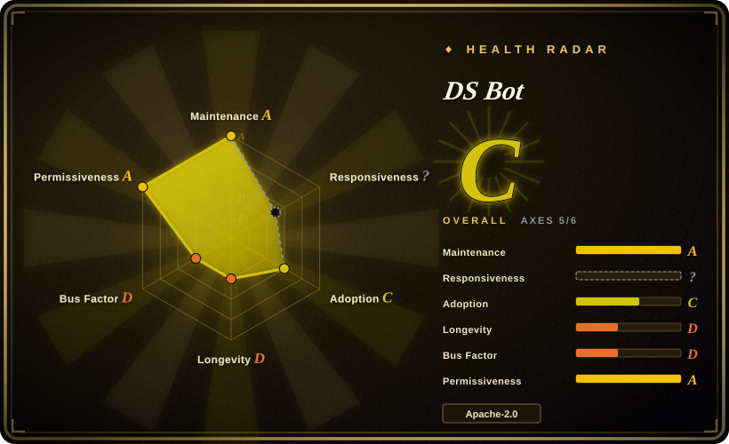
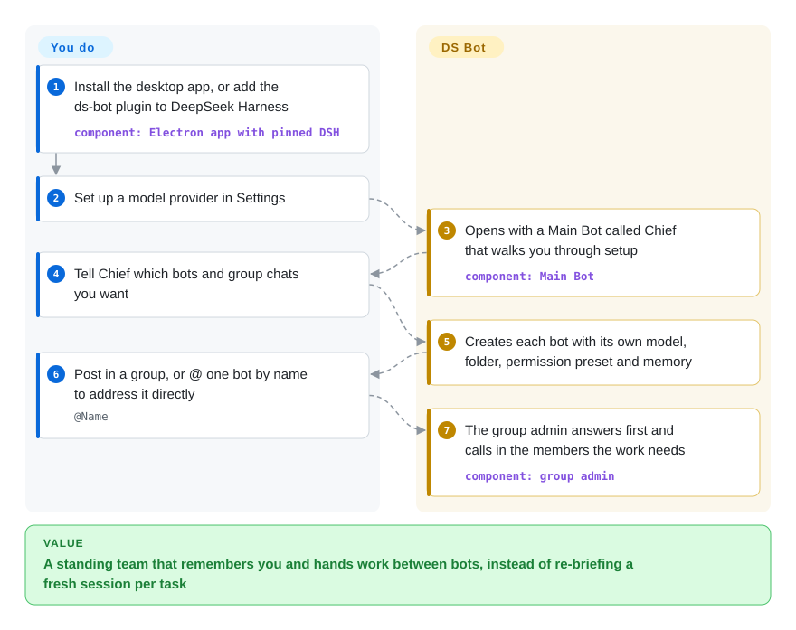
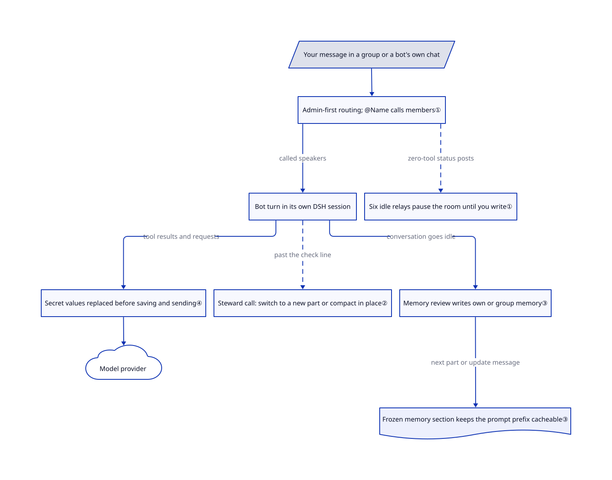

# DS Bot

Every task in DeepSeek Harness starts as a fresh agent session: you paste "answer in Chinese, keep tables, save to ~/notes" again, and getting a "writer" and a "coder" to cooperate means copying text between windows yourself. DS Bot keeps a standing team of named bots on your own machine, each with its own memory, model and folder, and lets them talk to you, message each other, and work in group chats where an admin bot decides who answers.

## When to use

You already use DeepSeek Harness (DSH), DeepSeek's open agent harness, or you are happy to let a desktop app install it for you, and you pay for model tokens through an API key. Your work recurs: a weekly report, a side project's code, a reading list. In a plain DSH session the agent forgets that you want reports in `~/notes/weekly/` with a summary table on top, and when you ask one session to draft and another to check numbers, you are the one carrying text between them. DS Bot turns DSH into a roster of long-lived bots. A Main Bot called Chief creates the others when you describe what you need. Each bot remembers corrections across chats. A group chat's admin answers you first and pulls in other members only when the work calls for them.

Pick it over [OpenMausBot](openmausbot.md) when you want bots on any model DSH can serve, billed per token, with memory and long-chat handling done by the app itself. OpenMausBot centres on driving Claude Code, Codex or Grok CLIs you already subscribe to; DS Bot can also attach such CLIs as bots, but its native bots run inside DSH. Pick it over [Hermes Agent](messaging-daemons/hermes-agent.md) when you want several specialised bots on your desktop rather than one assistant on a server reached through Telegram. The price is a hard dependency on a DSH release candidate and a project about six weeks old.

## When NOT to use

- **You do not want DeepSeek Harness under your assistant.** DS Bot is a DSH plugin: every bot is a DSH session, and the desktop app pins DSH `0.2.2-rc.1`, a release candidate. The project keeps a ledger of 15 places where it works around DSH limits. Examples: a DSH upgrade can leave the bot team unstarted until `npx ds-bot doctor --fix` removes stale pins, and a stuck model stream has no watchdog, so you stop the bot yourself. If you want a bot roster without a harness underneath, use [OpenMausBot](openmausbot.md); if you want one assistant on its own runtime, use [Hermes Agent](messaging-daemons/hermes-agent.md).
- **You need bots isolated from your system or from the model.** A "private bot" only isolates it from other bots. The README says it is not an OS sandbox: shell and network access still reach system files, and the provider still receives the conversation. The Docker edition runs every bot with `danger-full-access` and approval `never`, listening on `0.0.0.0:13080`; the container is the only boundary. Secret masking replaces exact copies only, so a bot that encodes a key can still print it. If each bot needs its own disposable computer, use [Rakazo](rakazo.md); for a bounded terminal behind a review gate, use [OpenMuse](openmuse.md).
- **Your token budget is tight.** Group chats call several models per message, and beyond the reply itself each conversation triggers extra model calls: a memory review after it goes idle, and a context-steward decision plus a checkpoint or handoff note when it grows long. The Usage page shows tokens, not cost. If one agent session is enough, run DSH directly, or use [dsh-TUI](../../../agent-tooling/supervision-surfaces/agent-cockpits/dsh-tui.md) for a richer terminal view of that session.
- **You want an always-on assistant reached mainly through chat apps.** The IM bridges to WeChat, Feishu, DingTalk, WeCom, QQ, Telegram, Discord and Slack only pass messages while your computer is awake and DS Bot is running, and WeChat supports private chat only. For a server-side assistant that lives in messengers, use [OpenClaw](messaging-daemons/openclaw.md) or [Hermes Agent](messaging-daemons/hermes-agent.md).
- **You need a stable, governed release line.** The repository was created 2026-10-07; npm shows 23 versions by 2026-11-18, there are 289 open issues, and one maintainer wrote close to 90% of the commits. Desktop installers are unsigned, so Windows SmartScreen and macOS Gatekeeper warn on first open. If you only need a dependable multi-model chat window, use [Open WebUI](../../../llm-chat-ui/open-webui.md).

## Comparison

| Alternative | In index | Our verdict | Tradeoff |
| --- | --- | --- | --- |
| [OpenMausBot](openmausbot.md) | ✅ | If your bots should be the Claude Code, Codex or Grok CLIs you already subscribe to, pick OpenMausBot; pick DS Bot when bots run on API-billed models through DSH and you want app-managed memory and group admins. | OpenMausBot reuses CLI subscriptions and passes each CLI's own approvals through; DS Bot adds memory review, a context steward and role rights, but ties you to DSH's release candidate. |
| [Rakazo](rakazo.md) | ✅ | When each bot needs its own checkpointed Linux computer on a server, pick Rakazo; pick DS Bot for a desktop team that works in your own folders with no container stack to run. | Rakazo pays for isolation with Postgres, a worker and a desktop image; DS Bot runs light on the desktop, but shell access is your machine unless you use its Docker edition. |
| [Hermes Agent](messaging-daemons/hermes-agent.md) | ✅ | For one long-lived assistant on a VPS that you reach through Telegram or Slack, pick Hermes Agent; pick DS Bot when you want several named bots with group chats and handoffs on your desktop. | Hermes Agent runs headless and always on; DS Bot's IM bridges stop when your computer sleeps, but it gives each bot separate memory, folder and permissions. |
| [dsh-TUI](../../../agent-tooling/supervision-surfaces/agent-cockpits/dsh-tui.md) | ✅ | If you only want to watch and steer one DSH session better, pick dsh-TUI; pick DS Bot when the point is several persistent DSH bots that address each other. | dsh-TUI adds a terminal view without extra model calls; DS Bot adds a team, memory and group routing at the cost of more tokens and a larger plugin surface. |
| DeepSeek Harness | not indexed | When one agent session per task is enough, use plain DSH and skip the plugin; add DS Bot when the same preferences and roles keep recurring across tasks (not added in this tab batch). | Plain DSH has fewer moving parts and no plugin-compat ledger; DS Bot layers persistent identity, memory and group chats onto DSH's sessions. |

## Quick start

Most users download the desktop installer from the GitHub Releases page; it bundles its own DSH, so nothing else is installed first. If you already run DSH, add the plugin instead: in DSH Desktop enter `ds-bot` under Plugins → Add plugin, or for DSH Web run `npx @deepseek-ai/dsh@0.2.2-rc.1 plugin --profile web add ds-bot`. You then set up a model provider (the company and API key that answer the bot's requests) in Settings → Models. On first open, a Main Bot called Chief greets you; you describe the bots and group chats you want, and Chief creates them, each with a model, a working folder and a permission preset (read only, workspace or full access). After that you chat with a bot directly or post in a group and `@` a bot by name. DS Bot handles routing, memory and long-chat condensing. Your responsibilities are the model bill, the folders and permissions you grant, and checking important actions. For a NAS or server, the `docker/` folder runs `dsh web` with the plugin in a container.

<!-- flow-steps:begin (generated from flows/ds-bot.json by tools/flow_card.py — do not edit) -->

Text version of the flow

1. **You**: Install the desktop app, or add the ds-bot plugin to DeepSeek Harness — component: `Electron app with pinned DSH`
2. **You**: Set up a model provider in Settings
3. **DS Bot**: Opens with a Main Bot called Chief that walks you through setup — component: `Main Bot`
4. **You**: Tell Chief which bots and group chats you want
5. **DS Bot**: Creates each bot with its own model, folder, permission preset and memory
6. **You**: Post in a group, or @ one bot by name to address it directly — `@Name`
7. **DS Bot**: The group admin answers first and calls in the members the work needs — component: `group admin`

**Value**: A standing team that remembers you and hands work between bots, instead of re-briefing a fresh session per task

<!-- flow-steps:end -->

## Key techniques

<!-- mechanism:begin (generated from mechanisms/ds-bot.json by tools/mechanism_card.py; do not edit) -->

Text version of the mechanism

- Your message in a group or a bot's own chat
- Admin-first routing; @Name calls members①
- Six idle relays pause the room until you write①
- Bot turn in its own DSH session
- Model provider
- Secret values replaced before saving and sending④
- Steward call: switch to a new part or compact in place②
- Memory review writes own or group memory③
- Frozen memory section keeps the prompt prefix cacheable③

- Your message in a group or a bot's own chat → Admin-first routing; @Name calls members①
- Admin-first routing; @Name calls members① → Bot turn in its own DSH session (called speakers)
- Admin-first routing; @Name calls members① → Six idle relays pause the room until you write① (zero-tool status posts) [optional/fallback]
- Bot turn in its own DSH session → Secret values replaced before saving and sending④ (tool results and requests)
- Secret values replaced before saving and sending④ → Model provider
- Bot turn in its own DSH session → Steward call: switch to a new part or compact in place② (past the check line) [optional/fallback]
- Bot turn in its own DSH session → Memory review writes own or group memory③ (conversation goes idle)
- Memory review writes own or group memory③ → Frozen memory section keeps the prompt prefix cacheable③ (next part or update message)

<!-- mechanism:end -->

### 1. Admin-first group routing with an idle brake

- **Problem:** A group of models that all answer every message burns tokens, and bots that keep replying "noted" to each other can loop without doing work.
- **How:** In admin mode a plain message goes only to the group admin, which answers or calls members with `@Name`; members named in a message start in parallel, and a member with nothing to add replies `[PASS]`. Each bot step that uses no tool counts as idle; after 6 consecutive idle steps the room pauses, and the calls it would have made are parked until you write.
- **Limits:** Idle detection is text heuristics (empty, short filler or repeated bodies), so a chatty but useless loop that calls tools is not caught. Admin-first only saves tokens if the admin's model judges well whom to call.
- **Source:** [reply rule:168](https://github.com/Fei2411/DS-Bot/blob/5e9b7da8882da3b68d8a0624342708c2150a9156/ds-bot/src/host/groups.js#L168-L168), [idle text check:67–71](https://github.com/Fei2411/DS-Bot/blob/5e9b7da8882da3b68d8a0624342708c2150a9156/ds-bot/src/host/groups.js#L67-L71), [idle streak and pause:957–1004](https://github.com/Fei2411/DS-Bot/blob/5e9b7da8882da3b68d8a0624342708c2150a9156/ds-bot/src/host/groups.js#L957-L1004), [speaker selection:1640–1660](https://github.com/Fei2411/DS-Bot/blob/5e9b7da8882da3b68d8a0624342708c2150a9156/ds-bot/src/host/groups.js#L1640-L1660), [limit of 6:90](https://github.com/Fei2411/DS-Bot/blob/5e9b7da8882da3b68d8a0624342708c2150a9156/ds-bot/src/host/constants.js#L90-L90).

### 2. A context steward decides between a new part and in-place compaction

- **Problem:** Generic compaction summarises a long chat at a fixed size whether or not a task is half-done, and each summary-of-a-summary loses more.
- **How:** DSH's own compaction is off for bot sessions. When a turn ends past a check line (80% of the usable window by default, capped at 380,000 tokens), a separate small model call reads the latest messages and returns JSON `switch` or `compact`. `switch` starts a new part with a handoff note; `compact` replaces older messages with a numbered checkpoint while your messages travel word for word. Older parts stay searchable through a SQLite full-text index.
- **Limits:** The decision is one model's judgment of a trimmed view (about 6,000 tokens), so it can misjudge a stopping point, and every decision costs an extra call. A model without a declared window falls back to a 500,000-token guess.
- **Source:** [lines and caps:11–33](https://github.com/Fei2411/DS-Bot/blob/5e9b7da8882da3b68d8a0624342708c2150a9156/ds-bot/src/host/steward.js#L11-L33), [steward prompt:35–48](https://github.com/Fei2411/DS-Bot/blob/5e9b7da8882da3b68d8a0624342708c2150a9156/ds-bot/src/host/steward.js#L35-L48), [decision parsing:82–97](https://github.com/Fei2411/DS-Bot/blob/5e9b7da8882da3b68d8a0624342708c2150a9156/ds-bot/src/host/steward.js#L82-L97), [feature description:23](https://github.com/Fei2411/DS-Bot/blob/5e9b7da8882da3b68d8a0624342708c2150a9156/ds-bot/README.md#L23-L23).

### 3. Memory written by a review pass, frozen per session for the cache

- **Problem:** Memory that depends on the bot deciding to call `remember` misses most preferences, and a system prompt that changes every turn defeats the provider's prompt cache.
- **How:** When a conversation goes idle, a review call reads what is new and adds, updates or removes entries itself. A bot's own chat feeds its own memory, and a group chat feeds that group's memory only, so group talk never lands in a bot's private notes. Entries that look like keys are refused. Each session freezes its memory section the first time it renders; later changes arrive as short update messages, so the prompt prefix stays byte-identical until the next part.
- **Limits:** Every review is another model call on the bot's or admin's model. A frozen section means a session can work from slightly stale memory until it sees the update message or starts a new part.
- **Source:** [review design:1–21](https://github.com/Fei2411/DS-Bot/blob/5e9b7da8882da3b68d8a0624342708c2150a9156/ds-bot/src/host/memory-review.js#L1-L21), [chat versus group review:228–270](https://github.com/Fei2411/DS-Bot/blob/5e9b7da8882da3b68d8a0624342708c2150a9156/ds-bot/src/host/memory-review.js#L228-L270), [freezing rule:18–26](https://github.com/Fei2411/DS-Bot/blob/5e9b7da8882da3b68d8a0624342708c2150a9156/ds-bot/src/host/memory.js#L18-L26), [frozen section:800–830](https://github.com/Fei2411/DS-Bot/blob/5e9b7da8882da3b68d8a0624342708c2150a9156/ds-bot/src/host/memory.js#L800-L830), [key refusal:425–430](https://github.com/Fei2411/DS-Bot/blob/5e9b7da8882da3b68d8a0624342708c2150a9156/ds-bot/src/host/memory.js#L425-L430).

### 4. Secrets the bot uses but never sees

- **Problem:** A bot that needs an API key usually gets it pasted into chat, where it sits in transcripts and goes to the model provider.
- **How:** The bot calls `request_secret` and you type the value into a card; it is stored in `secrets.json` (mode 600, optional scrypt + AES-256-GCM) and reaches the bot's shell only as `$DSH_SECRET_<NAME>`. Two hooks replace every copy with `[secret:<NAME>]`: one on tool results before they are saved, one on each model request before it leaves, covering JSON-escaped and URL-encoded forms. Values shorter than 8 characters are replaced only where no letter or digit touches them.
- **Limits:** Only exact copies are masked, so a bot that base64-encodes, splits or reverses the value can still print it. On a non-HTTPS DSH Web page the value crosses the network in clear text.
- **Source:** [thresholds and scope:15–28](https://github.com/Fei2411/DS-Bot/blob/5e9b7da8882da3b68d8a0624342708c2150a9156/ds-bot/src/host/secrets.js#L15-L28), [redactor:39–66](https://github.com/Fei2411/DS-Bot/blob/5e9b7da8882da3b68d8a0624342708c2150a9156/ds-bot/src/host/secrets.js#L39-L66), [tool-result and request hooks:731–761](https://github.com/Fei2411/DS-Bot/blob/5e9b7da8882da3b68d8a0624342708c2150a9156/ds-bot/src/host/secrets.js#L731-L761).

## Tech stack

- **Plugin** (`ds-bot/`): JavaScript ES modules loaded by DSH's Cordis plugin system, with peer dependencies on `@deepseek-ai/cordis`, `dsh-llm`, `dsh-tools`, `dsh-web` and related packages. The browser UI in `src/client/` is bundled by esbuild into a committed `client.js`.
- **Storage:** JSON state files, append-only JSONL group ledgers and memory journals, Markdown memory files, and `node:sqlite` databases for the chat full-text index (FTS5) and token usage.
- **Integrations:** `@modelcontextprotocol/client` for MCP servers, `playwright-core` for the bot browser, `imapflow`/`nodemailer` for mail connectors, adapters for local agent CLIs over ACP and MCP, and IM platform adapters.
- **Desktop app** (`app/`): Electron 44 with electron-builder and electron-updater, bundling DSH `0.2.2-rc.1` packages and a LibreOffice kit for Office rendering.
- **Phone link** (`link/`): TypeScript, X25519 keys with an encrypted handshake, and a relay server that forwards frames it cannot read.
- **Docker:** `node:24-bookworm-slim` running `dsh web` with the plugin.

## Dependencies

- **DeepSeek Harness**: bundled in the desktop app; otherwise DSH Desktop, or DSH Web with Node.js 22.19+ and pnpm.
- **A model provider and its API key**: DeepSeek or any provider DSH serves; every bot turn, memory review and steward call is billed to it. Local agent bots instead use the CLI's own sign-in and plan.
- **Optional**: a vision model for image-to-text when the bot's model cannot read images; accounts for connectors (GitHub, mail, remote MCP), IM platforms and the default phone relay `relay.dsbot.app` (self-hostable from `link/server`).
- **Platforms**: Windows, macOS and Linux desktop builds. Linux needs glibc 2.28+, otherwise use Docker. Computer use needs macOS 14+ or X11 on Linux.

## Ops difficulty

**Low for one person on the desktop app; medium as a DSH plugin or Docker server.** The desktop installer brings its own DSH and data folder (`~/.ds-bot`). The plugin route shares `~/.dsh` with DSH, so a DSH upgrade can break the team until the bundled doctor clears version pins. Running DSH Web and Desktop on the same home makes one of them read-only through a lock file. Backups mean quitting DSH and copying the whole home, since `bot/` alone loses the chats. Moving to another computer with a different path is documented as untested. The Docker edition is the always-on route, but you own its full-access container, the trusted-host list and the port exposure. Day two is a release every one to three days through the in-app update check.

## Health & viability

- **Maintenance (2026-11-18):** very active. Pushed today; 22 GitHub releases from v0.1.0 (2026-10-10) to v0.3.8 (2026-11-16) and 638 merged PRs. The repository records each design in `docs/plans/` and carries CI for unit, packaging and Docker tests.
- **Governance and bus factor:** a personal repository (`Fei2411`). The owner has about 2,650 of roughly 2,960 contributor commits; the next two contributors have 131 and 109. The roadmap is one person's, and the project depends on DeepSeek's DSH while stating that it is not an official DeepSeek product.
- **Age and Lindy:** created 2026-10-07, so about six weeks old. There is no Lindy signal; its continuation depends on DSH's own direction and on one maintainer's pace. [推断：based on age and contributor share, not on any stated plan]
- **Adoption:** 8,251 stars, 818 forks and 15 watchers (2026-11-18); the `ds-bot` npm package had 62,719 downloads in the last month (health scorer, 2026-11-18). That pace mostly reflects DSH's launch attention rather than verified production use.
- **Risk flags:** Apache-2.0 with a NOTICE that names DSH-derived files (MIT). The README carries a sponsor block for an API aggregator, the desktop installers are unsigned, and the Docker edition defaults to full access.

## Caveats (unverified)

- [未验证：no app, plugin or container was run] Routing, memory review, the steward and secret masking were read from source at commit `5e9b7da8`, not exercised.
- [推断：based on contributor share and age] The bus-factor and longevity judgment rests on one maintainer holding most commits; no succession or organisation plan was found.
- [推断：the desktop app bundles `dsh-session-telemetry` and `dsh-anonymous-user-id`, and the Docker compose file leaves `DSH_TELEMETRY_DISABLED` commented out] DSH probably sends telemetry by default; what it sends was not traced.
- [未验证：relay server operations are not observable] The default phone relay `relay.dsbot.app` is described as forwarding encrypted frames it cannot read; its operator, retention and uptime were not checked.
- [推断：star and download curve against DSH's launch] Stars and npm downloads at six weeks reflect attention around DSH more than deployments; no public list of users was found.
- [未验证：the security model lists open questions] Whether a bot-scoped secret should also be hidden from Main Bots, and whether the Docker web UI is meant for trusted LANs only, are open questions in `SECURITY_MODEL.md`.
