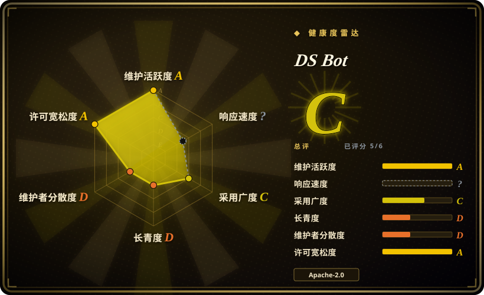
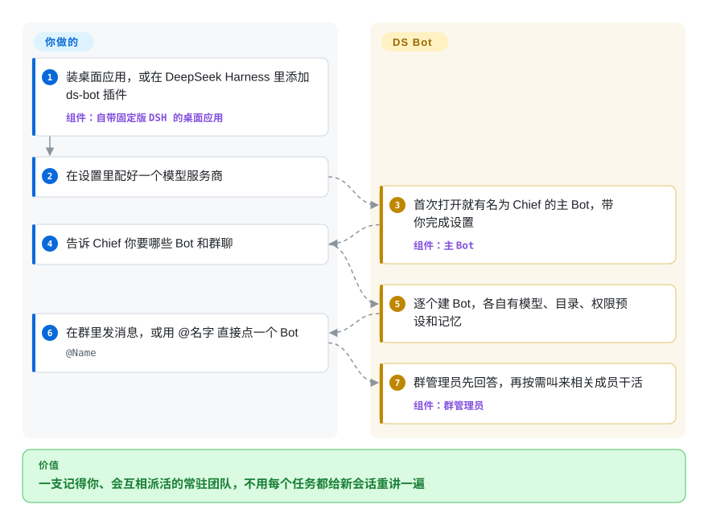
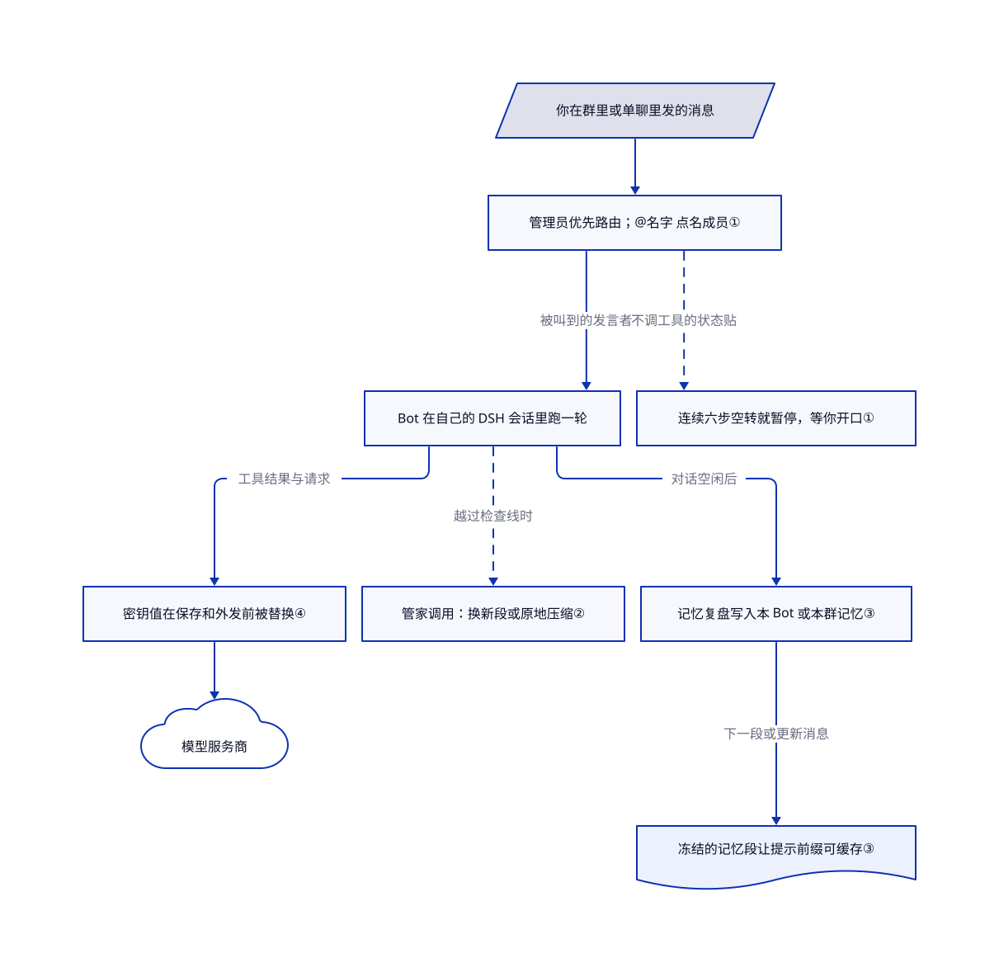

# DS Bot

在 DeepSeek Harness 里，每个任务都从一个全新的会话开始：“用中文回答、保留表格、存到 ~/notes”这句话得一遍遍重贴；想让“写手”和“程序员”配合，只能你自己在几个窗口之间搬文字。DS Bot 在你自己的电脑上养一支常驻的 Bot 团队，每个 Bot 有自己的记忆、模型和工作目录，能和你单聊、互相发消息派活，也能进群聊，由担任管理员的 Bot 决定谁来回答。

## 何时使用

你已经在用 DeepSeek 开源的 agent 运行框架 DeepSeek Harness（DSH），或者愿意让一个桌面应用替你装好它，并且按 token 付 API 费用。你的工作是反复出现的：每周的周报、一个业余项目的代码、一份阅读清单。在普通的 DSH 会话里，agent 记不住你要把周报放进 `~/notes/weekly/`、开头先放一张汇总表；你让一个会话起草、另一个会话核数字，来回传话的人还是你。DS Bot 把 DSH 变成一份常驻 Bot 名单：名叫 Chief 的主 Bot 听你描述需求后建出其他 Bot；每个 Bot 跨对话记住你的纠正；群聊里由管理员先回应你，只在需要时才叫其他成员上场。

如果你想让 Bot 跑在 DSH 能接的任意模型上、按 token 计费，并由应用自己管记忆和长对话，选它而不是 [OpenMausBot](openmausbot.zh.md)。OpenMausBot 的重心是驱动你已订阅的 Claude Code、Codex 或 Grok CLI；DS Bot 也能把这类 CLI 接成 Bot，但它原生的 Bot 运行在 DSH 里。如果你要的是桌面上几个分工明确的 Bot，而不是服务器上一个通过 Telegram 联系的助手，选它而不是 [Hermes Agent](messaging-daemons/hermes-agent.zh.md)。代价是硬依赖一个 DSH 候选发布版，而且项目只有约六周大。

## 何时不用

- **你不想在助手底下垫一层 DeepSeek Harness。** DS Bot 是 DSH 插件：每个 Bot 都是一个 DSH 会话，桌面应用锁定的 DSH 版本是候选发布版 `0.2.2-rc.1`。项目专门记了一本账，列出 15 处绕开 DSH 限制的做法。例如：DSH 升级后 Bot 团队可能起不来，要靠 `npx ds-bot doctor --fix` 清掉过期的版本锁定；模型流卡死时没有看门狗，只能你手动停掉那个 Bot。想要不依赖底层 harness 的 Bot 名单，用 [OpenMausBot](openmausbot.zh.md)；想要自带运行时的单个助手，用 [Hermes Agent](messaging-daemons/hermes-agent.zh.md)。
- **你需要把 Bot 和系统或模型隔开。** “私密 Bot”只把它和其他 Bot 隔开。README 明说这不是操作系统沙箱：给了 shell 和网络权限，它照样能读写系统文件、访问网络，模型服务商也照样收到对话。Docker 版让所有 Bot 以 `danger-full-access`、审批 `never` 运行，监听 `0.0.0.0:13080`，容器是唯一边界。密钥遮蔽只替换原样出现的值，Bot 把密钥编码后仍能打印出来。每个 Bot 需要一台独立可丢弃的电脑，用 [Rakazo](rakazo.zh.md)；要有审核关卡、受限的终端，用 [OpenMuse](openmuse.zh.md)。
- **你的 token 预算很紧。** 群聊一条消息会调用多个模型；除了回复本身，每段对话还会触发额外的模型调用：空闲后的一次记忆复盘，变长后的一次上下文管家判断，外加一份检查点或交接说明。用量页只显示 token，不显示花费。一个 agent 会话就够用的话，直接跑 DSH，或用 [dsh-TUI](../../../agent-tooling/supervision-surfaces/agent-cockpits/dsh-tui.zh.md) 在终端里把这个会话看得更清楚。
- **你要的是一直在线、主要通过聊天软件联系的助手。** 微信、飞书、钉钉、企业微信、QQ、Telegram、Discord 和 Slack 的桥接，只在你电脑醒着且 DS Bot 在运行时才收发消息，微信还只支持私聊。要一个住在聊天软件里的服务端助手，用 [OpenClaw](messaging-daemons/openclaw.zh.md) 或 [Hermes Agent](messaging-daemons/hermes-agent.zh.md)。
- **你需要稳定、有治理的发布线。** 仓库创建于 2026-10-07；到 2026-11-18，npm 上已有 23 个版本，开着 289 个 issue，近九成提交出自一位维护者。桌面安装包没有签名，Windows SmartScreen 和 macOS Gatekeeper 首次打开都会警告。只需要一个可靠的多模型聊天窗口，用 [Open WebUI](../../../llm-chat-ui/open-webui.zh.md)。

## 横向对比

| 替代品 | 是否收录 | 我们的评价 | 取舍 |
| --- | --- | --- | --- |
| [OpenMausBot](openmausbot.zh.md) | ✅ | 如果你的 Bot 就该是你已订阅的 Claude Code、Codex 或 Grok CLI，选 OpenMausBot；如果 Bot 通过 DSH 跑按量计费的模型，并且你要应用自管的记忆和群管理员，选 DS Bot。 | OpenMausBot 复用 CLI 订阅，审批直接沿用各 CLI 自己的模式；DS Bot 多了记忆复盘、上下文管家和角色权限，但把你绑在 DSH 的候选版上。 |
| [Rakazo](rakazo.zh.md) | ✅ | 每个 Bot 需要服务器上一台可回滚的独立 Linux 电脑时，选 Rakazo；要一支在你自己目录里干活、不用维护容器栈的桌面团队，选 DS Bot。 | Rakazo 用 Postgres、worker 和桌面镜像换来隔离；DS Bot 在桌面上很轻，但除非用 Docker 版，shell 权限落在你本机上。 |
| [Hermes Agent](messaging-daemons/hermes-agent.zh.md) | ✅ | 要一个在 VPS 上长期运行、通过 Telegram 或 Slack 联系的助手，选 Hermes Agent；要桌面上几个有名字、能群聊和互相交接的 Bot，选 DS Bot。 | Hermes Agent 无界面、一直在线；DS Bot 的聊天软件桥接随电脑休眠中断，但每个 Bot 有各自的记忆、目录和权限。 |
| [dsh-TUI](../../../agent-tooling/supervision-surfaces/agent-cockpits/dsh-tui.zh.md) | ✅ | 只想把一个 DSH 会话看得更清、管得更顺，选 dsh-TUI；要的是几个常驻、能互相点名的 DSH Bot，选 DS Bot。 | dsh-TUI 加的是终端视图，不多花模型调用；DS Bot 加的是团队、记忆和群聊路由，代价是更多 token 和更大的插件面。 |
| DeepSeek Harness | 未收录 | 一个任务一个会话就够时，直接用原版 DSH，不装插件；同样的偏好和角色在任务之间反复出现时，再加 DS Bot（本批标签未收录）。 | 原版 DSH 部件更少，没有插件兼容账本；DS Bot 在 DSH 会话之上叠加了常驻身份、记忆和群聊。 |

## 快速上手

多数用户从 GitHub Releases 页面下载桌面安装包；它自带 DSH，不需要先装别的。如果你已经在用 DSH，就改装插件：在 DSH Desktop 的“插件 → 添加插件”里输入 `ds-bot`，DSH Web 则运行 `npx @deepseek-ai/dsh@0.2.2-rc.1 plugin --profile web add ds-bot`。接着在“设置 → 模型”里配好模型服务商（也就是负责回答 Bot 请求的公司及其 API key）。第一次打开时，名叫 Chief 的主 Bot 会跟你打招呼；你描述想要哪些 Bot 和群聊，Chief 就把它们建出来，每个 Bot 带一个模型、一个工作目录和一档权限预设（只读、工作区或完全访问）。之后你可以直接和某个 Bot 单聊，也可以在群里发消息，用 `@` 加名字点某个 Bot。路由、记忆和长对话压缩由 DS Bot 负责；模型账单、你授予的目录和权限、以及重要操作的核对归你。要放在 NAS 或服务器上，`docker/` 目录会在容器里跑带插件的 `dsh web`。

<!-- flow-steps:begin (generated from flows/ds-bot.json by tools/flow_card.py — do not edit) -->

流程文字版

1. **你**：装桌面应用，或在 DeepSeek Harness 里添加 ds-bot 插件 — 组件：`自带固定版 DSH 的桌面应用`
2. **你**：在设置里配好一个模型服务商
3. **DS Bot**：首次打开就有名为 Chief 的主 Bot，带你完成设置 — 组件：`主 Bot`
4. **你**：告诉 Chief 你要哪些 Bot 和群聊
5. **DS Bot**：逐个建 Bot，各自有模型、目录、权限预设和记忆
6. **你**：在群里发消息，或用 @名字 直接点一个 Bot — `@Name`
7. **DS Bot**：群管理员先回答，再按需叫来相关成员干活 — 组件：`群管理员`

**价值**：一支记得你、会互相派活的常驻团队，不用每个任务都给新会话重讲一遍

<!-- flow-steps:end -->

## 技术要点

<!-- mechanism:begin (generated from mechanisms/ds-bot.json by tools/mechanism_card.py; do not edit) -->

机制文字版

- 你在群里或单聊里发的消息
- 管理员优先路由；@名字 点名成员①
- 连续六步空转就暂停，等你开口①
- Bot 在自己的 DSH 会话里跑一轮
- 模型服务商
- 密钥值在保存和外发前被替换④
- 管家调用：换新段或原地压缩②
- 记忆复盘写入本 Bot 或本群记忆③
- 冻结的记忆段让提示前缀可缓存③

- 你在群里或单聊里发的消息 → 管理员优先路由；@名字 点名成员①
- 管理员优先路由；@名字 点名成员① → Bot 在自己的 DSH 会话里跑一轮（被叫到的发言者）
- 管理员优先路由；@名字 点名成员① → 连续六步空转就暂停，等你开口①（不调工具的状态贴）〔可选／兜底〕
- Bot 在自己的 DSH 会话里跑一轮 → 密钥值在保存和外发前被替换④（工具结果与请求）
- 密钥值在保存和外发前被替换④ → 模型服务商
- Bot 在自己的 DSH 会话里跑一轮 → 管家调用：换新段或原地压缩②（越过检查线时）〔可选／兜底〕
- Bot 在自己的 DSH 会话里跑一轮 → 记忆复盘写入本 Bot 或本群记忆③（对话空闲后）
- 记忆复盘写入本 Bot 或本群记忆③ → 冻结的记忆段让提示前缀可缓存③（下一段或更新消息）

<!-- mechanism:end -->

### 1. 群聊由管理员优先路由，并带空转刹车

- **解决：** 一群模型每条消息都抢着回答会烧 token；几个 Bot 互相回“收到”还可能空转成死循环，活却没人干。
- **做法：** 管理员模式下，普通消息只交给群管理员，由它回答或用 `@名字` 叫成员；同一条消息点到的成员并行开工，没东西可补充的成员回 `[PASS]` 保持沉默。每个不调用工具的 Bot 步骤记为一次空转，连续 6 次后群聊暂停，本该发出的点名先挂起，等你发言后再执行。
- **边界：** 空转判断靠文本规则（空白、短套话或重复内容），一个会调工具但没产出的循环抓不住；管理员优先能省多少 token，取决于管理员的模型能否判断该叫谁。
- **源码：** [回复规则第 168 行](https://github.com/Fei2411/DS-Bot/blob/5e9b7da8882da3b68d8a0624342708c2150a9156/ds-bot/src/host/groups.js#L168-L168)、[空转文本判断第 67–71 行](https://github.com/Fei2411/DS-Bot/blob/5e9b7da8882da3b68d8a0624342708c2150a9156/ds-bot/src/host/groups.js#L67-L71)、[空转计数与暂停第 957–1004 行](https://github.com/Fei2411/DS-Bot/blob/5e9b7da8882da3b68d8a0624342708c2150a9156/ds-bot/src/host/groups.js#L957-L1004)、[发言者选择第 1640–1660 行](https://github.com/Fei2411/DS-Bot/blob/5e9b7da8882da3b68d8a0624342708c2150a9156/ds-bot/src/host/groups.js#L1640-L1660)、[上限 6 第 90 行](https://github.com/Fei2411/DS-Bot/blob/5e9b7da8882da3b68d8a0624342708c2150a9156/ds-bot/src/host/constants.js#L90-L90)。

### 2. 上下文管家决定换新段还是原地压缩

- **解决：** 通用压缩不管任务做没做完，到了固定长度就总结；总结再被总结，丢的细节越来越多。
- **做法：** Bot 会话关掉了 DSH 自带的压缩。一轮结束时若超过检查线（默认是可用窗口的 80%，上限 380,000 token），一次独立的小模型调用读最近的消息，返回 JSON 的 `switch` 或 `compact`。`switch` 带着交接说明开一段新对话；`compact` 把较早的消息换成带编号的检查点，你说过的话原样保留。旧段落仍可通过 SQLite 全文索引检索。
- **边界：** 判断来自一个模型对裁剪视图（约 6,000 token）的理解，可能看错停顿点，而且每次判断都多花一次调用；没有声明窗口的模型按 500,000 token 估算。
- **源码：** [检查线与上限第 11–33 行](https://github.com/Fei2411/DS-Bot/blob/5e9b7da8882da3b68d8a0624342708c2150a9156/ds-bot/src/host/steward.js#L11-L33)、[管家提示词第 35–48 行](https://github.com/Fei2411/DS-Bot/blob/5e9b7da8882da3b68d8a0624342708c2150a9156/ds-bot/src/host/steward.js#L35-L48)、[决定解析第 82–97 行](https://github.com/Fei2411/DS-Bot/blob/5e9b7da8882da3b68d8a0624342708c2150a9156/ds-bot/src/host/steward.js#L82-L97)、[功能说明第 23 行](https://github.com/Fei2411/DS-Bot/blob/5e9b7da8882da3b68d8a0624342708c2150a9156/ds-bot/README.md#L23-L23)。

### 3. 记忆由复盘写入，并按会话冻结以保住缓存

- **解决：** 指望 Bot 自己想起来调用 `remember`，大部分偏好都会漏记；系统提示每轮都变，又会让服务商的提示缓存失效。
- **做法：** 对话空闲后，一次复盘调用读新内容，自行增、改、删条目。Bot 单聊写进它自己的记忆，群聊只写进该群的记忆，群里的话不会落进某个 Bot 的私人笔记；看起来像密钥的条目会被拒绝。每个会话第一次渲染时冻结记忆段，之后的改动以简短更新消息送达，提示前缀在下一段开始前保持逐字节不变。
- **边界：** 每次复盘都在 Bot 或群管理员的模型上多花一次调用；冻结意味着会话在看到更新消息或开新段之前，可能按略旧的记忆干活。
- **源码：** [复盘设计第 1–21 行](https://github.com/Fei2411/DS-Bot/blob/5e9b7da8882da3b68d8a0624342708c2150a9156/ds-bot/src/host/memory-review.js#L1-L21)、[单聊与群聊复盘第 228–270 行](https://github.com/Fei2411/DS-Bot/blob/5e9b7da8882da3b68d8a0624342708c2150a9156/ds-bot/src/host/memory-review.js#L228-L270)、[冻结规则第 18–26 行](https://github.com/Fei2411/DS-Bot/blob/5e9b7da8882da3b68d8a0624342708c2150a9156/ds-bot/src/host/memory.js#L18-L26)、[冻结的记忆段第 800–830 行](https://github.com/Fei2411/DS-Bot/blob/5e9b7da8882da3b68d8a0624342708c2150a9156/ds-bot/src/host/memory.js#L800-L830)、[拒存密钥第 425–430 行](https://github.com/Fei2411/DS-Bot/blob/5e9b7da8882da3b68d8a0624342708c2150a9156/ds-bot/src/host/memory.js#L425-L430)。

### 4. Bot 能用、却看不到的密钥

- **解决：** Bot 需要 API key 时，通常是你把它贴进聊天，于是它留在记录里，还被发给模型服务商。
- **做法：** Bot 调用 `request_secret`，你在卡片里填值；值存进 `secrets.json`（权限 600，可选 scrypt + AES-256-GCM 加密），只以 `$DSH_SECRET_<NAME>` 环境变量的形式进入 Bot 的 shell。两处钩子把每一份副本替换成 `[secret:<NAME>]`：一处在工具结果保存前，一处在每次模型请求发出前，JSON 转义和 URL 编码的形式也覆盖。短于 8 个字符的值，只在前后不挨着字母或数字时才替换。
- **边界：** 只遮蔽原样副本，Bot 把值做 base64 编码、拆开或倒序后仍能打印出来；在非 HTTPS 的 DSH Web 页面上，值以明文经过网络。
- **源码：** [阈值与授权范围第 15–28 行](https://github.com/Fei2411/DS-Bot/blob/5e9b7da8882da3b68d8a0624342708c2150a9156/ds-bot/src/host/secrets.js#L15-L28)、[替换器第 39–66 行](https://github.com/Fei2411/DS-Bot/blob/5e9b7da8882da3b68d8a0624342708c2150a9156/ds-bot/src/host/secrets.js#L39-L66)、[工具结果与请求钩子第 731–761 行](https://github.com/Fei2411/DS-Bot/blob/5e9b7da8882da3b68d8a0624342708c2150a9156/ds-bot/src/host/secrets.js#L731-L761)。

## 技术栈

- **插件**（`ds-bot/`）：JavaScript ES 模块，由 DSH 的 Cordis 插件系统加载，对等依赖 `@deepseek-ai/cordis`、`dsh-llm`、`dsh-tools`、`dsh-web` 等包。`src/client/` 里的浏览器界面由 esbuild 打包成提交进仓库的 `client.js`。
- **存储**：JSON 状态文件、只追加的 JSONL 群聊账本和记忆日志、Markdown 记忆文件，以及 `node:sqlite` 数据库（聊天全文索引 FTS5 和 token 用量）。
- **集成**：用 `@modelcontextprotocol/client` 接 MCP 服务器，`playwright-core` 驱动 Bot 浏览器，`imapflow`／`nodemailer` 做邮箱连接器，通过 ACP 和 MCP 适配本地 agent CLI，另有各聊天平台的适配器。
- **桌面应用**（`app/`）：Electron 44，配 electron-builder 和 electron-updater，内置 DSH `0.2.2-rc.1` 各包和用于渲染 Office 文档的 LibreOffice 套件。
- **手机连接**（`link/`）：TypeScript，X25519 密钥加密握手，中继服务器只转发它读不懂的加密帧。
- **Docker**：`node:24-bookworm-slim` 镜像，运行带插件的 `dsh web`。

## 依赖

- **DeepSeek Harness**：桌面应用已内置；否则需要 DSH Desktop，或 DSH Web 加 Node.js 22.19+ 和 pnpm。
- **一个模型服务商及其 API key**：DeepSeek 或 DSH 能接的任意服务商；每轮 Bot 回复、每次记忆复盘和管家判断都计入它的账单。本地 agent 类 Bot 则用该 CLI 自己的登录和套餐。
- **可选**：当 Bot 的模型读不了图时，需要一个把图片转成文字的视觉模型；连接器（GitHub、邮箱、远程 MCP）和聊天平台的账号；默认手机中继 `relay.dsbot.app`（可用 `link/server` 自建）。
- **平台**：Windows、macOS、Linux 桌面安装包。Linux 需要 glibc 2.28 及以上，否则走 Docker；操作电脑功能需要 macOS 14+ 或 Linux 的 X11。

## 运维难度

**一个人用桌面应用时低；作为 DSH 插件或 Docker 服务器运行时中等。** 桌面安装包自带 DSH 和数据目录（`~/.ds-bot`）。插件方式与 DSH 共用 `~/.dsh`，DSH 升级后团队可能起不来，要用自带的 doctor 清掉版本锁定。DSH Web 和 Desktop 共用同一个目录时，靠锁文件让其中一个变成只读。备份要先退出 DSH 再拷整个目录，只拷 `bot/` 会丢掉聊天记录；换到路径不同的电脑，文档写明尚未测试。Docker 版是一直在线的方案，但完全访问的容器、可信主机列表和端口暴露都由你负责。日常运维是每一到三天一个新版本，经应用内的更新检查推送。

## 健康度与可持续性

- **维护（2026-11-18）：** 非常活跃。今天仍有推送；从 v0.1.0（2026-10-10）到 v0.3.8（2026-11-16）共 22 个 GitHub release，已合并 638 个 PR。每项设计都记在 `docs/plans/`，CI 覆盖单元、打包和 Docker 测试。
- **治理与巴士系数：** 个人仓库（`Fei2411`）。在约 2,960 次贡献者提交中，仓库主人占约 2,650 次，第二、第三名分别是 131 和 109 次。路线图由一个人决定；项目依赖 DeepSeek 的 DSH，同时声明自己不是 DeepSeek 官方产品。
- **年龄与 Lindy：** 创建于 2026-10-07，约六周大，没有 Lindy 信号；能否持续，取决于 DSH 自身的走向和一位维护者的节奏。[推断：依据是年龄和提交占比，没有找到任何公开计划]
- **采用度：** 8,251 星、818 个 fork、15 个 watcher（2026-11-18）；`ds-bot` npm 包近一个月下载 62,719 次（健康度评分器，2026-11-18）。这个速度主要反映 DSH 发布带来的关注，而不是已证实的生产使用。
- **风险信号：** Apache-2.0，NOTICE 列明了源自 DSH 的文件（MIT）。README 放了一个 API 聚合商的赞助位，桌面安装包未签名，Docker 版默认完全访问。

## 存疑（未验证）

- [未验证：没有运行应用、插件或容器] 路由、记忆复盘、上下文管家和密钥遮蔽都是在提交 `5e9b7da8` 上读源码得出，没有实际跑过。
- [推断：依据是提交占比和年龄] 巴士系数和长期性判断建立在一位维护者占大多数提交上，没有找到继任或组织化计划。
- [推断：桌面应用打包了 `dsh-session-telemetry` 和 `dsh-anonymous-user-id`，Docker compose 文件里 `DSH_TELEMETRY_DISABLED` 是注释掉的] DSH 很可能默认发送遥测，具体发送什么没有追查。
- [未验证：无法观察中继服务器的运营] 默认手机中继 `relay.dsbot.app` 被描述为只转发读不懂的加密帧，其运营方、留存和可用性没有核实。
- [推断：对照 DSH 发布时间看星数和下载曲线] 六周时的星数和 npm 下载量更多反映围绕 DSH 的关注，而非实际部署；没有找到公开的用户名单。
- [未验证：安全模型里列为待定问题] 只授权给某个 Bot 的密钥是否也应对主 Bot 隐藏、Docker 网页界面是否只打算在可信局域网里使用，在 `SECURITY_MODEL.md` 里仍是待定问题。
