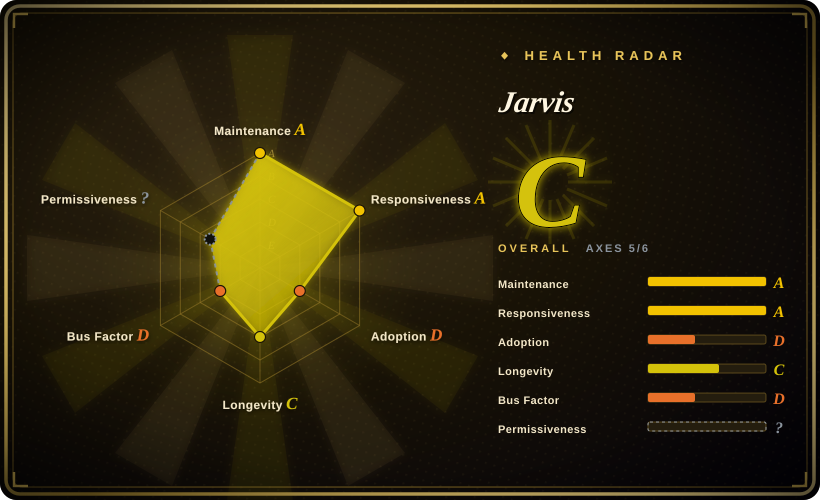
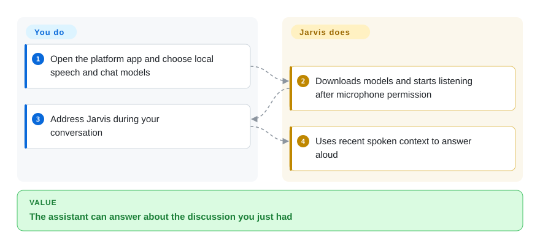
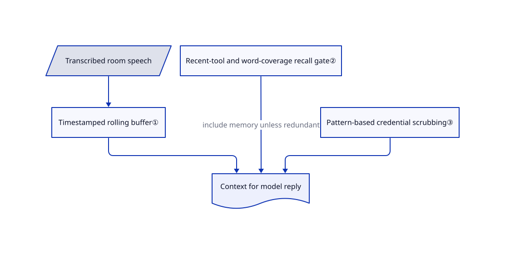

# Jarvis

You say “what do you think?” after a room conversation, but a normal chatbot has heard none of it. Jarvis keeps a short rolling transcript and lets you address a local desktop assistant by name.

## When to use

You want a personal desktop companion that can join a spoken discussion without sending every utterance to a cloud speech service. You install Jarvis, point it at a local model server, and let its speech recognition keep recent room context. Choose it over OpenClaw when nearby spoken context and local speech matter more than messaging-channel coverage; choose it over Open WebUI when an always-listening desktop face is the interaction you want, rather than a shared browser portal.

## When NOT to use

- **Commercial deployment without a separate license:** the actual license permits non-commercial use only and requires derivatives to keep those terms. Consider MIT-licensed [OpenClaw](openclaw.md) for commercial assistant integrations instead; this is source-available, not unrestricted open source.
- **A shared chat service:** choose [Open WebUI](../../../llm-chat-ui/open-webui.md) for browser accounts and document chat; Jarvis is a microphone-enabled personal desktop app.
- **Bots reached from many messaging apps:** choose [OpenClaw](openclaw.md); Jarvis prioritizes room voice and a companion text window.
- **Server-side scheduled shell work:** choose [Hermes Agent](hermes-agent.md), rather than maintaining an audio desktop stack for a headless task.
- **You specifically need macOS 26 dictation:** the README lists it as unavailable. A dedicated dictation product such as VoiceInk is a different option, but verify its current platform support before choosing it.

## Comparison

| Alternative | In index | Our verdict | Tradeoff |
|---|---|---|---|
| [OpenClaw](openclaw.md) | ✅ | Pick OpenClaw for an assistant reached from phone chat apps; pick Jarvis for ambient room conversation through local speech models. | Jarvis adds recent spoken context but lacks OpenClaw's breadth of channels and has a non-commercial license. |
| [Open WebUI](../../../llm-chat-ui/open-webui.md) | ✅ | Pick Open WebUI for several people chatting with local models and uploaded documents; pick Jarvis for one desktop microphone and voice replies. | A browser server supports accounts and retrieval; Jarvis instead needs audio permissions, downloaded speech models and a local model runtime. |
| [Hermes Agent](hermes-agent.md) | ✅ | Pick Hermes for a persistent VPS assistant running shell tasks and schedules; pick Jarvis when hearing the conversation is the requirement. | Hermes supplies terminal backends and agent-written skills; Jarvis supplies local speech and a desktop memory viewer. |

## Quick start

Download the platform archive from Releases, extract it and open the app; macOS users move it into Applications and use right-click Open. The setup wizard asks for speech models and Ollama or an OpenAI-compatible server, meaning an address with the same request format as OpenAI's API. Grant microphone access and wait for model downloads, then say “Jarvis, help me think through my day.” Jarvis transcribes nearby speech, produces a model response and speaks it; you supply the hardware, model server and permission decisions. Use a local endpoint for local inference; web tools, downloads, updates and connected tools can still use the network.

<!-- flow-steps:begin (generated from flows/jarvis.json by tools/flow_card.py — do not edit) -->

Text version of the flow

1. **You**: Open the platform app and choose local speech and chat models
2. **Jarvis**: Downloads models and starts listening after microphone permission
3. **You**: Address Jarvis during your conversation
4. **Jarvis**: Uses recent spoken context to answer aloud

**Value**: The assistant can answer about the discussion you just had

<!-- flow-steps:end -->

## Key techniques

<!-- mechanism:begin (generated from mechanisms/jarvis.json by tools/mechanism_card.py; do not edit) -->

Text version of the mechanism

- Transcribed room speech
- Timestamped rolling buffer①
- Recent-tool and word-coverage recall gate②
- Pattern-based credential scrubbing③
- Context for model reply

- Transcribed room speech → Timestamped rolling buffer①
- Timestamped rolling buffer① → Context for model reply
- Recent-tool and word-coverage recall gate② → Context for model reply (include memory unless redundant)
- Pattern-based credential scrubbing③ → Context for model reply

<!-- mechanism:end -->

### 1. Keep recent speech separate from saved memory

- **Problem:** A name-addressed question can refer to sentences spoken before the assistant was addressed.
- **How:** Timestamped transcript segments live in a locked rolling buffer. Queries can select a time window, mark already-processed segments and format the wake segment for the model.
- **Limits:** This is temporary transcript retention, not speaker consent or reliable speaker identification. The buffer constructor uses 120 seconds; its module introduction says five minutes, so do not treat that prose as the effective configuration.
- **Source:** [Transcript buffer](https://github.com/isair/jarvis/blob/380cf069714e819e11c6479d3fc20a19191d0dee/src/jarvis/listening/transcript_buffer.py#L48-L220).

### 2. Avoid unnecessary long-memory lookups

- **Problem:** Looking up diary and graph memory on every follow-up repeats context already supplied by a tool.
- **How:** A deterministic gate checks for a recent tool result and whether recent text covers at least half of the query's content words. Only then does it skip recall; missing data or exceptions keep recall enabled.
- **Limits:** Word coverage is not semantic understanding. The threshold can miss related wording, and the English stopword list does not establish equal effectiveness across languages.
- **Source:** [Recall gate](https://github.com/isair/jarvis/blob/380cf069714e819e11c6479d3fc20a19191d0dee/src/jarvis/memory/recall_gate.py#L19-L96).

### 3. Scrub structured secrets, not all sensitive meaning

- **Problem:** Tokens and addresses can leak through saved context and debug messages.
- **How:** Ordered regular expressions mask email addresses, authorization headers, several vendor token formats and keyword-associated credentials. The structured scrub preserves newlines; the shorter helper also collapses whitespace and caps length.
- **Limits:** Pattern matching is not complete privacy protection and can redact legitimate long numbers. Keep secrets out of conversations and enforce network restrictions separately.
- **Source:** [Redaction rules](https://github.com/isair/jarvis/blob/380cf069714e819e11c6479d3fc20a19191d0dee/src/jarvis/utils/redact.py#L4-L75).

## Tech stack

Python; PyQt6/WebEngine desktop UI; faster-whisper or Apple Silicon MLX speech recognition; Piper and optional source-install Chatterbox speech synthesis; local conversation and vector-memory components. The dependency file includes FAISS, NumPy, sounddevice and MCP clients.

## Dependencies

A desktop with microphone and sufficient RAM/VRAM for the chosen chat and speech models; Ollama or another compatible model server; model downloads on first use. Source installations additionally need the Python/audio stack. Optional OCR, web tools and MCP integrations bring their own binaries, credentials and network access.

## Ops difficulty

**Medium.** Packaged setup avoids building the UI, but audio drivers, model downloads, memory budgeting and OS permissions remain your responsibility. Back up the diary under `~/.local/share/jarvis` and review enabled tools. The README documents platform-specific dictation and echo-interruption failures; a successful launch is not proof the microphone and every tool work.

## Health & viability

- **2026-10-18:** v2.7.8 was released today, following v2.7.7 on October 14; this is an actively changing desktop application, not an abandoned sample.
- The repository was created in August 2025. About fourteen months of age plus current commits is encouraging, but supplies little long-term Lindy evidence.
- Visible contributions are strongly concentrated in `isair`; treat continued maintenance as dependent on the primary author. Stars indicate attention, not measured daily use.
- The decisive legal risk is explicit non-commercial licensing, not an ambiguous GitHub badge. Commercial use requires separate permission from Baris Sencan.

## Caveats (unverified)

- [未验证：本次禁止运行上游程序] Speech latency, recognition quality, interruption reliability and packaged installers were not tested on hardware.
- [推断：依据是静态规则与 README 网络边界] Secret scrubbing reduces recognizable credential exposure but cannot establish confidentiality for arbitrary spoken content.
