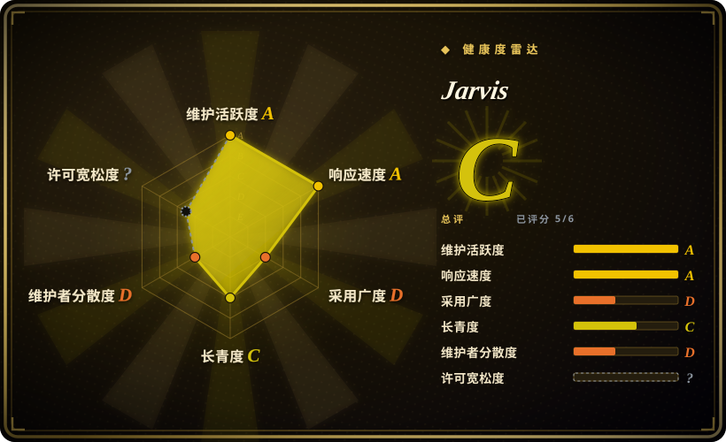
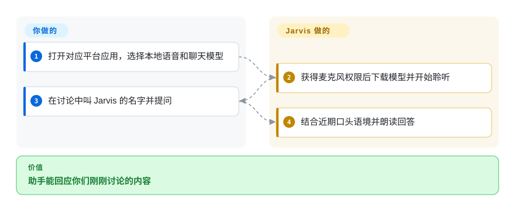
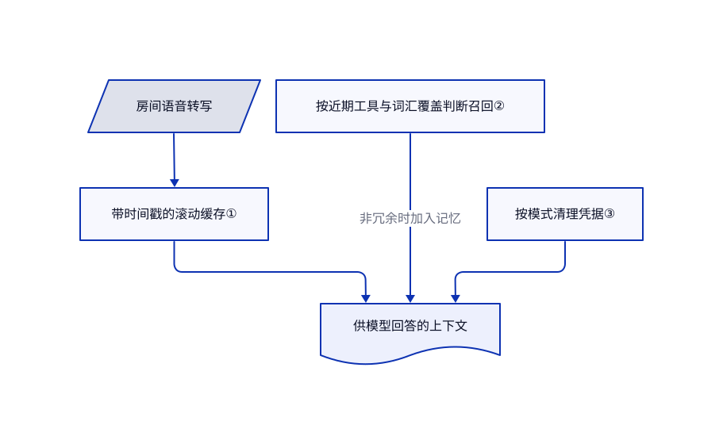

# Jarvis

你聊了半天后问“你怎么看”，普通聊天窗口却没听见前文。Jarvis 暂存身边的语音转写，让你直接叫名字，邀请本地桌面助手参与讨论。

## 何时使用

你想在自己的电脑上养一个语音助手，让它听懂房间里的讨论，又不把每句话送去云端识别。安装 Jarvis 后，连接本地模型服务，语音识别会保留近期讨论的上下文。相比 OpenClaw，你优先要的是身边的语音语境，而不是覆盖更多聊天平台；相比 Open WebUI，你要的是持续聆听的桌面伙伴，而不是多人浏览器门户。

## 何时不用

- **未经单独授权就商用：** LICENSE 只允许非商业用途，衍生作品还须沿用相同条款。商业助手集成可考虑 MIT 的 [OpenClaw](messaging-daemons/openclaw.zh.md)；Jarvis 属于源码可见，不是无限制开源。
- **多人共用聊天服务：** 选 [Open WebUI](../../../llm-chat-ui/open-webui.zh.md)，它提供浏览器账号和文档问答；Jarvis 是需要麦克风权限的个人桌面应用。
- **从多个聊天平台找同一个机器人：** 选 [OpenClaw](messaging-daemons/openclaw.zh.md)；Jarvis 的重点是房间语音和配套文字窗口。
- **在服务器定时跑终端任务：** 选 [Hermes Agent](messaging-daemons/hermes-agent.zh.md)，不必为无界面任务维护桌面音频栈。
- **明确需要 macOS 26 听写：** README 将其列为不可用。VoiceInk 等专用听写产品属于另一条路线，但选前仍要核对当前系统支持。

## 横向对比

| 替代品 | 是否收录 | 我们的评价 | 取舍 |
|---|---|---|---|
| [OpenClaw](messaging-daemons/openclaw.zh.md) | ✅ | 要从手机聊天平台找助手，选 OpenClaw；要本地语音参与身边讨论，选 Jarvis。 | Jarvis 换来近期口头语境，但聊天渠道更少，且有非商业许可限制。 |
| [Open WebUI](../../../llm-chat-ui/open-webui.zh.md) | ✅ | 多人共用本地模型并上传文档，选 Open WebUI；一台桌面的麦克风和语音回复，选 Jarvis。 | 浏览器服务提供账号与检索；Jarvis 则需要音频权限、语音模型和本地模型运行环境。 |
| [Hermes Agent](messaging-daemons/hermes-agent.zh.md) | ✅ | 服务器常驻、终端任务和调度，选 Hermes；必须听见房间对话，选 Jarvis。 | Hermes 提供终端后端和自主积累技能；Jarvis 提供本地语音与桌面记忆查看器。 |

## 快速上手

从 Releases 下载对应平台的压缩包，解压后打开；macOS 用户移入 Applications，再右键打开。向导会要求选择语音模型，以及 Ollama 或兼容 OpenAI 请求格式的模型服务地址。允许麦克风访问，等待模型下载，再说“Jarvis，帮我想想今天怎么安排”。Jarvis 负责转写、调用模型和朗读；你负责硬件、模型服务和权限取舍。使用本地服务才能让模型推理留在本机；网页工具、下载、更新和外接工具仍可能联网。

<!-- flow-steps:begin (generated from flows/jarvis.json by tools/flow_card.py — do not edit) -->

流程文字版

1. **你**：打开对应平台应用，选择本地语音和聊天模型
2. **Jarvis**：获得麦克风权限后下载模型并开始聆听
3. **你**：在讨论中叫 Jarvis 的名字并提问
4. **Jarvis**：结合近期口头语境并朗读回答

**价值**：助手能回应你们刚刚讨论的内容

<!-- flow-steps:end -->

## 技术要点

<!-- mechanism:begin (generated from mechanisms/jarvis.json by tools/mechanism_card.py; do not edit) -->

机制文字版

- 房间语音转写
- 带时间戳的滚动缓存①
- 按近期工具与词汇覆盖判断召回②
- 按模式清理凭据③
- 供模型回答的上下文

- 房间语音转写 → 带时间戳的滚动缓存①
- 带时间戳的滚动缓存① → 供模型回答的上下文
- 按近期工具与词汇覆盖判断召回② → 供模型回答的上下文（非冗余时加入记忆）
- 按模式清理凭据③ → 供模型回答的上下文

<!-- mechanism:end -->

### 1. 将近期口头语境与长期记忆分开

- **解决：** 叫名字后的问题，可能指向叫名字之前说过的内容。
- **做法：** 带时间戳的转写片段进入带锁的滚动缓存，可按时间窗取出、标记已处理片段，并向模型标出唤醒位置。
- **边界：** 这是临时转写保留，不等于获得旁人同意或可靠识别说话者。构造函数默认是 120 秒，模块开头却写五分钟，不能把该注释当成生效配置。
- **源码：** [转写缓存](https://github.com/isair/jarvis/blob/380cf069714e819e11c6479d3fc20a19191d0dee/src/jarvis/listening/transcript_buffer.py#L48-L220)。

### 2. 避免重复查询长期记忆

- **解决：** 每句追问都查日记和关系图，会重复加入工具已经提供的上下文。
- **做法：** 确定性规则同时检查近期工具结果，以及近期文字是否覆盖问题中至少一半的内容词。只有满足条件才跳过召回；缺数据或异常时仍召回。
- **边界：** 词汇覆盖不是语义理解，近义表达可能匹配不到；英文停用词表也不能证明各语言效果一致。
- **源码：** [召回门控](https://github.com/isair/jarvis/blob/380cf069714e819e11c6479d3fc20a19191d0dee/src/jarvis/memory/recall_gate.py#L19-L96)。

### 3. 清理可识别的凭据，而非所有敏感含义

- **解决：** 令牌和地址可能从保存的上下文与调试消息中泄露。
- **做法：** 有序正则表达式遮盖邮箱、认证头、部分厂商令牌和带关键词的凭据。结构化清理保留换行，短文本助手还会合并空白并限制长度。
- **边界：** 模式匹配不是完整隐私保证，也可能误删正常长数字。仍应避免口述秘密，并单独限制网络。
- **源码：** [脱敏规则](https://github.com/isair/jarvis/blob/380cf069714e819e11c6479d3fc20a19191d0dee/src/jarvis/utils/redact.py#L4-L75)。

## 技术栈

Python；PyQt6 与 WebEngine 桌面界面；faster-whisper 或 Apple Silicon 的 MLX 语音识别；Piper 与源码安装可选的 Chatterbox 语音合成；本地会话及向量记忆组件。依赖文件包含 FAISS、NumPy、sounddevice 和 MCP 客户端。

## 依赖

带麦克风的桌面电脑，以及容纳所选聊天和语音模型的内存或显存；Ollama 或其他兼容模型服务；首次使用需要下载模型。源码安装还要准备 Python 和音频依赖。可选 OCR、网页和 MCP 工具各自带来二进制、凭据与联网要求。

## 运维难度

**中。** 安装包免去界面构建，但音频驱动、模型下载、内存预算和系统权限仍由你管理。备份 `~/.local/share/jarvis` 下的日记，检查启用的工具。README 列出了平台听写与回声打断问题；启动成功不代表麦克风和每个工具都可用。

## 健康度与可持续性

- **2026-10-18：** 今天发布 v2.7.8，上次 v2.7.7 为 10 月 14 日；这是持续变化的桌面应用，不是废弃演示。
- 仓库创建于 2025 年 8 月。约十四个月且仍有提交，是积极信号，但不足以形成长期林迪证据。
- 可见提交高度集中在 `isair`，持续维护依赖主要作者。星标代表关注，不等于实测日活。
- 决定性的法律风险是明确的非商业限制，而不是模糊的 GitHub 徽章；商用须取得 Baris Sencan 的单独许可。

## 存疑（未验证）

- [未验证：本次禁止运行上游程序] 未在真实硬件测试语音延迟、识别质量、打断可靠性和安装包。
- [推断：依据是静态规则与 README 网络边界] 脱敏能减少常见凭据暴露，但不能证明任意口头内容都得到保密。
