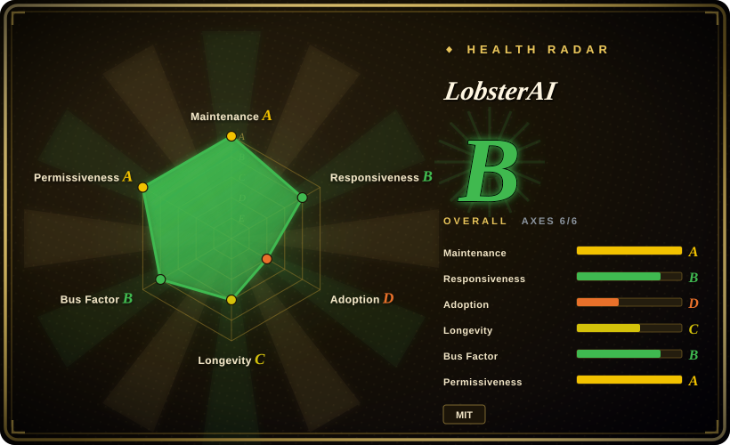
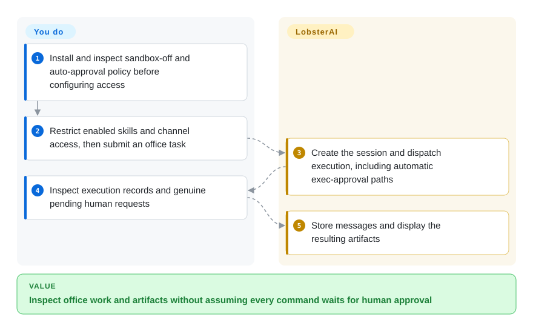
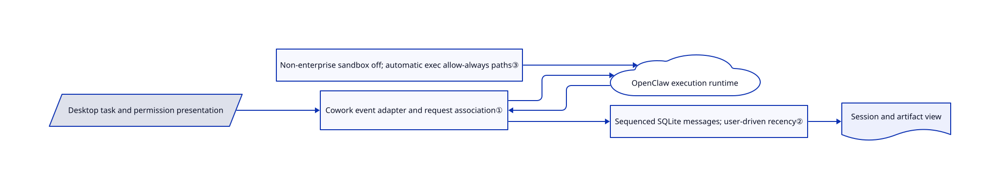

# LobsterAI

You want an office task to work on local files and return through your chat channel; LobsterAI adds a desktop session, artifact and approval layer around an OpenClaw runtime.

## When to use

You prepare reports, local data dashboards or scheduled digests and need a desktop UI to connect models, skills, MCP tools and IM channels. Pick LobsterAI over running OpenClaw alone when local session storage, artifact previews and packaged office workflows save setup work. You still authorize accounts and tools and check the produced documents; local SQLite storage does not mean model or connector traffic stays offline.

## When NOT to use

- For a headless gateway without Electron, choose [OpenClaw](messaging-daemons/openclaw.md) directly.
- For a VPS-first persistent assistant, choose [Hermes Agent](messaging-daemons/hermes-agent.md); a desktop cowork UI adds little to that deployment.
- For a different desktop approval and audit design, compare [OpenWorker](openworker.md); inspect both projects' actual sandbox settings rather than equating approval dialogs with isolation.
- For mutually untrusted users, use separate hosts and accounts rather than treating one desktop gateway as enterprise tenant isolation.
- If every sensitive command must wait for a person or execution must be sandboxed, use a separately enforced sandbox-and-approval setup instead. In this snapshot, non-enterprise configuration maps sandbox mode to `off`; channel-session exec approvals, or commands not classified as deletion, enter an automatic-allow path. A permission event or selected project directory is not proof of either guarantee.

## Comparison

| Alternative | In index | Our verdict | Tradeoff |
| --- | --- | --- | --- |
| [OpenClaw](messaging-daemons/openclaw.md) | ✅ | Choose OpenClaw for a direct headless gateway; choose LobsterAI for desktop office workflows over that runtime. | Less product-layer machinery versus local artifacts, settings and session management. |
| [Hermes Agent](messaging-daemons/hermes-agent.md) | ✅ | Choose Hermes for a persistent VPS assistant; choose LobsterAI when desktop files and rich artifact review are central. | Server-first operation versus a heavier graphical application. |
| [OpenWorker](openworker.md) | ✅ | Compare OpenWorker when its approval ladder and audit trail decide; choose LobsterAI when OpenClaw channels and office kits are the integration target. | Different policy and runtime boundaries; neither UI alone establishes OS isolation. |

## Quick start

Install a macOS or Windows release, configure the model connection and select a project directory. Before submitting a small office task, inspect execution policy: non-enterprise mode configures the OpenClaw sandbox as `off`, and the approval bridge automatically allows channel-session exec requests or commands it does not classify as deletion. Its controller submits an allow decision with `allowAlways`, which resolves to `allow-always` on this exec path; it still emits a permission event afterwards, so a visible prompt does not prove execution is waiting. Inspect execution records and artifacts, and respond only to requests actually awaiting a person; before enabling remote channels, separately verify caller identity, tool scope and exposure of credentials. LobsterAI supplies sessions and runtime integration; you supply credentials, model costs and final review. Source development uses Node `>=24.15.0 <25`, npm `>=11.17.0 <12`, Git and pnpm, then `npm run electron:dev:openclaw`; see [installation](https://github.com/netease-youdao/LobsterAI/blob/b649d5c80f25887e6d0c1ff04024150f7476da5d/README.md#install) and the [approval controller](https://github.com/netease-youdao/LobsterAI/blob/b649d5c80f25887e6d0c1ff04024150f7476da5d/src/main/libs/agentEngine/openclawApprovalController.ts#L93-L131).

<!-- flow-steps:begin (generated from flows/lobsterai.json by tools/flow_card.py — do not edit) -->

Text version of the flow

1. **You**: Install and inspect sandbox-off and auto-approval policy before configuring access
2. **You**: Restrict enabled skills and channel access, then submit an office task
3. **LobsterAI**: Create the session and dispatch execution, including automatic exec-approval paths
4. **You**: Inspect execution records and genuine pending human requests
5. **LobsterAI**: Store messages and display the resulting artifacts

**Value**: Inspect office work and artifacts without assuming every command waits for human approval

<!-- flow-steps:end -->

## Key techniques

<!-- mechanism:begin (generated from mechanisms/lobsterai.json by tools/mechanism_card.py; do not edit) -->

Text version of the mechanism

- Desktop task and permission presentation
- Cowork event adapter and request association①
- OpenClaw execution runtime
- Non-enterprise sandbox off; automatic exec allow-always paths③
- Sequenced SQLite messages; user-driven recency②
- Session and artifact view

- Desktop task and permission presentation → Cowork event adapter and request association①
- Cowork event adapter and request association① → OpenClaw execution runtime
- Non-enterprise sandbox off; automatic exec allow-always paths③ → OpenClaw execution runtime
- OpenClaw execution runtime → Cowork event adapter and request association①
- Cowork event adapter and request association① → Sequenced SQLite messages; user-driven recency②
- Sequenced SQLite messages; user-driven recency② → Session and artifact view

<!-- mechanism:end -->

### 1. Translate runtime events into product session events

- **Problem:** Desktop state and execution callbacks otherwise become coupled to one engine API.
- **How:** CoworkEngineRouter forwards message, permission and completion events, tracks request-to-session associations and clears them on termination. The reviewed constructor binds OpenClaw.
- **Limits:** An older architecture document describes two switchable engines; the current router accepts only an OpenClaw runtime dependency, so do not infer current dual-engine support from that document.
- **Source:** [Runtime binding](https://github.com/netease-youdao/LobsterAI/blob/b649d5c80f25887e6d0c1ff04024150f7476da5d/src/main/libs/agentEngine/coworkEngineRouter.ts#L26-L77), [event translation](https://github.com/netease-youdao/LobsterAI/blob/b649d5c80f25887e6d0c1ff04024150f7476da5d/src/main/libs/agentEngine/coworkEngineRouter.ts#L241-L317).

### 2. Keep message order separate from session-list recency

- **Problem:** Streaming assistant updates can continually reorder a multi-session sidebar.
- **How:** The SQLite store assigns per-session sequence numbers, writes message metadata with the selected model, and advances session recency only for user messages.
- **Limits:** Persisted messages are application state, not a cryptographically tamper-proof audit log or a backup strategy.
- **Source:** [Message insertion](https://github.com/netease-youdao/LobsterAI/blob/b649d5c80f25887e6d0c1ff04024150f7476da5d/src/main/coworkStore.ts#L2357-L2409).

### 3. Distinguish policy decisions from permission presentation

- **Problem:** A desktop approval card can be mistaken for mandatory human review or an OS sandbox.
- **How:** Configuration maps all non-enterprise execution modes to sandbox `off`. The exec bridge sets `shouldAutoApprove` for a recognized channel session or a command not classified as deletion; the controller submits an allow with `allowAlways`, and decision mapping produces `allow-always` for that request.
- **Limits:** The controller still emits a permission event after submitting automatic approval, so presentation does not imply a human gate. Plugin approvals use a separate path, and these static branches do not establish safety for every command or authenticated remote caller; verify channel identity and restrict tools independently before exposing credential-bearing projects.
- **Source:** [Sandbox mapping](https://github.com/netease-youdao/LobsterAI/blob/b649d5c80f25887e6d0c1ff04024150f7476da5d/src/main/libs/openclawConfigSync.ts#L116-L129), [auto-approval predicate](https://github.com/netease-youdao/LobsterAI/blob/b649d5c80f25887e6d0c1ff04024150f7476da5d/src/main/libs/agentEngine/openclawApprovalBridge.ts#L83-L99), [decision mapping](https://github.com/netease-youdao/LobsterAI/blob/b649d5c80f25887e6d0c1ff04024150f7476da5d/src/main/libs/agentEngine/openclawApprovalBridge.ts#L173-L188), [controller paths](https://github.com/netease-youdao/LobsterAI/blob/b649d5c80f25887e6d0c1ff04024150f7476da5d/src/main/libs/agentEngine/openclawApprovalController.ts#L93-L174).

## Tech stack

TypeScript, Electron 43, React/Redux and Tailwind; better-sqlite3 stores desktop state. A pinned OpenClaw runtime and connector plugins supply execution and channel integration.

## Dependencies

Desktop OS and a model account or compatible endpoint; channel accounts and external services depend on enabled features. Source builds prepare a pinned sibling OpenClaw checkout. Bundled skills and models/services can have separate licenses and costs from the MIT application.

## Ops difficulty

**Medium to high.** A local install is simpler than source packaging, but credentials, connector updates, scheduled jobs and runtime repair still need ownership. Non-enterprise mode configures the sandbox off, and exec approval can be automatic, including `allow-always`; neither selecting a directory nor seeing a dialog supplies confinement or per-command human consent. Never expose remote control without independently checking caller identity and allowed filesystem/shell actions.

## Health & viability

- On 2026-10-18, the latest release was October 16; multiple substantial contributors and automated build/test workflows are visible.
- Created February 2026 and backed by the NetEase Youdao organization, the app is young and vendor-steered. [推断：依据是仓库年龄与组织归属] Team backing helps continuity, but does not establish a long Lindy record.
- Root MIT text names NetEase Youdao. Included skill licenses and external generation/hosting services remain separate obligations.

## Caveats (unverified)

- [未验证：本批禁止运行上游或登录账号] The observed behavior of the source-confirmed sandbox-off and automatic exec-approval paths, channel authentication, and document quality were not tested end to end; no per-command human-review or isolation guarantee is asserted.
- [未验证：只审客户端仓库] Commercial service availability, pricing and private backend implementation were not audited.
- [推断：依据是仓库年龄与组织归属] Long-term product continuity is not guaranteed by vendor ownership.
