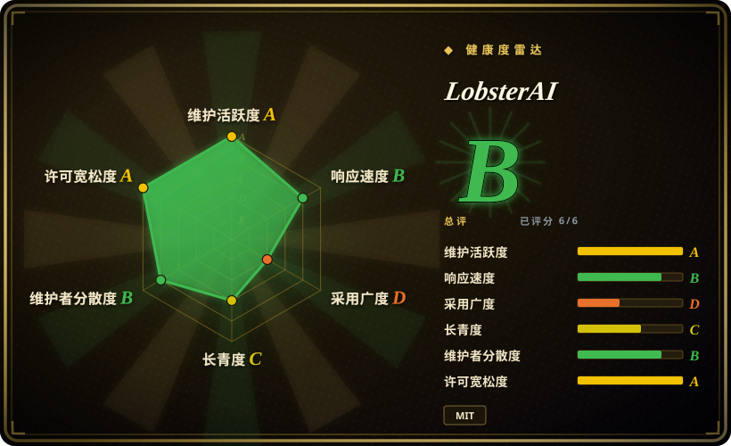
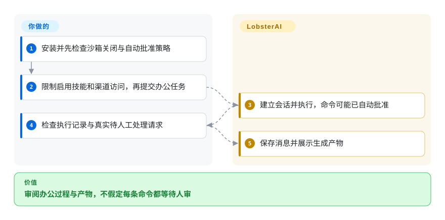
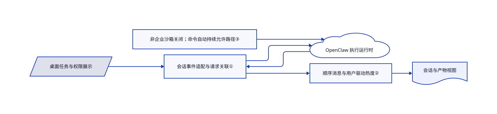

# LobsterAI

你想让办公任务处理本地文件，再从聊天渠道回传结果。LobsterAI 在 OpenClaw 运行时外增加桌面会话、产物和审批界面。

## 何时使用

你要生成报告、分析本地表格或定时汇总资讯，需要图形界面连接模型、技能、MCP 工具和即时通信渠道。若本地会话、产物预览和办公流程能减少配置工作，可以选 LobsterAI，而非独自组装 OpenClaw。账号与工具仍由你授权，文档仍需验收；本地 SQLite 不代表模型和连接器流量离线。

## 何时不用

- 要不带 Electron 的无头网关，直接选 [OpenClaw](openclaw.zh.md)。
- 要 VPS 上长期运行的助手，选 [Hermes Agent](hermes-agent.zh.md)，桌面界面帮助不大。
- 要不同的桌面审批与审计设计，可比较 [OpenWorker](openworker.zh.md)。两者都需审查实际沙箱，弹窗不是隔离证明。
- 多个互不信任用户，应分开主机与账号，不能把一个桌面网关当企业租户隔离。
- 所有敏感命令必须逐次人审，或必须强制沙箱时，应改用独立强制沙箱与审批方案。此快照中非企业模式把沙箱设为 `off`；渠道会话的命令审批，或未被识别为删除的命令，会进入自动允许路径。权限事件和项目目录选择都不证明上述保证。

## 横向对比

| 替代品 | 是否收录 | 我们的评价 | 取舍 |
| --- | --- | --- | --- |
| [OpenClaw](openclaw.zh.md) | ✅ | 要直接无头网关选 OpenClaw；要围绕该运行时的桌面办公流程选 LobsterAI。 | 少一层产品机制，对比本地产物、设置与会话管理。 |
| [Hermes Agent](hermes-agent.zh.md) | ✅ | 要常驻 VPS 助手选 Hermes；桌面文件与丰富产物审核更重要时选 LobsterAI。 | 服务端运维，对比较重的图形应用。 |
| [OpenWorker](openworker.zh.md) | ✅ | 审批阶梯与审计轨迹决定选型时比较 OpenWorker；围绕 OpenClaw 渠道和办公套件集成时选 LobsterAI。 | 策略和运行时边界不同，界面本身均不证明系统隔离。 |

## 快速上手

安装 macOS 或 Windows 发布版，配置模型连接并选择项目目录。提交小型办公任务前先检查执行策略：非企业模式把 OpenClaw 沙箱设为 `off`，审批桥会自动允许渠道会话的命令请求，或未被识别为删除的命令。控制器提交带 `allowAlways` 的允许决定，在该命令路径映射为 `allow-always`；之后仍发权限事件，所以看见弹窗不证明执行正在等人。应检查执行记录和产物，只对真实人工等待作答；开放远程渠道前，另核调用者身份、工具范围及凭据暴露。LobsterAI 提供会话与运行时集成，凭据、模型费用和验收归你。源码开发需 Node `>=24.15.0 <25`、npm `>=11.17.0 <12`、Git 与 pnpm，再使用 `npm run electron:dev:openclaw`；来源为[安装路径](https://github.com/netease-youdao/LobsterAI/blob/b649d5c80f25887e6d0c1ff04024150f7476da5d/README.md#install)和[审批控制器](https://github.com/netease-youdao/LobsterAI/blob/b649d5c80f25887e6d0c1ff04024150f7476da5d/src/main/libs/agentEngine/openclawApprovalController.ts#L93-L131)。

<!-- flow-steps:begin (generated from flows/lobsterai.json by tools/flow_card.py — do not edit) -->

流程文字版

1. **你**：安装并先检查沙箱关闭与自动批准策略
2. **你**：限制启用技能和渠道访问，再提交办公任务
3. **LobsterAI**：建立会话并执行，命令可能已自动批准
4. **你**：检查执行记录与真实待人工处理请求
5. **LobsterAI**：保存消息并展示生成产物

**价值**：审阅办公过程与产物，不假定每条命令都等待人审

<!-- flow-steps:end -->

## 技术要点

<!-- mechanism:begin (generated from mechanisms/lobsterai.json by tools/mechanism_card.py; do not edit) -->

机制文字版

- 桌面任务与权限展示
- 会话事件适配与请求关联①
- OpenClaw 执行运行时
- 非企业沙箱关闭；命令自动持续允许路径③
- 顺序消息与用户驱动热度②
- 会话与产物视图

- 桌面任务与权限展示 → 会话事件适配与请求关联①
- 会话事件适配与请求关联① → OpenClaw 执行运行时
- 非企业沙箱关闭；命令自动持续允许路径③ → OpenClaw 执行运行时
- OpenClaw 执行运行时 → 会话事件适配与请求关联①
- 会话事件适配与请求关联① → 顺序消息与用户驱动热度②
- 顺序消息与用户驱动热度② → 会话与产物视图

<!-- mechanism:end -->

### 1. 把运行时事件转换成产品会话事件

- **解决：** 桌面状态与执行回调容易紧绑某个引擎接口。
- **做法：** CoworkEngineRouter 转发消息、权限和完成事件，记录请求与会话的对应关系，并在结束时清理。已审构造器绑定 OpenClaw。
- **边界：** 旧架构文档描述双引擎切换，但当前路由器只接收 OpenClaw 运行时，不能由旧文档推断现有双引擎支持。
- **源码：** [运行时绑定](https://github.com/netease-youdao/LobsterAI/blob/b649d5c80f25887e6d0c1ff04024150f7476da5d/src/main/libs/agentEngine/coworkEngineRouter.ts#L26-L77)、[事件转换](https://github.com/netease-youdao/LobsterAI/blob/b649d5c80f25887e6d0c1ff04024150f7476da5d/src/main/libs/agentEngine/coworkEngineRouter.ts#L241-L317)。

### 2. 消息顺序与会话列表热度分开

- **解决：** 助手流式输出可能让多个会话在侧栏反复跳动。
- **做法：** SQLite 存储给会话消息分配顺序号，记录当时模型元数据，并且只有用户消息更新会话热度时间。
- **边界：** 持久消息是应用状态，不是密码学防篡改审计，也不能代替备份。
- **源码：** [消息写入](https://github.com/netease-youdao/LobsterAI/blob/b649d5c80f25887e6d0c1ff04024150f7476da5d/src/main/coworkStore.ts#L2357-L2409)。

### 3. 区分策略决定与权限展示

- **解决：** 桌面审批卡片容易被误当成强制人审或系统沙箱。
- **做法：** 配置把非企业模式的所有执行选项映射为沙箱 `off`。命令审批桥对可识别渠道会话或未识别为删除的命令设置 `shouldAutoApprove`，控制器提交带 `allowAlways` 的允许决定，再映射为 `allow-always`。
- **边界：** 自动批准提交后仍会发权限事件，展示不代表人审硬门。插件审批另走路径；这些静态分支不证明所有命令安全或远程调用者身份有效，开放含凭据项目之前必须独立核渠道身份并限制工具。
- **源码：** [沙箱映射](https://github.com/netease-youdao/LobsterAI/blob/b649d5c80f25887e6d0c1ff04024150f7476da5d/src/main/libs/openclawConfigSync.ts#L116-L129)、[自动批准条件](https://github.com/netease-youdao/LobsterAI/blob/b649d5c80f25887e6d0c1ff04024150f7476da5d/src/main/libs/agentEngine/openclawApprovalBridge.ts#L83-L99)、[决定映射](https://github.com/netease-youdao/LobsterAI/blob/b649d5c80f25887e6d0c1ff04024150f7476da5d/src/main/libs/agentEngine/openclawApprovalBridge.ts#L173-L188)、[控制器路径](https://github.com/netease-youdao/LobsterAI/blob/b649d5c80f25887e6d0c1ff04024150f7476da5d/src/main/libs/agentEngine/openclawApprovalController.ts#L93-L174)。

## 技术栈

TypeScript、Electron 43、React、Redux 与 Tailwind，better-sqlite3 保存桌面状态。固定版本的 OpenClaw 和连接器插件提供执行及渠道接入。

## 依赖

桌面系统、模型账号或兼容服务地址；账号和外部服务取决于启用功能。源码构建会准备相邻的固定版本 OpenClaw。附带技能、模型与服务可能有不同于应用 MIT 的许可和费用。

## 运维难度

**中到高。** 安装包比源码打包简单，但仍需维护凭据、连接器、定时任务与运行时修复。非企业沙箱关闭，命令审批可自动允许，包括 `allow-always`；选目录与弹窗都不提供隔离或逐次人工同意。开放远程控制前，必须独立核查调用者身份与获准文件、终端操作。

## 健康度与可持续性

- 截至 2026-10-18，最近版本于 10 月 16 日发布，多名实质贡献者及自动构建测试可见。
- 仓库创建于 2026 年 2 月，由网易有道组织主导，历史仍短。[推断：依据是仓库年龄与组织归属] 团队支持有利延续，但没有长期 Lindy 记录。
- 根 MIT 许可署名网易有道。技能许可、外部生成与托管服务仍有独立义务。

## 存疑（未验证）

- [未验证：本批禁止运行上游或登录账号] 未端到端观察源码已确认的沙箱关闭、命令自动批准路径、渠道身份验证及文档质量；不承诺逐次人审或隔离。
- [未验证：只审客户端仓库] 未审商业服务可用性、价格和私有后台实现。
- [推断：依据是仓库年龄与组织归属] 厂商归属不保证产品长期延续。
