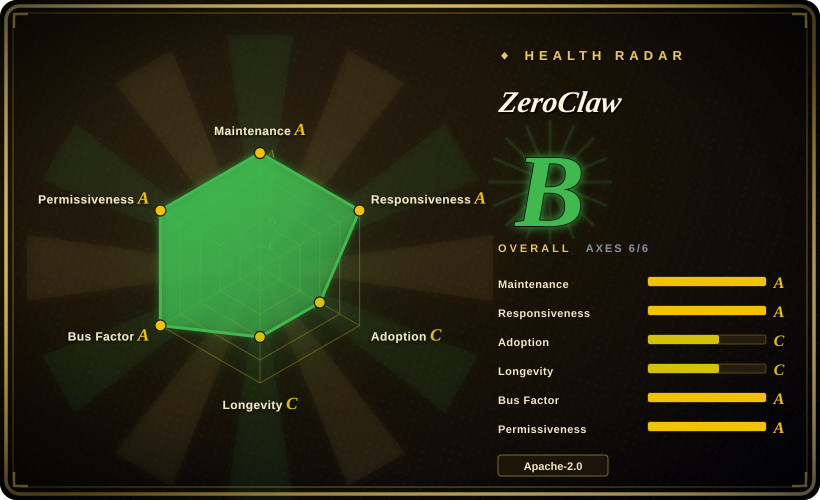
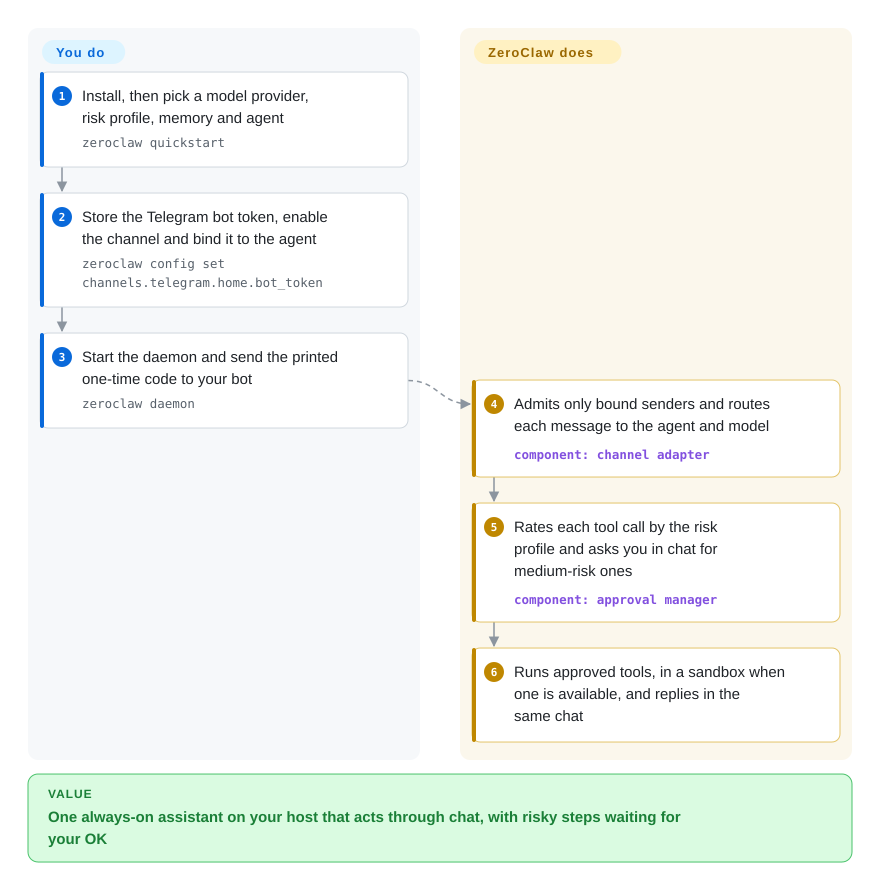
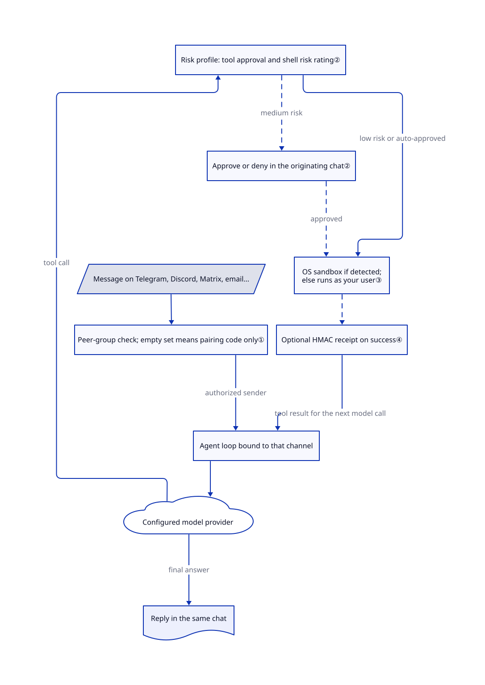

# ZeroClaw

You want an assistant on your own machine that answers you on Telegram and can run commands, but a bot that says "done" after `rm -rf` — or a stranger who finds your bot — is the nightmare. ZeroClaw is a single Rust program that answers on 30+ chat channels and stops each risky tool call to ask you in that same chat first.

## When to use

You run a home server or a VPS and want one always-on assistant you reach from Telegram, Discord, Matrix or email: "check why last night's backup failed and restart it." The blocker is not model access but trust — the bot will run `systemctl restart` on a box you care about. You pick ZeroClaw over [OpenClaw](openclaw.md) when you would rather install one compiled binary than run a Node.js gateway, and over [PicoClaw](picoclaw.md) when you want safety rails that start closed: an unconfigured Telegram bot answers only after a one-time `/bind` code, and the default `supervised` risk profile turns a medium-risk command into an approve/deny button in your chat while blocking high-risk ones.

Choose it over [Hermes Agent](hermes-agent.md) when per-tool approval policy, many channel adapters and an optional path to GPIO/I2C hardware matter more than an assistant that writes its own reusable skills. You supply the model key, the host and the policy decisions; ZeroClaw supplies the runtime, channel adapters, tools, memory and the approval plumbing.

## When NOT to use

- **You need a tested, stable production release.** The project is pre-1.0 (v0.9.0, 2026-11-12), and the v0.9 changelog requires `zeroclaw config migrate` before config-editing commands work again. A third-party review filed as [issue #12158](https://github.com/zeroclaw-labs/zeroclaw/issues/12158) on 2026-10-31 lists ten claimed unpatched findings (one critical) and had no maintainer reply on 2026-11-18. If you need a supported product, use a hosted assistant (not a repo) or put ZeroClaw behind your own review and network isolation.
- **You will run the published container image as-is on a reachable host.** The release `Dockerfile` writes `host = "[::]"`, `allow_public_bind = true` and `require_pairing = false` into its default config; only the Compose file's `127.0.0.1` port prefix keeps the gateway off the LAN. If you want gateway exposure to be safe by default, run the native binary with pairing on, or keep the container behind loopback or a tunnel.
- **You are on Windows and need OS-level confinement of tools.** The sandbox docs list no OS backend for Windows, and stock release builds omit Landlock, so Linux only gets Firejail if you install it. Policy checks still apply, but a permitted command runs as your user. If isolation is the requirement, use the Docker runtime or [PicoClaw](picoclaw.md) on Linux with its bubblewrap isolation enabled.
- **You want the broadest consumer-messaging coverage and phone companion apps.** Prefer [OpenClaw](openclaw.md); ZeroClaw's 30+ channels lean towards chat-ops and developer surfaces (Matrix, Mattermost, ACP, webhooks, MQTT), and its companion surface is a Tauri desktop shell over the web dashboard — the v0.9.0 release assets contain no phone app.
- **You want an assistant that accumulates its own procedures over time.** Prefer [Hermes Agent](hermes-agent.md), whose self-written skills and session search are the product; ZeroClaw keeps behaviour in your config and risk profiles, and its docs say there is no hidden personality prompt.
- **You are building a product on top of an agent library.** ZeroClaw's own docs say it is "not a framework": you configure it and connect channels. Use an agent framework instead and keep the assistant runtime out of your application.

## Comparison

| Alternative | In index | Our verdict | Tradeoff |
| --- | --- | --- | --- |
| [OpenClaw](openclaw.md) | ✅ | Pick OpenClaw when consumer messengers and native phone/desktop companions decide it; pick ZeroClaw when a single compiled binary with deny-by-default pairing and per-tool approval policy matters more. | OpenClaw has the larger device and plugin surface on a Node.js gateway; ZeroClaw has more security knobs to configure correctly and a younger, pre-1.0 config schema. |
| [PicoClaw](picoclaw.md) | ✅ | Pick PicoClaw for the smallest Go executable on an odd-architecture board; pick ZeroClaw when you want unknown senders refused and risky tools held for chat approval out of the box. | PicoClaw's empty sender list accepts everyone and remote exec is on by default; ZeroClaw ships 33–59 MiB binaries (per its docs) and a much larger config surface. |
| [Hermes Agent](hermes-agent.md) | ✅ | Pick Hermes when a server assistant that writes reusable skills and searches past sessions is the goal; pick ZeroClaw when explicit risk profiles and many channel adapters outweigh self-improvement. | Hermes is Python with self-modifying procedures; ZeroClaw is Rust with config-defined behaviour and receipts, but no learning loop of its own. |
| IronClaw (`nearai/ironclaw`) | not indexed | Pick IronClaw when you want untrusted tools inside a WASM capability sandbox on every OS; pick ZeroClaw when channel breadth and hardware peripherals matter more than that isolation model. | Both are 2026-born Rust assistants under MIT OR Apache-2.0; IronClaw (12.7k stars, 2026-11-18) leans on WASM and Docker sandboxes, ZeroClaw on policy plus optional OS sandboxes. Not added in this tab batch. |

## Quick start

On macOS or Linux, run the README's `install.sh` one-liner (it downloads a release binary; Windows has a PowerShell/MSI path), then `zeroclaw quickstart`, which asks for a model provider and key, a risk profile (the autonomy and sandbox posture — how much the agent may do without asking), a memory backend and an agent name, and writes `~/.zeroclaw/config.toml`. To reach it from Telegram, store the bot token with `zeroclaw config set channels.telegram.home.bot_token`, enable the channel and add `telegram.home` to your agent's `channels` list. Start `zeroclaw daemon` (or `zeroclaw service install` to keep it running) and send the six-digit code it prints to the bot as `/bind <code>`; only bound identities get answers. From then on ZeroClaw routes each message to the agent, calls your model, runs low-risk tools directly and puts medium-risk ones up as approve/deny buttons in the chat. You pay the model bill, choose the risk profile, and keep the host and its credentials safe.

<!-- flow-steps:begin (generated from flows/zeroclaw.json by tools/flow_card.py — do not edit) -->

Text version of the flow

1. **You**: Install, then pick a model provider, risk profile, memory and agent — `zeroclaw quickstart`
2. **You**: Store the Telegram bot token, enable the channel and bind it to the agent — `zeroclaw config set channels.telegram.home.bot_token`
3. **You**: Start the daemon and send the printed one-time code to your bot — `zeroclaw daemon`
4. **ZeroClaw**: Admits only bound senders and routes each message to the agent and model — component: `channel adapter`
5. **ZeroClaw**: Rates each tool call by the risk profile and asks you in chat for medium-risk ones — component: `approval manager`
6. **ZeroClaw**: Runs approved tools, in a sandbox when one is available, and replies in the same chat

**Value**: One always-on assistant on your host that acts through chat, with risky steps waiting for your OK

<!-- flow-steps:end -->

## Key techniques

<!-- mechanism:begin (generated from mechanisms/zeroclaw.json by tools/mechanism_card.py; do not edit) -->

Text version of the mechanism

- Message on Telegram, Discord, Matrix, email…
- Peer-group check; empty set means pairing code only①
- Agent loop bound to that channel
- Configured model provider
- Risk profile: tool approval and shell risk rating②
- Approve or deny in the originating chat②
- OS sandbox if detected; else runs as your user③
- Optional HMAC receipt on success④
- Reply in the same chat

- Message on Telegram, Discord, Matrix, email… → Peer-group check; empty set means pairing code only①
- Peer-group check; empty set means pairing code only① → Agent loop bound to that channel (authorized sender)
- Agent loop bound to that channel → Configured model provider
- Configured model provider → Risk profile: tool approval and shell risk rating② (tool call)
- Risk profile: tool approval and shell risk rating② → Approve or deny in the originating chat② (medium risk) [optional/fallback]
- Approve or deny in the originating chat② → OS sandbox if detected; else runs as your user③ (approved) [optional/fallback]
- Risk profile: tool approval and shell risk rating② → OS sandbox if detected; else runs as your user③ (low risk or auto-approved)
- OS sandbox if detected; else runs as your user③ → Optional HMAC receipt on success④ [optional/fallback]
- Optional HMAC receipt on success④ → Agent loop bound to that channel (tool result for the next model call)
- Configured model provider → Reply in the same chat (final answer)

<!-- mechanism:end -->

### 1. Refuse unknown senders until a one-time pairing code is redeemed

- **Problem:** A chat bot token is effectively a public door; anyone who finds the bot can try to drive the agent and its tools.
- **How:** Channel authorization comes from peer groups, and an empty resolved set denies everyone. When a Telegram channel starts with no authorized peers it generates a six-digit pairing code, logs it, and admits only the sender who sends `/bind <code>`; username and numeric ID are checked together so a deny on one cannot be bypassed through the other.
- **Limits:** `external_peers = ["*"]` turns pairing off and admits everyone. This guards who can talk to the agent, not what an authorized but mistaken or prompt-injected conversation asks it to do.
- **Source:** [pairing on empty peer set:2699–2730](https://github.com/zeroclaw-labs/zeroclaw/blob/cda933e6b9937deacbcc0d4d2cd7f1ae5bb4500e/crates/zeroclaw-channels/src/telegram.rs#L2699-L2730), [identity check:4669–4688](https://github.com/zeroclaw-labs/zeroclaw/blob/cda933e6b9937deacbcc0d4d2cd7f1ae5bb4500e/crates/zeroclaw-channels/src/telegram.rs#L4669-L4688), [empty set denies everyone](https://github.com/zeroclaw-labs/zeroclaw/blob/cda933e6b9937deacbcc0d4d2cd7f1ae5bb4500e/docs/book/src/channels/peer-groups.md#L10-L14).

### 2. Gate each tool call by a named risk profile and ask in the originating chat

- **Problem:** "Allow everything" and "allow nothing" are both useless for an assistant that should restart a service but never wipe a disk.
- **How:** Each agent points at a risk profile with a level (`readonly`, `supervised`, `full`) plus `auto_approve`, `always_ask` and command allowlists. The approval manager decides per tool name whether to prompt; the shell policy splits a command into segments and rates it low/medium/high, blocking high risk and asking for medium. Prompts go back through the channel that started the turn (Telegram inline buttons, Slack Block Kit, token replies elsewhere) or to a separate approver channel, and time out as denials.
- **Limits:** `full` and YOLO profiles skip prompts, and the plain non-interactive path skips the tool-level shell prompt, leaving only command policy. Rating shell text is heuristic: a third-party report claims stdin-fed interpreters on the default allowlist bypass approval (unconfirmed by maintainers).
- **Source:** [approval decision:233–270](https://github.com/zeroclaw-labs/zeroclaw/blob/cda933e6b9937deacbcc0d4d2cd7f1ae5bb4500e/crates/zeroclaw-runtime/src/approval/mod.rs#L233-L270), [non-interactive managers:115–165](https://github.com/zeroclaw-labs/zeroclaw/blob/cda933e6b9937deacbcc0d4d2cd7f1ae5bb4500e/crates/zeroclaw-runtime/src/approval/mod.rs#L115-L165), [command risk:4127–4170](https://github.com/zeroclaw-labs/zeroclaw/blob/cda933e6b9937deacbcc0d4d2cd7f1ae5bb4500e/crates/zeroclaw-config/src/policy.rs#L4127-L4170), [risk table and approval channel](https://github.com/zeroclaw-labs/zeroclaw/blob/cda933e6b9937deacbcc0d4d2cd7f1ae5bb4500e/docs/book/src/security/autonomy.md#L21-L35).

### 3. Pick an OS sandbox per platform and fall back to none

- **Problem:** Policy decides whether a command may run; once it runs, nothing in policy stops it reading `~/.ssh`.
- **How:** With `sandbox_backend = "auto"`, the runtime probes Landlock then Firejail on Linux and Bubblewrap then Seatbelt (`sandbox-exec`) on macOS, and wraps tool processes in the first available one; Docker is tried only for non-native runtimes. File writes are confined to the workspace and `/tmp`.
- **Limits:** Windows has no OS backend, stock release builds are compiled without Landlock and Bubblewrap, and Firejail must be installed separately, so a default Linux install may end at `none`. Landlock and Firejail leave network egress open; Bubblewrap, Seatbelt and Docker restrict it.
- **Source:** [backend detection:228–275](https://github.com/zeroclaw-labs/zeroclaw/blob/cda933e6b9937deacbcc0d4d2cd7f1ae5bb4500e/crates/zeroclaw-runtime/src/security/detect.rs#L228-L275), [auto-detection and confinement docs](https://github.com/zeroclaw-labs/zeroclaw/blob/cda933e6b9937deacbcc0d4d2cd7f1ae5bb4500e/docs/book/src/security/sandboxing.md#L27-L70).

### 4. Sign successful tool results so fabricated ones stand out

- **Problem:** A model can say "I ran `git log` and the latest commit is…" without having run anything.
- **How:** When `tool_receipts.enabled` is set, the runtime keeps a random in-memory key per scope and appends `zc-receipt-<time>-<HMAC-SHA256>` over tool name, arguments, result and timestamp to each successful tool result; it can also list receipts under the user-visible reply.
- **Limits:** Off by default. The key is ephemeral, failed or blocked calls get no receipt, and the reviewed runtime only generates receipts — `verify` is called from tests, so spotting a missing or forged one is left to you or your log tooling.
- **Source:** [receipt generation and verify:40–108](https://github.com/zeroclaw-labs/zeroclaw/blob/cda933e6b9937deacbcc0d4d2cd7f1ae5bb4500e/crates/zeroclaw-runtime/src/agent/tool_receipts.rs#L40-L108), [attached to successful calls:516–524](https://github.com/zeroclaw-labs/zeroclaw/blob/cda933e6b9937deacbcc0d4d2cd7f1ae5bb4500e/crates/zeroclaw-runtime/src/agent/tool_execution.rs#L516-L524), [default off:6809–6825](https://github.com/zeroclaw-labs/zeroclaw/blob/cda933e6b9937deacbcc0d4d2cd7f1ae5bb4500e/crates/zeroclaw-config/src/schema.rs#L6809-L6825).

## Tech stack

- Rust (edition 2024, `rust-version` 1.96) Cargo workspace of about two dozen `zeroclaw-*` crates (channels, providers, tools, runtime, gateway, memory, hardware, plugins); about 1,000 `.rs` files under `src/` and `crates/` at the reviewed commit.
- Feature-flagged build: `default` brings the agent runtime, a lean channel bundle (Telegram, Discord, email, webhook, ACP, filesystem), the gateway and Prometheus metrics; more channels, WASM plugins (Wasmtime) and sandbox backends are opt-in features.
- TOML config (`schema_version = 4`), SQLite/Markdown/Postgres/Qdrant memory backends, a web dashboard under `web/` (wrapped by a Tauri desktop app in `apps/tauri`), a `zerocode` terminal UI, and firmware sources for ESP32, Arduino, STM32 Nucleo and Pico peripherals.

## Dependencies

- A model provider: a hosted API key (Anthropic, OpenAI, OpenRouter and others), a Codex/Claude subscription token, or a separately run local server such as Ollama. No GPU is needed for remote inference.
- Credentials for each channel you enable (bot tokens, Matrix account, IMAP/SMTP, and so on) and network reach to those APIs.
- Optional: Firejail on Linux or Docker for tool isolation, Postgres or Qdrant if you pick those memory backends, a Rust 1.96 toolchain for source builds with non-default features, and supported boards for hardware tools.

## Ops difficulty

**Low to start, medium to high to run safely.** Install and quickstart are one command each and the result is a single binary plus one TOML file, with `zeroclaw service` for systemd, launchd or Windows Service. The hard part is policy: peer groups per channel, the risk profile, sandbox availability on your OS, gateway pairing and bind address, and secrets. Releases have arrived roughly every two to four weeks with schema migrations, so pin a version, read `CHANGELOG-next.md` and run `zeroclaw config migrate` on upgrade. Its own CI security job has repeatedly failed on new RustSec advisories in dependencies (SQLite, Wasmtime, Matrix crypto), which you inherit until fixed.

## Health & viability

- **Maintenance, checked 2026-11-18:** very active — the default branch was last committed 2026-11-17, v0.9.0 shipped 2026-11-12 after v0.8.5–v0.8.7 in September–October, and 208 pull requests were merged in the 30 days before the check. The flip side is 767 open issues (267 labelled bug) and 530 open pull requests.
- **Governance / backing:** owned by the ZeroClaw Labs GitHub organization, with a named original creator and a separate project lead, an RFC process, a light CLA and a trademark policy; top contributors are spread (the largest account has about 914 commits out of a long tail), so bus factor is not one person. ZeroClaw Labs' legal form and funding were not found in the repository.
- **Age / Lindy:** created 2026-02-13, about nine months old. [推断：based on repository age and release history] A Lindy prior gives little confidence yet; fast growth and frequent schema changes point to an early project still finding its shape.
- **Adoption:** about 33.4k stars and 5.0k forks on the check date, plus prebuilt archives for Linux (glibc and musl, x86_64 and ARM), macOS, Windows and Android. Stars do not prove production use.
- **License / risk:** dual MIT OR Apache-2.0 (license files held by ZeroClaw Labs); the CLA grants rights under both licenses without transferring copyright, which limits relicensing. Open, unanswered third-party security findings (#12158) and the container image's open-gateway default are the risk flags that matter more than the license.
- **Measured radar:** B with all six axes scored. Maintenance, responsiveness and governance are A; adoption is C from Homebrew installs and release downloads (crates.io shows about 4.7k monthly downloads), and longevity is C for age. These grades do not certify deployment safety.

## Caveats (unverified)

- [未验证：no live model or Telegram account connected] The quickstart, Telegram pairing and chat-approval flow were checked against the reviewed docs and source, not run end to end.
- [未验证：third-party report, not reproduced] The ten findings in issue #12158 (interpreter stdin bypass, operator gate, WebSocket cwd widening and others) were not reproduced here; only the Dockerfile's `require_pairing = false` default was confirmed by reading the file.
- [推断：based on repository age and release history] The nine-month history and frequent config-schema migrations make long-term compatibility uncertain.
- [未验证：figures from upstream docs, not measured] Binary sizes of about 33–59 MiB come from ZeroClaw's own "Minimal" philosophy page for v0.8.5; startup time and memory use were not measured.
- [未验证：grep of the reviewed commit only] The claim that runtime code never calls receipt `verify` outside tests rests on a text search of one commit and may change.
