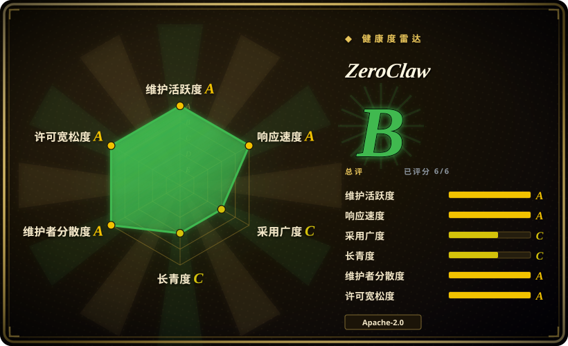
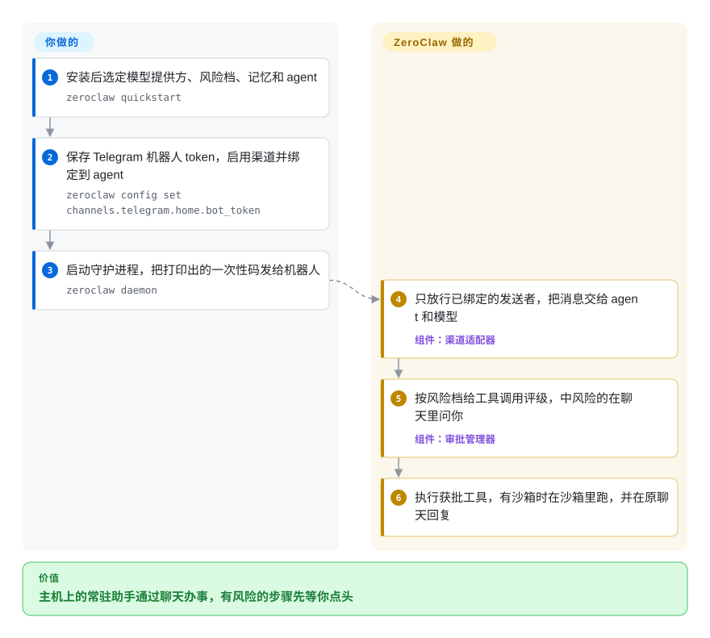
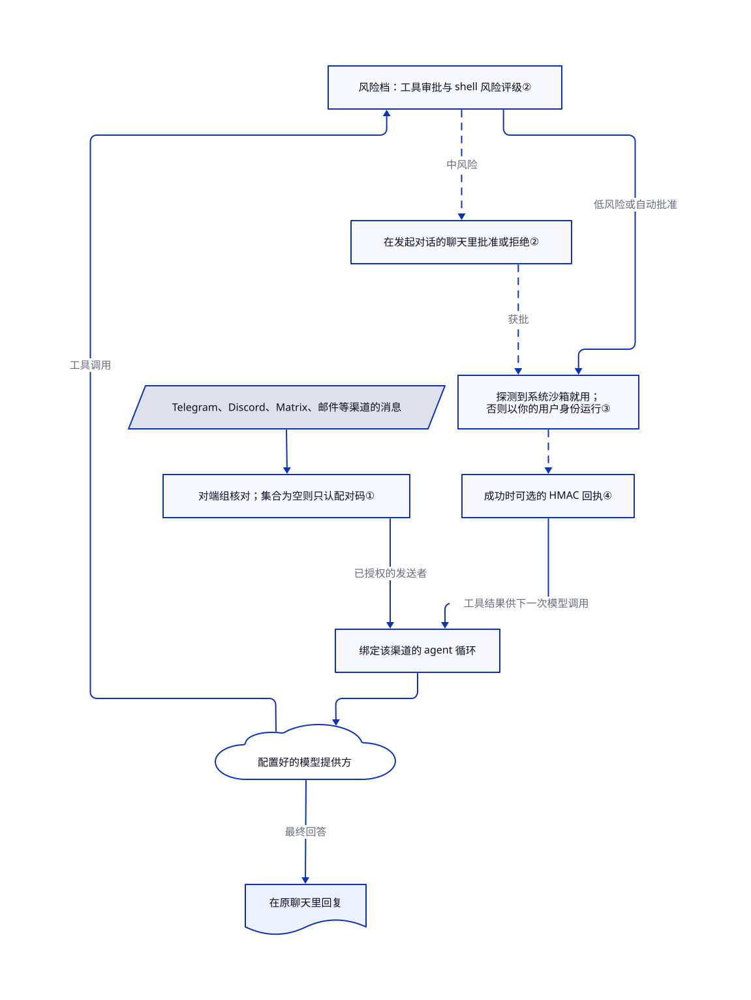

# ZeroClaw

你想让自己机器上的助手在 Telegram 里接活、还能跑命令，最怕的是它执行完 `rm -rf` 才回一句“搞定了”，或者陌生人找到你的机器人随手指挥它。ZeroClaw 是一个 Rust 程序，在 30 多个聊天渠道里应答，遇到有风险的工具调用先停下来，在同一个聊天里问你批不批。

## 何时使用

你有一台家用服务器或 VPS，想要一个常驻助手，从 Telegram、Discord、Matrix 或邮件里给它派活：“查一下昨晚备份为什么失败，然后重跑。”卡住你的不是模型，而是信任——这个机器人会在你在乎的机器上执行 `systemctl restart`。比起 [OpenClaw](openclaw.zh.md)，你更想装一个编译好的二进制，而不是维护 Node.js 网关；比起 [PicoClaw](picoclaw.zh.md)，你想要默认收紧的安全栏：没配置过的 Telegram 机器人要先用一次性 `/bind` 码配对才会应答，默认的 `supervised` 风险档会把中风险命令变成聊天里的批准／拒绝按钮，高风险命令直接拦下。

如果逐工具审批策略、大量渠道适配器，以及可选的 GPIO／I2C 硬件接入，比“助手自己写可复用技能”更重要，就选它而不是 [Hermes Agent](hermes-agent.zh.md)。模型 key、主机和策略决定由你提供；运行时、渠道适配、工具、记忆和审批链路由 ZeroClaw 提供。

## 何时不用

- **你需要经过检验的稳定生产版本。** 项目还在 1.0 之前（v0.9.0，2026-11-12），v0.9 的变更日志要求先跑 `zeroclaw config migrate`，改配置的命令才能恢复使用。第三方在 2026-10-31 提交的 [issue #12158](https://github.com/zeroclaw-labs/zeroclaw/issues/12158) 列出十条据称尚未修复的问题（其中一条严重级），到 2026-11-18 仍没有维护者回复。要有人兜底的产品，就用托管助手（非仓库），或者把 ZeroClaw 放在你自己的审查和网络隔离之后。
- **你打算把官方容器镜像原样跑在别人能访问到的主机上。** 发布用的 `Dockerfile` 在默认配置里写死了 `host = "[::]"`、`allow_public_bind = true` 和 `require_pairing = false`；只有 Compose 文件里端口前缀 `127.0.0.1` 挡住了局域网访问。想让网关默认就安全，改跑原生二进制并开启配对，或者让容器只监听回环地址、走隧道。
- **你在 Windows 上，需要操作系统级的工具隔离。** 沙箱文档写明 Windows 没有系统级后端；官方发布构建没编进 Landlock，Linux 上只有你自己装了 Firejail 才有隔离。策略检查依然生效，但获准的命令就以你的用户身份运行。隔离是硬要求时，用 Docker 运行时，或在 Linux 上用开启了 bubblewrap 隔离的 [PicoClaw](picoclaw.zh.md)。
- **你要覆盖面最广的大众聊天软件和手机伴侣应用。** 选 [OpenClaw](openclaw.zh.md)。ZeroClaw 的 30 多个渠道偏向运维和开发场景（Matrix、Mattermost、ACP、webhook、MQTT），伴侣端是套在网页控制台外的 Tauri 桌面壳，v0.9.0 的发布资产里没有手机应用。
- **你想要一个会自己积累做事方法的助手。** 选 [Hermes Agent](hermes-agent.zh.md)，它卖的就是自写技能和历史会话检索；ZeroClaw 的行为全在你的配置和风险档里，文档也说明它不藏人格提示词。
- **你要在某个 agent 库之上做产品。** ZeroClaw 自己的文档说它“不是框架”：你只做配置、接渠道。这种情况用 agent 框架，把助手运行时留在你的应用之外。

## 横向对比

| 替代品 | 是否收录 | 我们的评价 | 取舍 |
| --- | --- | --- | --- |
| [OpenClaw](openclaw.zh.md) | ✅ | 大众聊天软件和原生手机／桌面伴侣应用是决定因素时选 OpenClaw；更看重单个编译二进制、默认拒绝的配对和逐工具审批策略时选 ZeroClaw。 | OpenClaw 在 Node.js 网关上有更大的设备和插件面；ZeroClaw 要你正确配置的安全开关更多，配置结构也更年轻、仍在 1.0 之前。 |
| [PicoClaw](picoclaw.zh.md) | ✅ | 要在冷门架构小板子上跑最小的 Go 可执行文件时选 PicoClaw；想开箱就拒绝陌生发送者、把有风险的工具挂起等聊天审批时选 ZeroClaw。 | PicoClaw 的发送者名单为空时接受所有人，远程命令默认开启；ZeroClaw 的二进制按其文档在 33–59 MiB 之间，配置面也大得多。 |
| [Hermes Agent](hermes-agent.zh.md) | ✅ | 目标是一个会写可复用技能、能检索历史会话的服务器助手时选 Hermes；明确的风险档和大量渠道适配比自我进化更重要时选 ZeroClaw。 | Hermes 是 Python，做事流程会自我修改；ZeroClaw 是 Rust，行为由配置决定、有工具回执，但自己没有学习循环。 |
| IronClaw（`nearai/ironclaw`） | 未收录 | 想在所有系统上都把不可信工具关进 WASM 能力沙箱时选 IronClaw；渠道广度和硬件外设比这种隔离模型更重要时选 ZeroClaw。 | 两者都是 2026 年诞生的 Rust 助手，都用 MIT OR Apache-2.0；IronClaw（2026-11-18 时 12.7k 星）依赖 WASM 和 Docker 沙箱，ZeroClaw 靠策略加可选的系统沙箱。本批标签未收录。 |

## 快速上手

在 macOS 或 Linux 上执行 README 里的 `install.sh` 一行命令（下载发布版二进制；Windows 走 PowerShell／MSI），再运行 `zeroclaw quickstart`：它会依次问模型提供方和 key、风险档（自主度和沙箱姿态，即 agent 不经询问能做多少事）、记忆后端和 agent 名称，然后写出 `~/.zeroclaw/config.toml`。要从 Telegram 访问，用 `zeroclaw config set channels.telegram.home.bot_token` 保存机器人 token，启用这个渠道，并把 `telegram.home` 加进 agent 的 `channels` 列表。启动 `zeroclaw daemon`（或用 `zeroclaw service install` 让它常驻），把它打印出的六位码以 `/bind <code>` 发给机器人；只有绑定过的身份才会得到回复。之后 ZeroClaw 把每条消息路由给 agent、调用你的模型，低风险工具直接执行，中风险的在聊天里弹出批准／拒绝按钮。模型费用、风险档的选择、主机和凭据的安全都由你负责。

<!-- flow-steps:begin (generated from flows/zeroclaw.json by tools/flow_card.py — do not edit) -->

流程文字版

1. **你**：安装后选定模型提供方、风险档、记忆和 agent — `zeroclaw quickstart`
2. **你**：保存 Telegram 机器人 token，启用渠道并绑定到 agent — `zeroclaw config set channels.telegram.home.bot_token`
3. **你**：启动守护进程，把打印出的一次性码发给机器人 — `zeroclaw daemon`
4. **ZeroClaw**：只放行已绑定的发送者，把消息交给 agent 和模型 — 组件：`渠道适配器`
5. **ZeroClaw**：按风险档给工具调用评级，中风险的在聊天里问你 — 组件：`审批管理器`
6. **ZeroClaw**：执行获批工具，有沙箱时在沙箱里跑，并在原聊天回复

**价值**：主机上的常驻助手通过聊天办事，有风险的步骤先等你点头

<!-- flow-steps:end -->

## 技术要点

<!-- mechanism:begin (generated from mechanisms/zeroclaw.json by tools/mechanism_card.py; do not edit) -->

机制文字版

- Telegram、Discord、Matrix、邮件等渠道的消息
- 对端组核对；集合为空则只认配对码①
- 绑定该渠道的 agent 循环
- 配置好的模型提供方
- 风险档：工具审批与 shell 风险评级②
- 在发起对话的聊天里批准或拒绝②
- 探测到系统沙箱就用； 否则以你的用户身份运行③
- 成功时可选的 HMAC 回执④
- 在原聊天里回复

- Telegram、Discord、Matrix、邮件等渠道的消息 → 对端组核对；集合为空则只认配对码①
- 对端组核对；集合为空则只认配对码① → 绑定该渠道的 agent 循环（已授权的发送者）
- 绑定该渠道的 agent 循环 → 配置好的模型提供方
- 配置好的模型提供方 → 风险档：工具审批与 shell 风险评级②（工具调用）
- 风险档：工具审批与 shell 风险评级② → 在发起对话的聊天里批准或拒绝②（中风险）〔可选／兜底〕
- 在发起对话的聊天里批准或拒绝② → 探测到系统沙箱就用； 否则以你的用户身份运行③（获批）〔可选／兜底〕
- 风险档：工具审批与 shell 风险评级② → 探测到系统沙箱就用； 否则以你的用户身份运行③（低风险或自动批准）
- 探测到系统沙箱就用； 否则以你的用户身份运行③ → 成功时可选的 HMAC 回执④〔可选／兜底〕
- 成功时可选的 HMAC 回执④ → 绑定该渠道的 agent 循环（工具结果供下一次模型调用）
- 配置好的模型提供方 → 在原聊天里回复（最终回答）

<!-- mechanism:end -->

### 1. 一次性配对码兑现之前，拒绝所有陌生发送者

- **解决：** 聊天机器人 token 实际上是一扇公开的门，谁找到机器人都能试着指挥 agent 和它的工具。
- **做法：** 渠道授权来自 peer group（对端组），解析出的集合为空就拒绝所有人。Telegram 渠道启动时若没有任何已授权对端，会生成六位配对码写进日志，只放行发送 `/bind <code>` 的那个人；用户名和数字 ID 一起核对，避免绕开其中一个上的拒绝规则。
- **边界：** `external_peers = ["*"]` 会关闭配对、放行所有人。它只管谁能和 agent 说话，管不了已授权的对话里因误操作或提示注入而提出的请求。
- **源码：** [对端为空时生成配对码第 2699–2730 行](https://github.com/zeroclaw-labs/zeroclaw/blob/cda933e6b9937deacbcc0d4d2cd7f1ae5bb4500e/crates/zeroclaw-channels/src/telegram.rs#L2699-L2730)、[身份核对第 4669–4688 行](https://github.com/zeroclaw-labs/zeroclaw/blob/cda933e6b9937deacbcc0d4d2cd7f1ae5bb4500e/crates/zeroclaw-channels/src/telegram.rs#L4669-L4688)、[空集合拒绝所有人](https://github.com/zeroclaw-labs/zeroclaw/blob/cda933e6b9937deacbcc0d4d2cd7f1ae5bb4500e/docs/book/src/channels/peer-groups.md#L10-L14)。

### 2. 按命名风险档逐个工具把关，并在发起对话的聊天里询问

- **解决：** “全部放行”和“全部禁止”对一个该能重启服务、但绝不能清空磁盘的助手都没用。
- **做法：** 每个 agent 指向一个风险档，含等级（`readonly`、`supervised`、`full`）以及 `auto_approve`、`always_ask` 和命令白名单。审批管理器按工具名决定要不要问；shell 策略把命令拆段后评为低／中／高，高风险拦截、中风险询问。询问发回发起本轮对话的渠道（Telegram 内联按钮、Slack Block Kit、其他渠道用口令回复），也可以发到单独的审批渠道，超时按拒绝处理。
- **边界：** `full` 和 YOLO 档不再询问；普通的非交互路径会跳过 shell 的工具级询问，只剩命令策略把关。给 shell 文本评级是启发式的：有第三方报告称，默认白名单里的解释器经 stdin 喂代码可以绕过审批（维护者尚未确认）。
- **源码：** [审批判断第 233–270 行](https://github.com/zeroclaw-labs/zeroclaw/blob/cda933e6b9937deacbcc0d4d2cd7f1ae5bb4500e/crates/zeroclaw-runtime/src/approval/mod.rs#L233-L270)、[非交互审批管理器第 115–165 行](https://github.com/zeroclaw-labs/zeroclaw/blob/cda933e6b9937deacbcc0d4d2cd7f1ae5bb4500e/crates/zeroclaw-runtime/src/approval/mod.rs#L115-L165)、[命令风险评级第 4127–4170 行](https://github.com/zeroclaw-labs/zeroclaw/blob/cda933e6b9937deacbcc0d4d2cd7f1ae5bb4500e/crates/zeroclaw-config/src/policy.rs#L4127-L4170)、[风险表与审批渠道](https://github.com/zeroclaw-labs/zeroclaw/blob/cda933e6b9937deacbcc0d4d2cd7f1ae5bb4500e/docs/book/src/security/autonomy.md#L21-L35)。

### 3. 按平台挑选系统沙箱，找不到就退回无沙箱

- **解决：** 策略只决定命令能不能跑；一旦跑起来，策略本身拦不住它去读 `~/.ssh`。
- **做法：** `sandbox_backend = "auto"` 时，运行时在 Linux 上依次探测 Landlock、Firejail，在 macOS 上依次探测 Bubblewrap、Seatbelt（`sandbox-exec`），用第一个可用的包住工具进程；只有非原生运行时才会尝试 Docker。文件写入限制在工作区和 `/tmp`。
- **边界：** Windows 没有系统级后端；官方发布构建没编进 Landlock 和 Bubblewrap，Firejail 又要单独安装，所以默认的 Linux 安装可能最后落到 `none`。Landlock 和 Firejail 不限制出网；Bubblewrap、Seatbelt 和 Docker 会限制。
- **源码：** [后端探测第 228–275 行](https://github.com/zeroclaw-labs/zeroclaw/blob/cda933e6b9937deacbcc0d4d2cd7f1ae5bb4500e/crates/zeroclaw-runtime/src/security/detect.rs#L228-L275)、[自动探测与隔离范围文档](https://github.com/zeroclaw-labs/zeroclaw/blob/cda933e6b9937deacbcc0d4d2cd7f1ae5bb4500e/docs/book/src/security/sandboxing.md#L27-L70)。

### 4. 给成功的工具结果签名，让编造的结果露馅

- **解决：** 模型可以说“我跑了 `git log`，最新提交是……”，实际上什么都没跑。
- **做法：** 打开 `tool_receipts.enabled` 后，运行时为每个作用域在内存里保存一个随机密钥，对工具名、参数、结果和时间戳算 HMAC-SHA256，以 `zc-receipt-<time>-<digest>` 的形式附在每个成功的工具结果后面；也可以把回执列在给用户的回复末尾。
- **边界：** 默认关闭。密钥是临时的，失败或被拦的调用没有回执；在所审查的版本里，运行时只生成回执，`verify` 只在测试里被调用，所以发现缺失或伪造的回执要靠你自己或你的日志工具。
- **源码：** [回执生成与校验第 40–108 行](https://github.com/zeroclaw-labs/zeroclaw/blob/cda933e6b9937deacbcc0d4d2cd7f1ae5bb4500e/crates/zeroclaw-runtime/src/agent/tool_receipts.rs#L40-L108)、[附在成功调用上第 516–524 行](https://github.com/zeroclaw-labs/zeroclaw/blob/cda933e6b9937deacbcc0d4d2cd7f1ae5bb4500e/crates/zeroclaw-runtime/src/agent/tool_execution.rs#L516-L524)、[默认关闭第 6809–6825 行](https://github.com/zeroclaw-labs/zeroclaw/blob/cda933e6b9937deacbcc0d4d2cd7f1ae5bb4500e/crates/zeroclaw-config/src/schema.rs#L6809-L6825)。

## 技术栈

- Rust（edition 2024，`rust-version` 1.96）Cargo 工作区，约二十多个 `zeroclaw-*` crate（渠道、模型提供方、工具、运行时、网关、记忆、硬件、插件）；所审查提交里 `src/` 和 `crates/` 下约 1000 个 `.rs` 文件。
- 按 feature 组装：`default` 带 agent 运行时、精简渠道包（Telegram、Discord、邮件、webhook、ACP、文件系统）、网关和 Prometheus 指标；更多渠道、WASM 插件（Wasmtime）和沙箱后端都是可选 feature。
- TOML 配置（`schema_version = 4`），SQLite／Markdown／Postgres／Qdrant 记忆后端，`web/` 下的网页控制台（`apps/tauri` 里的 Tauri 桌面应用套在它外面），`zerocode` 终端界面，以及 ESP32、Arduino、STM32 Nucleo、Pico 外设的固件源码。

## 依赖

- 一个模型提供方：托管 API key（Anthropic、OpenAI、OpenRouter 等）、Codex／Claude 订阅 token，或你另外运行的本地服务（如 Ollama）。用远程推理不需要 GPU。
- 你启用的每个渠道的凭据（机器人 token、Matrix 账号、IMAP／SMTP 等），以及到这些 API 的网络。
- 可选：Linux 上的 Firejail 或 Docker 用于工具隔离；选了 Postgres 或 Qdrant 记忆后端就要运行它们；带非默认 feature 从源码构建需要 Rust 1.96 工具链；硬件工具需要受支持的开发板。

## 运维难度

**上手低，安全地跑起来中到高。** 安装和 quickstart 各一条命令，结果是一个二进制加一个 TOML 文件，`zeroclaw service` 负责注册 systemd、launchd 或 Windows 服务。难的是策略：每个渠道的 peer group、风险档、你所在系统上沙箱是否可用、网关配对和监听地址、密钥管理。发布节奏大约两到四周一次，常带配置结构迁移，所以要固定版本、读 `CHANGELOG-next.md`，升级后跑 `zeroclaw config migrate`。它自己的 CI 安全检查多次因依赖里新出的 RustSec 公告（SQLite、Wasmtime、Matrix 加密库）失败，修好之前这些风险你也一并继承。

## 健康度与可持续性

- **维护（2026-11-18 核对）：** 非常活跃——默认分支最近提交在 2026-11-17，v0.9.0 于 2026-11-12 发布，此前 9–10 月有 v0.8.5–v0.8.7，核对前 30 天合并了 208 个 PR。反面是 767 个未关闭 issue（267 个标了 bug）和 530 个未关闭 PR。
- **治理与背书：** 归属 ZeroClaw Labs 的 GitHub 组织，有署名的原始作者和另一位项目负责人，有 RFC 流程、轻量 CLA 和商标政策；贡献者分布较散（最大的账号约 914 次提交，后面是长尾），不是单人项目。仓库里没找到 ZeroClaw Labs 的法律实体形式和资金来源。
- **年龄与 Lindy：** 2026-02-13 创建，约九个月。[推断：依据仓库年龄和发布历史] Lindy 先验目前给不了多少信心；增长快、配置结构频繁变化，说明项目还在早期定型阶段。
- **采用：** 核对当天约 33.4k 星、5.0k fork，提供 Linux（glibc 和 musl，x86_64 和 ARM）、macOS、Windows 和 Android 的预编译包。星数不能证明生产使用。
- **许可与风险：** MIT OR Apache-2.0 双许可（许可文件署名 ZeroClaw Labs）；CLA 按两种许可授权、不转让版权，这限制了改许可的空间。比许可更要紧的风险信号，是悬而未答的第三方安全报告（#12158）和容器镜像默认开放网关。
- **实测雷达：** B，六个轴全部有分。维护、响应和治理为 A；采用度 C，依据是 Homebrew 安装量和发布包下载量（crates.io 每月约 4.7k 次下载），寿命因年龄为 C。这些分数不代表部署安全。

## 存疑（未验证）

- [未验证：没有接入真实模型和 Telegram 账号] quickstart、Telegram 配对和聊天审批流程是对照所审查的文档和源码核对的，没有端到端跑过。
- [未验证：第三方报告，未复现] issue #12158 里的十条问题（解释器 stdin 绕过、operator 门、WebSocket cwd 扩大等）这里没有复现；只有 Dockerfile 里 `require_pairing = false` 的默认值是读文件确认的。
- [推断：依据仓库年龄和发布历史] 九个月的历史加上频繁的配置结构迁移，长期兼容性不确定。
- [未验证：数字来自上游文档，未实测] 约 33–59 MiB 的二进制大小来自 ZeroClaw 自己针对 v0.8.5 的“Minimal”理念页；启动时间和内存占用没有实测。
- [未验证：只对所审查提交做了文本搜索] “运行时代码在测试之外从不调用回执 `verify`”这一点基于一个提交的 grep 结果，之后可能变化。
