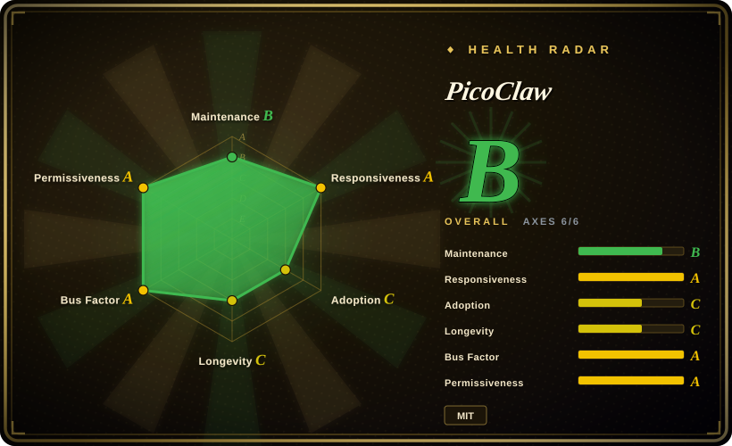
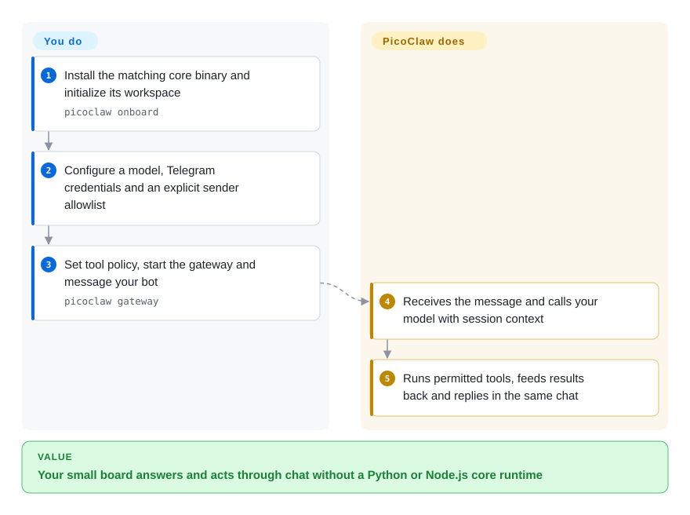
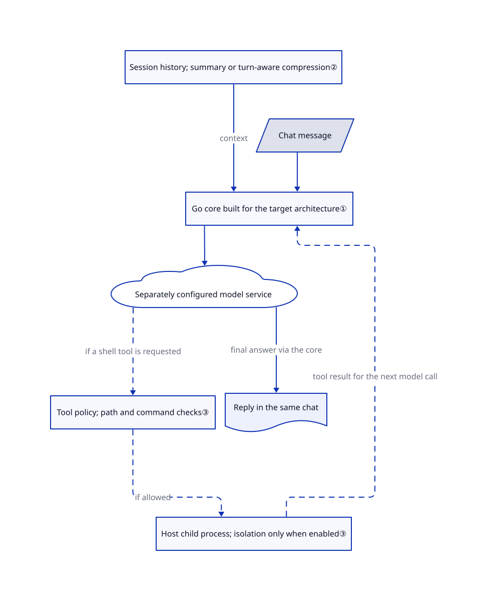

# PicoClaw

Your spare Linux board has little RAM, but you want it to answer messages and run small chores without installing Node.js or Python. PicoClaw puts the assistant runtime in a Go binary; the language model still runs through a separately configured service.

## When to use

You maintain a home server, router or RISC-V board and want to send it a Telegram message such as “read the latest sensor log and summarize the failures.” Installing a full application runtime on that board is the obstacle, not access to a model. You choose PicoClaw over [OpenClaw](openclaw.md) when shipping a core executable for ARM, MIPS or RISC-V matters more than companion apps and a broad plugin ecosystem. It supplies messaging adapters, file and shell tools, local conversation state and scheduled tasks; you supply the model service and protect the device.

Choose it over [Hermes Agent](hermes-agent.md) when avoiding a Python environment is the deciding constraint, rather than prioritizing a server assistant's accumulated procedures. The upstream hardware guide lists small Linux boards, but its memory figures are not a measured capacity guarantee for your selected build and workload.

## When NOT to use

- **You interpret “$10 hardware” as a complete offline LLM appliance.** PicoClaw calls a model provider; its Ollama/vLLM examples point to separate inference services. For an offline assistant on sufficiently capable hardware, evaluate [OpenHuman](openhuman.md) and budget for the model separately. PicoClaw's advertised RAM does not include model weights or inference.
- **You need a production-supported, security-hardened release.** The [README warning](https://github.com/sipeed/picoclaw/blob/bbf6893ca7afad27f1d00a0f5a45982a549c6ed6/README.md#L48-L55) explicitly says not to deploy to production before v1.0. For a production evaluation, prefer [OpenClaw](openclaw.md) with its documented hardening and release process; it also needs isolation and access policy, not blind trust.
- **Strangers can message a bot attached to an important host.** An empty sender allowlist accepts everyone; remote shell execution defaults to enabled, while subprocess isolation defaults to disabled. Workspace path checks and command-pattern filtering are not an operating-system security boundary. For visible per-action approvals and audit provenance, evaluate [OpenWorker](openworker.md), and enable its optional sandbox too.
- **Your priority is native companion apps and the widest messaging ecosystem.** Prefer [OpenClaw](openclaw.md). PicoClaw's portable core is the advantage here, not compatibility with every OpenClaw plugin or device integration.
- **You expect exact recall of every earlier detail.** Default context management summarizes history and can drop its oldest turns on overflow. Prefer [Hermes Agent](hermes-agent.md) when searchable past sessions are central, while still validating its retrieval results rather than treating memory as an audit log.

## Comparison

| Alternative | In index | Our verdict | Tradeoff |
| --- | --- | --- | --- |
| [OpenClaw](openclaw.md) | ✅ | Pick PicoClaw for a small Linux board where deploying a Go executable is decisive; pick OpenClaw when native companion apps and ecosystem reach justify a Node.js host. | PicoClaw offers cross-architecture core builds; OpenClaw offers a larger device/plugin surface. This is not a verified RAM or startup-speed comparison. |
| [Hermes Agent](hermes-agent.md) | ✅ | Pick Hermes when a server assistant's reusable procedures and session search are the product; pick PicoClaw when avoiding a Python runtime on the target is the stronger constraint. | Hermes bundles a Python environment and multiple terminal backends; PicoClaw packages the core in Go and can load Markdown skills. Neither makes a weak model reliable. |
| [OpenWorker](openworker.md) | ✅ | Pick OpenWorker when desktop approvals and a traceable record of tool authorization matter most; pick PicoClaw for a headless board reached through chat. | OpenWorker adds a desktop control surface and approval workflow; PicoClaw needs explicit sender/tool policy and optional process isolation. Both require sandbox configuration. |

## Quick start

Download a core binary matching your OS and architecture from [Releases](https://github.com/sipeed/picoclaw/releases), then run `picoclaw onboard` to create the config and workspace. In `~/.picoclaw/config.json`, select a model service and configure Telegram under `channel_list`, including an explicit `allow_from` list of your user IDs. Store the model key and bot token in `~/.picoclaw/.security.yml`, following the [security mapping guide](https://github.com/sipeed/picoclaw/blob/bbf6893ca7afad27f1d00a0f5a45982a549c6ed6/docs/security/security_configuration.md); keep that file private. Decide whether to disable remote shell access or enable supported process isolation before running `picoclaw gateway`, the background bridge that receives and answers chat messages. Send the bot a request; PicoClaw calls your configured model, executes permitted tools and replies, while you pay model costs and operate the host. These instructions follow the reviewed main commit; do not assume the older stable release has the same config layout.

<!-- flow-steps:begin (generated from flows/picoclaw.json by tools/flow_card.py — do not edit) -->

Text version of the flow

1. **You**: Install the matching core binary and initialize its workspace — `picoclaw onboard`
2. **You**: Configure a model, Telegram credentials and an explicit sender allowlist
3. **You**: Set tool policy, start the gateway and message your bot — `picoclaw gateway`
4. **PicoClaw**: Receives the message and calls your model with session context
5. **PicoClaw**: Runs permitted tools, feeds results back and replies in the same chat

**Value**: Your small board answers and acts through chat without a Python or Node.js core runtime

<!-- flow-steps:end -->

## Key techniques

<!-- mechanism:begin (generated from mechanisms/picoclaw.json by tools/mechanism_card.py; do not edit) -->

Text version of the mechanism

- Chat message
- Go core built for the target architecture①
- Session history; summary or turn-aware compression②
- Separately configured model service
- Tool policy; path and command checks③
- Host child process; isolation only when enabled③
- Reply in the same chat

- Chat message → Go core built for the target architecture①
- Session history; summary or turn-aware compression② → Go core built for the target architecture① (context)
- Go core built for the target architecture① → Separately configured model service
- Separately configured model service → Tool policy; path and command checks③ (if a shell tool is requested) [optional/fallback]
- Tool policy; path and command checks③ → Host child process; isolation only when enabled③ (if allowed) [optional/fallback]
- Host child process; isolation only when enabled③ → Go core built for the target architecture① (tool result for the next model call) [optional/fallback]
- Separately configured model service → Reply in the same chat (final answer via the core)

<!-- mechanism:end -->

### 1. Cross-compile the core instead of shipping an interpreter environment

- **Problem:** Small boards and unusual CPU architectures make deploying a large runtime inconvenient.
- **How:** The Makefile defaults to `CGO_ENABLED=0`, strips debug symbols and defines core builds for ARM, RISC-V, MIPS, LoongArch and desktop targets. Model and chat integrations are Go packages rather than a required Node.js/Python host.
- **Limits:** An executable is built per OS/architecture, not one universal file. The web launcher has a separate frontend build, and external tools or local inference still bring their own dependencies; this does not establish a 10 MB memory ceiling.
- **Source:** [Build defaults](https://github.com/sipeed/picoclaw/blob/bbf6893ca7afad27f1d00a0f5a45982a549c6ed6/Makefile#L30-L51), [core targets](https://github.com/sipeed/picoclaw/blob/bbf6893ca7afad27f1d00a0f5a45982a549c6ed6/Makefile#L315-L332), [dependencies](https://github.com/sipeed/picoclaw/blob/bbf6893ca7afad27f1d00a0f5a45982a549c6ed6/go.mod).

### 2. Reduce conversation context at turn boundaries

- **Problem:** Sending an ever-growing conversation eventually exceeds a model's input allowance.
- **How:** The default legacy context manager loads session history and summary. After thresholds are exceeded, it requests a model-written summary; emergency compression keeps recent turns and records that older messages were dropped. Turn boundaries keep a tool call and its results together.
- **Limits:** Summarization is lossy and adds model calls. Emergency compression does not faithfully summarize the discarded half; an older detail may disappear. This describes the default strategy, not every optional context manager.
- **Source:** [History and thresholds](https://github.com/sipeed/picoclaw/blob/bbf6893ca7afad27f1d00a0f5a45982a549c6ed6/pkg/agent/context_legacy.go#L23-L107), [turn-aware dropping](https://github.com/sipeed/picoclaw/blob/bbf6893ca7afad27f1d00a0f5a45982a549c6ed6/pkg/agent/context_legacy.go#L114-L171), [summary generation](https://github.com/sipeed/picoclaw/blob/bbf6893ca7afad27f1d00a0f5a45982a549c6ed6/pkg/agent/context_legacy.go#L174-L260).

### 3. Separate tool guards from opt-in subprocess isolation

- **Problem:** Letting a chat message cause a host command creates a much larger trust boundary than generating text.
- **How:** The shell tool checks remote-channel policy, working-directory paths and command patterns before launching through a common isolation entry point. When enabled, Linux isolation uses bubblewrap; Windows uses restricted tokens and job objects. The main PicoClaw process remains on the host.
- **Limits:** Defaults allow remote execution and leave process isolation off. macOS process isolation is not implemented; regex/path checks alone do not confine arbitrary child-process behavior. Sender allowlists must be configured separately, and an empty list accepts everyone.
- **Source:** [Execution checks](https://github.com/sipeed/picoclaw/blob/bbf6893ca7afad27f1d00a0f5a45982a549c6ed6/pkg/tools/shell.go#L295-L417), [defaults](https://github.com/sipeed/picoclaw/blob/bbf6893ca7afad27f1d00a0f5a45982a549c6ed6/pkg/config/defaults.go#L19-L29), [remote-exec default](https://github.com/sipeed/picoclaw/blob/bbf6893ca7afad27f1d00a0f5a45982a549c6ed6/pkg/config/defaults.go#L390-L397), [isolation scope](https://github.com/sipeed/picoclaw/blob/bbf6893ca7afad27f1d00a0f5a45982a549c6ed6/pkg/isolation/README.md), [sender checks](https://github.com/sipeed/picoclaw/blob/bbf6893ca7afad27f1d00a0f5a45982a549c6ed6/pkg/channels/base.go#L204-L260).

## Tech stack

- Go application; the reviewed `go.mod` requires Go 1.25.13. Cobra CLI, native provider/channel SDKs, the Go MCP SDK and JSON/YAML configuration.
- Local workspace files for skills, memory and sessions. MCP connects external tool servers; it is not a required hosted backend.
- Optional web launcher: browser frontend, with Node.js 22+ and pnpm 10.33.0+ needed to build it from source, not to run the core binary.

## Dependencies

- An OS/CPU supported by the chosen build, writable storage, network access to the selected model and chat APIs, plus their credentials. A prebuilt core does not require installing Go, Python or Node.js.
- A hosted model account, or a separately operated local model service. No GPU is required for a core that uses remote inference; local inference has its own hardware budget.
- Optional dependencies: bubblewrap for Linux subprocess isolation; each selected MCP server's runtime; channel-specific bridges; a container runtime for the Docker deployment path.

## Ops difficulty

**Low to start, medium to operate safely.** One executable and local files simplify deployment, but you still manage model bills, bot credentials, sender allowlists, tool privileges and backups. Keep the gateway and launcher private unless you have secured their access. Pin a reviewed build and check migrations: the latest stable release is from July, while this page checks main as observed in October, so verify config compatibility with the release you choose. Test actual RAM and latency on the target board rather than sizing from the README headline.

## Health & viability

- **Maintenance, checked 2026-10-18:** the [latest main commit](https://github.com/sipeed/picoclaw/commit/bbf6893ca7afad27f1d00a0f5a45982a549c6ed6) is dated 2026-08-19, 60 days ago; the scorer finds two active weeks in the last 13. The latest stable release is [v0.3.1](https://github.com/sipeed/picoclaw/releases/tag/v0.3.1), published 2026-07-03. Repository `pushed_at` is 2026-10-15, but that does not prove newer main code.
- **Governance / backing:** Sipeed initiated and owns the repository; the top contributor list includes several substantial human contributors, not just one account. The [contribution policy](https://github.com/sipeed/picoclaw/blob/bbf6893ca7afad27f1d00a0f5a45982a549c6ed6/CONTRIBUTING.md) requires disclosure and human review of AI-generated changes. Vendor ownership is not foundation governance or a support commitment.
- **Age / Lindy:** created 2026-02-04, about eight months old. [推断：based on repository age and measured commit cadence] Evaluate cautiously: a short history and a recent slowdown do not establish long-term compatibility or survival.
- **Adoption / substance:** about 30.1k stars and 4.5k forks on the check date. The reviewed tree contains 541 non-test Go files and 327 Go test files; these are evidence of reusable implementation and test investment, not measured production adoption.
- **License / risk:** [MIT, copyright PicoClaw contributors](https://github.com/sipeed/picoclaw/blob/bbf6893ca7afad27f1d00a0f5a45982a549c6ed6/LICENSE). The upstream pre-v1 production warning, permissive remote-tool defaults and optional isolation matter more to deployment than the popularity count.
- **Measured radar:** B with all six axes scored. Maintenance is B; adoption is C from installation/download signals, not the star count. These grades do not certify deployment safety.

## Caveats (unverified)

- [未验证：no target-board benchmark run] Upstream advertises under 10 MB and sub-second startup but also notes recent builds may use 10–20 MB. Neither those figures nor speed/memory comparisons with OpenClaw were reproduced; model inference is separate.
- [未验证：no live model or chat accounts connected] The setup and tool flow were checked against main's docs and source, not exercised end to end. Channel reliability and prompt-injection resistance were not tested.
- [推断：based on repository age and measured commit cadence] The young project and recent slowdown call for cautious evaluation; neither long-term maintenance nor future compatibility can be established from this history.
