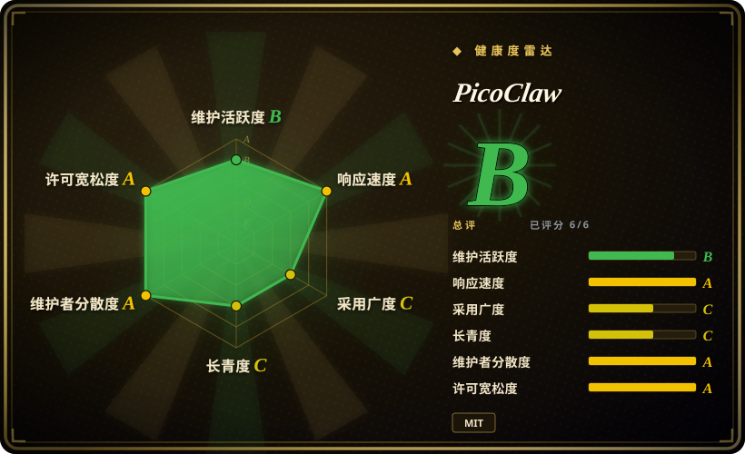
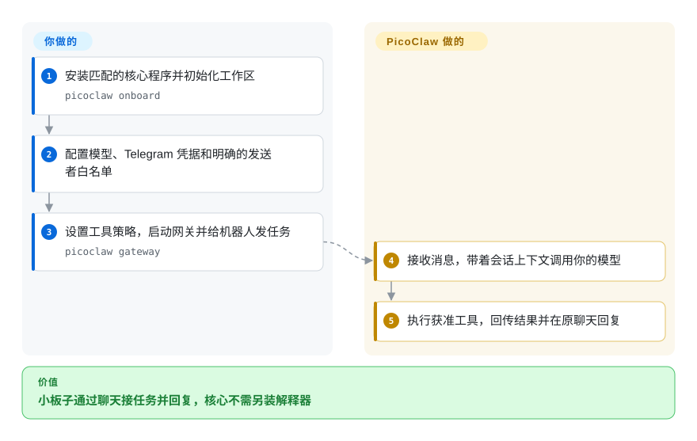
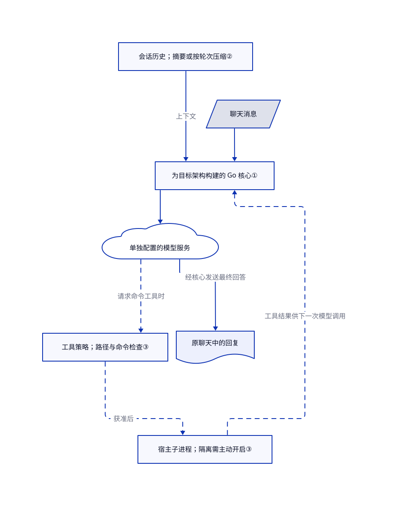

# PicoClaw

闲置 Linux 板子内存不多，你却想让它接消息、做些小任务，又不想装一套解释器环境。PicoClaw 把助手运行时打成 Go 可执行文件；语言模型仍由另配的服务运行。

## 何时使用

你在维护家用服务器、路由器或 RISC-V 板子。你想发条 Telegram 消息：“读一下最新的传感器日志，汇总失败项。”难点是在板子上部署助手，不是找不到模型。相比 [OpenClaw](openclaw.zh.md)，你选它是因为 ARM、MIPS、RISC-V 的核心可执行文件更重要，配套 App 和插件生态反而次要。它提供消息接入、文件与命令工具、本机会话状态和定时任务；模型服务和设备安全仍由你负责。

相比 [Hermes Agent](hermes-agent.zh.md)，当目标设备不适合维护 Python 环境时选它。若你更看重服务器上的助手积累做法，就不是同一个取舍。上游列出了小型 Linux 板子的兼容情况，但内存宣传不等于你的构建和负载已经通过容量验证。

## 何时不用

- **你把“十美元硬件”理解成完整离线大模型机器。** 它调用模型提供方，Ollama、vLLM 示例也指向独立推理服务。若要在足够强的硬件上部署离线助手，可评估 [OpenHuman](openhuman.zh.md)，另算模型资源。宣传内存不含模型权重和推理开销。
- **你需要适合生产的受支持安全版本。** [README 警告](https://github.com/sipeed/picoclaw/blob/bbf6893ca7afad27f1d00a0f5a45982a549c6ed6/README.md#L48-L55)明确要求不要在 v1.0 前部署到生产。生产选型可先评估 [OpenClaw](openclaw.zh.md) 的加固文档和发布流程，但它也需要隔离与访问策略，不能盲信。
- **陌生人能给连着重要主机的机器人发消息。** 发送者白名单为空时放行所有人；远程命令执行默认开启，子进程隔离默认关闭。工作区路径检查和命令模式过滤不是操作系统隔离。若你要看得见的逐项审批和授权来源记录，可评估 [OpenWorker](openworker.zh.md)，也要开启它的可选沙箱。
- **你优先要原生配套 App 和最广的聊天生态。** 选 [OpenClaw](openclaw.zh.md)。这里的优势是核心运行时便于跨架构部署，不是兼容所有 OpenClaw 插件和设备功能。
- **你要求精确记住所有旧细节。** 默认上下文管理会摘要历史，超限时还能丢弃最早的对话轮次。若历史会话检索才是核心，可选 [Hermes Agent](hermes-agent.zh.md)，但仍需核对检索结果，不能把记忆当审计日志。

## 横向对比

| 替代品 | 是否收录 | 我们的评价 | 取舍 |
| --- | --- | --- | --- |
| [OpenClaw](openclaw.zh.md) | ✅ | 小型 Linux 板子的关键约束是部署一个 Go 程序时选 PicoClaw；若原生配套 App 和生态值得维护 Node.js 主机，就选 OpenClaw。 | 前者提供多架构核心构建，后者提供更广的设备和插件入口。这不是已验证的内存或启动速度对比。 |
| [Hermes Agent](hermes-agent.zh.md) | ✅ | 服务器助手的可复用做法和会话搜索才是产品时选 Hermes；避免在目标设备维护 Python 环境更重要时选 PicoClaw。 | Hermes 打包 Python 环境及多种终端后端；PicoClaw 用 Go 打包核心，也可加载 Markdown 技能。两者都不能让弱模型自动可靠。 |
| [OpenWorker](openworker.zh.md) | ✅ | 桌面审批和工具授权溯源最重要时选 OpenWorker；无显示器的板子主要靠聊天接任务时选 PicoClaw。 | 前者多了桌面控制面和审批流程；后者要显式配置发送者、工具策略及可选进程隔离。两者都要配置沙箱。 |

## 快速上手

从 [Releases](https://github.com/sipeed/picoclaw/releases) 下载匹配系统及架构的核心程序，运行 `picoclaw onboard` 创建配置和工作区。在 `~/.picoclaw/config.json` 选择模型服务，并在 `channel_list` 配置 Telegram；用 `allow_from` 明确列出自己的用户 ID。按[敏感配置映射文档](https://github.com/sipeed/picoclaw/blob/bbf6893ca7afad27f1d00a0f5a45982a549c6ed6/docs/security/security_configuration.md)，把模型密钥和机器人令牌放进 `~/.picoclaw/.security.yml`，不要公开这个文件。先决定是否禁用远程命令，或开启受支持的进程隔离，再运行 `picoclaw gateway`；这是接收并回复聊天消息的常驻桥接进程。给机器人发任务后，它调用所选模型、执行获准工具并回复；模型费用和主机运维归你。这套说明对应本次读取的主分支提交，不能假定较老的稳定版使用相同配置结构。

<!-- flow-steps:begin (generated from flows/picoclaw.json by tools/flow_card.py — do not edit) -->

流程文字版

1. **你**：安装匹配的核心程序并初始化工作区 — `picoclaw onboard`
2. **你**：配置模型、Telegram 凭据和明确的发送者白名单
3. **你**：设置工具策略，启动网关并给机器人发任务 — `picoclaw gateway`
4. **PicoClaw**：接收消息，带着会话上下文调用你的模型
5. **PicoClaw**：执行获准工具，回传结果并在原聊天回复

**价值**：小板子通过聊天接任务并回复，核心不需另装解释器

<!-- flow-steps:end -->

## 技术要点

<!-- mechanism:begin (generated from mechanisms/picoclaw.json by tools/mechanism_card.py; do not edit) -->

机制文字版

- 聊天消息
- 为目标架构构建的 Go 核心①
- 会话历史；摘要或按轮次压缩②
- 单独配置的模型服务
- 工具策略；路径与命令检查③
- 宿主子进程；隔离需主动开启③
- 原聊天中的回复

- 聊天消息 → 为目标架构构建的 Go 核心①
- 会话历史；摘要或按轮次压缩② → 为目标架构构建的 Go 核心①（上下文）
- 为目标架构构建的 Go 核心① → 单独配置的模型服务
- 单独配置的模型服务 → 工具策略；路径与命令检查③（请求命令工具时）〔可选／兜底〕
- 工具策略；路径与命令检查③ → 宿主子进程；隔离需主动开启③（获准后）〔可选／兜底〕
- 宿主子进程；隔离需主动开启③ → 为目标架构构建的 Go 核心①（工具结果供下一次模型调用）〔可选／兜底〕
- 单独配置的模型服务 → 原聊天中的回复（经核心发送最终回答）

<!-- mechanism:end -->

### 1. 交叉编译核心，不分发解释器环境

- **解决：** 小板子和少见处理器架构不方便部署较大的运行环境。
- **做法：** 构建文件默认设置 `CGO_ENABLED=0`，裁掉调试符号，并提供 ARM、RISC-V、MIPS、LoongArch 和桌面目标。模型与聊天集成使用 Go 包，不要求核心宿主另装解释器。
- **边界：** 每种系统和架构各有构建，不是同一个文件通吃。网页启动器要另建前端，外部工具和本地推理也有自己的依赖；这些设计不证明内存一定低于 10 MB。
- **源码：** [构建默认项](https://github.com/sipeed/picoclaw/blob/bbf6893ca7afad27f1d00a0f5a45982a549c6ed6/Makefile#L30-L51)、[核心构建目标](https://github.com/sipeed/picoclaw/blob/bbf6893ca7afad27f1d00a0f5a45982a549c6ed6/Makefile#L315-L332)、[依赖清单](https://github.com/sipeed/picoclaw/blob/bbf6893ca7afad27f1d00a0f5a45982a549c6ed6/go.mod)。

### 2. 沿完整对话轮次缩减上下文

- **解决：** 不断把完整对话发给模型，最终会超过输入容量。
- **做法：** 默认旧版上下文管理器读取会话历史和摘要。超过阈值后请模型写摘要；紧急压缩保留较近轮次，并记下丢弃了多少旧消息。按轮次切分，避免拆散工具调用及其返回结果。
- **边界：** 摘要会损失信息，也增加模型调用。紧急压缩不是忠实摘要被丢弃的那一半，旧细节可能消失。本节只描述默认策略，不代表所有可选上下文管理器。
- **源码：** [历史与阈值](https://github.com/sipeed/picoclaw/blob/bbf6893ca7afad27f1d00a0f5a45982a549c6ed6/pkg/agent/context_legacy.go#L23-L107)、[按轮次丢弃](https://github.com/sipeed/picoclaw/blob/bbf6893ca7afad27f1d00a0f5a45982a549c6ed6/pkg/agent/context_legacy.go#L114-L171)、[生成摘要](https://github.com/sipeed/picoclaw/blob/bbf6893ca7afad27f1d00a0f5a45982a549c6ed6/pkg/agent/context_legacy.go#L174-L260)。

### 3. 区分工具检查和可选子进程隔离

- **解决：** 聊天消息能触发主机命令后，信任范围远大于只生成文字。
- **做法：** 命令工具先检查远程渠道策略、工作目录和命令模式，再通过统一隔离入口启动。开启后，Linux 使用 bubblewrap，Windows 使用受限令牌和作业对象。主进程仍在宿主环境运行。
- **边界：** 默认允许远程执行，进程隔离却关闭。macOS 尚无进程隔离实现；正则和路径检查不能单独限制任意子进程行为。发送者白名单另配，空列表会放行所有人。
- **源码：** [执行前检查](https://github.com/sipeed/picoclaw/blob/bbf6893ca7afad27f1d00a0f5a45982a549c6ed6/pkg/tools/shell.go#L295-L417)、[隔离默认项](https://github.com/sipeed/picoclaw/blob/bbf6893ca7afad27f1d00a0f5a45982a549c6ed6/pkg/config/defaults.go#L19-L29)、[远程执行默认项](https://github.com/sipeed/picoclaw/blob/bbf6893ca7afad27f1d00a0f5a45982a549c6ed6/pkg/config/defaults.go#L390-L397)、[隔离范围](https://github.com/sipeed/picoclaw/blob/bbf6893ca7afad27f1d00a0f5a45982a549c6ed6/pkg/isolation/README.md)、[发送者检查](https://github.com/sipeed/picoclaw/blob/bbf6893ca7afad27f1d00a0f5a45982a549c6ed6/pkg/channels/base.go#L204-L260)。

## 技术栈

- Go 应用，本次读取的依赖清单要求 Go 1.25.13。使用 Cobra 命令行、原生模型与聊天 SDK、Go MCP SDK，以及 JSON、YAML 配置。
- 本地工作区保存技能、记忆与会话。MCP 用来接入外部工具服务，不是强制托管后端。
- 可选网页启动器使用浏览器前端；从源码构建它需要 Node.js 22+ 和 pnpm 10.33.0+，运行核心程序不需要。

## 依赖

- 所选构建支持的系统与处理器、可写存储，以及通向模型和聊天接口的网络与凭据。预编译核心不要求安装 Go 或解释器。
- 托管模型账号，或自行运行的独立本地模型服务。使用远程推理的核心不要求显卡；本地推理另算硬件预算。
- 可选依赖包括 Linux 子进程隔离所需的 bubblewrap、各 MCP 服务所需的运行时、聊天渠道专用桥接，以及 Docker 部署所需的容器运行时。

## 运维难度

**启动低，安全运行中。** 一个程序配本地文件，部署较简单。但你仍要管模型账单、机器人凭据、发送者白名单、工具权限和备份。未加固访问前，不要公开网关及启动器。固定已审查构建，并复核迁移：最新稳定版在七月发布，本页读取十月核验时的主分支，应核对所选版本的配置兼容性。容量规划应在目标板实测内存和延迟，不照抄首页宣传。

## 健康度与可持续性

- **维护，核验于 2026-10-18：** [主分支最新提交](https://github.com/sipeed/picoclaw/commit/bbf6893ca7afad27f1d00a0f5a45982a549c6ed6)日期为 2026-08-19，距今 60 天；评分器测得近 13 周仅两周有提交。最新稳定版 [v0.3.1](https://github.com/sipeed/picoclaw/releases/tag/v0.3.1) 发布于 2026-07-03。仓库推送时间虽是 2026-10-15，却不能证明主分支代码更新。
- **治理与支持方：** Sipeed 发起并持有仓库，主要贡献者列表中有多位贡献较多的人类账号，不只一个账号。[贡献规则](https://github.com/sipeed/picoclaw/blob/bbf6893ca7afad27f1d00a0f5a45982a549c6ed6/CONTRIBUTING.md)要求披露 AI 生成内容并由人核查。厂商持有仓库不等于基金会治理或支持承诺。
- **仓龄与 Lindy：** 创建于 2026-02-04，约八个月。[推断：依据是仓龄与实测提交节奏] 应谨慎评估；短历史加上近期放缓，不能证明长期兼容或项目寿命。
- **采用与实质内容：** 核验日约 3.01 万星、4500 个分叉。源码树有 541 个非测试 Go 文件，以及 327 个 Go 测试文件。这能说明有可复用实现和测试投入，不能换算成生产用户数。
- **许可与风险：** [MIT 许可，版权为 PicoClaw contributors](https://github.com/sipeed/picoclaw/blob/bbf6893ca7afad27f1d00a0f5a45982a549c6ed6/LICENSE)。部署判断应优先看上游的生产警告、宽松的远程工具默认项和可选隔离，不看热度。
- **机器雷达：** 综合 B，六轴均已评分。维护为 B，采用为 C，采用依据是安装与下载信号，不是星数。评分不认证部署安全。

## 存疑（未验证）

- [未验证：未在目标板运行基准] 上游宣传低于 10 MB、亚秒启动，同时承认近期构建可能占 10–20 MB。本次没有复测这些数字，也没有复测与 OpenClaw 的速度和内存对比；模型推理另算。
- [未验证：没有接入真实模型和聊天账号] 上手路径与工具流程核对了主分支文档及源码，但未跑端到端。聊天渠道稳定性和抵御提示注入的能力没有实测。
- [推断：依据是仓龄与实测提交节奏] 项目年轻且近期提交放缓，应谨慎评估。这段历史不能证明长期维护或未来版本兼容。
