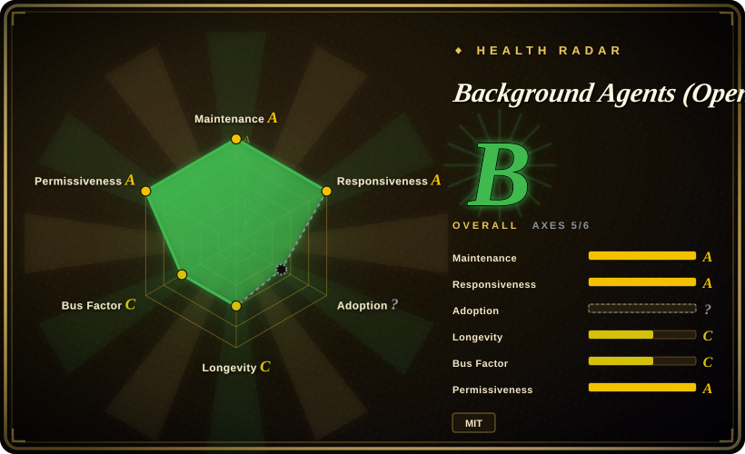
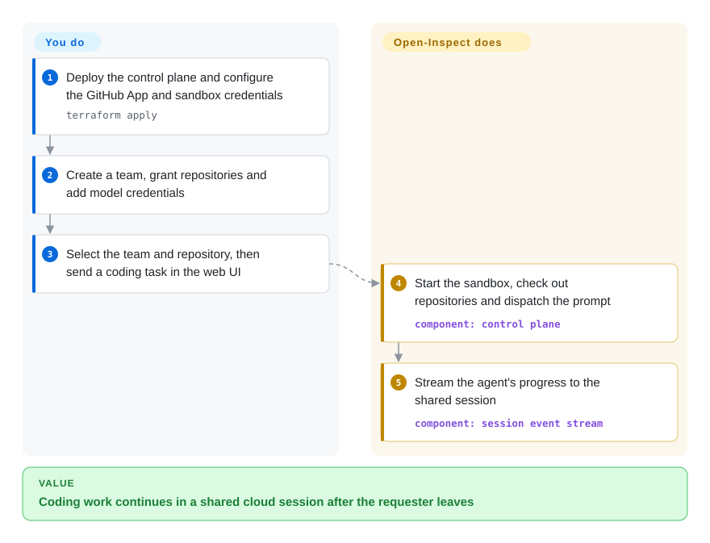
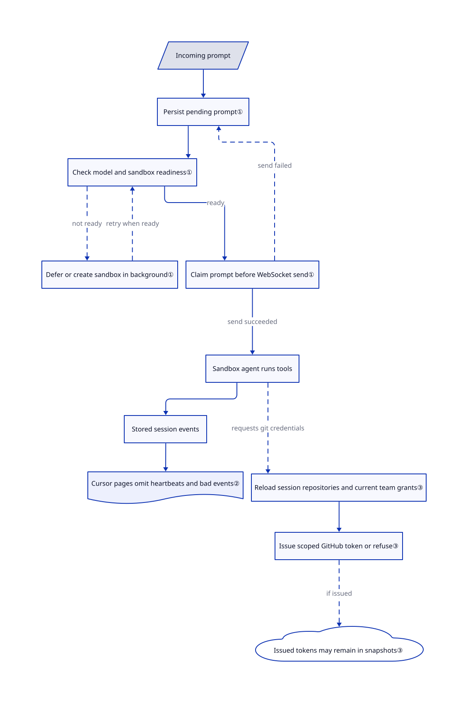

# Background Agents (Open-Inspect)

Your team's coding task stops when someone closes their laptop, and a CI job cannot provide an interactive shared session. Open-Inspect keeps the work in cloud sandboxes, with a self-hosted session UI and integration triggers.

## When to use

You're operating one trusted engineering organization: a Linear issue needs a patch while its requester is away, and a colleague must be able to inspect progress or add a prompt without taking over that person's terminal. Open-Inspect runs background sandbox sessions, streams their progress to collaborators, and supports web, Slack, GitHub, Linear, schedules and webhooks. Pick it over a local coding CLI when those shared sessions, up to ten repositories per session and reusable sandbox lifecycle justify a separate control plane.

Choose it only when you can operate identity, a GitHub App, model credentials, a sandbox provider and the single-tenant trust model. Cloudflare is the main deployment guide; an AWS-hosted control-plane path is also documented. It is internal engineering automation, not an out-of-the-box personal assistant.

## When NOT to use

- **You need multi-tenant SaaS or authorization based on each user's personal GitHub permissions.** Choose a separately isolated deployment per organization or an explicitly tenant-isolated platform. Open-Inspect now has teams, repository grants and session-scoped GitHub credentials, but still shares an installation, does not compare personal GitHub permissions, defaults team-read enforcement to `shadow`, and cannot immediately revoke issued tokens. See the reviewed [security model](https://github.com/ColeMurray/background-agents/blob/824d678830a4c1e88cb1ba9267356996e2d67e0e/README.md#security-model-single-tenant-only).
- **You are an individual developer or only need terminal pair programming.** Choose [OpenCode](../terminal-agents/independent-runtimes/opencode.md); Terraform, GitHub App/OAuth setup, cloud control-plane and sandbox credentials are disproportionate for a local workflow.
- **Your policy forbids cloud sandbox providers.** Choose a local agent such as OpenCode or evaluate a self-managed [OpenHands](openhands.md) deployment; the documented sandbox paths use Modal, Daytona, Vercel Sandbox, OpenComputer or E2B. AWS hosting removes the Cloudflare requirement, not the sandbox-provider responsibility.
- **You only need one audited CI event to produce a patch.** Use GitHub Actions plus OpenCode rather than this session platform; sandbox credential caches and snapshots, secret scopes, bots and schedules add access paths that you must manage.
- **You need a long-lived, versioned production platform with established releases.** Choose a more mature hosted or self-managed option; this young repository had no GitHub Releases at review time and its workspace version is `0.1.0`.

## Comparison

| Alternative | In index | Our verdict | Tradeoff |
|---|---|---|---|
| [OpenCode](../terminal-agents/independent-runtimes/opencode.md) | ✅ | Choose OpenCode for a local developer-operated coding agent; choose Open-Inspect when trusted-team background sessions and integrations justify a cloud control plane. | OpenCode avoids infrastructure and shared credentials; Open-Inspect adds sandbox scheduling, integrations, and multi-repository automation. |
| [OpenHands](openhands.md) | ✅ | Choose OpenHands' Agent Canvas when one developer or a small team wants to start with a local backend; choose Open-Inspect when organizational sandbox lifecycle and attributed background work justify its single-tenant setup. | Agent Canvas starts on one machine and adds remote/automation backends; Open-Inspect starts with cloud infrastructure and a shared GitHub App trust boundary. |
| GitHub Actions plus an agent CLI | not a repo | Choose CI-triggered agent scripts when a narrow, audited event flow is enough; choose Open-Inspect when interactive sessions, live collaboration, and reusable sandbox lifecycle are required. | This is a composition pattern, not a single repository; scripts keep a smaller control plane but leave session UI and sandbox reuse to you. |
| [CC Switch](cc-switch.md) | ✅ | Choose CC Switch for one person's desktop management of installed agents; choose Open-Inspect for organizational cloud execution and asynchronous automation. | CC Switch is low-ops and local; Open-Inspect introduces credentials, sandboxes, data-plane operations, and a shared trust boundary. |

## Quick start

Follow the reviewed [deployment guide](https://github.com/ColeMurray/background-agents/blob/824d678830a4c1e88cb1ba9267356996e2d67e0e/docs/GETTING_STARTED.md): install Node 24+, Terraform 1.14+ and the Modal Python tooling, fork the repository, run `npm install` and `npm run build -w @open-inspect/shared`, then configure the cloud accounts and GitHub App in the provided Terraform files. From `terraform/environments/production`, run `terraform init -backend-config=backend.tfvars` and `terraform apply`; these create billable infrastructure, not a local demo. Bootstrap a workspace Owner using the guide's `npm run rbac:bootstrap-owner` procedure, create a team, grant its repositories, add model credentials, and explicitly enable `teams_enforcement = "on"` before relying on team-only reads. Select that team and repository in the web UI and send a coding task; the platform starts the sandbox and streams the agent's work, with pull-request creation available from the session. You pay for hosting, sandboxes and models, define access scopes, and review changes before merging; neither successful startup nor the health endpoint verifies authorization policy.

This is the deployment path, not a runnable single-command install: also run `uv sync --frozen` inside `packages/modal-infra` and build the control-plane and bot workers listed in the guide before Terraform. The guide's first apply creates Workers without bindings; enable both binding flags and apply again. With the Vercel web platform, deploying the web code is a separate step.

<!-- flow-steps:begin (generated from flows/background-agents.json by tools/flow_card.py — do not edit) -->

Text version of the flow

1. **You**: Deploy the control plane and configure the GitHub App and sandbox credentials — `terraform apply`
2. **You**: Create a team, grant repositories and add model credentials
3. **You**: Select the team and repository, then send a coding task in the web UI
4. **Background Agents (Open-Inspect)**: Start the sandbox, check out repositories and dispatch the prompt — component: `control plane`
5. **Background Agents (Open-Inspect)**: Stream the agent's progress to the shared session — component: `session event stream`

**Value**: Coding work continues in a shared cloud session after the requester leaves

<!-- flow-steps:end -->

## Key techniques

<!-- mechanism:begin (generated from mechanisms/background-agents.json by tools/mechanism_card.py; do not edit) -->

Text version of the mechanism

- Incoming prompt
- Persist pending prompt①
- Check compatibility, authentication and sandbox readiness①
- Fail prompt, then process next queued item①
- Defer or create sandbox in background①
- Claim prompt before WebSocket send①
- Sandbox agent runs tools
- Stored session events
- Cursor pages omit heartbeats and bad events②
- Reload session repositories and current team grants③
- Issue scoped GitHub token or refuse③
- Issued tokens may remain in snapshots③

- Incoming prompt → Persist pending prompt①
- Persist pending prompt① → Check compatibility, authentication and sandbox readiness①
- Check compatibility, authentication and sandbox readiness① → Fail prompt, then process next queued item① (incompatible or unauthenticated) [optional/fallback]
- Check compatibility, authentication and sandbox readiness① → Defer or create sandbox in background① (not ready) [optional/fallback]
- Defer or create sandbox in background① → Check compatibility, authentication and sandbox readiness① (when ready) [optional/fallback]
- Check compatibility, authentication and sandbox readiness① → Claim prompt before WebSocket send① (ready)
- Claim prompt before WebSocket send① → Persist pending prompt① (send failed) [optional/fallback]
- Claim prompt before WebSocket send① → Sandbox agent runs tools (send succeeded)
- Sandbox agent runs tools → Stored session events
- Stored session events → Cursor pages omit heartbeats and bad events②
- Sandbox agent runs tools → Reload session repositories and current team grants③ (requests git credentials) [optional/fallback]
- Reload session repositories and current team grants③ → Issue scoped GitHub token or refuse③
- Issue scoped GitHub token or refuse③ → Issued tokens may remain in snapshots③ (if issued) [optional/fallback]

<!-- mechanism:end -->

### 1. Keep prompts pending until a sandbox can accept them

- **Problem:** A bot request should not wait for a slow sandbox boot, and concurrent dispatchers must not both take the same queued prompt.
- **How:** Store the prompt first; incompatible model/harness choices or unavailable provider authentication fail that prompt rather than leave it waiting. Otherwise defer or start sandbox creation in background work, then claim before WebSocket delivery; a failed send returns it to pending and terminates the unresponsive sandbox.
- **Limits:** Cancellation and session state are rechecked after authentication waits, but recovering a queue entry does not make external tool effects execute exactly once.
- **Source:** [`message-queue.ts:405–625`](https://github.com/ColeMurray/background-agents/blob/824d678830a4c1e88cb1ba9267356996e2d67e0e/packages/control-plane/src/session/message-queue.ts#L405-L625), [`message-queue.ts:836–934`](https://github.com/ColeMurray/background-agents/blob/824d678830a4c1e88cb1ba9267356996e2d67e0e/packages/control-plane/src/session/message-queue.ts#L836-L934).

### 2. Resume the timeline through bounded replay

- **Problem:** A collaborator reconnecting to a session needs its recent progress without keeping the original browser tab alive.
- **How:** Read stored events with a timeline cursor, which marks where a page ends, and leave out heartbeat messages. Replay defaults to 500 events; history pages default to 200 and are constrained to 1–500.
- **Limits:** Invalid stored timeline events are skipped. This UI recovery path is not a promise of a complete audit export.
- **Source:** [`event-stream.ts:21–107`](https://github.com/ColeMurray/background-agents/blob/824d678830a4c1e88cb1ba9267356996e2d67e0e/packages/control-plane/src/session/event-stream.ts#L21-L107), [`event-stream.ts:136–139`](https://github.com/ColeMurray/background-agents/blob/824d678830a4c1e88cb1ba9267356996e2d67e0e/packages/control-plane/src/session/event-stream.ts#L136-L139).

### 3. Recompute repository scope before issuing GitHub credentials

- **Problem:** A sandbox must not inherit every repository reachable by the shared GitHub App, especially after team grants change.
- **How:** Reload session ownership and its persisted repository members, resolve numeric repository IDs, and intersect them with current owning-team grants. Unresolved identities or an empty scope are refused instead of expanding access.
- **Limits:** Already issued tokens and credentials retained in filesystem snapshots are not immediately revoked. GitLab still uses a deployment-wide personal access token rather than this per-session GitHub boundary.
- **Source:** [`session-scope.ts:9–34`](https://github.com/ColeMurray/background-agents/blob/824d678830a4c1e88cb1ba9267356996e2d67e0e/packages/control-plane/src/source-control/session-scope.ts#L9-L34), [`repository-scope.ts:7–43`](https://github.com/ColeMurray/background-agents/blob/824d678830a4c1e88cb1ba9267356996e2d67e0e/packages/control-plane/src/source-control/repository-scope.ts#L7-L43), [`credential-scope.ts:14–38`](https://github.com/ColeMurray/background-agents/blob/824d678830a4c1e88cb1ba9267356996e2d67e0e/packages/control-plane/src/source-control/credential-scope.ts#L14-L38), [`AUTH.md:394–417`](https://github.com/ColeMurray/background-agents/blob/824d678830a4c1e88cb1ba9267356996e2d67e0e/docs/AUTH.md#L394-L417).

## Tech stack

- **Control plane:** TypeScript on Cloudflare Workers, Durable Objects, D1, KV, R2, SQLite, and WebSockets.
- **Web:** Next.js 16, React 19, Tailwind CSS and Radix UI, confirmed by `packages/web/package.json`.
- **Sandbox runtime:** OpenCode or Claude Agent harness, Node.js, Python, Bun, Git, GitHub CLI, `agent-browser` and headless Chromium.
- **Infrastructure:** Terraform and Modal, Daytona, Vercel Sandbox, OpenComputer or E2B integrations; Python handles parts of sandbox provisioning. `docs/AWS_BRING_UP.md` also documents a Node control plane on EC2 with Docker Compose, EBS, S3 and Caddy rather than Cloudflare.

## Dependencies

- **Deployment core:** Node.js 24+ (`package.json` engines), npm, Terraform 1.14+; Cloudflare guide additionally requires Wrangler, Cloudflare credentials and Python 3.12+/uv for Modal. The AWS guide instead requires AWS CLI/Session Manager and corresponding accounts.
- **Source control:** GitHub App/OAuth configuration and deliberately constrained installation scope.
- **Sandbox:** one supported sandbox provider and its credentials/resources.
- **Models / integrations:** configure credentials for the selected model/harness; Anthropic API keys are not mandatory for the guide's bot-disabled core path. Optional Slack/Linear classifiers, Google sign-in, Sentry and webhooks bring additional credentials. Subscription-based paths still require provider login and eligibility.

## Ops difficulty

**High.** This is a distributed control plane with identity, GitHub installation credentials, secrets injection, worker state, cloud sandboxes, webhooks, and repository lifecycle scripts. Its own README limits deployment to one trusted tenant; secure operation means minimizing GitHub App scope, entry points, secret scope, and automation permissions.

## Health & viability

- **Maintenance snapshot (2026-10-17):** unarchived, reviewed default-branch commit `824d678`; GitHub reports 3365 stars, but stars do not measure installations. Workspace version remains `0.1.0`, with no GitHub Releases.
- **Governance / bus factor:** the repository is user-owned and contributor activity is heavily concentrated in ColeMurray. The project is actively developed but has a material key-maintainer risk. [推断]
- **Age / Lindy:** created 2026-01 and lacks GitHub Releases, so there is no long operational history or release-line stability signal.
- **Measured coverage:** overall B covers 5/6 axes. Adoption remains `? / no_package_structural`: the root workspace is private and the scorer found neither a canonical package nor an installation signal. This is an unmeasured axis, not zero users or a license exemption.
- **Security / operational risk:** team grants and scoped credentials do not turn a trusted single-tenant product into multi-tenant SaaS. Team-read enforcement's `shadow` default and credentials retained in snapshots require an explicit deployment review.

## Caveats (unverified)

- [未验证：cloud infrastructure was not deployed] Sandbox backends, AWS/Cloudflare deployment and subscription login were source-reviewed, not independently run or security-audited.
- [推断：shared installation, shadow defaults and snapshot credential boundaries] Start with a restricted internal pilot rather than broad repository access; source inspection alone cannot establish production isolation.
