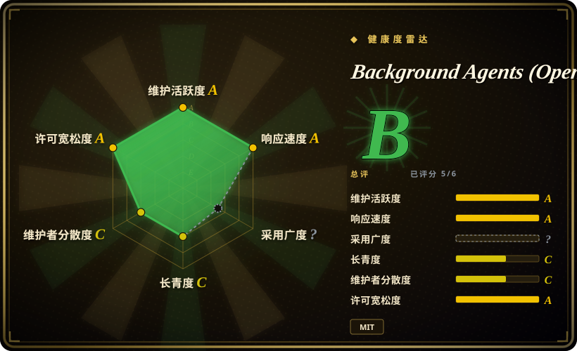
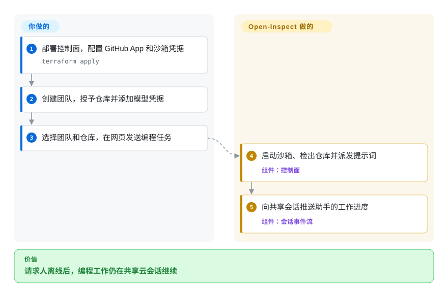
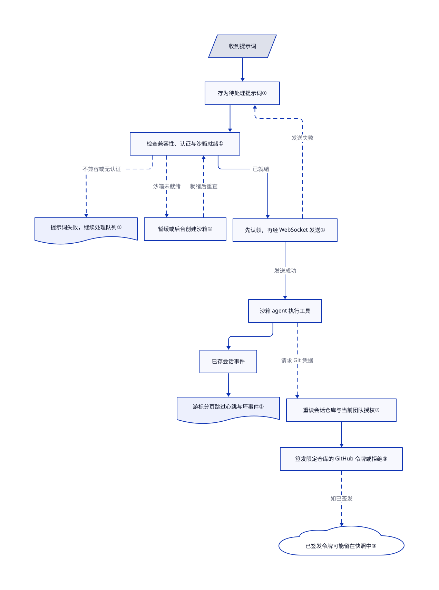

# Background Agents (Open-Inspect)

同事合上电脑，交给编程助手的任务就停了；CI 作业又不能让其他人随时接着提问。Open-Inspect 把工作留在云沙箱，提供自托管的共享会话界面和集成触发入口。

## 何时使用

你运营的是一个可信工程组织：Linear 工单需要在请求人离线时继续修复，同事还得查看进度、追加要求，却不能接管他的终端。Open-Inspect 在后台运行沙箱会话，向协作者推送进度，提供网页、Slack、GitHub、Linear、定时任务和 webhook 入口。共享会话、每会话至多十个仓库和可复用的沙箱生命周期足以抵消独立控制面的成本时，才选它而不是本地编程 CLI。

只有能运维身份、GitHub App、模型凭据、沙箱提供商和单租户信任模型时才选它。主要部署指南使用 Cloudflare，也有 AWS 控制面的文档路径；它面向内部工程自动化，不是开箱即用的个人助手。

## 何时不用

- **你需要多租户 SaaS，或按个人 GitHub 权限授权。**改用逐组织独立部署或明确隔离租户的平台。Open-Inspect 已有团队、仓库授权和会话级 GitHub 凭据，但仍共享 App 安装、不比较个人 GitHub 权限，团队读取控制默认是 `shadow`，已签发令牌不能立即撤销。见所读版本的[安全模型](https://github.com/ColeMurray/background-agents/blob/824d678830a4c1e88cb1ba9267356996e2d67e0e/README.md#security-model-single-tenant-only)。
- **你是个人开发者，或只需终端结对编程。**改选 [OpenCode](../terminal-agents/opencode.zh.md)；Terraform、GitHub App、OAuth、云控制面和沙箱凭据的成本，对本地工作流不成比例。
- **你的政策禁止云沙箱提供商。**改用 OpenCode 这类本地 agent，或评估自管的 [OpenHands](openhands.zh.md)；文档中的沙箱路径使用 Modal、Daytona、Vercel Sandbox、OpenComputer 或 E2B。AWS 托管可去掉 Cloudflare 依赖，不能去掉沙箱提供商的运维责任。
- **你只需一个可审计的 CI 事件产生补丁。**改用 GitHub Actions 加 OpenCode；会话平台的凭据缓存、快照、secret 作用域、机器人和定时任务增加了需要管理的访问路径。
- **你需要有长期版本线和正式发布的生产平台。**改选更成熟的托管或自管方案；本项目较新，审查时没有 GitHub Releases，workspace 版本为 `0.1.0`。

## 横向对比

| 替代品 | 是否收录 | 我们的评价 | 取舍 |
|---|---|---|---|
| [OpenCode](../terminal-agents/opencode.zh.md) | ✅ | 本地由开发者操作的 coding agent 选 OpenCode；可信团队的后台会话和集成足以证明云控制面成本合理时选 Open-Inspect。 | OpenCode 避开基础设施和共享凭据；Open-Inspect 加入沙箱调度、集成和多仓库自动化。 |
| [OpenHands](openhands.zh.md) | ✅ | 个人或小团队想从本地后端开始时选 OpenHands 的 Agent Canvas；组织级沙箱生命周期和可归属的后台工作足以证明单租户配置成本合理时选 Open-Inspect。 | Agent Canvas 从一台机器开始，再加远程和自动化后端；Open-Inspect 从云基础设施和共享 GitHub App 信任边界开始。 |
| GitHub Actions 加 agent CLI | 非仓库 | 窄而可审计的事件流足够时选 CI 触发的 agent 脚本；需要交互会话、实时协作和可复用沙箱生命周期时选 Open-Inspect。 | 这是组合模式，不是单个仓库；脚本的控制面更小，但会话界面与沙箱复用要自行实现。 |
| [CC Switch](cc-switch.zh.md) | ✅ | 一个人在桌面管理已安装 agent 时选 CC Switch；组织级云端执行与异步自动化时选 Open-Inspect。 | CC Switch 是低运维、本地工具；Open-Inspect 引入凭据、沙箱、数据平面运维和共享信任边界。 |

## 快速上手

以下是部署路径，不是一条命令就能运行的安装方法：还要在 `packages/modal-infra` 执行 `uv sync --frozen`，并在 Terraform 前构建指南列出的控制面与机器人 Worker。指南第一次 apply 创建不带绑定的 Worker，再打开两项绑定开关，第二次 apply；选择 Vercel 网页平台时，部署网页代码还是单独一步。

按所读版本的[部署指南](https://github.com/ColeMurray/background-agents/blob/824d678830a4c1e88cb1ba9267356996e2d67e0e/docs/GETTING_STARTED.md)，准备 Node 24 以上、Terraform 1.14 以上和 Modal 的 Python 工具，fork 仓库，执行 `npm install`、`npm run build -w @open-inspect/shared`，在提供的 Terraform 文件中配置云账号和 GitHub App。在 `terraform/environments/production` 执行 `terraform init -backend-config=backend.tfvars`、`terraform apply`；这些命令创建会计费的云基础设施，不是本地演示。按照指南的 `npm run rbac:bootstrap-owner` 流程初始化工作区 Owner，创建团队、授予仓库、添加模型凭据，并在依赖团队私有读取前明确启用 `teams_enforcement = "on"`。网页中选择团队和仓库，输入编程任务，平台启动沙箱并推送助手的工作过程，也提供从会话创建拉取请求的功能。你承担托管、沙箱和模型费用，定义访问范围，并在合并前审查改动；启动成功或健康端点返回正常都不代表授权策略正确。

<!-- flow-steps:begin (generated from flows/background-agents.json by tools/flow_card.py — do not edit) -->

流程文字版

1. **你**：部署控制面，配置 GitHub App 和沙箱凭据 — `terraform apply`
2. **你**：创建团队，授予仓库并添加模型凭据
3. **你**：选择团队和仓库，在网页发送编程任务
4. **Background Agents (Open-Inspect)**：启动沙箱、检出仓库并派发提示词 — 组件：`控制面`
5. **Background Agents (Open-Inspect)**：向共享会话推送助手的工作进度 — 组件：`会话事件流`

**价值**：请求人离线后，编程工作仍在共享云会话继续

<!-- flow-steps:end -->

## 技术要点

<!-- mechanism:begin (generated from mechanisms/background-agents.json by tools/mechanism_card.py; do not edit) -->

机制文字版

- 收到提示词
- 存为待处理提示词①
- 检查模型与沙箱就绪状态①
- 暂缓或后台创建沙箱①
- 先认领，再经 WebSocket 发送①
- 沙箱 agent 执行工具
- 已存会话事件
- 游标分页跳过心跳与坏事件②
- 重读会话仓库与当前团队授权③
- 签发限定仓库的 GitHub 令牌或拒绝③
- 已签发令牌可能留在快照中③

- 收到提示词 → 存为待处理提示词①
- 存为待处理提示词① → 检查模型与沙箱就绪状态①
- 检查模型与沙箱就绪状态① → 暂缓或后台创建沙箱①（未就绪）〔可选／兜底〕
- 暂缓或后台创建沙箱① → 检查模型与沙箱就绪状态①（就绪后重查）〔可选／兜底〕
- 检查模型与沙箱就绪状态① → 先认领，再经 WebSocket 发送①（已就绪）
- 先认领，再经 WebSocket 发送① → 存为待处理提示词①（发送失败）〔可选／兜底〕
- 先认领，再经 WebSocket 发送① → 沙箱 agent 执行工具（发送成功）
- 沙箱 agent 执行工具 → 已存会话事件
- 已存会话事件 → 游标分页跳过心跳与坏事件②
- 沙箱 agent 执行工具 → 重读会话仓库与当前团队授权③（请求 Git 凭据）〔可选／兜底〕
- 重读会话仓库与当前团队授权③ → 签发限定仓库的 GitHub 令牌或拒绝③
- 签发限定仓库的 GitHub 令牌或拒绝③ → 已签发令牌可能留在快照中③（如已签发）〔可选／兜底〕

<!-- mechanism:end -->

### 1. 沙箱能接收任务后，再认领并发送提示词

- **解决：**机器人请求不该一直等沙箱启动，多个派发者也不能同时拿走同一条排队提示词。
- **做法：**先存下提示词，检查模型与执行器是否兼容；沙箱未就绪就暂缓，缺沙箱就交后台创建。通过 WebSocket 发送前，先认领已存提示词；发送失败便恢复待处理状态，并终止无响应沙箱。
- **边界：**等待认证结果后会重查取消和会话状态，但恢复队列记录不等于外部工具副作用恰好执行一次。
- **源码：**[`message-queue.ts:405–625`](https://github.com/ColeMurray/background-agents/blob/824d678830a4c1e88cb1ba9267356996e2d67e0e/packages/control-plane/src/session/message-queue.ts#L405-L625)、[`message-queue.ts:836–934`](https://github.com/ColeMurray/background-agents/blob/824d678830a4c1e88cb1ba9267356996e2d67e0e/packages/control-plane/src/session/message-queue.ts#L836-L934)。

### 2. 断线后按游标分批补回进度

- **解决：**协作者重新连进会话时，需要看到近期进度，不必让请求人的浏览器标签页一直开着。
- **做法：**按时间线游标读取已存事件，游标就是这一页读到哪的标记；心跳消息不进入回放。回放默认取 500 条，历史分页默认 200 条，并限制在 1–500 条。
- **边界：**格式不合法的已存时间线事件会被跳过。这条界面恢复路径不保证审计导出的完整性。
- **源码：**[`event-stream.ts:21–107`](https://github.com/ColeMurray/background-agents/blob/824d678830a4c1e88cb1ba9267356996e2d67e0e/packages/control-plane/src/session/event-stream.ts#L21-L107)、[`event-stream.ts:136–139`](https://github.com/ColeMurray/background-agents/blob/824d678830a4c1e88cb1ba9267356996e2d67e0e/packages/control-plane/src/session/event-stream.ts#L136-L139)。

### 3. 签发 GitHub 凭据前，重算可访问仓库

- **解决：**沙箱不应直接获得共享 GitHub App 能访问的全部仓库，尤其不能忽略团队授权的变化。
- **做法：**重读会话归属和已存仓库成员，把仓库解析成数字 ID，再与所属团队当前的授权取交集。身份解析失败或范围为空便拒绝，不扩大访问范围。
- **边界：**已签发的令牌和文件系统快照里的凭据不会立即失效。GitLab 仍使用部署级个人访问令牌，不具备这条会话级 GitHub 边界。
- **源码：**[`session-scope.ts:9–34`](https://github.com/ColeMurray/background-agents/blob/824d678830a4c1e88cb1ba9267356996e2d67e0e/packages/control-plane/src/source-control/session-scope.ts#L9-L34)、[`repository-scope.ts:7–43`](https://github.com/ColeMurray/background-agents/blob/824d678830a4c1e88cb1ba9267356996e2d67e0e/packages/control-plane/src/source-control/repository-scope.ts#L7-L43)、[`credential-scope.ts:14–38`](https://github.com/ColeMurray/background-agents/blob/824d678830a4c1e88cb1ba9267356996e2d67e0e/packages/control-plane/src/source-control/credential-scope.ts#L14-L38)、[`AUTH.md:394–417`](https://github.com/ColeMurray/background-agents/blob/824d678830a4c1e88cb1ba9267356996e2d67e0e/docs/AUTH.md#L394-L417)。

## 技术栈

- **控制面：**Cloudflare Workers、Durable Objects、D1、KV、R2、SQLite、WebSockets 上的 TypeScript。
- **Web：**Next.js 16、React 19、Tailwind CSS、Radix UI，依据 `packages/web/package.json`。
- **沙箱运行时：**OpenCode 或 Claude Agent 执行器、Node.js、Python、Bun、Git、GitHub CLI、`agent-browser`、无头 Chromium。
- **基础设施：**Terraform，以及 Modal、Daytona、Vercel Sandbox、OpenComputer、E2B 集成；部分沙箱配置用 Python。`docs/AWS_BRING_UP.md` 还描述 EC2 上的 Node 控制面，使用 Docker Compose、EBS、S3、Caddy 而非 Cloudflare。

## 依赖

- **部署核心：**Node.js 24 以上（`package.json` 的 engines）、npm、Terraform 1.14 以上；Cloudflare 路径另外要求 Wrangler、Cloudflare 凭据，以及 Modal 所需的 Python 3.12 以上和 uv。AWS 路径则要求 AWS CLI、Session Manager 和对应账号。
- **源码管理：**GitHub App/OAuth 配置，并刻意收窄安装范围。
- **沙箱：**一个支持的沙箱提供商及其凭据、资源。
- **模型与集成：**为所选模型和执行器配置凭据；指南中关闭机器人的核心路径并不强制要求 Anthropic API key。可选的 Slack、Linear 分类器、Google 登录、Sentry、webhook 需要额外凭据；订阅路径仍需提供商登录与资格。

## 运维难度

**高。**这是含身份、GitHub 安装凭据、secrets 注入、worker 状态、云沙箱、webhook 和仓库生命周期脚本的分布式控制面。README 自己把部署限制为一个可信租户；安全运行意味着收窄 GitHub App 范围、入口、secret 范围和自动化权限。

## 健康度与可持续性

- **维护快照（2026-10-17）：**未归档，核对的默认分支提交为 `824d678`；GitHub 显示 3365 stars，但 stars 不是安装量。工作区版本仍为 `0.1.0`，没有 GitHub Releases。
- **治理与 bus factor：**仓库由个人账号拥有，贡献活动高度集中于 ColeMurray。项目正在活跃开发，但关键维护者风险实质存在。[推断]
- **年龄与 Lindy：**创建于 2026-01，且没有 GitHub Releases，因此尚无长期运维史或稳定发布线信号。
- **实测覆盖：**综合 B 覆盖 5/6 轴。采用量仍是 `? / no_package_structural`；根工作区为私有包，评分器未找到规范包或安装信号。这表示未测到，不表示没有用户，也不是许可证豁免。
- **安全与运维风险：**团队授权与会话级凭据不会把可信单租户产品变成多租户 SaaS。团队读取控制默认 `shadow`，快照可能保留凭据，都要求明确的部署审查。

## 存疑（未验证）

- [未验证：未部署云基础设施] 沙箱后端、AWS、Cloudflare 部署与订阅登录只核过源码，没有独立运行或安全审计。
- [推断：依据是共享安装、shadow 默认与快照凭据边界] 应从受限内部试点开始，而非开放大量仓库访问权；源码阅读不能证明生产隔离性。
