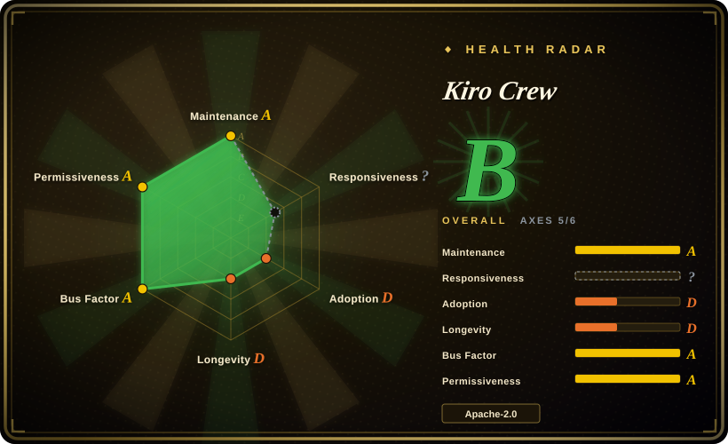
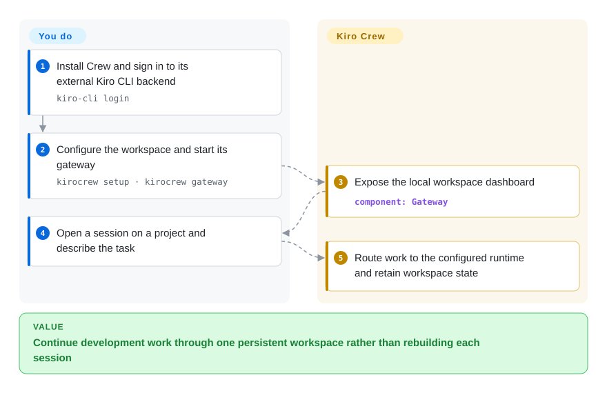
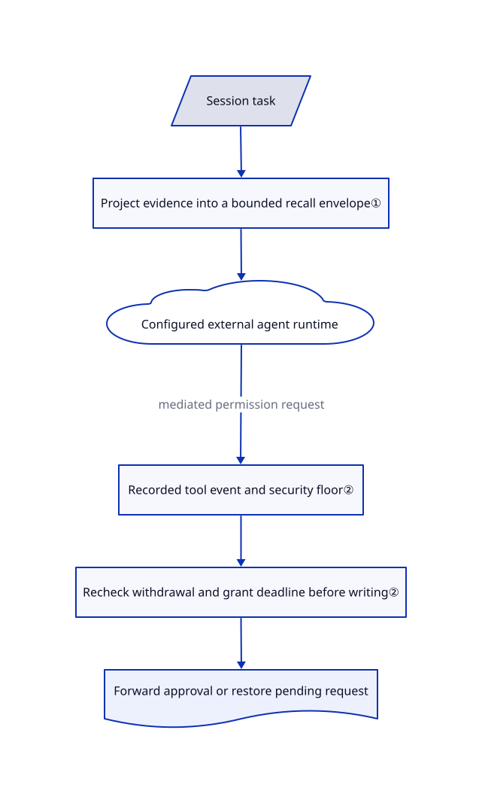

# Kiro Crew

Your overnight coding task loses its conversation, schedule and lessons when a terminal closes. Kiro Crew keeps those in a persistent gateway and connects a desktop, browser and messaging channels to existing agent runtimes.

## When to use

You maintain several repositories and want to ask for work from a browser, return tomorrow, and still find its sessions, scheduled jobs and remembered corrections. You already have an agent CLI and its model account. Kiro Crew supplies the persistent workspace around that runtime, rather than asking you to build a memory service and scheduler beside every conversation.

Choose it over a bare agent CLI when continuity and unattended work matter more than keeping a single process. Choose it over a company-style board when conversations and learned context, rather than organization charts and ticket budgets, are your main unit of work. You still own credentials, host access, model costs and acceptance of the changes.

## When NOT to use

- **One interactive coding session is enough.** Use your existing CLI rather than operating a gateway, dashboard, memory store and update channel.
- **The missing layer is containerized collaboration across mixed agents.** Evaluate [Scion](scion.md), which makes workspace and container provisioning central; Kiro Crew's permission transport is not by itself an OS isolation boundary.
- **The main problem is staffing a standing agent organization with ticket ownership and budgets.** Prefer [Paperclip](../../../agent-tooling/supervision-surfaces/agent-cockpits/paperclip.md). A persistent conversation workspace is not the same management model.
- **You only want a browser console over remote agent backends.** Compare [OpenHands](openhands.md) before adopting Kiro Crew's broader memory, apps and background-work surface.
- **Your policy forbids default outbound usage reporting.** The README documents enabled-by-default daily usage heartbeats and official-app install receipts. Disable them explicitly and audit the chosen runtime's separate network behavior; a local gateway does not make model calls local.

## Comparison

| Alternative | In index | Our verdict | Tradeoff |
|---|---|---|---|
| [OpenHands](openhands.md) | Indexed | Pick OpenHands for a browser dispatch desk across remote agent servers; pick Kiro Crew when persistent memories, lessons and messaging continuity are the reason to add a workspace. | Both add operational services around existing agents; their backend and state models differ. |
| [Scion](scion.md) | Indexed | Pick Scion when explicit containerized team workspaces decide the choice; pick Kiro Crew for a continuously available personal development workspace. | Scion makes images and brokers part of your setup; Kiro Crew adds memory and app lifecycle concerns. |
| [Paperclip](../../../agent-tooling/supervision-surfaces/agent-cockpits/paperclip.md) | Indexed | Pick Paperclip for organization goals, ticket checkout and per-agent budgets; pick Kiro Crew when conversation state and learned context must survive sessions. | A ticket-management control plane trades conversational integration for explicit organizational bookkeeping. |

## Quick start

The [README](https://github.com/kirodotdev/KiroCrew/blob/66a137266f935c4189cda79fb26c4db66b8968a3/README.md#quick-start) offers signed desktop packages, a shell installer and a Docker image. For the documented default backend, install `kiro-cli` separately and sign in with `kiro-cli login`; this is the external agent runtime, not a model included in the gateway. After installing Kiro Crew, run `kirocrew setup`, then `kirocrew gateway`, and open the local dashboard at `http://localhost:5476` to give a session its project and task. Kiro Crew keeps the workspace and routes the conversation to the configured runtime; you provide its account, machine permissions and review of resulting edits. Source builds require Python 3.12+, Node.js 22.12+ and npm; no installation or upstream execution was performed for this page.

<!-- flow-steps:begin (generated from flows/kirocrew.json by tools/flow_card.py — do not edit) -->

Text version of the flow

1. **You**: Install Crew and sign in to its external Kiro CLI backend — `kiro-cli login`
2. **You**: Configure the workspace and start its gateway — `kirocrew setup · kirocrew gateway`
3. **Kiro Crew**: Expose the local workspace dashboard — component: `Gateway`
4. **You**: Open a session on a project and describe the task
5. **Kiro Crew**: Route work to the configured runtime and retain workspace state

**Value**: Continue development work through one persistent workspace rather than rebuilding each session

<!-- flow-steps:end -->

## Key techniques

<!-- mechanism:begin (generated from mechanisms/kirocrew.json by tools/mechanism_card.py; do not edit) -->

Text version of the mechanism

- Session task
- Project evidence into a bounded recall envelope①
- Configured external agent runtime
- Recorded tool event and security floor②
- Recheck withdrawal and grant deadline before writing②
- Forward approval or restore pending request

- Session task → Project evidence into a bounded recall envelope①
- Project evidence into a bounded recall envelope① → Configured external agent runtime
- Configured external agent runtime → Recorded tool event and security floor② (mediated permission request)
- Recorded tool event and security floor② → Recheck withdrawal and grant deadline before writing②
- Recheck withdrawal and grant deadline before writing② → Forward approval or restore pending request

<!-- mechanism:end -->

### 1. Bound recalled evidence, not just its text

- **Problem:** A small memory snippet can still produce a large tool response once evidence metadata and JSON escaping are included.
- **How:** The recall layer projects evidence fields and accounts for the complete encoded payload. Its MCP mode also budgets the outer text-content envelope and framing reserve; it first shortens large snippets with truncation markers, then removes tail records or the lesson block as needed, regenerating matching context.
- **Limits:** The payload cap is 16,384 bytes, not a promise to return every relevant memory. Caller-supplied arbitrarily large JSON-RPC identifiers are outside this memory-data bound, and embedding identity is explicitly not proof of retrieval calibration.
- **Source:** [Payload accounting and limits](https://github.com/kirodotdev/KiroCrew/blob/66a137266f935c4189cda79fb26c4db66b8968a3/src/kiro_crew/memory_recall.py#L13-L19), [evidence projection and envelope](https://github.com/kirodotdev/KiroCrew/blob/66a137266f935c4189cda79fb26c4db66b8968a3/src/kiro_crew/memory_recall.py#L92-L208), [budget reduction](https://github.com/kirodotdev/KiroCrew/blob/66a137266f935c4189cda79fb26c4db66b8968a3/src/kiro_crew/memory_recall.py#L269-L332).

### 2. Recheck approval at the transport boundary

- **Problem:** A UI approval can become stale while waiting for a runtime write lock, or arrive without sufficient tool identity for policy evaluation.
- **How:** `approve_tool` refuses requests lacking a recorded gate event and applies a security floor before forwarding approval. Timed grants and withdrawal checks run again around the final response write; an expired or withdrawn grant restores pending request records.
- **Limits:** This governs requests reaching this ACP permission path. It is not evidence that every external runtime action is mediated, nor a substitute for sandboxing or reviewing the runtime's own permissions.
- **Source:** [Approval floor, deadline and withdrawal handling](https://github.com/kirodotdev/KiroCrew/blob/66a137266f935c4189cda79fb26c4db66b8968a3/src/kiro_crew/acp/session_handle_permissions.py#L65-L189).

## Tech stack

Python gateway with an `aiohttp` HTTP layer, a TypeScript web interface and desktop packaging. Agent integration uses ACP, a protocol for connecting external agent processes. The package declares NumPy, JSON Schema validation, cron parsing, Slack SDK and WebSocket dependencies in [setup.cfg](https://github.com/kirodotdev/KiroCrew/blob/66a137266f935c4189cda79fb26c4db66b8968a3/setup.cfg#L1-L75).

## Dependencies

- An installed, authenticated backend CLI; the default is `kiro-cli`. Model access and billing remain external.
- A host that can keep the gateway running, storage for sessions and memory, and credentials for any enabled messaging integrations.
- Python 3.12+ for source/wheel use; Node.js 22.12+ and npm for building the web interface. Docker is an alternative distribution, not a universal requirement.

## Ops difficulty

**Medium.** A personal loopback deployment avoids a separate fleet control plane, but a continuous gateway still needs updates, backups and deliberate permissions. Data lives under `~/.kiro/crew` by default; removing the application is not the same as deleting session or credential data. Remote exposure, channels, installed apps and external runtimes each add their own trust boundary. The documented outbound-reporting controls are separate from local performance telemetry.

## Health & viability

- **2026-11-01 maintenance:** the latest sampled release is v0.11.1, published 2026-10-31; the reviewed manifest is already 0.12.0. Pin a distribution channel rather than treating main as the released binary.
- **Governance:** the public repository belongs to the Kiro organization and publishes contribution and security-reporting procedures. The sampled top five contributors all have hundreds of contributions; that is broader visible participation, not proof of independent governance or a support SLA.
- **Age and viability:** created 2026-07-16, it is less than four months old. [推断: based on creation and release dates] Active releases improve short-term confidence, but it has not earned a long-lived maintenance prior.
- **Measured coverage:** the automatic radar is B with five of six axes scored. Responsiveness has `no_window_signal`, not a measured poor response time; the aggregate is not a security or project-quality verdict.
- **License and risk:** the root LICENSE is Apache-2.0; external agent accounts, bundled third-party materials and model services retain their separate terms. The principal adoption cost is trusting a fast-changing, persistent host-access application, not merely reading its dashboard.

## Caveats (unverified)

- [未验证: upstream installation and execution prohibited in this batch] Installation, restart recovery, permission enforcement across every supported backend, and cross-platform behavior were researched statically, not reproduced.
- [未验证: receiving service not audited] The README's telemetry field list and CDN logging claims describe upstream policy; this page does not independently certify the receiving service or anonymity.
- [推断: based on creation and release records] Short-term development activity does not establish long-term durability. Full dependency ownership and third-party license compliance were not exhaustively audited.
- [未验证: upstream moved during scoring] Sources were reviewed at `66a137266f935c4189cda79fb26c4db66b8968a3`; the automatic upstream snapshot records a later observation, not a review of that intervening change.
