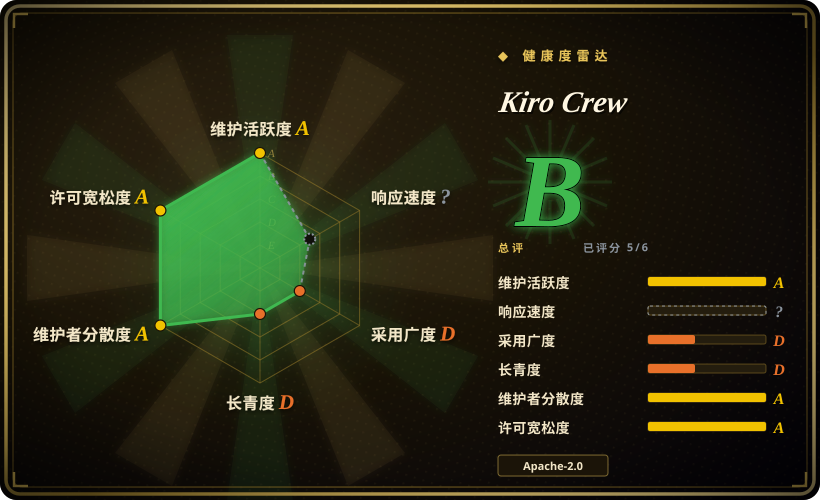
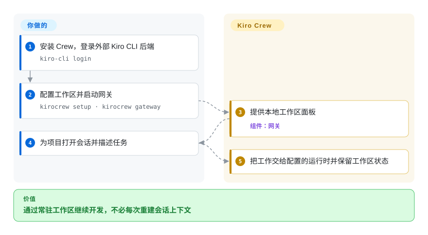
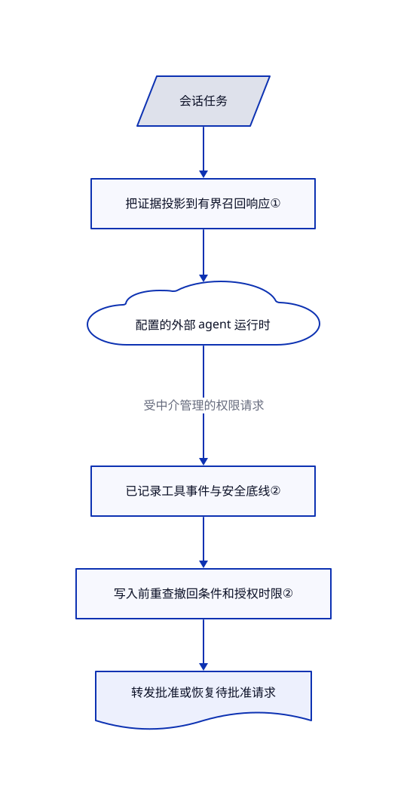

# Kiro Crew

终端一关，隔夜编码任务的对话、定时工作和纠正记录就散了。Kiro Crew 用常驻网关保存这些状态，让桌面、浏览器和消息渠道连接已有的 agent 运行时。

## 何时使用

你维护几个仓库，希望从浏览器交办任务，第二天仍能找到会话、定时工作和记住的纠正。你已有 agent CLI 和模型账号。Kiro Crew 补上运行时周围的常驻工作区，不必再为每段对话另接记忆服务和调度器。

当跨会话连续性和无人值守工作比单进程简单性更重要时，选它而非裸 CLI。当你管理的主要对象是会话和积累的上下文，而非组织图和工单预算时，选它而非公司式看板。凭据、主机权限、模型费用和改动验收仍由你负责。

## 何时不用

- **一个交互式编码会话已经够用。** 直接用已有 CLI，不必再运维网关、面板、记忆存储和更新渠道。
- **你缺的是混合 agent 的容器化协作环境。** 比较 [Scion](scion.zh.md)，它把工作区和容器供应放在核心位置；Kiro Crew 的权限传输本身不是操作系统隔离边界。
- **你要管理常驻 agent 组织的工单归属和预算。** 优先看 [Paperclip](../../../agent-tooling/supervision-surfaces/agent-cockpits/paperclip.zh.md)。持久会话工作区不是同一种管理模型。
- **你只要浏览器控制远端 agent 后端。** 先比较 [OpenHands](openhands.zh.md)，再决定是否承担 Kiro Crew 更广的记忆、应用和后台工作面。
- **你的政策禁止默认对外报告用量。** README 说明每日使用心跳和官方应用安装回执默认开启。应明确关闭，并另审所选运行时的联网行为；网关在本机不代表模型调用也在本机。

## 横向对比

| 替代品 | 是否收录 | 我们的评价 | 取舍 |
|---|---|---|---|
| [OpenHands](openhands.zh.md) | 已收录 | 要浏览器调度多个远端 agent 服务，选 OpenHands；要保留记忆、经验和消息渠道连续性，选 Kiro Crew。 | 两者都在已有 agent 周围增加运维服务，但后端和状态模型不同。 |
| [Scion](scion.zh.md) | 已收录 | 容器化团队工作区是硬条件时，选 Scion；需要持续在线的个人开发工作区时，选 Kiro Crew。 | Scion 要管理镜像和 broker；Kiro Crew 增加记忆及应用生命周期管理。 |
| [Paperclip](../../../agent-tooling/supervision-surfaces/agent-cockpits/paperclip.zh.md) | 已收录 | 要组织目标、工单领取和单 agent 预算，选 Paperclip；要让对话状态及学到的上下文跨会话保留，选 Kiro Crew。 | 工单控制面换来明确的组织管理，但不是同样的会话集成。 |

## 快速上手

[README](https://github.com/kirodotdev/KiroCrew/blob/66a137266f935c4189cda79fb26c4db66b8968a3/README.md#quick-start) 提供签名桌面包、Shell 安装器和 Docker 镜像。使用文档默认后端时，先单独安装 `kiro-cli`，再用 `kiro-cli login` 登录；这是外部 agent 运行时，不是网关附带的模型。安装 Kiro Crew 后，运行 `kirocrew setup`，再运行 `kirocrew gateway`，打开 `http://localhost:5476`，给会话指定项目和任务。它维护工作区并把对话交给配置的运行时；你提供账号、机器权限，并审查最终修改。源码构建要求 Python 3.12+、Node.js 22.12+ 和 npm；本页没有执行安装或上游代码。

<!-- flow-steps:begin (generated from flows/kirocrew.json by tools/flow_card.py — do not edit) -->

流程文字版

1. **你**：安装 Crew，登录外部 Kiro CLI 后端 — `kiro-cli login`
2. **你**：配置工作区并启动网关 — `kirocrew setup · kirocrew gateway`
3. **Kiro Crew**：提供本地工作区面板 — 组件：`网关`
4. **你**：为项目打开会话并描述任务
5. **Kiro Crew**：把工作交给配置的运行时并保留工作区状态

**价值**：通过常驻工作区继续开发，不必每次重建会话上下文

<!-- flow-steps:end -->

## 技术要点

<!-- mechanism:begin (generated from mechanisms/kirocrew.json by tools/mechanism_card.py; do not edit) -->

机制文字版

- 会话任务
- 把证据投影到有界召回响应①
- 配置的外部 agent 运行时
- 已记录工具事件与安全底线②
- 写入前重查撤回条件和授权时限②
- 转发批准或恢复待批准请求

- 会话任务 → 把证据投影到有界召回响应①
- 把证据投影到有界召回响应① → 配置的外部 agent 运行时
- 配置的外部 agent 运行时 → 已记录工具事件与安全底线②（受中介管理的权限请求）
- 已记录工具事件与安全底线② → 写入前重查撤回条件和授权时限②
- 写入前重查撤回条件和授权时限② → 转发批准或恢复待批准请求

<!-- mechanism:end -->

### 1. 限制完整召回证据，不只限制文字

- **解决：** 记忆片段虽短，证据元数据和 JSON 转义仍会让工具响应膨胀。
- **做法：** 召回层先筛选证据字段，再计算整个编码响应的大小。MCP 模式还计算外层文字内容封装和协议余量；先缩短大段片段并标记截断，再按需移除尾部记录或经验块，同步重建上下文。
- **边界：** 上限为 16384 字节，不承诺返回全部相关记忆。调用方传入的任意长 JSON-RPC 标识不在记忆数据边界内；嵌入模型身份也不等于召回阈值已经校准。
- **源码：** [响应预算与边界](https://github.com/kirodotdev/KiroCrew/blob/66a137266f935c4189cda79fb26c4db66b8968a3/src/kiro_crew/memory_recall.py#L13-L19)、[证据投影和封装](https://github.com/kirodotdev/KiroCrew/blob/66a137266f935c4189cda79fb26c4db66b8968a3/src/kiro_crew/memory_recall.py#L92-L208)、[超限收缩](https://github.com/kirodotdev/KiroCrew/blob/66a137266f935c4189cda79fb26c4db66b8968a3/src/kiro_crew/memory_recall.py#L269-L332)。

### 2. 在传输边界再次检查批准

- **解决：** 界面批准等待运行时写锁时可能过期，也可能缺少足够工具身份供策略判断。
- **做法：** `approve_tool` 拒绝没有记录门禁事件的请求，转发批准前先检查安全底线。带时限的授权和撤回条件在最终响应写入前再次检查；授权过期或撤回时恢复待批准记录。
- **边界：** 这只管理进入该 ACP 权限路径的请求，不证明所有外部运行时动作都经过它，也不能替代沙箱和运行时自身权限审查。
- **源码：** [批准底线、时限及撤回处理](https://github.com/kirodotdev/KiroCrew/blob/66a137266f935c4189cda79fb26c4db66b8968a3/src/kiro_crew/acp/session_handle_permissions.py#L65-L189)。

## 技术栈

Python 网关使用 `aiohttp` 提供 HTTP 服务，配有 TypeScript 网页界面和桌面打包。agent 通过 ACP 协议连接外部进程。[setup.cfg](https://github.com/kirodotdev/KiroCrew/blob/66a137266f935c4189cda79fb26c4db66b8968a3/setup.cfg#L1-L75) 声明 NumPy、JSON Schema 校验、定时表达式解析、Slack SDK 和 WebSocket 依赖。

## 依赖

- 已安装并登录的后端 CLI，默认是 `kiro-cli`；模型访问和账单在外部。
- 能持续运行网关的主机、会话和记忆存储，以及启用消息集成所需凭据。
- 源码或 wheel 安装需要 Python 3.12+；构建网页需要 Node.js 22.12+ 和 npm。Docker 是分发选择，不是所有路径的必需依赖。

## 运维难度

**中。** 个人回环地址部署不必另建集群控制面，但常驻网关仍需升级、备份和审慎配置权限。数据默认在 `~/.kiro/crew`，卸载程序不等于删除会话和凭据数据。远端暴露、消息渠道、已装应用和外部运行时各有信任边界。文档中的对外报告开关与本地性能遥测分开。

## 健康度与可持续性

- **维护情况，2026-11-01：** 抽样发行的最新版本为 v0.11.1，发布于 2026-10-31；已读源码清单已经是 0.12.0。应锁定分发渠道，不把主干当已发布二进制。
- **治理：** 仓库属于 Kiro 组织，公开贡献流程和安全报告入口。抽样前五位贡献者均有数百次贡献，说明公开参与面较广，不证明独立治理或服务承诺。
- **年龄和持续性：** 仓库创建于 2026-07-16，尚不足四个月。[推断：依据是仓库创建时间及近期发布] 活跃发布增加短期信心，但不足以建立长期维护先验。
- **机器覆盖率：** 自动雷达为 B，六轴中五轴有评分。响应轴的 `no_window_signal` 表示没有窗口样本，不是已测得响应差；总评不是安全或项目质量结论。
- **许可和风险：** 根 LICENSE 为 Apache-2.0；外部 agent 账号、第三方材料和模型服务仍有各自条款。采用它意味着信任一个快速变化、长期持有主机操作权限的应用，不只是读面板。

## 存疑（未验证）

- [未验证：本轮禁止安装或执行上游] 安装、重启恢复、全部后端的权限覆盖和跨平台行为均只做静态研究，没有复现。
- [未验证：未审计接收方服务] README 的遥测字段及 CDN 日志说明是上游政策，本页没有独立认证接收服务或匿名性。
- [推断：依据是创建日期和发布记录] 短期开发活跃不证明长期耐久；本轮没有穷尽全部依赖权属和第三方许可合规。
- [未验证：评分期间上游前进] 源码审阅点为 `66a137266f935c4189cda79fb26c4db66b8968a3`；自动快照记录的是更晚的观察，不代表已审阅中间变化。
