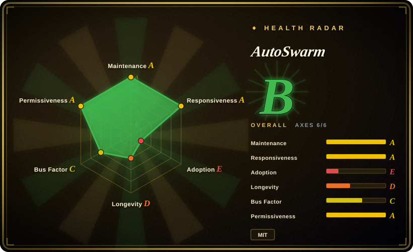
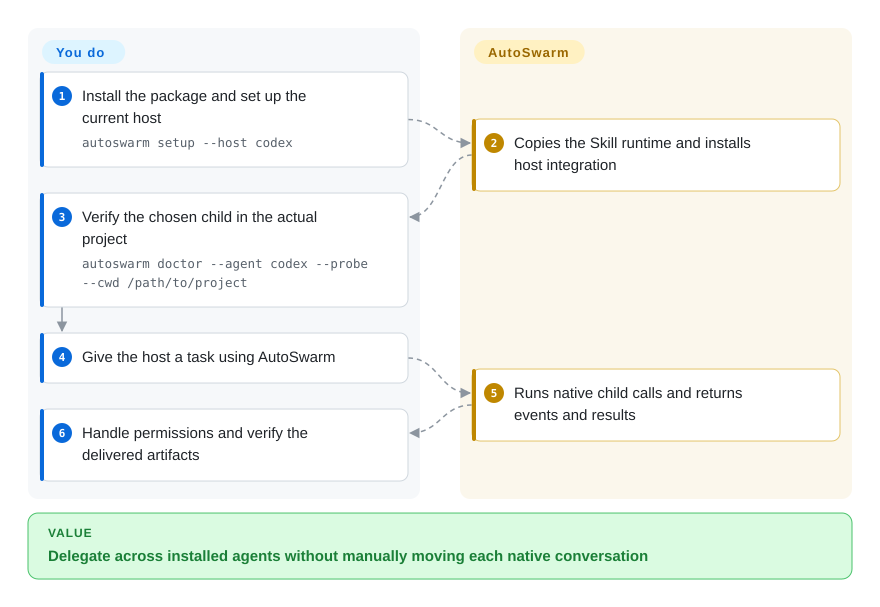
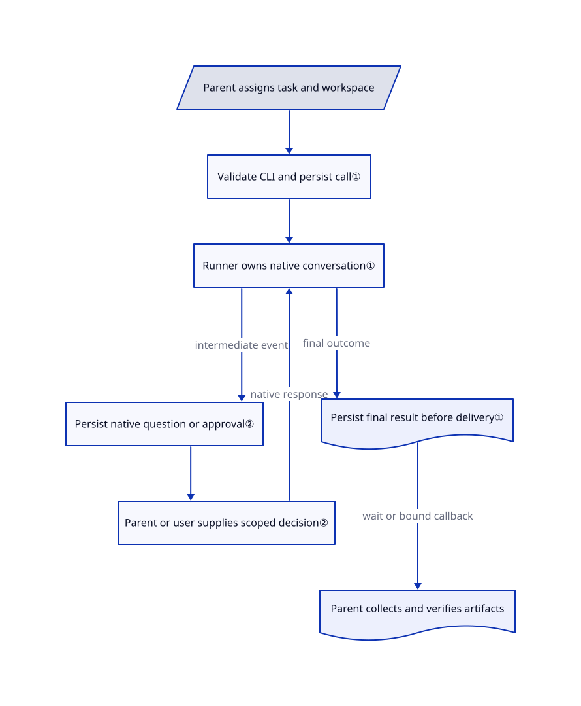

# AutoSwarm

You keep pasting work between Codex, Claude Code and other agent terminals. AutoSwarm lets your current agent delegate through their native CLIs and collect results, questions and permission requests in the same conversation.

## When to use

You already have authenticated coding agents on your workstation. One should investigate a failure while another reviews the patch, but you keep moving prompts, copying results and reopening the right child conversation. You want a common delegation interface without replacing each agent's native model configuration, tools or session history.

Choose AutoSwarm when the missing piece is this conversation-to-CLI bridge, not a desktop task board or a prescribed development pipeline. Unlike container-oriented [Scion](../scion.md), it launches local native processes without a Hub. Unlike [oh-my-claudecode](../oh-my-claudecode.md), its core does not impose a Claude-led plan-to-fix pipeline. The parent agent still chooses the work split, prepares separate workspaces and judges the results. This page covers the root v2 implementation, not the frozen v1 company-style application under `autoswarm-v1.0.0/`.

## When NOT to use

- **You need automatic branch isolation and PR supervision.** Pick [Agent Orchestrator](../../../../agent-tooling/supervision-surfaces/agent-cockpits/agent-orchestrator.md) for task worktrees and CI/review feedback. AutoSwarm accepts an existing working directory; two children can edit the same files unless you separate them.
- **You need container workspaces and hosted execution infrastructure.** Evaluate [Scion](../scion.md). AutoSwarm's file locks serialize session bookkeeping, not untrusted code or filesystem access; native credentials and project configuration remain in use.
- **You want a ready-made planning, implementation and verification loop.** Pick [oh-my-claudecode](../oh-my-claudecode.md) inside Claude Code. AutoSwarm's Skill asks the parent to coordinate and verify; a completed native call is not task acceptance.
- **Every permission must require a human.** Keep the native CLI's direct approval surface rather than adopting this bridge unchanged. Parent-agent approval delegation defaults to enabled; disabling it enforces a parent/user source convention, not independent human identity authentication. The Nanobot bridge additionally defaults to native Full Access, with an explicit restricted-mode option.
- **You expect every idle desktop app to wake automatically.** Use explicit collection in your existing agent, or [Agent Orchestrator](../../../../agent-tooling/supervision-surfaces/agent-cockpits/agent-orchestrator.md) for visible desktop supervision. AutoSwarm callbacks require a supported binding; a Codex thread ID alone is insufficient, and most hosts use in-turn waiting.

## Comparison

| Alternative | In index | Our verdict | Tradeoff |
|---|---|---|---|
| [oh-my-claudecode](../oh-my-claudecode.md) | ✅ | Choose OMC for a Claude-led plan-to-verify workflow; choose AutoSwarm when an existing parent needs native calls and resumes across installed agent products. | OMC supplies process and routing conventions. AutoSwarm keeps the bridge smaller but leaves scheduling and acceptance to the parent. |
| [Scion](../scion.md) | ✅ | Choose Scion when agents need container workspaces and local-to-hosted infrastructure; choose AutoSwarm for delegation on an already configured workstation. | AutoSwarm avoids images and a Hub, but adds no container isolation or workspace provisioning. |
| [Agent Orchestrator](../../../../agent-tooling/supervision-surfaces/agent-cockpits/agent-orchestrator.md) | ✅ | Choose AO when humans supervise branches, PRs and CI on a desktop; choose AutoSwarm when the coordinating interface should remain the current agent conversation. | AO owns a visual task lifecycle and worktrees. AutoSwarm retains native sessions and lightweight call records, but you arrange branch safety and review. |

## Quick start

The [pinned README](https://github.com/HKUDS/AutoSwarm/blob/5325b6d98dad7a9a12811c0b5fa0817ffbbc71f9/README.md#for-agents-how-to-use-autoswarm) installs the root package with `uv tool install --force .` after cloning, then runs `autoswarm setup --host codex` for a Codex host. Setup copies a Skill and its own runtime; Claude Code setup also writes user hooks, while OpenCode setup writes a plugin. Read the installed Skill and use its exact launcher, then verify the chosen child in the real project with `autoswarm doctor --agent codex --probe --cwd /path/to/project`; this makes paid model calls and tests native resume. Give the host a task; it delegates work and collects intermediate questions, approvals and final results through the launcher. You supply installed and authenticated CLIs, permissions, separate editing directories, model spend and artifact verification; the bridge does not provide a model service or acceptance oracle. Updating the package alone does not refresh the copied Skill runtime: rerun setup and reload the host as documented.

<!-- flow-steps:begin (generated from flows/autoswarm.json by tools/flow_card.py — do not edit) -->

Text version of the flow

1. **You**: Install the package and set up the current host — `autoswarm setup --host codex`
2. **AutoSwarm**: Copies the Skill runtime and installs host integration
3. **You**: Verify the chosen child in the actual project — `autoswarm doctor --agent codex --probe --cwd /path/to/project`
4. **You**: Give the host a task using AutoSwarm
5. **AutoSwarm**: Runs native child calls and returns events and results
6. **You**: Handle permissions and verify the delivered artifacts

**Value**: Delegate across installed agents without manually moving each native conversation

<!-- flow-steps:end -->

## Key techniques

<!-- mechanism:begin (generated from mechanisms/autoswarm.json by tools/mechanism_card.py; do not edit) -->

Text version of the mechanism

- Parent assigns task and workspace
- Validate CLI and persist call①
- Runner owns native conversation①
- Persist native question or approval②
- Parent or user supplies scoped decision②
- Persist final result before delivery①
- Parent collects and verifies artifacts

- Parent assigns task and workspace → Validate CLI and persist call①
- Validate CLI and persist call① → Runner owns native conversation①
- Runner owns native conversation① → Persist native question or approval② (intermediate event)
- Persist native question or approval② → Parent or user supplies scoped decision②
- Parent or user supplies scoped decision② → Runner owns native conversation① (native response)
- Runner owns native conversation① → Persist final result before delivery① (final outcome)
- Persist final result before delivery① → Parent collects and verifies artifacts (wait or bound callback)

<!-- mechanism:end -->

### 1. Preserve each native conversation behind a per-call runner

- **Problem:** Restarting a CLI loses context; rerunning after a delivery failure can duplicate file changes.
- **How:** The engine validates the native executable, writes a task record and starts one runner. The runner publishes the final result before attempting host delivery. Resume creates another call using the retained native session ID, leaving the earlier result intact.
- **Limits:** This is local execution, not a sandbox or worktree allocator. A stored completed result proves a native call ended, not that its artifacts passed review; failed notification must not be confused with failed execution.
- **Source:** [Call creation and inspection](https://github.com/HKUDS/AutoSwarm/blob/5325b6d98dad7a9a12811c0b5fa0817ffbbc71f9/src/autoswarm/engine.py#L31-L92), [native resume](https://github.com/HKUDS/AutoSwarm/blob/5325b6d98dad7a9a12811c0b5fa0817ffbbc71f9/src/autoswarm/engine.py#L151-L160), [result publication before delivery](https://github.com/HKUDS/AutoSwarm/blob/5325b6d98dad7a9a12811c0b5fa0817ffbbc71f9/src/autoswarm/runner.py#L149-L188).

### 2. Return intermediate permissions without declaring the task finished

- **Problem:** Waiting only for a final answer deadlocks when a child needs permission or user input.
- **How:** A broker persists each native request and its supported response scope. The collection loop returns approval, interaction and message events before final completion. Decisions are locked, tied to the original request and invalidated when withdrawn or finished.
- **Limits:** Parent delegation defaults to true. The actor field is a local convention, not a security identity; Nanobot lacks the same native approval relay and defaults to Full Access. Native restrictions and explicit user authorization still matter.
- **Source:** [Default delegation and decision checks](https://github.com/HKUDS/AutoSwarm/blob/5325b6d98dad7a9a12811c0b5fa0817ffbbc71f9/src/autoswarm/approvals.py#L14-L111), [request broker](https://github.com/HKUDS/AutoSwarm/blob/5325b6d98dad7a9a12811c0b5fa0817ffbbc71f9/src/autoswarm/approvals.py#L166-L255), [event-aware wait](https://github.com/HKUDS/AutoSwarm/blob/5325b6d98dad7a9a12811c0b5fa0817ffbbc71f9/src/autoswarm/engine.py#L139-L148), [Nanobot permission boundary](https://github.com/HKUDS/AutoSwarm/blob/5325b6d98dad7a9a12811c0b5fa0817ffbbc71f9/docs/architecture.zh-CN.md#L45-L69).

## Tech stack

Python 3.10+; Hatchling packaging; no declared third-party runtime dependencies in the root package. Native adapters use subprocess transports, JSON-RPC, stream-JSON, ACP and local HTTP according to provider. Records are local files rather than a shared database. See the [manifest](https://github.com/HKUDS/AutoSwarm/blob/5325b6d98dad7a9a12811c0b5fa0817ffbbc71f9/pyproject.toml) and [provider invocation builder](https://github.com/HKUDS/AutoSwarm/blob/5325b6d98dad7a9a12811c0b5fa0817ffbbc71f9/src/autoswarm/providers.py).

## Dependencies

- A Python interpreter plus the native CLIs you actually delegate to; each retains its authentication, tools, project context and model/network requirements.
- A host capable of command execution. Native asynchronous return additionally needs the host's actual session connection, Claude hooks or OpenCode plugin; ordinary delegation can use explicit waiting.
- No root-package database, model weights or GPU requirement. Do not inherit the archived v1 dependency environment; the root README explicitly separates it.

## Ops difficulty

**Medium.** The bridge avoids a persistent central service, but you maintain multiple native CLI versions and authentication states. Setup writes outside the project, and the copied runtime requires explicit updates. Preserve call records and logs for uncertain deliveries, allocate separate workspaces before parallel edits, and define cancellation, retention and cost policies yourself: the core adds no fixed task timeout or record expiry. See [setup implementation](https://github.com/HKUDS/AutoSwarm/blob/5325b6d98dad7a9a12811c0b5fa0817ffbbc71f9/src/autoswarm/setup.py#L14-L80) and [state boundaries](https://github.com/HKUDS/AutoSwarm/blob/5325b6d98dad7a9a12811c0b5fa0817ffbbc71f9/docs/architecture.zh-CN.md#L89-L113).

## Health & viability

- **Maintenance, 2026-10-28:** not archived; pushed 2026-10-27. Root metadata identifies `2.0.0.dev0`; the releases API returns no GitHub releases. The complete v1 archive is frozen at 2026-10-20, so its UI and dependencies must not be attributed to the new root.
- **Backing and governance:** HKUDS organization ownership and named paper authors provide attribution, not a support contract. The repository includes contribution guidance and a root test suite; no foundation governance was identified in the inspected root tree.
- **Age and adoption:** created 2026-07-01, under four months old; 2,046 stars and 370 forks at collection. [推断: short history plus the v2 rewrite] Evaluate it as a young integration layer, not a stable long-term protocol or evidence of production adoption. The automated scorer measures eight active contributors and a 66% top-contributor share; its adoption lookup found no linked packages, not proof of no users.
- **License and risk:** the root MIT text names OpenOPC Authors; the [archive's rename note](https://github.com/HKUDS/AutoSwarm/blob/5325b6d98dad7a9a12811c0b5fa0817ffbbc71f9/autoswarm-v1.0.0/README.md#L208-L210) identifies the older name. Native protocol compatibility, global host integration, approval defaults and sensitive local records matter more than star growth. Source inspection is not an end-to-end compatibility test.

## Caveats (unverified)

- [未验证: upstream execution and model calls were prohibited for this intake] Installation, callbacks, cross-platform operation and child-tool compatibility were not exercised; sources establish implementation paths, not live reliability.
- [推断: based on repository age and the archived-v1/current-v2 split] Longevity and interface stability remain unproven despite recent commits.
- [未验证: contributor attribution is not a staffing or legal audit] Organizational ownership does not establish funded maintenance or complete third-party rights clearance; the MIT holder is quoted as written, not independently authenticated.
