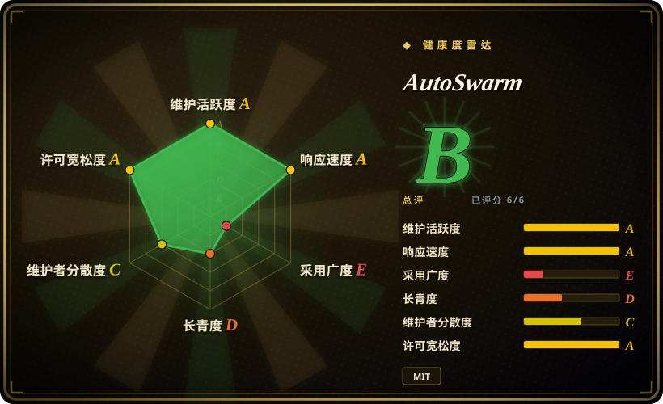
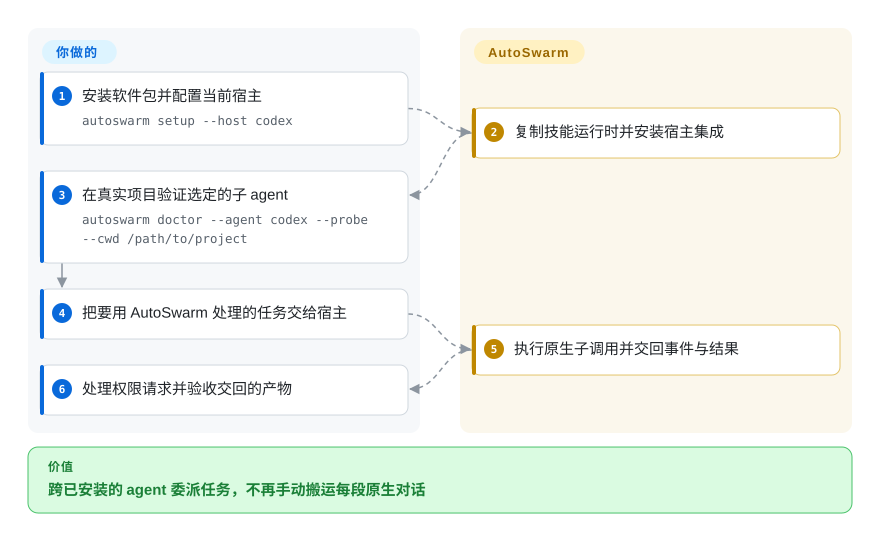
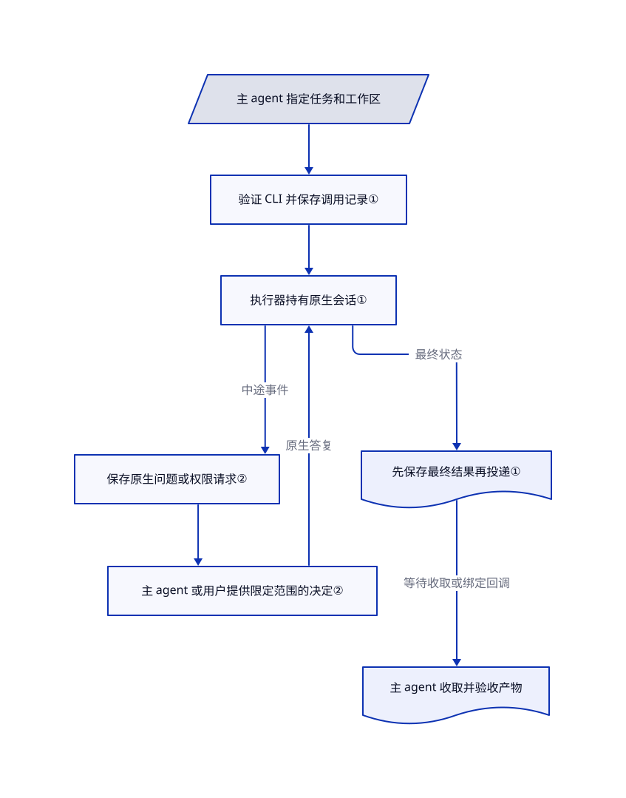

# AutoSwarm

你在几个 agent 终端间反复粘贴任务和结果。AutoSwarm 让当前 agent 调用其他产品的原生命令行，并在原对话收回结果、提问和权限请求。

## 何时使用

你的电脑上已经配置并登录了多种编码 agent。你想让一个查故障，另一个审补丁，却总要手动搬运提示词、复制结果，再找回对应子会话。你缺的是统一委派入口，不想替换每个产品已有的模型配置、工具和会话历史。

当缺口是“当前对话调用其他 CLI”，而非桌面任务看板或固定开发流水线时，选 AutoSwarm。与容器化的 [Scion](../scion.zh.md) 相比，它直接启动本机原生进程，不需要控制中心。与 [oh-my-claudecode](../oh-my-claudecode.zh.md) 相比，核心不强加 Claude 主导的规划到返工流程。主 agent 仍负责拆任务、分开编辑目录和验收结果。本页介绍根目录的 v2，不把 `autoswarm-v1.0.0/` 中冻结的公司式旧应用混进来。

## 何时不用

- **需要自动隔离分支并监管 PR。** 选 [Agent Orchestrator](../../../../agent-tooling/supervision-surfaces/agent-cockpits/agent-orchestrator.zh.md)，它提供任务工作树和 CI／评审反馈。AutoSwarm 接受已有工作目录；不主动分开时，两个子 agent 可以修改同一份文件。
- **需要容器工作区与托管执行基础设施。** 评估 [Scion](../scion.zh.md)。AutoSwarm 的文件锁保护会话记账，不隔离不可信代码或文件访问；原生凭据和项目配置仍会生效。
- **需要现成的规划、实现、验证循环。** 在 Claude Code 内选 [oh-my-claudecode](../oh-my-claudecode.zh.md)。AutoSwarm 的技能要求主 agent 协调和验证；原生调用完成不等于任务通过验收。
- **每次权限都必须由人确认。** 保留原生 CLI 的直接批准界面，不要原样采用此桥接器。主 agent 代批默认开启；关闭后执行的是 parent／user 来源约定，不是独立的人类身份认证。Nanobot 桥接还默认采用原生 Full Access，可显式改用受限模式。
- **期待所有空闲桌面应用都会自动续跑。** 在现有 agent 中显式收取结果，或用 [Agent Orchestrator](../../../../agent-tooling/supervision-surfaces/agent-cockpits/agent-orchestrator.zh.md) 做可视监管。AutoSwarm 回调需要支持的宿主绑定；仅有 Codex 线程 ID 不够，多数宿主依靠当前轮等待。

## 横向对比

| 替代品 | 是否收录 | 我们的评价 | 取舍 |
|---|---|---|---|
| [oh-my-claudecode](../oh-my-claudecode.zh.md) | 已收录 | 要 Claude 主导的规划到验证流程，选 OMC；已有主 agent 只缺跨产品原生调用和续接时，选 AutoSwarm。 | OMC 提供流程与路由约定；AutoSwarm 缩小桥接层，但把调度和验收留给主 agent。 |
| [Scion](../scion.zh.md) | 已收录 | 要容器工作区和本机到托管的基础设施，选 Scion；只在已配置好的电脑上委派任务，选 AutoSwarm。 | AutoSwarm 省去镜像与控制中心，但不提供容器隔离或工作区创建。 |
| [Agent Orchestrator](../../../../agent-tooling/supervision-surfaces/agent-cockpits/agent-orchestrator.zh.md) | 已收录 | 人在桌面监管分支、PR 和 CI 时选 AO；希望协调入口始终是当前 agent 对话时，选 AutoSwarm。 | AO 接管可视任务生命周期和工作树；AutoSwarm 保留原生会话与轻量调用记录，但分支安全和评审要自己安排。 |

## 快速上手

[固定版本 README](https://github.com/HKUDS/AutoSwarm/blob/5325b6d98dad7a9a12811c0b5fa0817ffbbc71f9/README.md#for-agents-how-to-use-autoswarm) 的路径是克隆后用 `uv tool install --force .` 安装根包，再为 Codex 宿主执行 `autoswarm setup --host codex`。安装器复制技能和独立运行时；Claude Code 安装还会写用户 hooks，OpenCode 安装会写插件。读取安装后的技能，使用其准确启动参数，再在真实项目中执行 `autoswarm doctor --agent codex --probe --cwd /path/to/project`，它会付费调用模型并检查原生会话续接。把任务交给宿主后，主 agent 用启动器委派任务，收回中途提问、权限请求和最终结果。你提供已安装并认证的 CLI、权限、分开的编辑目录、模型费用和产物验收；桥接器不提供模型服务，也不能自动判断业务正确。仅更新软件包不会更新技能内复制的运行时，还要重新执行安装配置并按文档重载宿主。

<!-- flow-steps:begin (generated from flows/autoswarm.json by tools/flow_card.py — do not edit) -->

流程文字版

1. **你**：安装软件包并配置当前宿主 — `autoswarm setup --host codex`
2. **AutoSwarm**：复制技能运行时并安装宿主集成
3. **你**：在真实项目验证选定的子 agent — `autoswarm doctor --agent codex --probe --cwd /path/to/project`
4. **你**：把要用 AutoSwarm 处理的任务交给宿主
5. **AutoSwarm**：执行原生子调用并交回事件与结果
6. **你**：处理权限请求并验收交回的产物

**价值**：跨已安装的 agent 委派任务，不再手动搬运每段原生对话

<!-- flow-steps:end -->

## 技术要点

<!-- mechanism:begin (generated from mechanisms/autoswarm.json by tools/mechanism_card.py; do not edit) -->

机制文字版

- 主 agent 指定任务和工作区
- 验证 CLI 并保存调用记录①
- 执行器持有原生会话①
- 保存原生问题或权限请求②
- 主 agent 或用户提供限定范围的决定②
- 先保存最终结果再投递①
- 主 agent 收取并验收产物

- 主 agent 指定任务和工作区 → 验证 CLI 并保存调用记录①
- 验证 CLI 并保存调用记录① → 执行器持有原生会话①
- 执行器持有原生会话① → 保存原生问题或权限请求②（中途事件）
- 保存原生问题或权限请求② → 主 agent 或用户提供限定范围的决定②
- 主 agent 或用户提供限定范围的决定② → 执行器持有原生会话①（原生答复）
- 执行器持有原生会话① → 先保存最终结果再投递①（最终状态）
- 先保存最终结果再投递① → 主 agent 收取并验收产物（等待收取或绑定回调）

<!-- mechanism:end -->

### 1. 用每次调用的执行器保留原生会话

- **解决：** 重启 CLI 会丢上下文；投递失败后重新执行，可能重复修改文件。
- **做法：** 引擎先验证原生可执行文件，再写任务记录并启动独立执行器。执行器先保存最终结果，再尝试向宿主投递。续接使用保留的原生会话 ID 创建新调用，旧结果不被覆盖。
- **边界：** 这是本机执行，不是沙箱或工作树分配器。完成记录只说明原生调用结束，不说明产物通过评审；通知失败不能混同执行失败。
- **源码：** [创建与检查调用](https://github.com/HKUDS/AutoSwarm/blob/5325b6d98dad7a9a12811c0b5fa0817ffbbc71f9/src/autoswarm/engine.py#L31-L92)、[原生续接](https://github.com/HKUDS/AutoSwarm/blob/5325b6d98dad7a9a12811c0b5fa0817ffbbc71f9/src/autoswarm/engine.py#L151-L160)、[先保存再投递](https://github.com/HKUDS/AutoSwarm/blob/5325b6d98dad7a9a12811c0b5fa0817ffbbc71f9/src/autoswarm/runner.py#L149-L188)。

### 2. 中途交回权限请求，不冒充任务完成

- **解决：** 只等最终结果，会在子 agent 需要权限或用户回答时卡死。
- **做法：** 转接器持久化每个原生请求及支持的答复范围。收取循环会在任务完成前交回权限、交互和消息事件。决定加锁并绑定原请求，撤回或结束后失效。
- **边界：** 主 agent 代批默认开启。actor 字段是本机约定，不是安全身份；Nanobot 没有同等的原生批准转接，且默认 Full Access。原生限制与明确的用户授权仍然重要。
- **源码：** [默认代批与决定检查](https://github.com/HKUDS/AutoSwarm/blob/5325b6d98dad7a9a12811c0b5fa0817ffbbc71f9/src/autoswarm/approvals.py#L14-L111)、[请求转接](https://github.com/HKUDS/AutoSwarm/blob/5325b6d98dad7a9a12811c0b5fa0817ffbbc71f9/src/autoswarm/approvals.py#L166-L255)、[识别中途事件的等待](https://github.com/HKUDS/AutoSwarm/blob/5325b6d98dad7a9a12811c0b5fa0817ffbbc71f9/src/autoswarm/engine.py#L139-L148)、[Nanobot 权限边界](https://github.com/HKUDS/AutoSwarm/blob/5325b6d98dad7a9a12811c0b5fa0817ffbbc71f9/docs/architecture.zh-CN.md#L45-L69)。

## 技术栈

Python 3.10+，用 Hatchling 打包；根包未声明第三方运行时依赖。适配器按产品使用子进程传输、JSON-RPC、stream-JSON、ACP 和本机 HTTP。记录保存在本地文件，不依赖共享数据库。依据是[依赖清单](https://github.com/HKUDS/AutoSwarm/blob/5325b6d98dad7a9a12811c0b5fa0817ffbbc71f9/pyproject.toml)和[原生命令构造器](https://github.com/HKUDS/AutoSwarm/blob/5325b6d98dad7a9a12811c0b5fa0817ffbbc71f9/src/autoswarm/providers.py)。

## 依赖

- Python 解释器和实际要委派的原生 CLI；各产品保留自己的认证、工具、项目上下文及模型和网络要求。
- 能执行命令的宿主。异步原生回传还需要真实的宿主会话连接、Claude hooks 或 OpenCode 插件；普通委派可显式等待。
- 根包不要求数据库、模型权重或 GPU。不要沿用旧版归档环境；根 README 明确要求分开。

## 运维难度

**中。** 桥接器不需要常驻中心服务，但你要维护多个原生 CLI 版本和登录状态。安装配置会写项目之外的位置，复制的运行时需要明确更新。保留调用记录和日志来核查不确定的投递，平行编辑前先分配工作区，并自行制定取消、记录保留与费用策略：核心不额外设置固定任务超时或记录过期。依据是[安装实现](https://github.com/HKUDS/AutoSwarm/blob/5325b6d98dad7a9a12811c0b5fa0817ffbbc71f9/src/autoswarm/setup.py#L14-L80)和[状态边界](https://github.com/HKUDS/AutoSwarm/blob/5325b6d98dad7a9a12811c0b5fa0817ffbbc71f9/docs/architecture.zh-CN.md#L89-L113)。

## 健康度与可持续性

- **维护，2026-10-28：** 未归档，最近推送为 2026-10-27。根包版本为 `2.0.0.dev0`；发布 API 没有 GitHub release。完整 v1 归档冻结于 2026-10-20，不能把其界面和依赖当作新根包能力。
- **背书与治理：** HKUDS 组织所有权和具名论文作者提供归属，不等于支持合同。仓库有贡献指南与根目录测试集；检查的根树中未找到基金会治理。
- **年龄与采用：** 2026-07-01 创建，尚不足四个月；取证时为 2046 stars 和 370 forks。[推断：依据是短历史与 v2 重写] 应按年轻的集成层评估，不应视为稳定长期协议，热度也不证明生产采用。自动评分测得八位活跃贡献者，首位占比 66%；采用度查询没有找到关联软件包，不等于无人使用。
- **许可与风险：** 根 MIT 正文署名 OpenOPC Authors；[归档改名说明](https://github.com/HKUDS/AutoSwarm/blob/5325b6d98dad7a9a12811c0b5fa0817ffbbc71f9/autoswarm-v1.0.0/README.md#L208-L210)明确记录旧名。原生协议兼容、全局宿主集成、代批默认值和敏感本地记录，比增长热度更重要。源码阅读不等于端到端兼容测试。

## 存疑（未验证）

- [未验证：本轮禁止执行上游和调用模型] 没有实测安装、回调、跨平台运行或子工具兼容；源码证明实现路径，不证明实际可靠性。
- [推断：依据是仓库年龄与旧 v1／新 v2 分离] 虽然近期有提交，长期可持续性和接口稳定性仍无足够历史支撑。
- [未验证：贡献归属不是人员或法律审计] 组织所有权不证明有资金支持维护，也不证明第三方权利已全部核清；MIT 署名按原文引用，未独立认证作者身份。
