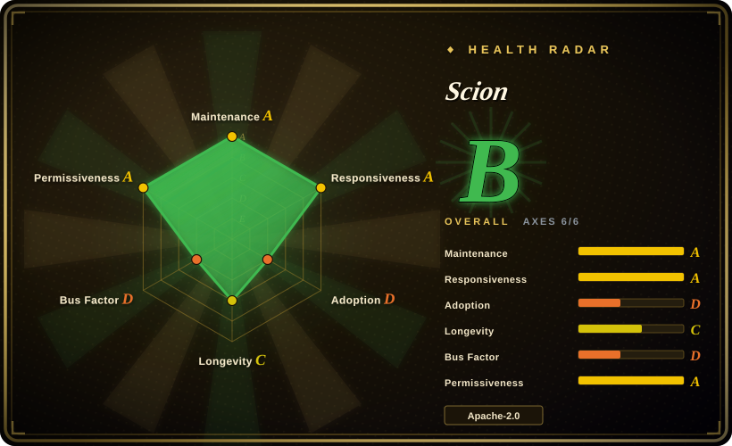
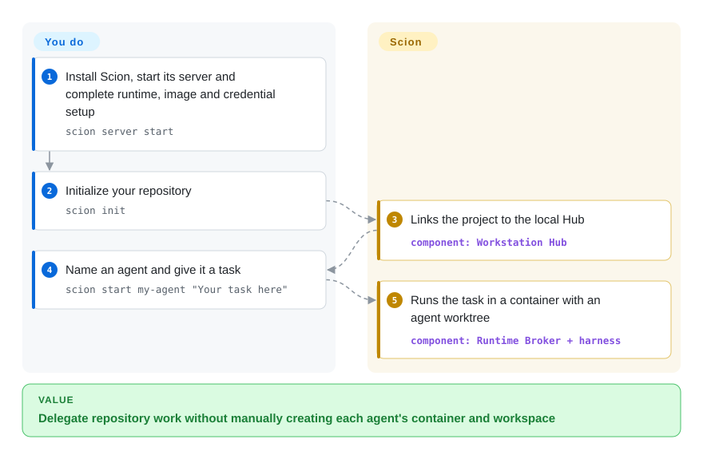
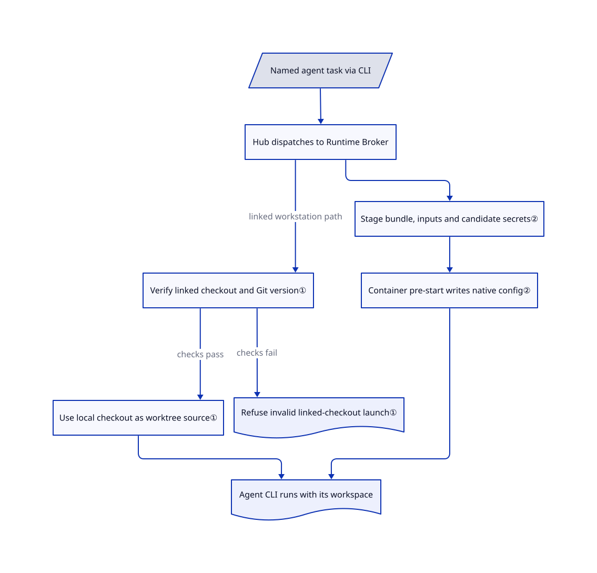

# Scion

Several agents need to work on one project, but you keep copying their findings between terminals and separating their edits by hand. Scion runs existing agent CLIs in containers, gives them configurable workspaces and messaging, and puts their sessions behind one local or hosted control plane.

## When to use

You lead a small engineering team testing a mixed-agent workflow: one agent investigates a failure, another writes a fix, and a third reviews it. Today you start separate terminals, paste findings between them, and discover that two workers changed the same checkout. You want to keep each agent's own CLI and model, but give the team shared communication, per-agent configuration and a deliberate choice between shared files, separate working trees and independent clones.

Choose Scion when that collaboration environment is the missing layer, and you want the same platform on a laptop and later on remote container hosts. Unlike a desktop-only supervisor such as [Agent Orchestrator](../../../agent-tooling/supervision-surfaces/agent-cockpits/agent-orchestrator.md), it includes a hosted Hub and Runtime Brokers — services that launch agents on compute hosts. Unlike [gh-aw](gh-aw.md), it supports ongoing interactive collaboration outside GitHub Actions. You still design the roles, review the output and operate the infrastructure; Scion does not supply a mandatory plan-to-merge methodology.

## When NOT to use

- **You only need to supervise branches and PR feedback on your own desktop.** Pick [Agent Orchestrator](../../../agent-tooling/supervision-surfaces/agent-cockpits/agent-orchestrator.md) for its task board and CI/review feedback loop. Scion adds container images, a Hub and broker lifecycle even on a workstation.
- **Your jobs are unattended GitHub chores with explicitly restricted writes.** Pick [gh-aw](gh-aw.md) for compiled Actions workflows, network allow-lists and separate write jobs. Scion's container boundary is not the same permission model: its Codex bundle launches with approval and inner-sandbox bypass flags, and shared directories remain writable across agents.
- **You want a browser conversation console with scheduled or webhook jobs, rather than a collaborating agent team.** Start with [OpenHands](openhands.md). Scion asks you to configure team instructions, workspace sharing and harness bundles; it does not remove that design work.
- **You expect Google product support or a stable 1.0 interface.** The README explicitly denies official Google support and labels the project pre-1.0. For a supported hosted coding service, evaluate GitHub Copilot coding agent instead; it is a closed hosted product, not an indexed repository.
- **You cannot review installation provenance and credentials.** The recommended Homebrew path uses a community tap and its container registry, and also installs a Telegram plugin. Workstation setup can pass existing harness login files into agents. Use [gh-aw](gh-aw.md) with deliberately scoped CI credentials for repo-only automation, or stay with an already approved local agent; neither is a drop-in replacement for Scion's collaboration platform.

## Comparison

| Alternative | In index | Our verdict | Tradeoff |
|---|---|---|---|
| [Agent Orchestrator](../../../agent-tooling/supervision-surfaces/agent-cockpits/agent-orchestrator.md) | ✅ | Pick Agent Orchestrator when the bottleneck is supervising parallel PRs on one desktop; pick Scion when agents must communicate and run on local or hosted container infrastructure. | AO packages a branch/task board and CI/review routing. Scion adds runtime and team infrastructure, but you own images, credentials and hosted operations. |
| [OpenHands](openhands.md) | ✅ | Pick OpenHands for a browser console over conversations plus scheduled/webhook jobs; pick Scion when configurable team workspaces and agent-to-agent collaboration are central. | Agent Canvas uses Agent Server backends and ACP integrations. Scion uses a Hub, brokers and harness bundles, giving you more explicit workspace choices and more provisioning to manage. |
| [gh-aw](gh-aw.md) | ✅ | Pick gh-aw when GitHub events should trigger bounded chores with declared writes; pick Scion for persistent, interactive mixed-harness teams outside Actions. | gh-aw inherits Actions runners and separates agent output from applied writes. Scion keeps control of compute and sessions with you, but containerization alone does not reproduce those restrictions. |

## Quick start

The [README quick start](https://github.com/GoogleCloudPlatform/scion/blob/163f4e8f0c37bdd342a695a76433d8eab89a427a/README.md#quick-start) recommends `brew tap homebrew-scion/scion`, then `brew install homebrew-scion/scion/scion`; this is a community distribution, not a Google-supported package. Run `scion server start` and complete the browser setup for a container runtime, images and model access. In your repository, run `scion init`, then `scion start my-agent "Your task here"`; Scion links the project to the local Hub and runs the agent in its container. You provide credentials, task instructions, compute and model billing; you review and merge the resulting branch. The [tutorial](https://github.com/GoogleCloudPlatform/scion/blob/163f4e8f0c37bdd342a695a76433d8eab89a427a/docs-site/src/content/docs/getting-started/tutorial.md#2-initialize-your-repository) requires Git 2.48+ for linked worktrees, warns against naming an agent after your checked-out branch, and says deletion can remove unmerged branch commits. For a source build with the web UI, use `make all`: the installation guide warns that `go install` alone omits the frontend assets.

<!-- flow-steps:begin (generated from flows/scion.json by tools/flow_card.py — do not edit) -->

Text version of the flow

1. **You**: Install Scion, start its server and complete runtime, image and credential setup — `scion server start`
2. **You**: Initialize your repository — `scion init`
3. **Scion**: Links the project to the local Hub — component: `Workstation Hub`
4. **You**: Name an agent and give it a task — `scion start my-agent "Your task here"`
5. **Scion**: Runs the task in a container with an agent worktree — component: `Runtime Broker + harness`

**Value**: Delegate repository work without manually creating each agent's container and workspace

<!-- flow-steps:end -->

## Key techniques

<!-- mechanism:begin (generated from mechanisms/scion.json by tools/mechanism_card.py; do not edit) -->

Text version of the mechanism

- Named agent task via CLI
- Hub dispatches to Runtime Broker
- Verify linked checkout and Git version①
- Use local checkout as worktree source①
- Stage bundle, inputs and candidate secrets②
- Container pre-start writes native config②
- Agent CLI runs with its workspace
- Refuse invalid linked-checkout launch①

- Named agent task via CLI → Hub dispatches to Runtime Broker
- Hub dispatches to Runtime Broker → Verify linked checkout and Git version① (linked workstation path)
- Verify linked checkout and Git version① → Use local checkout as worktree source① (checks pass)
- Verify linked checkout and Git version① → Refuse invalid linked-checkout launch① (checks fail)
- Hub dispatches to Runtime Broker → Stage bundle, inputs and candidate secrets②
- Stage bundle, inputs and candidate secrets② → Container pre-start writes native config②
- Use local checkout as worktree source① → Agent CLI runs with its workspace
- Container pre-start writes native config② → Agent CLI runs with its workspace

<!-- mechanism:end -->

### 1. Verify the local checkout before routing an agent into a worktree

- **Problem:** Re-cloning a remote loses local commits that have not been pushed; sharing one working directory lets parallel edits collide.
- **How:** The broker recognizes a linked workstation project, checks Git 2.48+, verifies the local checkout and compares its normalized origin with the Hub project. Successful routing uses that checkout as the worktree source; failed verification refuses the launch instead of silently cloning elsewhere.
- **Limits:** This routing applies to the colocated workstation path, not Kubernetes. Worktrees still share Git history and refs; shared directories bypass working-tree isolation, and an agent named for the current branch can use your checkout directly.
- **Source:** [Routing checks, lines 86–176](https://github.com/GoogleCloudPlatform/scion/blob/163f4e8f0c37bdd342a695a76433d8eab89a427a/pkg/runtimebroker/linked_checkout.go#L86-L176), [Git version gate](https://github.com/GoogleCloudPlatform/scion/blob/163f4e8f0c37bdd342a695a76433d8eab89a427a/pkg/runtime/worktree_eligibility.go#L23-L50), [sharing modes and shared-directory boundary](https://github.com/GoogleCloudPlatform/scion/blob/163f4e8f0c37bdd342a695a76433d8eab89a427a/docs-site/src/content/docs/local/workspaces-and-sharing.md#L160-L165).

### 2. Move harness-specific setup into container-side bundles

- **Problem:** Different agent CLIs need different authentication files, instructions and launch arguments; putting every translation in the control plane couples it to every CLI.
- **How:** The Go adapter stages a bundle, input files and candidate secrets in the agent home. A pre-start script inside the container writes native configuration; declarative command fields assemble the CLI invocation. The Codex script, for example, selects API-key or auth-file access and writes credential files with mode `0600` through a temporary file and rename.
- **Limits:** Bundles are executable configuration, not passive prompts. Codex, OpenCode and Antigravity bundles are opt-in, and their capabilities differ; the Codex bundle bypasses its own approvals and sandbox, leaving the outer runtime and credential scope as important controls.
- **Source:** [Container-side boundary](https://github.com/GoogleCloudPlatform/scion/blob/163f4e8f0c37bdd342a695a76433d8eab89a427a/pkg/harness/container_script_harness.go#L33-L40), [command assembly](https://github.com/GoogleCloudPlatform/scion/blob/163f4e8f0c37bdd342a695a76433d8eab89a427a/pkg/harness/container_script_harness.go#L173-L231), [Codex credential writer](https://github.com/GoogleCloudPlatform/scion/blob/163f4e8f0c37bdd342a695a76433d8eab89a427a/harnesses/codex/provision.py#L75-L130), [Codex launch flags](https://github.com/GoogleCloudPlatform/scion/blob/163f4e8f0c37bdd342a695a76433d8eab89a427a/harnesses/codex/config.yaml#L73-L103), [opt-in bundles](https://github.com/GoogleCloudPlatform/scion/blob/163f4e8f0c37bdd342a695a76433d8eab89a427a/harnesses/README.md#L1-L27).

## Tech stack

- Go 1.26.1 in `go.mod`; Cobra CLI, Ent persistence, SQLite and PostgreSQL drivers.
- TypeScript web UI with Lit, Shoelace, xterm.js, CodeMirror and Vite; Python container-side harness provisioners.
- Docker, Podman, Apple Container, Kubernetes and Cloud Run execution paths; OpenTelemetry dependencies for observability.
- [Dependency manifest](https://github.com/GoogleCloudPlatform/scion/blob/163f4e8f0c37bdd342a695a76433d8eab89a427a/go.mod), [web manifest](https://github.com/GoogleCloudPlatform/scion/blob/163f4e8f0c37bdd342a695a76433d8eab89a427a/web/package.json).

## Dependencies

- **Workstation:** one local server combining Hub, Runtime Broker and web UI; embedded SQLite; a working container runtime and harness images. Git 2.48+ is required for the documented linked-repository worktree path.
- **Model access:** provider keys or supported harness login files. Claude and Gemini are the default-install bundle set; Codex, OpenCode and Antigravity require opt-in bundles. You pay model usage and supply project permissions.
- **Hosted:** a networked Hub, authenticated brokers, identity configuration and storage. HA hosting adds external PostgreSQL, object storage and replicated Hub instances; GCP infrastructure is not required for the basic workstation path.
- See [deployment modes](https://github.com/GoogleCloudPlatform/scion/blob/163f4e8f0c37bdd342a695a76433d8eab89a427a/docs-site/src/content/docs/choosing-a-mode.md#L40-L70) and [credential handling](https://github.com/GoogleCloudPlatform/scion/blob/163f4e8f0c37bdd342a695a76433d8eab89a427a/docs-site/src/content/docs/getting-started/tutorial.md#L69-L83).

## Ops difficulty

**Medium on a workstation; high for HA hosting.** A single server and guided setup reduce initial assembly, but even CLI usage now requires a Hub; the older no-Hub local mode was removed. You maintain container images, harness bundles, model credentials and backups of local state. Hosted operations add TLS, user/agent authorization, broker trust and storage; HA adds PostgreSQL and object storage. Review mounts and shared directories before handing agents sensitive repositories, and pin tested releases rather than treating nightly builds as a stability guarantee.

## Health & viability

- **Maintenance — active, pre-1.0 (2026-10-18).** GitHub shows a push on 2026-10-18 and five consecutive daily prereleases through `nightly-20261018`. The README explicitly warns that APIs and configuration may change.
- **Backing and support.** The repository belongs to GoogleCloudPlatform and source files carry Google LLC copyright under Apache-2.0. The README explicitly says it is not an officially supported Google product; organization ownership is not a support contract.
- **Governance / bus factor.** The contributors API lists `ptone` at 5,876 contributions, far ahead of the next listed human at 30. [推断: based on contributor counts, not a staffing audit] Maintenance is highly concentrated despite organizational ownership.
- **Age / Lindy.** Created 2026-03-10: roughly seven months old at verification. [推断: based on age and pre-1.0 status] Active development supports evaluation, but the project has not earned a long-lived stability prior.
- **Adoption and risk.** GitHub reports 1,955 stars and 291 forks. The README describes internal Google experiments, not independently verified production adoption. The public repository advisory endpoint returned no published advisories on 2026-10-18; that is not evidence of an absence of vulnerabilities. The community tap/registry and executable harness bundles add trust dependencies.

## Caveats (unverified)

- [未验证: no agent containers, model credentials or hosted deployment were exercised] Installation success, collaboration quality, runtime isolation and HA behavior were assessed from documentation and selected source, not from an end-to-end run.
- [推断: contributor counts are not a staffing audit] The bus-factor concern follows from the large contribution gap; actual review ownership and succession arrangements are unknown.
- [推断: seven months of history and pre-1.0 warnings] The limited Lindy credit is a selection judgment, not a prediction that the project will be abandoned.
