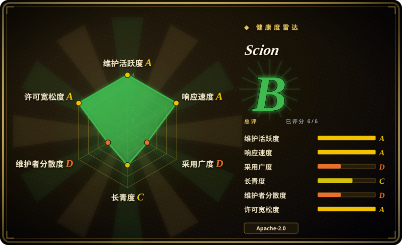
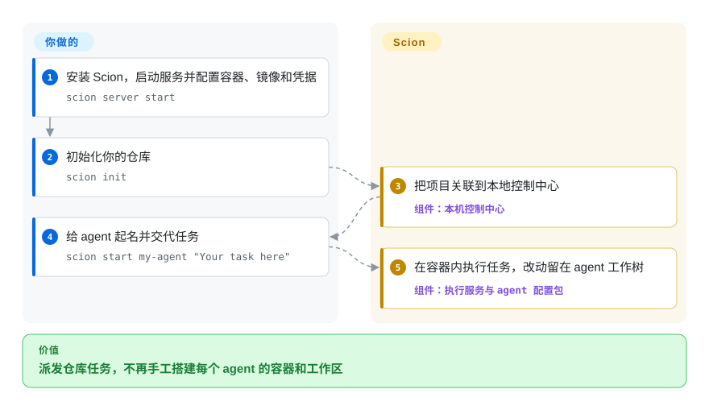
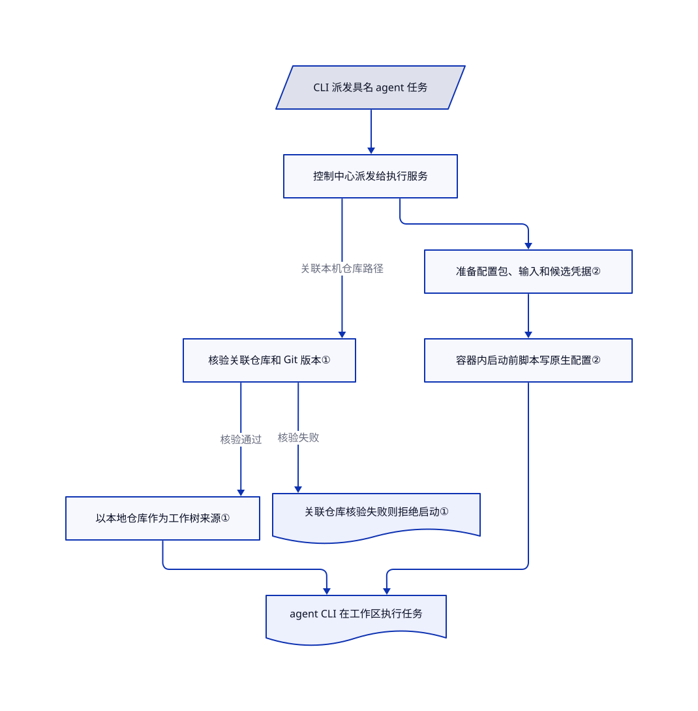

# Scion

几个 agent 要共同完成一个项目，你却得来回复制结论，还要手动分开它们的代码改动。Scion 把现有 agent CLI 放进容器，提供可选的工作区隔离和消息通道，再用本地或托管控制台统一管理。

## 何时使用

你带一个小型工程团队，正在试多 agent 协作：一个查故障，一个写修复，另一个做评审。现在你得开几个终端，手动搬运调查结果，最后发现两个 worker 改了同一个目录。你想保留各自的 CLI 和模型，但需要统一通信、独立配置，并明确选择共享文件、独立工作树或独立克隆。

如果缺的是这层协作运行环境，并希望以后从笔记本迁到远程容器主机，就考虑 Scion。相对桌面监督工具 [Agent Orchestrator](../../../agent-tooling/supervision-surfaces/agent-cockpits/agent-orchestrator.zh.md)，它提供托管 Hub（控制中心）和 Runtime Broker（负责启动 agent 的执行服务）。相对 [gh-aw](gh-aw.zh.md)，它支持 GitHub Actions 之外的持续交互协作。角色怎么分、产物怎么审、基础设施怎么维护，仍归你负责；它不强制提供从计划到合并的方法论。

## 何时不用

- **只想在自己的桌面监督分支和 PR 反馈。** 选 [Agent Orchestrator](../../../agent-tooling/supervision-surfaces/agent-cockpits/agent-orchestrator.zh.md)，直接用任务看板和 CI／评审反馈回路。Scion 即使在本机也多出容器镜像、Hub 和执行服务的维护。
- **任务只是无人值守的 GitHub 杂活，而且写权限必须明确受限。** 选 [gh-aw](gh-aw.zh.md)，用编译后的 Actions 工作流、网络白名单和独立写入任务。Scion 的容器隔离不是同一种权限模型：Codex 配置包会跳过自身审批和内层沙箱，共享目录也仍可被多个 agent 写入。
- **要的是浏览器对话控制台，加定时或 webhook 任务，不是协作团队。** 先看 [OpenHands](openhands.zh.md)。Scion 仍要求你设计团队指令、工作区共享方式和各 agent 的配置包，不会消掉这些设计工作。
- **需要 Google 产品支持，或稳定的 1.0 接口。** README 明说它不是 Google 官方支持产品，且尚未到 1.0。需要有人运营的托管编码服务，可评估 GitHub Copilot coding agent；它是闭源托管产品，不是本索引收录的仓库。
- **不能审查安装来源和凭据流向。** 推荐安装路径用社区 Homebrew 源和镜像仓库，还会安装 Telegram 插件。本机模式也会把已有 agent 登录文件交给容器内的 agent。仅做仓库自动化时，可选 [gh-aw](gh-aw.zh.md) 并明确收窄 CI 凭据；否则保留已获批准的本地 agent。两者都不能原样替代 Scion 的协作平台。

## 横向对比

| 替代品 | 是否收录 | 我们的评价 | 取舍 |
|---|---|---|---|
| [Agent Orchestrator](../../../agent-tooling/supervision-surfaces/agent-cockpits/agent-orchestrator.zh.md) | ✅ | 瓶颈是在一个桌面监督多个 PR，选 Agent Orchestrator；需要 agent 互通消息，并在本机或托管容器中运行，选 Scion。 | AO 打包了分支任务看板和 CI／评审反馈。Scion 增加运行环境与团队基础设施，但镜像、凭据和托管运维归你管。 |
| [OpenHands](openhands.zh.md) | ✅ | 要浏览器对话控制台及定时／webhook 任务，选 OpenHands；团队工作区选择和 agent 之间协作才是核心，选 Scion。 | Agent Canvas 使用 Agent Server 后端和 ACP 接入。Scion 使用 Hub、执行服务和配置包，工作区选择更明确，但初始化配置也更多。 |
| [gh-aw](gh-aw.zh.md) | ✅ | 要 GitHub 事件触发有限任务，并声明允许的写操作，选 gh-aw；要 Actions 之外持续交互的混合 agent 团队，选 Scion。 | gh-aw 借用 Actions 执行器，把 agent 输出与实际写入分开。Scion 把算力和会话控制留给你，但容器本身不等于这些权限限制。 |

## 快速上手

[README 快速开始](https://github.com/GoogleCloudPlatform/scion/blob/163f4e8f0c37bdd342a695a76433d8eab89a427a/README.md#quick-start)推荐先运行 `brew tap homebrew-scion/scion`，再运行 `brew install homebrew-scion/scion/scion`；这是社区分发，不是 Google 支持的软件包。运行 `scion server start`，在浏览器完成容器运行时、镜像和模型凭据配置。在你的仓库执行 `scion init`，再执行 `scion start my-agent "Your task here"`；Scion 会把项目连到本地控制中心，并在容器内启动 agent。你提供凭据、任务指令、算力和模型费用，最终审查并合并产物分支。[教程](https://github.com/GoogleCloudPlatform/scion/blob/163f4e8f0c37bdd342a695a76433d8eab89a427a/docs-site/src/content/docs/getting-started/tutorial.md#2-initialize-your-repository)要求关联工作树使用 Git 2.48+，提醒不要让 agent 与当前分支同名，并说明删除 agent 可能删掉尚未合并的分支提交。从源码构建且需要网页界面时用 `make all`；安装文档明确说，仅用 `go install` 不会包含前端资源。

<!-- flow-steps:begin (generated from flows/scion.json by tools/flow_card.py — do not edit) -->

流程文字版

1. **你**：安装 Scion，启动服务并配置容器、镜像和凭据 — `scion server start`
2. **你**：初始化你的仓库 — `scion init`
3. **Scion**：把项目关联到本地控制中心 — 组件：`本机控制中心`
4. **你**：给 agent 起名并交代任务 — `scion start my-agent "Your task here"`
5. **Scion**：在容器内执行任务，改动留在 agent 工作树 — 组件：`执行服务与 agent 配置包`

**价值**：派发仓库任务，不再手工搭建每个 agent 的容器和工作区

<!-- flow-steps:end -->

## 技术要点

<!-- mechanism:begin (generated from mechanisms/scion.json by tools/mechanism_card.py; do not edit) -->

机制文字版

- CLI 派发具名 agent 任务
- 控制中心派发给执行服务
- 核验关联仓库和 Git 版本①
- 以本地仓库作为工作树来源①
- 准备配置包、输入和候选凭据②
- 容器内启动前脚本写原生配置②
- agent CLI 在工作区执行任务
- 关联仓库核验失败则拒绝启动①

- CLI 派发具名 agent 任务 → 控制中心派发给执行服务
- 控制中心派发给执行服务 → 核验关联仓库和 Git 版本①（关联本机仓库路径）
- 核验关联仓库和 Git 版本① → 以本地仓库作为工作树来源①（核验通过）
- 核验关联仓库和 Git 版本① → 关联仓库核验失败则拒绝启动①（核验失败）
- 控制中心派发给执行服务 → 准备配置包、输入和候选凭据②
- 准备配置包、输入和候选凭据② → 容器内启动前脚本写原生配置②
- 以本地仓库作为工作树来源① → agent CLI 在工作区执行任务
- 容器内启动前脚本写原生配置② → agent CLI 在工作区执行任务

<!-- mechanism:end -->

### 1. 先核验本地仓库，再分配独立工作树

- **解决：** 重新克隆远端会漏掉尚未推送的本地提交；直接共享工作目录，又会让并行改动撞在一起。
- **做法：** 执行服务识别关联到本机的项目，检查 Git 2.48+，核验本地仓库，并比较规范化后的远端地址是否与控制中心登记的一致。核验通过就以这个仓库作为工作树来源；失败则拒绝启动，不悄悄改成重新克隆。
- **边界：** 这条路由只适用于控制中心与执行服务同进程的本机模式，不适用于 Kubernetes。工作树仍共享历史和分支引用，共享目录也不受工作树隔离保护；agent 若与当前分支同名，还可能直接使用你的目录。
- **源码：** [路由检查第 86–176 行](https://github.com/GoogleCloudPlatform/scion/blob/163f4e8f0c37bdd342a695a76433d8eab89a427a/pkg/runtimebroker/linked_checkout.go#L86-L176)、[Git 版本门槛](https://github.com/GoogleCloudPlatform/scion/blob/163f4e8f0c37bdd342a695a76433d8eab89a427a/pkg/runtime/worktree_eligibility.go#L23-L50)、[共享目录边界](https://github.com/GoogleCloudPlatform/scion/blob/163f4e8f0c37bdd342a695a76433d8eab89a427a/docs-site/src/content/docs/local/workspaces-and-sharing.md#L160-L165)。

### 2. 把各 agent 的原生配置放进容器脚本

- **解决：** 不同 agent CLI 需要不同的登录文件、指令和启动参数；全部写进控制中心会把它与每种 CLI 绑死。
- **做法：** Go 适配器把配置包、输入文件和候选凭据放进 agent 的独立主目录。容器内的启动前脚本写入原生配置，再由声明式命令字段组装 CLI 参数。例如 Codex 脚本会选择 API 密钥或登录文件，并用权限为 `0600` 的临时文件加重命名写入凭据。
- **边界：** 配置包能执行代码，不是被动提示词。Codex、OpenCode 和 Antigravity 需要额外安装配置包，能力也不一致；Codex 包会绕过自身审批和沙箱，因此外层运行环境与凭据范围仍是重要防线。
- **源码：** [容器侧执行边界](https://github.com/GoogleCloudPlatform/scion/blob/163f4e8f0c37bdd342a695a76433d8eab89a427a/pkg/harness/container_script_harness.go#L33-L40)、[启动参数组装](https://github.com/GoogleCloudPlatform/scion/blob/163f4e8f0c37bdd342a695a76433d8eab89a427a/pkg/harness/container_script_harness.go#L173-L231)、[Codex 凭据写入](https://github.com/GoogleCloudPlatform/scion/blob/163f4e8f0c37bdd342a695a76433d8eab89a427a/harnesses/codex/provision.py#L75-L130)、[Codex 启动参数](https://github.com/GoogleCloudPlatform/scion/blob/163f4e8f0c37bdd342a695a76433d8eab89a427a/harnesses/codex/config.yaml#L73-L103)、[可选配置包](https://github.com/GoogleCloudPlatform/scion/blob/163f4e8f0c37bdd342a695a76433d8eab89a427a/harnesses/README.md#L1-L27)。

## 技术栈

- `go.mod` 要求 Go 1.26.1；使用 Cobra 命令行、Ent 持久层，以及 SQLite 和 PostgreSQL 驱动。
- 网页端使用 TypeScript、Lit、Shoelace、xterm.js、CodeMirror 和 Vite；容器内初始化脚本使用 Python。
- 执行路径包括 Docker、Podman、Apple Container、Kubernetes 和 Cloud Run；通过 OpenTelemetry 相关依赖提供可观测能力。
- 来源：[后端依赖](https://github.com/GoogleCloudPlatform/scion/blob/163f4e8f0c37bdd342a695a76433d8eab89a427a/go.mod)、[网页端依赖](https://github.com/GoogleCloudPlatform/scion/blob/163f4e8f0c37bdd342a695a76433d8eab89a427a/web/package.json)。

## 依赖

- **本机模式：** 一个进程组合控制中心、执行服务和网页端，使用内嵌 SQLite；还需要可用的容器运行时和 agent 镜像。文档中的本地仓库工作树路径要求 Git 2.48+。
- **模型访问：** 厂商密钥或受支持的 agent 登录文件。默认安装的配置包是 Claude 和 Gemini；Codex、OpenCode 和 Antigravity 要额外安装。模型费用和项目权限由你提供。
- **托管模式：** 网络可达的控制中心、已认证执行服务、身份配置和存储。高可用部署再加外部 PostgreSQL、对象存储和多副本控制中心；基础本机路径不要求 GCP 基础设施。
- 来源：[部署模式](https://github.com/GoogleCloudPlatform/scion/blob/163f4e8f0c37bdd342a695a76433d8eab89a427a/docs-site/src/content/docs/choosing-a-mode.md#L40-L70)、[凭据配置](https://github.com/GoogleCloudPlatform/scion/blob/163f4e8f0c37bdd342a695a76433d8eab89a427a/docs-site/src/content/docs/getting-started/tutorial.md#L69-L83)。

## 运维难度

**本机中等，高可用托管较高。** 单进程和引导配置降低了初次搭建成本，但现在连 CLI 运行也必须经过控制中心；旧版不依赖 Hub 的本地模式已经移除。你要维护容器镜像、配置包、模型凭据和本地状态备份。托管再增加 TLS、用户及 agent 授权、执行服务信任和存储；高可用还要维护 PostgreSQL 与对象存储。交给 agent 敏感仓库前，先检查挂载与共享目录；固定已验证版本，不把每日构建当成稳定性保证。

## 健康度与可持续性

- **维护活跃，但尚未到 1.0（2026-10-18）。** GitHub 显示当天有推送，最近五个预发布版本逐日更新，最新是 `nightly-20261018`。README 明确提醒接口与配置可能变化。
- **组织归属与支持。** 仓库属于 GoogleCloudPlatform，源码标注 Google LLC 版权，使用 Apache-2.0。README 同时明说它不是 Google 官方支持产品；组织归属不是服务承诺。
- **治理与人员集中度。** 贡献者 API 中，`ptone` 有 5,876 次贡献，下一位列出的真人贡献者为 30 次。[推断：依据是贡献数，不是人员审计] 即使仓库属于组织，维护仍高度集中。
- **年龄与林迪效应。** 仓库创建于 2026-03-10，核验时约七个月。[推断：依据是仓龄和未到 1.0 的状态] 活跃度支持试用，但尚不足以获得长期稳定性的历史加分。
- **采用与风险。** GitHub 显示 1,955 star、291 fork。README 列的是 Google 内部实验，不是经独立验证的生产采用。2026-10-18 查询公开安全公告接口，结果为空；这不证明没有漏洞。社区软件源、镜像仓库和可执行配置包也增加了信任依赖。

## 存疑（未验证）

- [未验证：未运行 agent 容器、未使用模型凭据、未部署托管服务] 安装成功率、协作质量、运行时隔离和高可用行为仅依据文档及选读源码判断，未做端到端运行。
- [推断：贡献数不等于人员审计] 人员集中风险来自贡献量差距；实际评审归属和接班安排仍未知。
- [推断：依据是七个月历史及未到 1.0 的提示] 林迪加分有限是选型判断，不是预测项目会停止维护。
