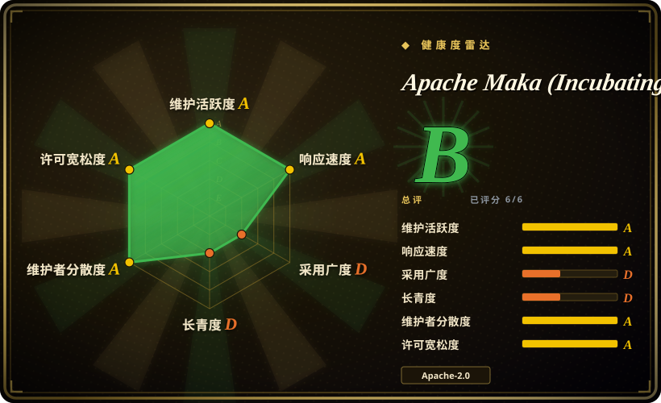
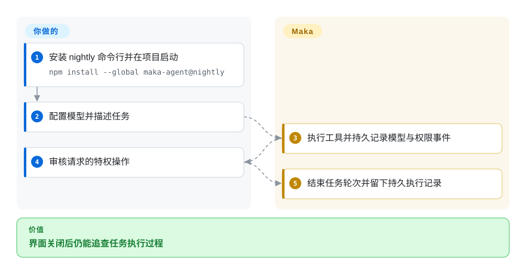

# Apache Maka (Incubating)

agent 崩溃后，最后一次工具操作不该随窗口消失。Maka 把模型、工具和权限事件写入本地账本，供桌面和终端共同读取。

## 何时使用

你要追查编码任务为什么停在权限请求或工具调用之后。若执行记录比极简终端循环更重要，可以选 Maka。它让不同客户端共享 Runtime Host，并从事件记录重建视图。你仍提供模型账号、审核改动；账本证明执行过程，不证明代码正确。

## 何时不用

- 要自己定制小型终端 agent，选 [Pi](pi.zh.md)。Maka 多了运行宿主、存储和桌面架构。
- 要较成熟的多供应商终端流程，选 [OpenCode](opencode.zh.md)。Maka 尚在孵化，明确警告格式和命令会变。
- 要逐次编辑的结对编程，选 [aider](aider.zh.md)，不必引入完整运行时。
- 密钥必须进入系统钥匙串时，应另审凭据方案。Maka 当前使用受账号权限保护的本地明文凭据文件。
- 集成前必须确认初始代码授权审查已完成时，应先等待，或自行完成许可审查。固定版本的 `DISCLAIMER-WIP` 明确审查仍开放；Apache 孵化、源码发布与工程测试通过都不代表授权闭环。这是审查未完成，不是已确认侵权。

## 横向对比

| 替代品 | 是否收录 | 我们的评价 | 取舍 |
| --- | --- | --- | --- |
| [OpenCode](opencode.zh.md) | ✅ | 优先现有供应商和客户端生态选 OpenCode；优先明确的事件账本与恢复架构选 Maka。 | Maka 集中执行权，但增加年轻的存储与协议面。 |
| [Pi](pi.zh.md) | ✅ | 要小型扩展式终端循环选 Pi；桌面和终端必须共享持久运行状态时选 Maka。 | 极简循环，对比宿主管理的工作区与投影。 |
| [aider](aider.zh.md) | ✅ | 要限定文件的结对编辑选 aider；要记录自主任务的工具与权限过程选 Maka。 | Git 编辑流程，对比更大的自主工作台。 |

## 快速上手

运行 `npm install --global maka-agent@nightly`，然后在目标项目启动 `maka`。首次设置要求填写供应商密钥并启用模型，之后用 `/setup` 修改连接，用 `/model` 切换模型。Maka 执行任务并记录事件；你负责需求、特权操作审批和结果验收。要可重复使用，应固定已审阅的 nightly 版本，不能把早期占位版 `latest` 当作完整 CLI。Apache 正式发布物是签名源码包，npm 和桌面包是便利构建。来源为[命令行文档](https://github.com/apache/maka/blob/d14cec5719352f77d324e1065e0c1943c33772c7/packages/cli/README.md)。

<!-- flow-steps:begin (generated from flows/maka.json by tools/flow_card.py — do not edit) -->

流程文字版

1. **你**：安装 nightly 命令行并在项目启动 — `npm install --global maka-agent@nightly`
2. **你**：配置模型并描述任务
3. **Apache Maka (Incubating)**：执行工具并持久记录模型与权限事件
4. **你**：审核请求的特权操作
5. **Apache Maka (Incubating)**：结束任务轮次并留下持久执行记录

**价值**：界面关闭后仍能追查任务执行过程

<!-- flow-steps:end -->

## 技术要点

<!-- mechanism:begin (generated from mechanisms/maka.json by tools/mechanism_card.py; do not edit) -->

机制文字版

- 桌面与终端客户端
- 单一执行宿主
- 事务提交事件与投影①
- 按最后事件分类未结束运行②
- 失败决定与诊断

- 桌面与终端客户端 → 单一执行宿主
- 单一执行宿主 → 事务提交事件与投影①
- 事务提交事件与投影① → 按最后事件分类未结束运行②（中断之后）
- 按最后事件分类未结束运行② → 失败决定与诊断

<!-- mechanism:end -->

### 1. 事件和派生状态一起提交

- **解决：** 仅在界面保存动作，会在重启时丢失，或与持久状态不一致。
- **做法：** SQLite 存储校验事件身份，在同一写事务中追加事件并更新相关投影；运行组成记录发生冲突时拒绝重写。
- **边界：** 历史记录不证明任务正确，也不能把外部副作用变成数据库事务。
- **源码：** [追加事务](https://github.com/apache/maka/blob/d14cec5719352f77d324e1065e0c1943c33772c7/packages/storage/src/agent-run-store.ts#L137-L198)。

### 2. 从账本判断中断状态

- **解决：** 重启不能把未完成工具或权限等待误判为成功。
- **做法：** 恢复器读取最后一个未损坏事件，将运行记为失败，并区分工具中断、过期等待等原因。沙箱关闭记录保留运行来源。
- **边界：** 识别失败不等于重做任务；显式续跑可能再次调用模型并消耗 token。
- **源码：** [恢复分类器](https://github.com/apache/maka/blob/d14cec5719352f77d324e1065e0c1943c33772c7/packages/runtime/src/agent-run-recovery.ts#L49-L107)、[续跑行为](https://github.com/apache/maka/blob/d14cec5719352f77d324e1065e0c1943c33772c7/README.md#local-data-and-recovery)。

## 技术栈

TypeScript npm 工作区、Node.js、SQLite、Electron 和 React 桌面，以及终端命令行。可选对等连接组件使用 Rust 原生扩展。

## 依赖

Node 22 分支需 22.19+，或使用 Node 24+；还需模型连接和本地可写目录。源码开发另需 Git 和 ripgrep；对等组件开发需要 Rust 1.98+ 和系统链接器。不附送共享模型账号。

## 运维难度

**中等。** 备份 SQLite 和本地凭据，固定 nightly 版本并跟踪迁移。旧 JSONL 与 safeStorage 凭据不会自动导入。Windows 和 Linux 桌面仍标注预览版。

## 健康度与可持续性

- 截至 2026-10-18，正式源码版 0.2.0 与频繁开发版并行，多名贡献者有实质提交记录。
- 文档写明 Apache 孵化，而非毕业；仓库创建于 2026 年 5 月。[推断：依据是创建日期与孵化声明] 基金会设施有利治理，但不能证明生产稳定。
- Apache-2.0 附有第三方声明。原生组件和变化中的数据格式增加升级负担。
- **已审快照的初始代码授权仍未闭环。** `DISCLAIMER-WIP` 说明已登记一份 ICLA，并删除 Deep Research 实现，但保留的初始代码仍须登记授权依据；这些变化不证明已提交软件授权协议（SGA）。这是具体的许可尽调风险，不能推断已经侵权。来源为[项目自身声明](https://github.com/apache/maka/blob/d14cec5719352f77d324e1065e0c1943c33772c7/DISCLAIMER-WIP#L9-L23)。

## 存疑（未验证）

- [未验证：本批禁止运行上游] 未复现恢复、沙箱约束和公开评测结果。
- [未验证：固定快照声明审查仍开放，本轮未取得闭环依据] 未确认保留初始代码的授权审查已结束，也未确认 SGA 已提交；不据此判定侵权。
- [推断：依据是创建日期与孵化声明] 年轻的孵化项目仍缺少长期存续证据。
