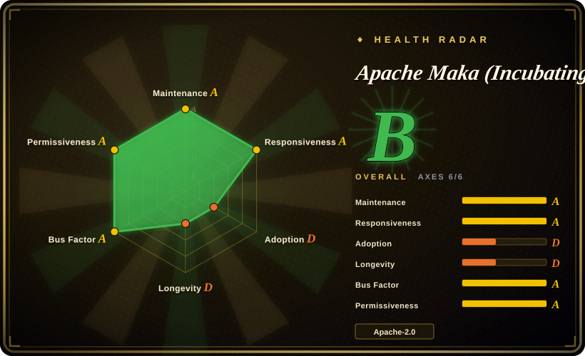
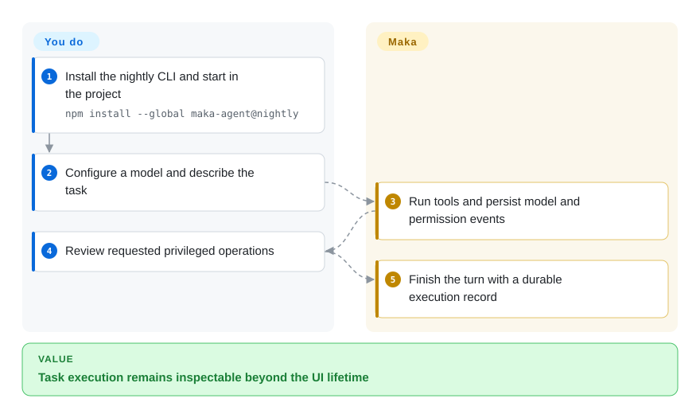
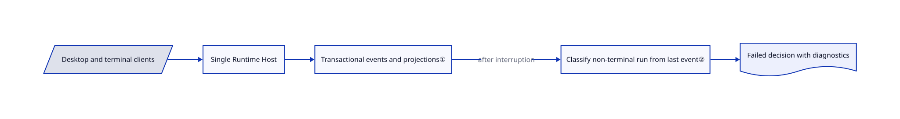

# Apache Maka (Incubating)

After an agent crashes, its last tool action should not vanish with the window; Maka records model, tool and permission events in a local runtime ledger shared by desktop and terminal clients.

## When to use

You need to investigate why an autonomous coding task stopped after asking permission or starting a tool. Choose Maka when the durable execution record matters more than a minimal terminal loop: its clients share a Runtime Host and reconstruct views from recorded events. You supply the model account and review changes; the ledger is evidence of execution, not evidence that the resulting patch is correct.

## When NOT to use

- For a small terminal agent you customize yourself, choose [Pi](pi.md); Maka adds a host, storage and desktop architecture.
- For an established multi-provider terminal workflow, choose [OpenCode](opencode.md); Maka is still incubating and explicitly warns that formats and commands change.
- For deliberate edit-by-edit pairing, choose [aider](aider.md), rather than adopting Maka's broader runtime.
- If keys must live in an OS keychain, use a separately reviewed credential boundary instead: Maka currently stores its credential vault as local plaintext protected by account permissions.
- If your integration requires the initial code's authorization basis to have completed review, defer adoption or conduct your own licensing review. The pinned `DISCLAIMER-WIP` says that review remains open; Apache incubation, a source release and passing engineering tests do not close it. This is an unresolved authorization review, not a finding that infringement occurred.

## Comparison

| Alternative | In index | Our verdict | Tradeoff |
| --- | --- | --- | --- |
| [OpenCode](opencode.md) | ✅ | Choose OpenCode for its established provider and client ecosystem; choose Maka for its explicit runtime-event and recovery architecture. | Maka centralizes execution authority but introduces a young storage and protocol surface. |
| [Pi](pi.md) | ✅ | Choose Pi for a compact extension-driven terminal loop; choose Maka when desktop and CLI must share durable run state. | Minimalism versus a host-owned workspace and projections. |
| [aider](aider.md) | ✅ | Choose aider for scoped pair-programming edits; choose Maka for agent tasks whose tools and permission decisions need a run ledger. | Git-centered edits versus a larger autonomous workspace. |

## Quick start

Install `npm install --global maka-agent@nightly`, then run `maka` from the target project. The setup flow asks for a provider key and enabled models; `/setup` changes connections and `/model` switches models. Maka executes turns and records their events while you supply the task, approve privileged operations and validate the result. Pin a reviewed nightly version for reproducibility: `latest` is an early alpha stub, not the full CLI. Official Apache releases are signed source archives; npm and desktop packages are convenience artifacts. See the [CLI guide](https://github.com/apache/maka/blob/d14cec5719352f77d324e1065e0c1943c33772c7/packages/cli/README.md).

<!-- flow-steps:begin (generated from flows/maka.json by tools/flow_card.py — do not edit) -->

Text version of the flow

1. **You**: Install the nightly CLI and start in the project — `npm install --global maka-agent@nightly`
2. **You**: Configure a model and describe the task
3. **Apache Maka (Incubating)**: Run tools and persist model and permission events
4. **You**: Review requested privileged operations
5. **Apache Maka (Incubating)**: Finish the turn with a durable execution record

**Value**: Task execution remains inspectable beyond the UI lifetime

<!-- flow-steps:end -->

## Key techniques

<!-- mechanism:begin (generated from mechanisms/maka.json by tools/mechanism_card.py; do not edit) -->

Text version of the mechanism

- Desktop and terminal clients
- Single Runtime Host
- Transactional events and projections①
- Classify non-terminal run from last event②
- Failed decision with diagnostics

- Desktop and terminal clients → Single Runtime Host
- Single Runtime Host → Transactional events and projections①
- Transactional events and projections① → Classify non-terminal run from last event② (after interruption)
- Classify non-terminal run from last event② → Failed decision with diagnostics

<!-- mechanism:end -->

### 1. Commit events and derived state together

- **Problem:** A UI-only action record disappears on restart or disagrees with persisted state.
- **How:** The SQLite run store validates event identity, appends the event and writes relevant projections in one write transaction; conflicting run-composition rewrites are rejected.
- **Limits:** Durable history records what happened; it cannot prove task correctness or make an external side effect transactional.
- **Source:** [Append transaction](https://github.com/apache/maka/blob/d14cec5719352f77d324e1065e0c1943c33772c7/packages/storage/src/agent-run-store.ts#L137-L198).

### 2. Classify interrupted runs from their ledger

- **Problem:** Restarting an agent can otherwise mistake an unfinished tool or permission wait for success.
- **How:** Recovery examines the last non-corrupt event and records a failed decision with diagnostics such as interrupted tool or stale user wait. Sandbox closure records preserve run provenance.
- **Limits:** Classifying a failed run is not rerunning it; explicit resume can call the model and spend additional tokens.
- **Source:** [Recovery classifier](https://github.com/apache/maka/blob/d14cec5719352f77d324e1065e0c1943c33772c7/packages/runtime/src/agent-run-recovery.ts#L49-L107), [resume behavior](https://github.com/apache/maka/blob/d14cec5719352f77d324e1065e0c1943c33772c7/README.md#local-data-and-recovery).

## Tech stack

TypeScript npm workspaces, Node.js runtime, SQLite storage, Electron/React desktop and a terminal CLI. Optional peer components use Rust native addons.

## Dependencies

Node 22.19+ on the 22 line or Node 24+, a model connection and local writable workspace. Source development additionally needs Git and ripgrep; peer development needs Rust 1.98+ and platform linkers. No shared model subscription is bundled.

## Ops difficulty

**Medium.** Back up the live SQLite database and local vault, pin nightly packages and track migrations. Older JSONL and safeStorage credentials are not imported automatically. Windows and Linux desktop builds are labelled preview.

## Health & viability

- As of 2026-10-18, source release 0.2.0 and frequent development builds coexist; several contributors have substantial histories.
- Apache incubation is documented, not graduation. The repository was created May 2026. [推断：依据是创建日期与孵化声明] Foundation infrastructure helps governance, but neither age nor incubation proves production stability.
- Apache-2.0 is accompanied by third-party notices. Native components and changing data formats increase upgrade obligations.
- **Initial-code authorization remains unresolved in the reviewed snapshot.** `DISCLAIMER-WIP` states that an ICLA has been recorded and the Deep Research implementation removed, but the authorization basis for retained initial code still needs to be recorded; those changes do not establish that a Software Grant Agreement (SGA) was filed. Treat this as a specific licensing due-diligence risk, not proof of infringement. See the [project's own notice](https://github.com/apache/maka/blob/d14cec5719352f77d324e1065e0c1943c33772c7/DISCLAIMER-WIP#L9-L23).

## Caveats (unverified)

- [未验证：本批禁止运行上游] Recovery, sandbox enforcement and published evaluation results were not reproduced.
- [未验证：固定快照声明审查仍开放，本轮未取得闭环依据] Closure of the retained initial code's authorization review and filing of an SGA were not established. No conclusion of infringement is drawn from the unresolved notice.
- [推断：依据是创建日期与孵化声明] Long-term durability remains unproven for this young incubating project.
