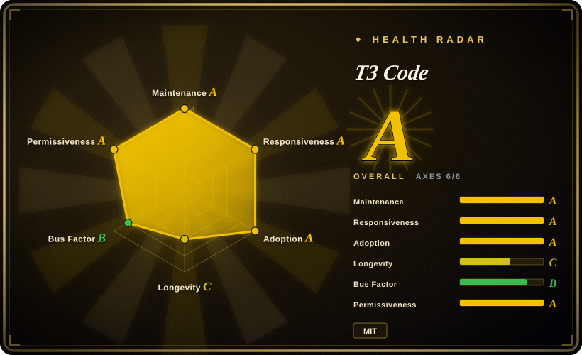
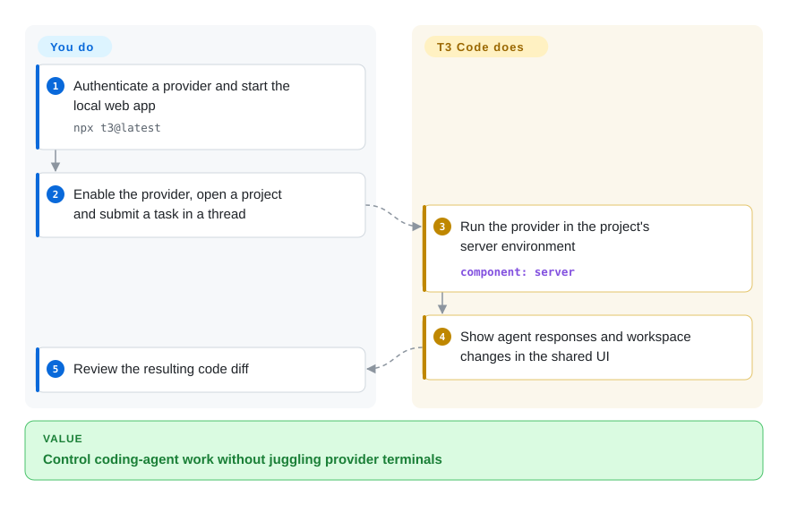

# T3 Code

You keep switching terminal windows to find which coding agent is waiting for input, and cannot inspect its work from your phone. T3 Code puts agent threads in a shared graphical control surface while execution stays on the workspace machine.

## When to use

You're already authorized in more than one coding-agent CLI and want a single graphical workspace for sessions rather than several terminal windows. Pick T3 Code over writing your own wrapper because it exposes a local web UI, `npx t3@latest` entry point, and desktop builds around supported agent CLIs. Its deciding tradeoff is convenience across providers without becoming a model provider or replacing the underlying agents.

Use it when a browser, desktop or mobile control surface is worth the added local service and you accept a fast-moving 0.0.x product. README explicitly supports Codex, Claude, Cursor, Grok Build, OpenCode and Antigravity; the install guide also documents Pi and Muse Code. A provider must be configured and authenticated before starting a thread, but managed ChatGPT/Antigravity paths do not require a preinstalled CLI.

## When NOT to use

- **You expect a free model or independent agent runtime.** Use the selected provider directly if you only need one agent; T3 Code controls existing or managed provider runtimes and you still need authentication and a subscription or API budget.
- **You need mature documentation, predictable compatibility, or a stable production control plane.** Use a supported provider's native client; the README calls T3 Code very early, and current releases are still 0.0.x with frequent nightlies.
- **You want a minimal terminal-only workflow or the smallest local attack surface.** Use the selected provider's CLI directly; T3 Code adds a Node service, WebSocket UI, persistence, and optionally Electron.
- **You need an open contribution process and externally governed roadmap.** Choose a project that accepts outside contributions; its contribution policy says external PRs may be closed, held indefinitely, or not reviewed.
- **You require an air-gapped phone-to-server setup without reviewing remote connectivity.** Use a local provider CLI or local-only T3 session; mobile access adds a separately configured connection and credentials, not a hosted coding sandbox.

## Comparison

| Alternative | In index | Our verdict | Tradeoff |
|---|---|---|---|
| [OpenCode](opencode.md) | ✅ | Choose OpenCode when a model-flexible terminal agent is sufficient; choose T3 Code when its GUI must coordinate an already installed OpenCode alongside other agents. | OpenCode is an agent runtime; T3 Code is an interface layer and adds local UI complexity. |
| [Codex CLI](codex.md) | ✅ | Choose Codex CLI when OpenAI's terminal workflow is all you need; choose T3 Code only to unify it with other authenticated providers. | Native CLI has fewer moving parts; T3 Code provides cross-provider session UX. |
| Claude Code vendor client | not a repo | Choose Claude Code when Anthropic's native workflow is the desired standard; choose T3 Code when switching to Codex, Cursor, or OpenCode in one GUI matters more. | This row refers to the proprietary client, not its public documentation repository; its [license](https://github.com/anthropics/claude-code/blob/main/LICENSE.md) reserves all rights. T3 Code adds a multi-provider interface rather than replacing that runtime. |
| [CC Switch](../orchestration-and-review/cc-switch.md) | ✅ | Choose CC Switch for a desktop manager of agent configurations and providers; choose T3 Code for a session-oriented GUI around agent runs. | Both add a meta-layer; CC Switch focuses on tool management, while T3 Code hosts coding-agent interactions. |

## Quick start

Install and authenticate a provider on the machine containing your project; for example, the [README](https://github.com/pingdotgg/t3code/blob/8d7523248964ec7b37cc08f91e15122def171821/README.md) specifies `codex login` after installing Codex CLI. Try `npx t3@latest` to start the local server and web app, or install a desktop release; `docs/user/install.md` documents the persistent `t3` installation and service commands. In Settings → Providers, enable the provider for that environment, open your project and start a thread with a coding task. T3 Code presents agent responses and workspace changes while its server runs the provider on that machine; you answer approval requests and review the resulting diff. Provider subscriptions/API usage remain your responsibility, and phone access requires a separate remote-connection setup rather than moving execution to the phone.

<!-- flow-steps:begin (generated from flows/t3code.json by tools/flow_card.py — do not edit) -->

Text version of the flow

1. **You**: Authenticate a provider and start the local web app — `npx t3@latest`
2. **You**: Enable the provider, open a project and submit a task in a thread
3. **T3 Code**: Run the provider in the project's server environment — component: `server`
4. **T3 Code**: Show agent responses and workspace changes in the shared UI
5. **You**: Review the resulting code diff

**Value**: Control coding-agent work without juggling provider terminals

<!-- flow-steps:end -->

## Key techniques

- **Record intent before external work.** [`apps/server/src/orchestration-v2/EventSink.ts:240–261`](https://github.com/pingdotgg/t3code/blob/8d7523248964ec7b37cc08f91e15122def171821/apps/server/src/orchestration-v2/EventSink.ts#L240-L261) defines the commit/publish boundary; [`EventSink.ts:527–592`](https://github.com/pingdotgg/t3code/blob/8d7523248964ec7b37cc08f91e15122def171821/apps/server/src/orchestration-v2/EventSink.ts#L527-L592) reserves a command ID, appends events, updates projections and queues effects in one SQL transaction, then publishes committed events. Reusing an ID returns the old receipt instead of committing again. This separates durable accepted intent from provider execution: an acknowledgement does not mean a tool operation has finished.
- **Bound reconnection work rather than replaying everything.** [`apps/server/src/orchestration-v2/ThreadStream.ts:14–124`](https://github.com/pingdotgg/t3code/blob/8d7523248964ec7b37cc08f91e15122def171821/apps/server/src/orchestration-v2/ThreadStream.ts#L14-L124) limits thread replay to 128 events and 1 MiB encoded data, checks raw payload safety, and falls back to a bounded snapshot when the cursor is invalid or the replay exceeds its budget. Clients receive history cursors to fetch more, rather than one unbounded transcript; snapshot delivery is not a promise that all old history is already loaded.

## Tech stack

- **Core:** TypeScript pnpm monorepo with a Node.js server, HTTP/WebSocket transport, and stdio JSON-RPC to local agent processes.
- **Web:** React 19, Vite/Vite+, and Tailwind CSS 4.
- **Desktop / mobile:** Electron desktop application and Expo/React Native mobile code.
- **Integrations:** provider SDKs for Claude and OpenCode, local Codex app-server integration, SSH/Tailscale and relay-related packages.

## Dependencies

- **Required:** one configured/authenticated provider runtime. CLI installation is provider-specific; managed ChatGPT and Antigravity paths are exceptions.
- **Runtime:** the published server package declares Node.js `^22.16 || ^23.11 || >=24.10`; repository development uses newer Node and pnpm.
- **Optional desktop:** Electron builds for supported desktop platforms.
- **Credentials:** provider logins or configured accounts belong to the server environment; the frontend does not supply model access. Development root requires Node `^24.13.1`, distinct from the published server's broader engines range.

## Ops difficulty

**Low to medium.** Trying it with `npx` is local and straightforward once an agent CLI is authenticated. Operating it as a durable desktop or team workflow is more involved: provider compatibility, token/session persistence, nightly upgrades, and the added service/UI layer must be reviewed.

## Health & viability

- **Maintenance snapshot (2026-10-13):** unarchived, with active main and frequent nightlies; GitHub reports 27350 stars, an attention signal rather than adoption proof.
- **Release discipline:** stable `v0.0.45` was published 2026-10-02; newest listed releases are `v0.0.46` nightly prereleases. Active release automation does not equal a stable compatibility contract. [推断：0.0.x versions and separate stable/nightly channels]
- **Governance / bus factor:** the repo belongs to the `pingdotgg` organization and has many contributors, but reported contributions are strongly concentrated in one maintainer and external contribution intake is deliberately restricted.
- **Age / Lindy:** created 2026-02, so its high early interest has not had time to become a long-term reliability signal. MIT is low-friction legally.

## Caveats (unverified)

- [未验证：providers and remote clients were not run] Provider authentication, desktop/mobile compatibility and remote connections were source-reviewed, not tested end to end.
- [推断：0.0.x versions and frequent nightlies] Pin and test a release before rollout; active releases and stars do not establish a stable compatibility contract.
