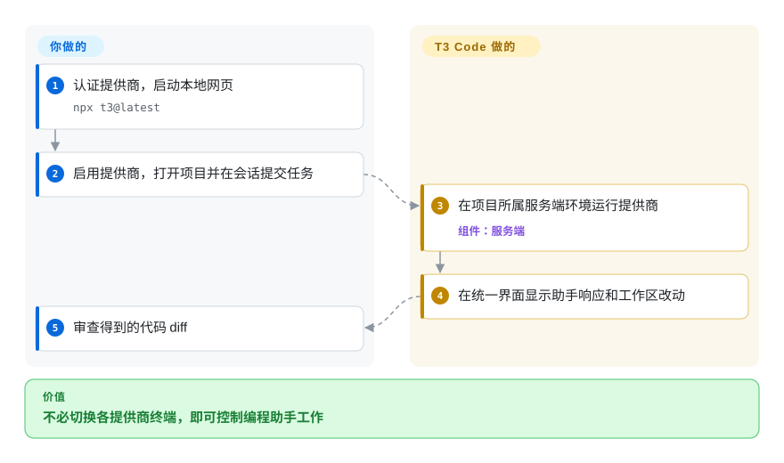

# T3 Code

你不断切换终端窗口，找哪个编程助手正在等输入，出门后又不能从手机查看进度。T3 Code 把这些会话放进统一图形界面，执行仍留在项目所在机器。

## 何时使用

你已经登录了不止一个 coding-agent CLI，不想在多个终端窗口之间切换，而想要统一的图形化会话工作区。此时选 T3 Code，而不是自己写包装器，因为它为受支持 agent CLI 提供本地 Web UI、`npx t3@latest` 入口与桌面构建。决定性取舍是：用跨提供商便利性换取更多本地运行层，它不提供模型，也不替代底层 agent。

当网页、桌面或手机交互面的价值大于新增本地服务成本，而且你接受高频变动的 0.0.x 产品时使用。README 明确支持 Codex、Claude、Cursor、Grok Build、OpenCode、Antigravity；安装指南还记录 Pi 和 Muse Code。开始会话前必须配置并认证提供商，但托管的 ChatGPT、Antigravity 路径不要求预装 CLI。

## 何时不用

- **你期待免费模型或独立助手运行时。**只需要一个助手时直接用所选提供商；T3 Code 控制既有或托管的提供商运行时，仍需要认证、订阅或 API 预算。
- **你需要成熟文档、可预测兼容性或稳定的生产控制面。**改用对应提供商的原生客户端；README 明确称项目非常早期，当前仍是 0.0.x，且 nightlies 很频繁。
- **你只要极简终端工作流，或想把本地攻击面压到最低。**直接用所选提供商的 CLI；T3 Code 会增加 Node 服务、WebSocket UI、持久化以及可选 Electron 层。
- **你需要开放贡献流程和外部共同治理的路线图。**改选明确接收外部贡献的项目；其贡献政策说明外部 PR 可能被关闭、无限期搁置或不被审阅。
- **你要求隔离网络中的手机访问，又不愿审查远程连接。**改用本地提供商 CLI 或仅本地的 T3 会话；手机访问需要另配连接与凭据，不是托管编程沙箱。

## 横向对比

| 替代品 | 是否收录 | 我们的评价 | 取舍 |
|---|---|---|---|
| [OpenCode](opencode.zh.md) | ✅ | 只需模型灵活的终端 agent 时选 OpenCode；必须用 GUI 协调已安装的 OpenCode 与其他 agent 时选 T3 Code。 | OpenCode 是 agent runtime；T3 Code 是界面层，会增加本地 UI 复杂度。 |
| [Codex CLI](codex.zh.md) | ✅ | 只需 OpenAI 的终端工作流时选 Codex CLI；只有在要和其他已认证提供商统一时才选 T3 Code。 | 原生 CLI 的运行部件更少；T3 Code 提供跨提供商会话体验。 |
| Claude Code | 未收录 | Anthropic 原生工作流是团队标准时选 Claude Code；在一个 GUI 里切换 Codex、Cursor、OpenCode 更重要时选 T3 Code。 | Claude Code 的厂商整合更聚焦；T3 Code 以多提供商外壳换取这种聚焦。 |
| [CC Switch](../orchestration-and-review/cc-switch.zh.md) | ✅ | 要管理 agent 配置与提供商的桌面工具时选 CC Switch；要围绕 agent 实际运行建立会话 GUI 时选 T3 Code。 | 两者都会增加元管理层；CC Switch 偏工具管理，T3 Code 承载编程 agent 交互。 |

## 快速上手

先在项目所在机器安装、认证提供商；例如所读版本的 [README](https://github.com/pingdotgg/t3code/blob/8d7523248964ec7b37cc08f91e15122def171821/README.md) 指定安装 Codex CLI 后执行 `codex login`。用 `npx t3@latest` 试启动本地服务和网页，或安装桌面发布版；`docs/user/install.md` 记录了持久安装 `t3` 和后台服务命令。在 Settings → Providers 为该运行环境启用提供商，打开项目，用编程任务开始会话。T3 Code 展示助手响应和工作区改动，由服务端在那台机器运行提供商；你回答权限确认并检查最终 diff。提供商订阅或 API 费用仍由你承担，手机访问另需远程连接配置，执行不会移到手机。

<!-- flow-steps:begin (generated from flows/t3code.json by tools/flow_card.py — do not edit) -->

流程文字版

1. **你**：认证提供商，启动本地网页 — `npx t3@latest`
2. **你**：启用提供商，打开项目并在会话提交任务
3. **T3 Code**：在项目所属服务端环境运行提供商 — 组件：`服务端`
4. **T3 Code**：在统一界面显示助手响应和工作区改动
5. **你**：审查得到的代码 diff

**价值**：不必切换各提供商终端，即可控制编程助手工作

<!-- flow-steps:end -->

## 技术要点

- **先记录意图，再执行外部工作。**[`apps/server/src/orchestration-v2/EventSink.ts:240–261,527–592`](https://github.com/pingdotgg/t3code/blob/8d7523248964ec7b37cc08f91e15122def171821/apps/server/src/orchestration-v2/EventSink.ts#L527-L592) 在同一个 SQL 事务里预留命令 ID、追加事件、更新投影并排队副作用，然后发布已提交事件。重用 ID 直接返回旧回执，不再次提交。因此持久化的接受意图与提供商执行分开；收到确认不代表工具操作已经完成。
- **限制重连成本，不一次回放全部历史。**[`apps/server/src/orchestration-v2/ThreadStream.ts:14–124`](https://github.com/pingdotgg/t3code/blob/8d7523248964ec7b37cc08f91e15122def171821/apps/server/src/orchestration-v2/ThreadStream.ts#L14-L124) 将会话回放限制在 128 个事件和 1 MiB 编码数据，检查原始载荷安全性；游标无效或回放超预算时改发有界快照。客户端拿历史游标继续分页，而不是一次传无界对话；快照送达不表示全部旧历史已加载。

## 技术栈

- **核心：**TypeScript 的 pnpm monorepo，含 Node.js 服务、HTTP/WebSocket 传输，以及到本地 agent 进程的 stdio JSON-RPC。
- **Web：**React 19、Vite/Vite+、Tailwind CSS 4。
- **桌面与移动：**Electron 桌面应用，以及 Expo/React Native 移动端代码。
- **集成：**Claude 和 OpenCode 的 provider SDK、本地 Codex app-server 集成，以及 SSH、Tailscale 和 relay 相关包。

## 依赖

- **必需：**至少一个已配置、认证的提供商运行时。是否安装 CLI 由提供商决定；托管的 ChatGPT、Antigravity 是例外。
- **运行时：**发布的 server 包声明 Node.js `^22.16 || ^23.11 || >=24.10`；仓库开发使用更新的 Node 与 pnpm。
- **可选桌面端：**受支持桌面平台的 Electron 构建。
- **凭据：**提供商登录或配置账号属于服务端环境，前端不提供模型使用权。开发根目录要求 Node `^24.13.1`，与发布服务端较宽的 engines 范围不同。

## 运维难度

**低到中。**已有 agent CLI 登录后，用 `npx` 试用是本地且直接的。把它作为长期桌面或团队工作流时更复杂：提供商兼容性、token 与会话持久化、nightly 升级，以及新增服务和 UI 层都需要评审。

## 健康度与可持续性

- **维护快照（2026-10-13）：**未归档，main 活跃且持续发布 nightly；GitHub 显示 27350 stars，这是关注信号，不是采用量证明。
- **发布纪律：**稳定版 `v0.0.45` 发布于 2026-10-02，最新列出的发布是 `v0.0.46` nightly 预发布。活跃的发布自动化不等于稳定兼容契约。[推断：依据是仍为 0.0.x 且稳定版和 nightly 分轨]
- **治理与 bus factor：**仓库归 `pingdotgg` 组织，贡献者较多，但公开统计显示贡献高度集中于一位维护者，且外部贡献入口被主动收紧。
- **年龄与 Lindy：**创建于 2026-02，早期高关注度尚未沉淀为长期可靠性信号。MIT 的法律摩擦较低。

## 存疑（未验证）

- [未验证：未运行提供商或远程客户端] 提供商认证、桌面手机兼容性与远程连接只读过源码，没有端到端测试。
- [推断：依据是 0.0.x 版本与高频 nightly] 上线前固定版本并实测；活跃发布和 stars 不能证明兼容契约稳定。
