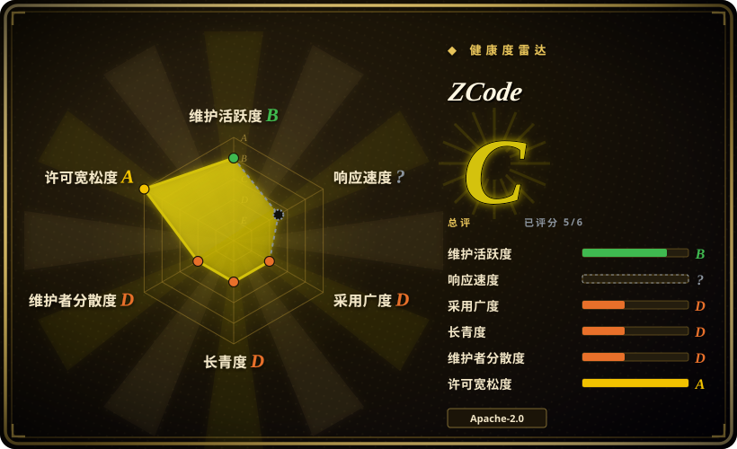
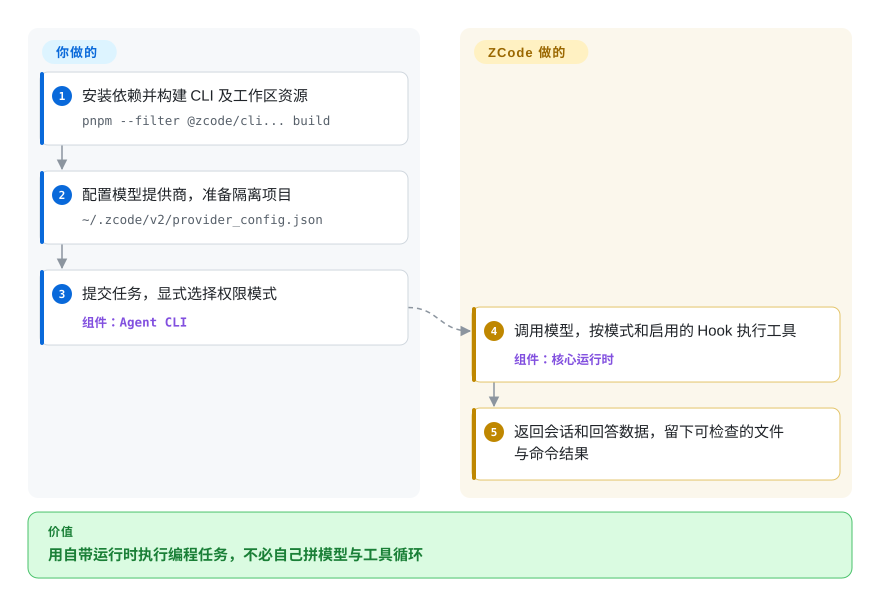
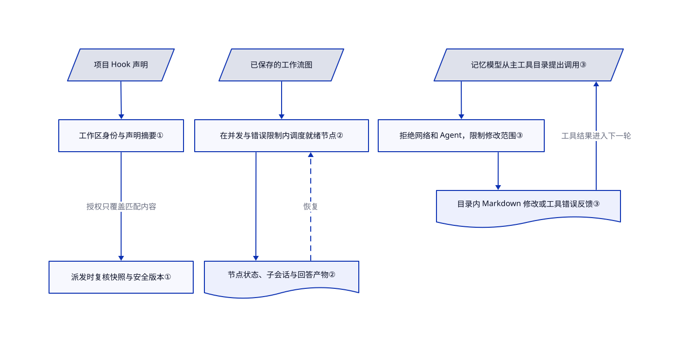

# ZCode

桌面查看改动、远程主机写代码、终端跑批任务，各自又要配一套 agent。ZCode 把自带运行时放进桌面、网页和终端，并提供按依赖调度的工作流，以及绑定声明内容的项目 Hook 授权。

## 何时使用

你在工作站和 SSH 主机上维护同一个代码库。你既想直观看改动，又想通过 CLI 重复跑任务，不想围绕第二个 agent 重建模型、技能和 Hook 接线。需要可修改源码的自带运行时、共享桌面／网页界面、自定义模型地址和内置工作流调度时，可以考虑 ZCode。例如，任务停下后，你可以查保存的会话和工作流产物，而不是在多个终端窗口里拼进度。

与 [T3 Code](../independent-runtimes/t3code.zh.md) 相比，关键选择是采用一个自带 agent，而非包住多个现有 CLI。与 [OpenCode](../independent-runtimes/opencode.zh.md) 相比，只有内置工作流和 Z.ai 账号界面比广泛的提供商生态更重要时，才优先选 ZCode。[README](https://github.com/zai-org/ZCode/blob/3c5b227649371507ddc4eb46ac5133afe6db1cab/README.md) 记录了 SSH／WSL 工作区；[CLI 配置指南](https://github.com/zai-org/ZCode/blob/3c5b227649371507ddc4eb46ac5133afe6db1cab/apps/zcode-cli/docs/usage/03-config.md) 支持 Chat Completions、Responses 和 Anthropic Messages 三种协议。这不代表开源构建具有商业产品的全部能力。

## 何时不用

- **必须先用系统沙箱隔离不可信仓库。** 优先选启用沙箱的 [Codex](codex.zh.md)。ZCode 的[声明](https://github.com/zai-org/ZCode/blob/3c5b227649371507ddc4eb46ac5133afe6db1cab/NOTICE.md#L5-L30) 明确没有默认系统沙箱，非交互 `--prompt` 默认采用 `yolo`。权限服务先放行普通 yolo 调用，再走常规拒绝规则；交互工具和强制确认工具另有规则。模式名称和工具过滤都不等于隔离。
- **只想给已有 agent 加图形界面。** 选 [T3 Code](../independent-runtimes/t3code.zh.md)。ZCode 自带 CLI、运行时和配置模型；如果问题只是找不到已有会话，没有必要换整套 agent。
- **多提供商接入比 Z.ai 产品接线更重要。** 优先选 [OpenCode](../independent-runtimes/opencode.zh.md)。ZCode 支持自定义 API，但其[声明](https://github.com/zai-org/ZCode/blob/3c5b227649371507ddc4eb46ac5133afe6db1cab/NOTICE.md#L32-L69) 记录了账号服务、官方端点的网关转发、远端凭据同步和本地模型输入输出日志。源码公开不等于没有外发，也不等于密钥只留在一台机器；OpenCode 自己的可选托管服务也要审查。
- **需要商业应用的原生桌面控制或完整训练轨迹。** 编程任务可选 [Codex](codex.zh.md)，额外自动化另行验收。ZCode 开源版 Computer Use 只会报不可用错误。[批量任务指南](https://github.com/zai-org/ZCode/blob/3c5b227649371507ddc4eb46ac5133afe6db1cab/apps/zcode-cli/docs/usage/13-automation.md#L77-L101) 还记录了默认日志转换及 `record:prompt` 失败，不能当作现成训练数据流水线。
- **要求简单明了的再分发审计。** 优先考虑 [Codex](codex.zh.md) 等范围更窄的 agent，再审计其实际产物。ZCode 第一方 Apache 许可真实存在，但[第三方材料说明](https://github.com/zai-org/ZCode/blob/3c5b227649371507ddc4eb46ac5133afe6db1cab/third-party/README.md) 记录了 25 项待核验事项，并说明严格检查会失败。这增加发行合规成本，不代表整个运行时闭源。

## 横向对比

| 替代品 | 是否收录 | 我们的评价 | 取舍 |
|---|---|---|---|
| [OpenCode](../independent-runtimes/opencode.zh.md) | ✅ | 要跨广泛模型和提供商的终端工作流，选 OpenCode；内置工作流调度和 Z.ai 桌面体验决定选择时，才选 ZCode。 | ZCode 提供自带桌面／网页栈与工作流机制，代价是产品服务接线和更短的公开维护历史。 |
| [Codex](codex.zh.md) | ✅ | 默认系统级执行隔离最重要时，选 Codex；要自带运行时贯通桌面、网页和 CLI，并配置三类模型协议时，考虑 ZCode。 | Codex 自定义提供商限制为 Responses；ZCode 协议更灵活，但执行隔离由你承担。 |
| [T3 Code](../independent-runtimes/t3code.zh.md) | ✅ | 要可视化协调已登录的编程 agent，选 T3 Code；要修改并统一 agent 运行时本身，选 ZCode。 | T3 Code 继承下层运行时行为；ZCode 自管更多循环、配置和扩展，也承担更多升级负担。 |

## 快速上手

按[源码快速开始](https://github.com/zai-org/ZCode/blob/3c5b227649371507ddc4eb46ac5133afe6db1cab/apps/zcode-cli/docs/usage/01-quickstart.md)，准备 Git、Node.js 24.14.0 和 pnpm 10.33.2，再执行 `pnpm install --frozen-lockfile` 与 `pnpm --filter @zcode/cli... build`。保留构建出的 bundle 及相邻资源；指南用 `zcode` 代指可执行文件，普通 bundle 则使用 `node /absolute/path/to/zcode.cjs`。在 `~/.zcode/v2/provider_config.json` 配模型提供商，也就是模型请求的地址和凭据；运行、权限及扩展设置另放在 `~/.zcode/cli/config.json`。先在一次性项目里提交任务，并显式写 `--mode`，分析先用 `plan`，无人值守改文件才在自行隔离的环境使用 `yolo`。ZCode 执行模型与工具循环，返回会话和回答数据；你承担模型费用、凭据保护，并检查真实文件、工具错误及测试结果，不能只信最终回答。若要图形界面，根 README 另列 `pnpm bootstrap` 后接 `pnpm dev:desktop` 或 `pnpm dev:web`，这些是另一条入口，不是 CLI 的前置要求。

<!-- flow-steps:begin (generated from flows/zcode.json by tools/flow_card.py — do not edit) -->

流程文字版

1. **你**：安装依赖并构建 CLI 及工作区资源 — `pnpm --filter @zcode/cli... build`
2. **你**：配置模型提供商，准备隔离项目 — `~/.zcode/v2/provider_config.json`
3. **你**：提交任务，显式选择权限模式 — 组件：`Agent CLI`
4. **ZCode**：调用模型，按模式和启用的 Hook 执行工具 — 组件：`核心运行时`
5. **ZCode**：返回会话和回答数据，留下可检查的文件与命令结果

**价值**：用自带运行时执行编程任务，不必自己拼模型与工具循环

<!-- flow-steps:end -->

## 技术要点

<!-- mechanism:begin (generated from mechanisms/zcode.json by tools/mechanism_card.py; do not edit) -->

机制文字版

- 项目 Hook 声明
- 工作区身份与声明摘要①
- 派发时复核快照与安全版本①
- 已保存的工作流图
- 在并发与错误限制内调度就绪节点②
- 节点状态、子会话与回答产物②
- 记忆模型从主工具目录提出调用③
- 拒绝网络和 Agent，限制修改范围③
- 目录内 Markdown 修改或工具错误反馈③

- 项目 Hook 声明 → 工作区身份与声明摘要①
- 工作区身份与声明摘要① → 派发时复核快照与安全版本①（授权只覆盖匹配内容）
- 已保存的工作流图 → 在并发与错误限制内调度就绪节点②
- 在并发与错误限制内调度就绪节点② → 节点状态、子会话与回答产物②
- 节点状态、子会话与回答产物② → 在并发与错误限制内调度就绪节点②（恢复）〔可选／兜底〕
- 记忆模型从主工具目录提出调用③ → 拒绝网络和 Agent，限制修改范围③
- 拒绝网络和 Agent，限制修改范围③ → 目录内 Markdown 修改或工具错误反馈③
- 目录内 Markdown 修改或工具错误反馈③ → 记忆模型从主工具目录提出调用③（工具结果进入下一轮）

<!-- mechanism:end -->

### 1. 把项目 Hook 信任绑定到声明与工作区

- **解决：** 打开仓库不应自动授权其生命周期脚本，旧授权也不应覆盖改过的声明。
- **做法：** 授权记录同时绑定工作区身份和 Hook 声明摘要。评估器把变更槽位标为过期，把损坏存储视为未信任；实际派发时还检查快照，并在安全版本变化后刷新缓存决策。
- **边界：** 它只控制项目 Hook 准入，不统一审核任意脚本、MCP 连接或插件 Hook。未信任的项目 Hook 会跳过，主任务可以继续；授权声明不是沙箱，也不证明脚本安全。
- **源码：** [信任评估第 15–68 行](https://github.com/zai-org/ZCode/blob/3c5b227649371507ddc4eb46ac5133afe6db1cab/apps/zcode-cli/packages/core/src/hooks/workspace-hook-trust-evaluation.ts#L15-L68)、[派发复核第 116–190 行](https://github.com/zai-org/ZCode/blob/3c5b227649371507ddc4eb46ac5133afe6db1cab/apps/zcode-cli/packages/core/src/hooks/workspace-hook-runtime-admission.ts#L116-L190)、[审核、授权与撤销指南](https://github.com/zai-org/ZCode/blob/3c5b227649371507ddc4eb46ac5133afe6db1cab/apps/zcode-cli/docs/usage/09-hooks.md#L53-L84)。

### 2. 只调度就绪节点，并保存工作流进度

- **解决：** 长任务有先后依赖，不能同时启动所有 worker，也不能暂停后丢掉各自状态。
- **做法：** 调度器推导就绪节点，按配置限制并行循环，保存节点活动、子会话关联和 Markdown 回答产物。依赖阻塞或连续出错时暂停，恢复前先协调已保存的快照。
- **边界：** 调度完成包含取消和跳过的节点；worker 完成只保存其回答，不独立证明产物正确。持久化不保证外部操作只执行一次，也不能在取消后撤销操作。
- **源码：** [调度循环第 51–165 行](https://github.com/zai-org/ZCode/blob/3c5b227649371507ddc4eb46ac5133afe6db1cab/apps/zcode-cli/packages/core/src/workflow/scheduler.ts#L51-L165)、[完成状态第 14–85 行](https://github.com/zai-org/ZCode/blob/3c5b227649371507ddc4eb46ac5133afe6db1cab/apps/zcode-cli/packages/core/src/workflow/scheduler/graph.ts#L14-L85)、[活动与产物保存第 89–201 行](https://github.com/zai-org/ZCode/blob/3c5b227649371507ddc4eb46ac5133afe6db1cab/apps/zcode-cli/packages/core/src/workflow/scheduler/node-runner.ts#L89-L201)。

### 3. 保留记忆 agent 工具目录，收窄实际执行

- **解决：** 整理记忆的模型不应继承主 agent 改项目或调用网络工具的能力。
- **做法：** 记忆循环仍向模型发送主工具目录，但在执行前检查每次调用。它拒绝 Agent、MCP 和网络副作用工具，Write／Edit 必须落在记忆根目录内的 Markdown；Shell 只能通过只读分类，或走受限的目录内 Markdown 删除路径。
- **边界：** 此策略未把 Read／Grep／Glob 限制到记忆根目录，因此它约束修改，不是保密沙箱。循环仍调用模型、消耗 token，并依赖路径解析和命令分类。
- **源码：** [记忆循环及执行策略第 43–216 行](https://github.com/zai-org/ZCode/blob/3c5b227649371507ddc4eb46ac5133afe6db1cab/apps/zcode-cli/packages/core/src/memory/memory-agent-loop.ts#L43-L216)、[记忆开关](https://github.com/zai-org/ZCode/blob/3c5b227649371507ddc4eb46ac5133afe6db1cab/apps/zcode-cli/docs/usage/11-memory.md)。

## 技术栈

- TypeScript／Node.js 的 pnpm monorepo；Electron 桌面端，React 19 共享界面，Zustand 管理状态。
- Hono HTTP 服务、WebSocket／RPC 传输、SSH2 远程连接，以及独立 CLI／核心运行时。本地会话存储包含 SQLite；文档中的本地启动不要求外部数据库集群。
- 证据见[根清单](https://github.com/zai-org/ZCode/blob/3c5b227649371507ddc4eb46ac5133afe6db1cab/package.json)、[服务端](https://github.com/zai-org/ZCode/blob/3c5b227649371507ddc4eb46ac5133afe6db1cab/packages/server/package.json)、[界面](https://github.com/zai-org/ZCode/blob/3c5b227649371507ddc4eb46ac5133afe6db1cab/packages/ui/package.json) 和[数据声明](https://github.com/zai-org/ZCode/blob/3c5b227649371507ddc4eb46ac5133afe6db1cab/NOTICE.md#L59-L69)。

## 依赖

- 支持工具调用的模型地址及凭据；自定义 API 支持文档列出的三类协议。Z.ai 账号是另一条接入路径，不是所有自定义端点的必要条件。
- 源码构建需要 Git、Node.js 24.14.0、pnpm 10.33.2，以及依赖和运行资源下载源。统一发行包仍需 Node；另行记录的 SEA 构建会内嵌 Node。
- 远程工作区需要 SSH／WSL 设置及预备资源。Browser Use 需要可用的 Chrome／Chromium 和插件；随附 Computer Use 不可用。MCP 服务和 Hook 程序还需各自依赖。

## 运维难度

**本地开发为中，无人值守和再分发为高。** 你要管理两类配置、本地数据库、凭据、模型日志和扩展信任。源码构建会准备原生组件及运行资源，远程工作还涉及凭据传输和主机执行。[网页启动器](https://github.com/zai-org/ZCode/blob/3c5b227649371507ddc4eb46ac5133afe6db1cab/README.md) 默认只监听本机且无令牌，监听非本机地址时默认生成令牌，但直接 HTTP 入口另有认证设置。固定源码版本，隔离自动化，按实际入口核验认证，再分发前处理第三方材料。

## 健康度与可持续性

- **维护，截至 2026-10-21：** 公开仓库建于 2026-09-20，最近更新为 2026-10-20。清单版本为 v3.16.2；GitHub 唯一列出的发行版仍是 2026-09-24 发布的 v3.14.3。源码新鲜度和可下载发行版新鲜度不能混为一谈。
- **治理：** 由 Z.ai 组织持有，近期提交是源码同步快照。贡献者 API 列出两个账号，议题关闭，新 PR 限协作者。评分器因议题关闭而保留响应速度未知，不是注册表查询超时。公开历史无法衡量内部团队人数和响应速度。
- **年龄与长期性：** 公开历史只有 31 天，即使已有 8075 星和 2471 个 fork，也不足以证明长期可持续。宜做可回退试用，不宜靠关注度就统一敏感自动化。[推断：依据为建库日期、厂商控制的贡献入口和有限公开历史]
- **许可与采用：** 第一方 Apache-2.0 允许修改；第三方组件各有条款，且存在文档明确登记的来源和许可待核验项。厂商公开了大量可复用代码，但许可本身不证明商业功能完全对齐或发行合规已清。

## 存疑（未验证）

- [未验证：本次收录禁止执行上游] 构建、模型调用、桌面／网页交互、远程主机和权限行为均只读源码，未实际运行。上游指南的 macOS／模拟提供商检查属于作者自报，不是本次测试。
- [未验证：内部历史和服务实现未在此公开] 公开贡献者不能证明厂商内部人员风险，客户端源码也不能说明官方网关的保留及处理策略。本文不声称完全本地或商业能力完全对齐。
- [推断：依据为 31 天公开历史和受限贡献入口] 相比把早期热度当作长期维护证据，可回退试用更稳妥。
