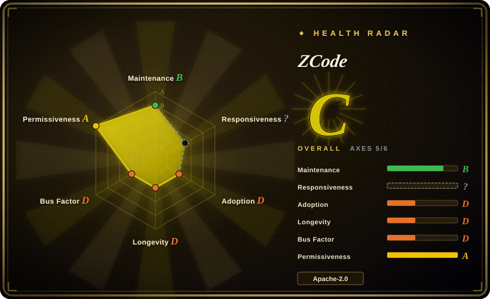
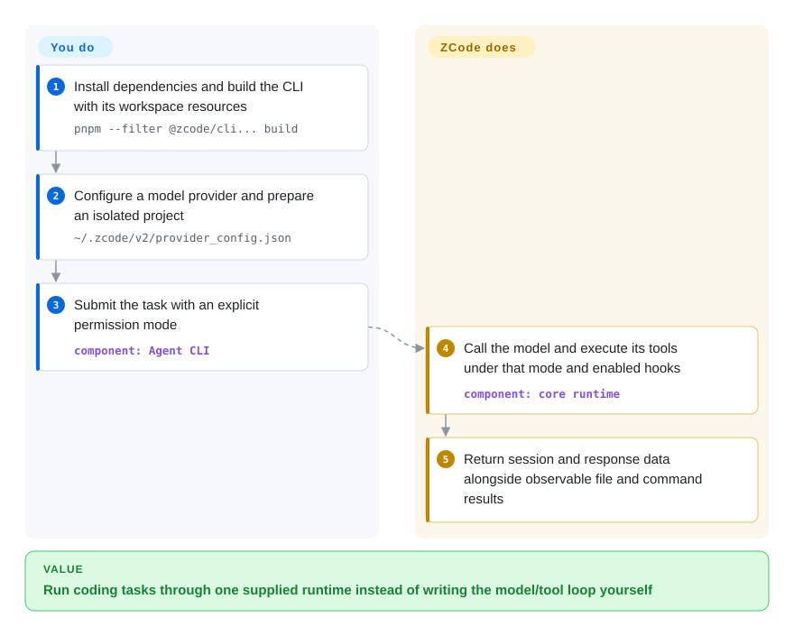
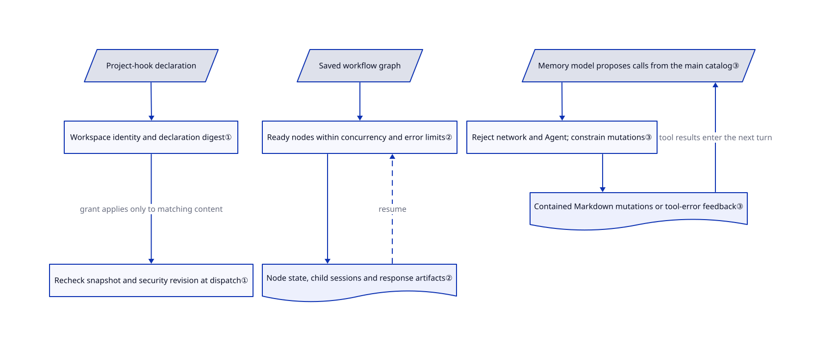

# ZCode

Your coding task spans a desktop window, a remote workspace and unattended terminal jobs, but each has different agent settings. ZCode supplies its own agent runtime with desktop, web and terminal interfaces, plus dependency-aware workflows and content-bound approval for project hooks.

## When to use

You maintain a codebase on a workstation and an SSH host. You want to inspect changes visually, then run a repeatable CLI task without rebuilding provider, skill and hook integration around a second agent. Choose ZCode when you want the runtime itself available in source, a shared desktop/web interface, custom model endpoints and a built-in workflow scheduler. For example, after an agent task stops, you can examine its saved sessions and workflow artifacts rather than reconstructing progress from several terminal windows.

The deciding tradeoff against [T3 Code](t3code.md) is owning one supplied agent rather than wrapping several existing agent CLIs. Against [OpenCode](opencode.md), prefer ZCode when its integrated workflow and Z.ai account surfaces matter more than OpenCode's broader provider ecosystem. The [README](https://github.com/zai-org/ZCode/blob/3c5b227649371507ddc4eb46ac5133afe6db1cab/README.en.md) documents SSH/WSL workspaces; its [CLI configuration guide](https://github.com/zai-org/ZCode/blob/3c5b227649371507ddc4eb46ac5133afe6db1cab/apps/zcode-cli/docs/usage/03-config.md) supports Chat Completions, Responses and Anthropic Messages protocols. This is not a promise that the open build reproduces every commercial feature.

## When NOT to use

- **You need an OS sandbox before processing an untrusted repository.** Prefer [Codex](codex.md) with its sandbox enabled. ZCode's [NOTICE](https://github.com/zai-org/ZCode/blob/3c5b227649371507ddc4eb46ac5133afe6db1cab/NOTICE.md#L5-L30) explicitly disclaims a default OS sandbox; non-interactive `--prompt` defaults to `yolo`. The permission service allows ordinary yolo calls before normal deny-rule checks, while special interaction and always-ask gates differ. A mode name or tool filter is not containment.
- **You only want a GUI around agents you already use.** Prefer [T3 Code](t3code.md). ZCode supplies its own CLI/runtime and configuration model; adopting a whole agent is unnecessary when the problem is merely finding existing sessions.
- **Broad provider support matters more than Z.ai product integration.** Prefer [OpenCode](opencode.md). ZCode supports custom APIs, but its [NOTICE](https://github.com/zai-org/ZCode/blob/3c5b227649371507ddc4eb46ac5133afe6db1cab/NOTICE.md#L32-L69) describes account services, official-endpoint gateway forwarding, remote credential synchronization and local model-input/output logs. Do not mistake source availability for no network traffic or secrets remaining on one host; OpenCode's own optional hosted services also require review.
- **You need the commercial app's native desktop-control feature or complete training traces.** For coding, use [Codex](codex.md) and validate any extra automation separately. ZCode's open Computer Use package only throws an unavailable error. Its [automation guide](https://github.com/zai-org/ZCode/blob/3c5b227649371507ddc4eb46ac5133afe6db1cab/apps/zcode-cli/docs/usage/13-automation.md#L77-L101) records failed default-log conversion and `record:prompt` paths; these are not a ready training-data pipeline.
- **You require an uncomplicated redistribution audit.** Prefer a narrower agent such as [Codex](codex.md), then audit its exact artifact too. ZCode's first-party Apache license is real, but its [third-party inventory documentation](https://github.com/zai-org/ZCode/blob/3c5b227649371507ddc4eb46ac5133afe6db1cab/third-party/README.md) records 25 unresolved review items and says strict checks fail. That is a release-compliance cost, not evidence that the entire runtime is closed.

## Comparison

| Alternative | In index | Our verdict | Tradeoff |
|---|---|---|---|
| [OpenCode](opencode.md) | ✅ | Choose OpenCode for a terminal workflow across a broad model/provider ecosystem; choose ZCode when its integrated workflow scheduler and Z.ai-oriented desktop experience decide the choice. | ZCode adds a supplied desktop/web stack and workflow machinery; you accept product-service integration and a much shorter public maintenance history. |
| [Codex](codex.md) | ✅ | Choose Codex when default OS-level execution isolation matters; choose ZCode for one source-available runtime spanning its desktop, web and CLI with three configurable model protocols. | Codex narrows custom providers to Responses; ZCode offers protocol flexibility but requires you to supply execution containment. |
| [T3 Code](t3code.md) | ✅ | Choose T3 Code to coordinate already authenticated coding agents visually; choose ZCode when you want to modify and standardize the agent runtime itself. | T3 Code inherits provider-runtime behavior; ZCode owns more of the loop, configuration, extensions and upgrade burden. |

## Quick start

Use the [source quick start](https://github.com/zai-org/ZCode/blob/3c5b227649371507ddc4eb46ac5133afe6db1cab/apps/zcode-cli/docs/usage/01-quickstart.md): prepare Git, Node.js 24.14.0 and pnpm 10.33.2, then run `pnpm install --frozen-lockfile` and `pnpm --filter @zcode/cli... build`. Keep the generated bundle and adjacent resources; the guide uses `zcode` as shorthand for that executable or `node /absolute/path/to/zcode.cjs`. Configure your model provider—the endpoint and credentials used for model requests—in `~/.zcode/v2/provider_config.json`; runtime, permissions and extensions live separately in `~/.zcode/cli/config.json`. Submit a task in a disposable project with an explicit `--mode`; begin with `plan` for analysis, and only use `yolo` for unattended edits inside isolation you control. ZCode runs the model/tool loop and returns session and response data; you pay for model calls, secure credentials and verify actual files, tool failures and test results rather than trusting the final answer. For a graphical source build, the root README instead documents `pnpm bootstrap` followed by `pnpm dev:desktop` or `pnpm dev:web`; these are separate entry paths, not requirements for CLI use.

<!-- flow-steps:begin (generated from flows/zcode.json by tools/flow_card.py — do not edit) -->

Text version of the flow

1. **You**: Install dependencies and build the CLI with its workspace resources — `pnpm --filter @zcode/cli... build`
2. **You**: Configure a model provider and prepare an isolated project — `~/.zcode/v2/provider_config.json`
3. **You**: Submit the task with an explicit permission mode — component: `Agent CLI`
4. **ZCode**: Call the model and execute its tools under that mode and enabled hooks — component: `core runtime`
5. **ZCode**: Return session and response data alongside observable file and command results

**Value**: Run coding tasks through one supplied runtime instead of writing the model/tool loop yourself

<!-- flow-steps:end -->

## Key techniques

<!-- mechanism:begin (generated from mechanisms/zcode.json by tools/mechanism_card.py; do not edit) -->

Text version of the mechanism

- Project-hook declaration
- Workspace identity and declaration digest①
- Recheck snapshot and security revision at dispatch①
- Saved workflow graph
- Ready nodes within concurrency and error limits②
- Node state, child sessions and response artifacts②
- Memory model proposes calls from the main catalog③
- Reject network and Agent; constrain mutations③
- Contained Markdown mutations or tool-error feedback③

- Project-hook declaration → Workspace identity and declaration digest①
- Workspace identity and declaration digest① → Recheck snapshot and security revision at dispatch① (grant applies only to matching content)
- Saved workflow graph → Ready nodes within concurrency and error limits②
- Ready nodes within concurrency and error limits② → Node state, child sessions and response artifacts②
- Node state, child sessions and response artifacts② → Ready nodes within concurrency and error limits② (resume) [optional/fallback]
- Memory model proposes calls from the main catalog③ → Reject network and Agent; constrain mutations③
- Reject network and Agent; constrain mutations③ → Contained Markdown mutations or tool-error feedback③
- Contained Markdown mutations or tool-error feedback③ → Memory model proposes calls from the main catalog③ (tool results enter the next turn)

<!-- mechanism:end -->

### 1. Bind project-hook trust to declarations and workspace identity

- **Problem:** Opening a repository must not silently authorize its lifecycle scripts, and an old approval must not authorize a changed declaration.
- **How:** Trust records key the workspace identity together with the hook declaration digest. Evaluation marks changed slots stale and corrupt stores untrusted; dispatch checks the snapshot and refreshes cached decisions when the security revision changes.
- **Limits:** This protects project-hook admission, not arbitrary scripts, MCP connections or plugin hooks. Untrusted project hooks are skipped while the main task can continue; an approved declaration is not a general sandbox or proof of script safety.
- **Source:** [Trust evaluation:15–68](https://github.com/zai-org/ZCode/blob/3c5b227649371507ddc4eb46ac5133afe6db1cab/apps/zcode-cli/packages/core/src/hooks/workspace-hook-trust-evaluation.ts#L15-L68), [dispatch recheck:116–190](https://github.com/zai-org/ZCode/blob/3c5b227649371507ddc4eb46ac5133afe6db1cab/apps/zcode-cli/packages/core/src/hooks/workspace-hook-runtime-admission.ts#L116-L190), [review/grant/revoke guide](https://github.com/zai-org/ZCode/blob/3c5b227649371507ddc4eb46ac5133afe6db1cab/apps/zcode-cli/docs/usage/09-hooks.md#L53-L84).

### 2. Schedule ready workflow nodes with persisted progress

- **Problem:** A long task with dependencies should not launch all workers at once or lose each worker's status when it pauses.
- **How:** The scheduler derives ready nodes, starts at most the configured concurrent loops, and records node activities, child-session links and Markdown response artifacts. It pauses on blocked progress or consecutive errors and reconciles a saved snapshot before resuming.
- **Limits:** Scheduler completion includes cancelled and skipped nodes; a completed worker stores its response, not independent proof that its output is correct. Persistence does not make external actions exactly-once or undo them after cancellation.
- **Source:** [Scheduler:51–165](https://github.com/zai-org/ZCode/blob/3c5b227649371507ddc4eb46ac5133afe6db1cab/apps/zcode-cli/packages/core/src/workflow/scheduler.ts#L51-L165), [completion statuses:14–85](https://github.com/zai-org/ZCode/blob/3c5b227649371507ddc4eb46ac5133afe6db1cab/apps/zcode-cli/packages/core/src/workflow/scheduler/graph.ts#L14-L85), [activity and artifact persistence:89–201](https://github.com/zai-org/ZCode/blob/3c5b227649371507ddc4eb46ac5133afe6db1cab/apps/zcode-cli/packages/core/src/workflow/scheduler/node-runner.ts#L89-L201).

### 3. Narrow memory-agent execution without shrinking its tool catalog

- **Problem:** A model organizing saved memories should not inherit the main agent's ability to edit the project or call network tools.
- **How:** The memory loop sends the main tool catalog to the model but checks every requested call before execution. It rejects Agent, MCP and network-scope tools; Write/Edit must target Markdown under the memory root, while shell calls pass a read-only classifier or a restricted contained Markdown-removal path.
- **Limits:** Read/Grep/Glob are not restricted to the memory root by this policy, so this is a mutation boundary, not a confidentiality sandbox. The loop still invokes a model, costs tokens and depends on path resolution and shell classification.
- **Source:** [Memory loop and execution policy:43–216](https://github.com/zai-org/ZCode/blob/3c5b227649371507ddc4eb46ac5133afe6db1cab/apps/zcode-cli/packages/core/src/memory/memory-agent-loop.ts#L43-L216), [memory controls](https://github.com/zai-org/ZCode/blob/3c5b227649371507ddc4eb46ac5133afe6db1cab/apps/zcode-cli/docs/usage/11-memory.md).

## Tech stack

- TypeScript/Node.js pnpm monorepo; Electron desktop and React 19 shared UI with Zustand state.
- Hono HTTP server, WebSocket/RPC transport, SSH2 remote connections and a separate CLI/core runtime. Local session storage includes SQLite; no external database cluster is required by the documented local start.
- [Manifests](https://github.com/zai-org/ZCode/blob/3c5b227649371507ddc4eb46ac5133afe6db1cab/package.json), [server](https://github.com/zai-org/ZCode/blob/3c5b227649371507ddc4eb46ac5133afe6db1cab/packages/server/package.json), [UI](https://github.com/zai-org/ZCode/blob/3c5b227649371507ddc4eb46ac5133afe6db1cab/packages/ui/package.json) and [data disclosure](https://github.com/zai-org/ZCode/blob/3c5b227649371507ddc4eb46ac5133afe6db1cab/NOTICE.md#L59-L69) define these surfaces.

## Dependencies

- A supported model endpoint with credentials and tool-calling support; custom APIs support three documented protocols. Z.ai account integration is a separate path, not mandatory for every custom endpoint.
- Source builds require Git, Node.js 24.14.0, pnpm 10.33.2 and access to dependency/runtime-resource downloads. The unified distribution still needs Node; the separately documented SEA build embeds it.
- SSH/WSL setup and staged remote assets for remote workspaces. Browser Use requires a usable Chrome/Chromium and its plugin; the shipped Computer Use package is unavailable. MCP servers and hook executables bring their own dependencies.

## Ops difficulty

**Medium for a local developer; high for unattended or redistributed deployments.** You manage two configuration families, local databases, credentials, model logs and extension trust. Source builds prepare native/runtime assets; remote work adds credential transmission and host-side execution. The [web launcher](https://github.com/zai-org/ZCode/blob/3c5b227649371507ddc4eb46ac5133afe6db1cab/README.en.md) defaults to loopback without a token and generates a token for non-loopback listening, but direct HTTP entry points have separate authentication settings. Pin a source revision, isolate automation, verify authentication for the exact entry point, and resolve third-party notices before distributing artifacts.

## Health & viability

- **Maintenance, 2026-10-21:** public source was created on 2026-09-20 and updated on 2026-10-20. The manifest is v3.16.2; GitHub's only listed release remains v3.14.3, published 2026-09-24. Source and downloadable-release freshness are different signals.
- **Governance:** Z.ai organization-owned; recent commits are source-sync snapshots. The contributor API lists two accounts, issues are disabled and new pull requests are restricted to collaborators. The scorer leaves responsiveness unknown because issues are disabled; this is not a registry timeout. This public history cannot measure the internal development team's size or response time.
- **Age / Lindy:** a 31-day public history gives little durability evidence, despite 8075 stars and 2471 forks. Favor a reversible trial rather than standardizing sensitive automation on attention counts. [推断：based on repository creation date, vendor-controlled intake and limited public history]
- **Licensing and viability:** first-party Apache-2.0 permits modification; bundled third-party materials remain separate, with documented unresolved provenance/license-review items. The vendor exposes substantial reusable code, but full commercial feature parity and redistribution clearance are not established by that license.

## Caveats (unverified)

- [未验证：upstream execution was prohibited in this intake] Build, model calls, desktop/web interactions, remote hosts and permission behavior were source-reviewed, not run. The upstream guide's macOS/mock-provider checks are author-reported evidence, not this intake's tests.
- [未验证：internal history and service implementations are not public here] Public contributors do not establish the vendor's internal bus factor, and client code does not reveal official gateway retention or processing. No all-local or complete-commercial-parity claim is made.
- [推断：31-day public age and restricted contribution surfaces] Reversible evaluation is safer than treating early popularity as long-term maintenance evidence.
